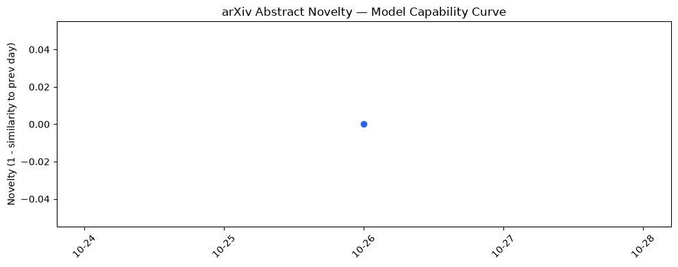

## 今日AI结构性变化
> 能力中心学习与自我修复等新范式的出现，标志着AI在模型自我提升和跨行业渗透方面的渐进式结构性升级。

今天最值得注意的结构性变化是，研究社区同步推出 **Capability‑Centric Learning**、**Self‑Directed Repair** 与 **Multi‑LLM** 协同框架，直接把模型的学习目标从“完成任务”转向“持续自我优化”。这不仅提升了模型在多轮协同、错误纠正等高风险场景的可靠性，也让 AI 第一次在制造业 NDE 4.0、金融犯罪图谱、数字人文等传统行业形成可落地的增量价值链。  

趋势信号  
- 🆕 Capability‑Centric Learning（Phronix）  
- 🆕 Self‑Directed Repair（持久记忆）  
- 🆕 Multi‑LLM 作为马尔可夫决策过程（$M^3$）  
- 📈 多语言低资源模型 LAMB（拉丁语）  

## 技术层信号
🟡 渐进改善  

模型能力边界正从“单轮推理”向“多轮协同自修”迁移。**Phronix** 将学习目标抽象为“能力集合”，让代理在任务执行中主动识别并补齐缺失能力；**Self‑Directed Repair** 通过持久记忆机制把错误转化为长期知识，显著降低重复失误率；**$M^3$** 将多 LLM 视作马尔可夫决策过程，实现对抗性 jailbreak 的多轮防御。与此同时，**LAMB** 为拉丁语提供专属预训练，打开了低资源语言在学术与文化遗产数字化中的新入口。技术层面仍然围绕传统 Transformer 编码器，但在训练范式、后处理监控（因果约束 CoT）以及蒸馏层级（Beyond On‑Policy vs. Off‑Policy）上出现了系统性创新。  

相关论文：  
- [Phronix: The Capability‑Centric Learning Paradigm for Agents](https://arxiv.org/abs/2610.31789)  
- [Don’t Forget What You Just Learned: Self‑Directed Repair Turns Agent Mistakes Into Lasting Lessons](https://arxiv.org/abs/2610.31846)  
- [$M^3$: A Multi‑LLM System for Multi‑Turn Jailbreaking as a Markov Decision Process](https://arxiv.org/abs/2610.31937)  
- [Learning to Be Monitored: Causal Bounds and Intervention‑Aware Post‑Training Recipes for Chain‑of‑Thought Monitorability](https://arxiv.org/abs/2610.31733)  
- [LAMB: A Modern Contextual Language Model for Latin](https://arxiv.org/abs/2610.31723)  

## 产业资本信号
⚪ 无显著变化  

资本层面仍保持观望。过去一周的融资数据未出现新一轮大额注资，主要基金仍在既有 AI 基础设施和生成式模型赛道中维持持仓。虽然技术信号已出现结构性突破，但缺乏明确的商业化路径（多数落地仍是增效工具），导致资本暂未形成聚焦。值得关注的是，已有数家专注工业 AI 的 VC 正在内部评估 NDE 4.0 与金融犯罪图谱的潜在投资机会，未来一两周内可能出现小规模跟进。  

## 潜在拐点判断
**拐点候选：能力中心学习 + 自我修复范式的产业化落地**。  
依据：① 多篇 arXiv 论文同步展示了从理论到原型的完整链路；② 应用层已在 NDE 4.0、金融犯罪图谱、数字人文等行业出现增量工具；③ 资本虽未大幅介入，但行业内部已出现“先行试点”信号。若这些试点在本季度实现 KPI 超过传统 SaaS 方案，预计将触发一轮专注“自我提升型 AI” 的种子/天使轮融资，进而加速模型自我迭代生态的形成。  

## 明日观察点
1. **自我修复代理的错误率下降幅度**：监测公开基准（如 OpenAI Gym、SafetyBench）上 Self‑Directed Repair 的表现。  
2. **资本对 Capability‑Centric 初创的兴趣**：关注 Crunchbase、PitchBook 中新增的种子轮或天使轮项目。  
3. **多语言低资源模型的下载与引用趋势**：尤其是 LAMB 在学术出版和数字人文项目中的采纳情况。  

## 长期趋势坐标
从月度视角看，**能力中心学习** 正从概念验证进入系统化研发阶段，预计 Q4‑Q1 将出现首批商业化 API；**Multi‑LLM 协同** 仍处于实验室验证期，但已形成跨模型治理的技术堆栈，未来半年内有望在高风险行业（航空、金融）实现合规化部署。**多语言模型** 的增长曲线在低资源语言上呈现指数级提升，拉丁语、古希腊语等学术细分市场将成为新增长极。  

## 数据洞察
### arXiv 摘要对比 — 模型能力提升曲线（arxiv_capability）
今日暂无数据，历史天数不足。

### GitHub Star 增速分析（github_stars）
- 今日累计星标 **2,403**，涉及 8 个仓库。  
- 增长最快的仓库是 **AgriciDaniel/claude-seo**，星标增长 10.1%。  
- 其余仓库整体呈下降趋势，尤其 **TauricResearch/TradingAgents** 下降 40.1%。  

### HuggingFace 模型下载量变化（huggingface_downloads）
- 今日总下载量 **15,491,249**，覆盖 20 个模型。  
- 主力模型 **Qwen/Qwen3.8-27B** 贡献 7,608,285 次下载，仍是社区热点。  
- **Lightricks/LTX-2.5** 下载小幅增长 0.5%。  

### 趋势图（chart_paths）
- 

## 参考来源
- 论文  
  - [Phronix: The Capability‑Centric Learning Paradigm for Agents](https://arxiv.org/abs/2610.31789) — arXiv  
  - [Don’t Forget What You Just Learned: Self‑Directed Repair Turns Agent Mistakes Into Lasting Lessons](https://arxiv.org/abs/2610.31846) — arXiv  
  - [$M^3$: A Multi‑LLM System for Multi‑Turn Jailbreaking as a Markov Decision Process](https://arxiv.org/abs/2610.31937) — arXiv  
  - [Learning to Be Monitored: Causal Bounds and Intervention‑Aware Post‑Training Recipes for Chain‑of‑Thought Monitorability](https://arxiv.org/abs/2610.31733) — arXiv  
  - [LAMB: A Modern Contextual Language Model for Latin](https://arxiv.org/abs/2610.31723) — arXiv  
  - [The Path to NDE 4.0: A Review of Algorithms, Techniques, and Strategies for Autonomous Inspection](https://arxiv.org/abs/2610.31704) — arXiv  
  - [Towards Adversarially Robust Multigraph Neural Networks for Financial Crime Analysis](https://arxiv.org/abs/2610.31718) — arXiv  

- 开源项目  
  - [AgriciDaniel/claude-seo](https://github.com/AgriciDaniel/claude-seo) — GitHub  
  - [unslothai/unsloth](https://github.com/unslothai/unsloth) — GitHub  
  - [AstrBotDevs/AstrBot](https://github.com/AstrBotDevs/AstrBot) — GitHub  

- 产业与资本  
  - 无显著新增融资公告（截至 2026‑10‑26），参考 Crunchbase 数据。