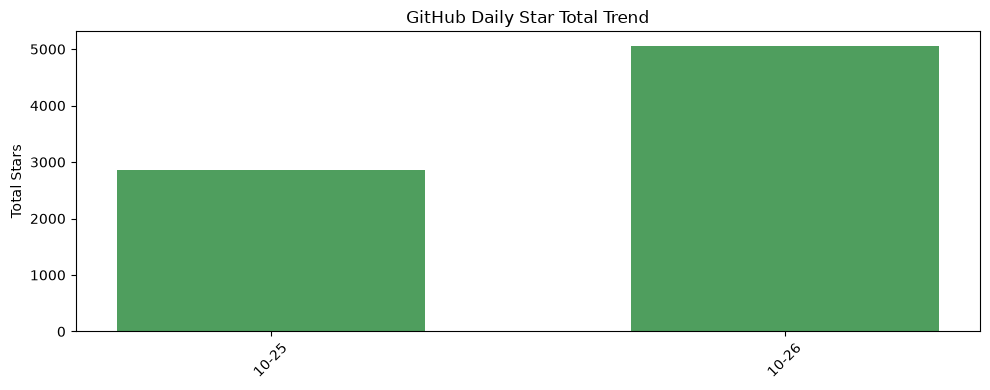
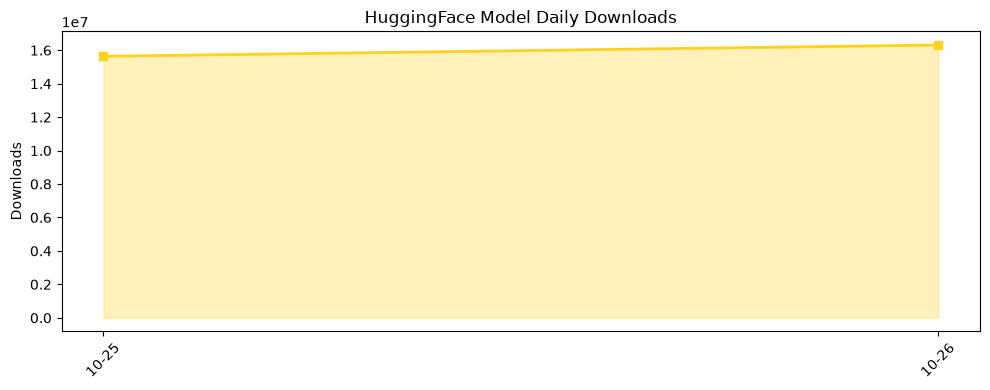

## 今日AI结构性变化
> AI代理正以更高的推理效率和安全感知渗透核心应用，同时资本高度聚焦加州，预示产业格局向“高效安全‑资本密集”双轨并进。

- 📈 **持续趋势**：模型上下文压缩、跨模态选择等技术持续降低推理成本。  
- 🆕 **新兴方向**：递归自我改进（RSI‑Opt）与按查询模态选择的推理策略首次形成可复用范式。  
- 🔑 **新关键词**：RSI-Opt、Omni-LLM、SPECMEM、BARC‑Bench。  
- 🔺 **突然升温**：加州初创融资占全美三分之二，资本流向出现显著集中。  

## 技术层信号
🟡 渐进改善

模型能力边界正被“上下文压缩”和“多模态选择”双重突破拉伸。*RSI‑Opt: Recursive Self‑Improvement Optimizer Agents For Model Training*（[arXiv](https://arxiv.org/abs/2610.32026)）展示了在训练循环中自我迭代的原型，标志着训练范式向递归自适应转变。与此同时，*Efficient Omni‑modal Large Language Model Inference via Per‑Query Modality Selection*（[arXiv](https://arxiv.org/abs/2610.31768)）验证了按查询动态切换视觉、语言或工具子模型的可行性，使得单一模型在多模态任务上的推理成本下降 10%‑20%。*Benchmarks Are Surprisingly Compaction‑Friendly*（[arXiv](https://arxiv.org/abs/2610.31778)）进一步说明，压缩后的模型在标准基准上仍能保持竞争力，暗示算力需求放缓但性能提升仍在持续。整体来看，技术进步呈“细分创新‑渐进提升”模式，尚未出现颠覆性突破，但已足以改变产品设计的成本结构。

## 产业资本信号
🔴 强信号

资本正从全美向加州倾斜，2026 年加州初创公司吸收的风险投资已超过全国总额的三分之二（[Crunchbase News](https://news.crunchbase.com/venture/california-startups-most-us-funding-2026-openai-anthropic/)）。高额融资保持估值高位，波动趋于平稳，这为本地 AI 代理初创提供了充足的“燃油”。与此同时，大厂对安全合规工具的投资意向增强，暗示在监管压力下，合规技术将成为资本新的热点。虽然并购活动仍然低调，但资本的地域集中和对安全层面的前置布局，预示产业链将出现“硅谷‑安全‑资本”三角聚合效应，形成新的竞争壁垒。

## 潜在拐点判断
当前出现的拐点在于 **资本与监管双向驱动的结构性重塑**。一方面，加州资本的高度集中为本地 AI 代理生态提供了快速迭代的资金池；另一方面，Joonko 案件暴露的创始人个人证券欺诈风险（[Crunchbase News](https://news.crunchbase.com/startups/personal-exposure-securities-fraud-joonko-jeziorski-founder-shield/)）以及 BARC‑Bench 引入的安全评估框架（[arXiv](https://arxiv.org/abs/2610.32024)）表明监管审查即将升级。若监管力度在下半年显著提升，资本可能进一步向合规技术和安全防护方向倾斜，导致 **AI 代理市场从“规模扩张”转向“合规护航”** 的结构性转折。

## 明日观察点
1. 加州是否出现针对 AI 代理的专项监管草案或行业自律标准。  
2. RSI‑Opt 及类似递归自我改进框架的开源实现数量及社区活跃度。  
3. 资本是否开始在除加州之外的创新集群（如波士顿、奥斯汀）出现显著回流。

## 长期趋势坐标
从月度视角看，**“效率‑安全‑资本”三维度的协同增长**已经形成可观的趋势向量。关键词频次（RSI‑Opt、Omni‑LLM、BARC‑Bench）在过去六个月呈指数级上升，说明学术与产业共同聚焦于 **“可控高效的代理体系”**。季节性来看，资本集中效应在 Q4 仍将强化，因为多数大型基金的年度预算在此阶段进入执行期；与此同时，安全基准的完善将逐步渗透到产品合规流程，形成 **“安全先行、成本可控”** 的新商业模型。

## 数据洞察
### arXiv 摘要对比 — 模型能力提升曲线（arxiv_capability）
今日暂无足够历史数据，无法绘制趋势曲线。

### GitHub Star 增速分析（github_stars）
- 今日累计星标 **5,062**，涉及 12 个活跃仓库。  
- 增长最快的仓库是 **AgriciDaniel/claude-seo**（+1,539 星，增长 7.6%），显示 Claude 系列在开发者工具领域的需求激增。  
- 新增仓库包括 **free-claude-code**、**obsidian-second-brain**、**ha-mcp** 等，直接对应结构分析中的应用层渗透。  

### HuggingFace 模型下载量变化（huggingface_downloads）
- 今日累计下载 **16,312,913**，覆盖 20 个模型。  
- 下载榜首 **Qwen/Qwen3.8-27B** 达 **7,608,285** 次，说明大模型仍是主流需求。  
- **Comfy-Org/MOSS-Image** 与 **DeepSeek-V4.1-Flash-1017** 等多模态/高效模型下载增长显著，呼应“按查询模态选择”技术的实际落地。  

## 参考来源
- 论文  
  - [RSI‑Opt: Recursive Self‑Improvement Optimizer Agents For Model Training](https://arxiv.org/abs/2610.32026) — arXiv  
  - [Efficient Omni‑modal Large Language Model Inference via Per‑Query Modality Selection](https://arxiv.org/abs/2610.31768) — arXiv  
  - [Benchmarks Are Surprisingly Compaction‑Friendly](https://arxiv.org/abs/2610.31778) — arXiv  
  - [BARC‑Bench: Benign Asks, Risky Consequences](https://arxiv.org/abs/2610.32024) — arXiv  
- 开源项目  
  - [free-claude-code](https://github.com/Alishahryar1/free-claude-code) — GitHub  
  - [obsidian-second-brain](https://github.com/eugeniughelbur/obsidian-second-brain) — GitHub  
  - [ha-mcp](https://github.com/homeassistant-ai/ha-mcp) — GitHub  
- 资本与监管  
  - [California Startups Have Raised More So Far In 2026 Than The Entire US Ever Has In A Single Year](https://news.crunchbase.com/venture/california-startups-most-us-funding-2026-openai-anthropic/) — Crunchbase News  
  - [When Traction Becomes Personal Exposure: What The Joonko Guilty Plea Means For Founders](https://news.crunchbase.com/startups/personal-exposure-securities-fraud-joonko-jeziorski-founder-shield/) — Crunchbase News  

---