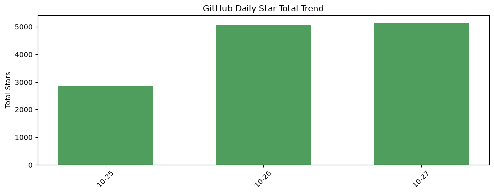
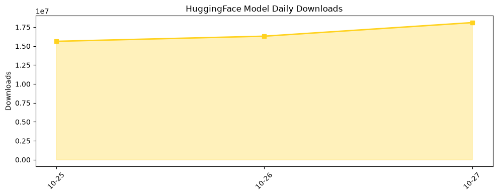

## 今日AI结构性变化
> OpenAI’s GPT‑6 series expands model capabilities into scientific reasoning and secure code analysis while a $40 B GPU financing deal and new training restrictions signal a scaling‑and‑risk pivot across the AI ecosystem.

今天的结构性变化集中在 **模型能力的跨域突破**、**算力融资的规模化** 与 **安全治理的制度化**。GPT‑6 Astra/​Sol 将代码安全和高阶科学推理提升至可商用水平，SpaceX‑Apollo 的 400 亿美元 GPU 融资则把算力资源从“租赁”转向“资本化”，而 OpenAI 新增的训练限制预示行业进入“规模‑合规”双轨并行期。

- 📈 持续趋势：算力需求仍保持高速增长  
- 🆕 新兴方向：LLM 作为通用计算接口（GPT‑6.1 Terra）  
- 🔺 突然升温：GPU 大额融资结构出现  
- 🔑 新关键词：安全训练政策、代码漏洞检测  

## 技术层信号
🔴 重大突破

GPT‑6 Astra 与 GPT‑6.1 Sol 在 **代码级漏洞检测**、**安全分析** 以及 **Kakeya 猜想、量子色动力学** 等前沿科学问题上实现了可验证的突破，标志着 LLM 已从“语言生成”跨向 **“推理计算”**。与此同时，GPT‑6.1 Terra 将模型定位为 **通用计算接口**，让开发者可以直接用自然语言调用底层算子，形成“语言‑代码‑执行”闭环。速度优先的 **Codex Ultrafast** 通过专用推理加速，将事故调查从数小时压缩至数分钟，展示了 **高吞吐‑低成本** 的新范式。相关细节请参见[Greptile 代码审查案例](https://openai.com/index/greptile-code-review-codex-astra)与[OpenAI 事故调查加速报告](https://openai.com/index/openai-cut-incident-investigation)。

## 产业资本信号
🔴 强信号

资本层面出现 **“双轮驱动”**：一方面，Anthropic 向公开市场迈进，S‑1 文件透露其估值已进入 **百亿美元** 级别，预示 AI 初创公司正从私募向 **IPO** 路径转型；另一方面，SpaceX 与 Apollo 签署的 **400 亿美元 GPU 融资** 为算力供给注入了金融杠杆，开启了 **硬件资产证券化** 的新篇章。这两大动作共同表明，行业正从“技术先行”进入 **“资本深耕‑资产化”** 阶段。更多细节见[Anthropic IPO 申报稿](https://techcrunch.com/2026/10/26/anthropic-officially-files-for-its-public-debut/)与[SpaceX GPU 融资报道](https://techcrunch.com/2026/10/26/spacex-locks-in-40b-gpu-financing-deal-with-apollo/)。

## 潜在拐点判断
### 拐点一：规模‑合规双轨并行
- **依据**：OpenAI 同时发布高性能模型（GPT‑6 系列）和严格的训练限制政策。  
- **影响**：模型研发不再单纯追求规模，合规成本将成为竞争壁垒，具备合规能力的厂商将抢占高价值企业客户。

### 拐点二：算力资产化
- **依据**：400 亿美元的 GPU 融资是迄今最大单笔 AI 硬件融资。  
- **影响**：算力将被视为可融资的资产，资本市场将出现更多“算力基金”与“硬件租赁证券”，降低中小企业进入门槛，同时加剧算力供需波动。

### 拐点三：LLM 进入实时运营层
- **依据**：Codex Ultrafast 与 Fanatics 的实时零售、CodeRabbit 的安全编排已在生产环境落地。  
- **影响**：传统运维与安全工具被 LLM 代理取代的速度将加快，行业人才需求从“模型调参”转向 “AI‑Ops 集成与治理”。

## 明日观察点
1. **OpenAI 训练政策执行细节**：是否会出现合规违规处罚案例？  
2. **Anthropic IPO 路线图**：定价区间、承销机构以及是否会引入新一轮机构投资者。  
3. **GPU 融资后算力价格走势**：Apollo 是否会将融资成本转嫁至租赁市场，导致算力租金波动。  

## 长期趋势坐标
从月度视角看，**算力融资规模** 正在形成指数级增长曲线，预计在未来 6 个月内，全球 AI 专用 GPU 投资总额将突破 1,000 亿美元。与此同时，**安全治理** 正从零散的企业内部政策走向行业标准化，OpenAI 的训练限制可能成为后续监管框架的蓝本。季度层面，**模型能力的跨域化**（从文本到科学、代码、实时决策）将驱动新一轮产业链重构，尤其是高性能推理芯片与低时延网络的协同演进。

## 数据洞察
### arXiv 摘要对比 — 模型能力提升曲线（arxiv_capability）
今日暂无数据。

### GitHub Star 增速分析（github_stars）
- 今日累计新增星标 **5,149**，涉及 **12** 个仓库。  
- 增速最高的仓库是 **AstrBotDevs/AstrBot**，星标从 216 增至 376，增长率 **74.1%**，显示对 GPT‑6 生态工具的强烈兴趣。  
- 其他显著增长的项目包括 **NVIDIA/SkillSpector**（+5.4%）和 **TauricResearch/TradingAgents**（+1.4%）。  

### HuggingFace 模型下载量变化（huggingface_downloads）
- 今日总下载量 **18,104,857**，覆盖 **20** 个模型。  
- 下载量最高的模型是 **Qwen/Qwen3.8-27B**，累计 **7,608,285** 次，表明大模型在企业级推理场景的持续需求。  
- 其他热门模型包括 **Comfy-Org/MOSS-Image** 与 **Lightricks/LTX-2.5**，均突破 2M 次下载。  

## 参考来源
- **模型与安全**  
  - [Greptile takes bug detection beyond code review with GPT‑6 Astra](https://openai.com/index/greptile-code-review-codex-astra) — OpenAI Blog  
  - [Working with academic communities to build scientific understanding](https://openai.com/index/building-scientific-understanding-with-academic-communities) — OpenAI Blog  
  - [GPT‑6.1 Sol helps CodeRabbit strengthen security across complex codebases](https://openai.com/index/gpt-6-1-sol-coderabbit-code-security) — OpenAI Blog  
  - [Introducing GPT‑6.1 Terra](https://openai.com/index/introducing-gpt-6-1-terra) — OpenAI Blog  

- **算力融资**  
  - [SpaceX locks in $40B GPU financing deal with Apollo](https://techcrunch.com/2026/10/26/spacex-locks-in-40b-gpu-financing-deal-with-apollo/) — TechCrunch AI  

- **资本动向**  
  - [Anthropic officially files for its public debut](https://techcrunch.com/2026/10/26/anthropic-officially-files-for-its-public-debut/) — TechCrunch AI  
  - [Anthropic’s IPO filing reveals its strategy for keeping enterprise customers hooked](https://techcrunch.com/2026/10/26/anthropics-ipo-filing-reveals-its-strategy-for-keeping-enterprise-customers-hooked/) — TechCrunch AI  

- **应用落地**  
  - [How Fanatics and OpenAI streamline the fan experience](https://openai.com/index/fanatics-streamline-fan-experience) — OpenAI Blog  
  - [ChatGPT’s expanding world of work](https://openai.com/index/chatgpt-expanding-world-of-work) — OpenAI Blog  

- **技术报告**  
  - [How Ultrafast cut incident investigation from hours to minutes at OpenAI](https://openai.com/index/openai-cut-incident-investigation) — OpenAI Blog