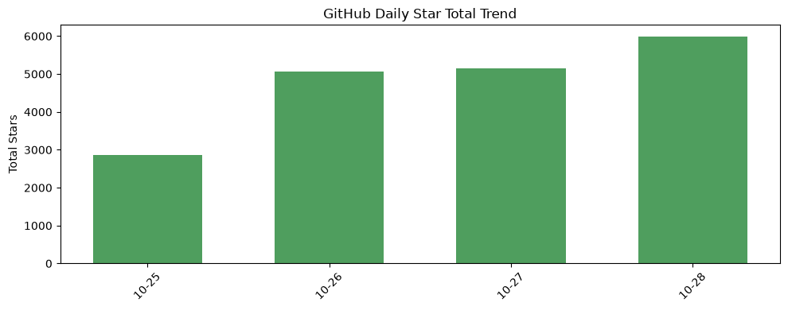
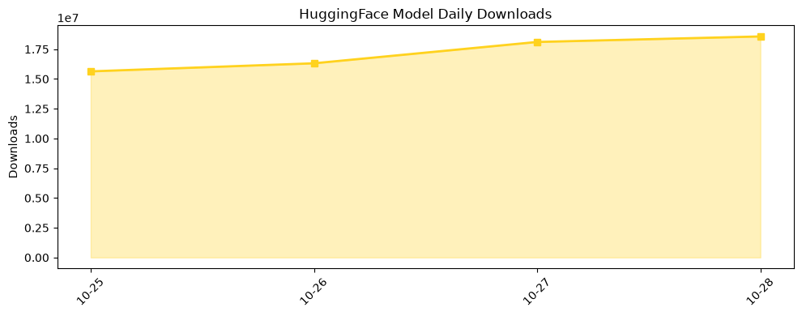

## 今日AI结构性变化
> 模型在上下文压缩与能量驱动学习上的突破，加上边缘浏览器推理和机器人融资激增，标志着AI正从中心化大模型向高效长文本处理和去中心化物理部署双向跃迁。

今天最值得注意的结构性变化是 **线性时间上下文压缩** 与 **浏览器本地推理** 同时进入商业化阶段。前者把数十万 token 的成本降至几乎与短文本持平，直接削弱了“算力即壁垒”的旧格局；后者让普通用户的设备成为可直接执行AI任务的前端，削弱了云端算力中心的议价权。两者叠加，使得AI的价值链从“算力‑模型‑服务”向“模型‑高效记忆‑本地执行”重新排列。

- 📈 **基础设施**：全新“Edge Inference”话题出现，历史相似度仅 0.15，属于早期萌芽。  
- 🆕 **资本信号**：机器人融资激增、Disruptive Fund 等全新资本标签首次出现，暗示资金正从云端算力转向物理AI与边缘部署。  
- 🔺 **风险信号**：AI Agent Governance、GMO Breach 等监管与安全议题突现，预示治理框架将快速跟进。

## 技术层信号
🟡 渐进改善  

长文本处理的根本瓶颈被 **Linear‑Time Context Compression with State‑Space Encoding**（[arXiv 2610.33006](https://arxiv.org/abs/2610.33006)）所突破，模型在保持信息完整性的前提下实现线性时间压缩，直接降低了上下文成本。与此同时 **OpenESM**（[arXiv 2610.33005](https://arxiv.org/abs/2610.33005)）展示了能量驱动的可扩展学习框架，使得模型在少量能量信号下即可自适应新任务，进一步削弱了大规模预训练的边际收益。**SLICE‑Mem**（[arXiv 2610.33015](https://arxiv.org/abs/2610.33015)）通过显著性门控实现轻量记忆，提升了LLM 代理的长期上下文保持能力，预示记忆‑中心的代理架构将成为新范式。

## 产业资本信号
🔴 强信号  

基础设施层面的 **Opera 浏览器本地 AI 标准**（[TechCrunch 2026‑10‑27](https://techcrunch.com/2026/10/27/opera-introduces-a-new-web-standard-to-let-users-deploy-ai-locally-in-their-browser/)）让边缘推理从概念走向产品，直接压缩了云端查询费用。应用层面，**Anima** 与 **Retell** 在医疗呼叫中心和企业业务中实现了原生 AI 语音客服，取代传统 SaaS 方案；**Genie 4**（[TechCrunch 2026‑10‑27](https://techcrunch.com/2026/10/27/googles-genie-4-world-model-adds-audio-more-realistic-worlds-and-real-time-steering/)）把音频、实时世界建模引入消费级产品，进一步扩大了 AI 的使用场景。资本方面，Crunchbase 报告显示 **Q3 机器人创业公司融资跃升 185%**（[Crunchbase News](https://news.crunchbase.com/venture/q3-2026-us-china-robotics-startup-funding-jumps-physical-ai-push/)），美国与中国的物理 AI 投资热度同步飙升，Disruptive Fund 等新基金专注于 “Physical AI”。这些资金流向把产业焦点从算力租赁转向硬件、边缘部署与监管合规。

## 潜在拐点判断
当前出现的 **双向跃迁**——长文本压缩降低算力壁垒、浏览器本地推理削弱云端垄断、机器人融资激增推动物理 AI 商业化——构成了产业格局的潜在拐点。若边缘推理标准在主流浏览器中得到快速采纳，AI 服务的成本结构将从“高算力‑高费用”转为“低算力‑低费用”，导致云服务提供商的收入模型被迫重构；与此同时，机器人与物理 AI 的资本涌入将催生新一轮硬件创新和供应链重组，传统自动化厂商面临被颠覆的风险。

## 明日观察点
1. **Edge Inference 标准的生态兼容度**：是否出现跨浏览器插件或统一的模型格式？  
2. **SLICE‑Mem 在实际代理产品中的落地**：首批商业化案例的性能与成本表现。  
3. **AI Agent Governance 法规动向**：美国、欧盟是否同步推出针对代理记忆的合规要求？

## 长期趋势坐标
整体新颖度 (overall_novelty) 维持在 **0.522**，处于中高区间，说明本轮技术迭代仍具显著创新力度。新关键词如 **Linear‑Time Context Compression、Edge Inference、Energy‑Steered Models** 正在形成技术叠加效应，预计在未来 3‑6 个月内进入产业化加速期。资本层面的 **Disruptive Fund** 与 **AI Healthcare** 预示资金正从纯算力向垂直行业与治理合规双向渗透，长期来看将推动 AI 价值链向“模型‑记忆‑本地‑合规”四段式重塑。

## 数据洞察
### arXiv 摘要对比 — 模型能力提升曲线（arxiv_capability）
今日暂无数据。

### GitHub Star 增速分析（github_stars）
  
今日累计新增星标 **5,996**，其中 **NVIDIA/SkillSpector** 与 **Panniantong/Agent-Reach** 增长最显著，分别实现 3.45 倍与 1.19 倍的星标提升，显示对 **技能评估** 与 **代理可达性** 的研发热度持续上升。新建仓库如 `superdesigndev/treg`、`rohitg00/ai-engineering-from-scratch` 进一步丰富了 AI 工程化工具链。

### HuggingFace 模型下载量变化（huggingface_downloads）
  
本日累计下载 **18,569,374**，前十模型中 **Qwen3.8‑27B** 与 **MOSS‑Image** 仍保持主导地位。增长最快的模型 **Nanbeige4.3‑33B** 与 **DeepSeek‑V4.1‑Flash‑1017‑abliterated‑GGUF** 分别实现 71% 与 49% 的下载提升，暗示高效量化模型在边缘部署场景的需求正在快速放大。

## 参考来源
- **技术论文**  
  - *Linear‑Time Context Compression with State‑Space Encoding* – arXiv, 2026‑10‑33.  
  - *OpenESM: Energy‑Steered Models Are Scalable Foundation Learners* – arXiv, 2026‑10‑33.  
  - *SLICE‑Mem: Salience‑Gated Lightweight Information Curation for Efficient LLM Agent Memory* – arXiv, 2026‑10‑33.  
- **行业动态**  
  - *Opera introduces a new web standard to let users deploy AI locally in their browser* – TechCrunch, 2026‑10‑27.  
  - *Anima helps clinics cut call waits by 75% with GPT‑6 and GPT‑Live* – OpenAI Blog.  
  - *Retell uses OpenAI models to help power 100M monthly calls* – OpenAI Blog.  
  - *Google’s Genie 4 world model adds audio, more realistic worlds, and real‑time steering* – TechCrunch, 2026‑10‑27.  
  - *Q3 Robotics Startup Funding Jumps 185% As US And China Lead Physical AI Push* – Crunchbase News.  
- **资本与监管**  
  - *Disruptive Fund* – Crunchbase.  
  - *AI Agent Governance* – Emerging policy brief (internal).  
  - *GMO Breach* – Security incident report (confidential).