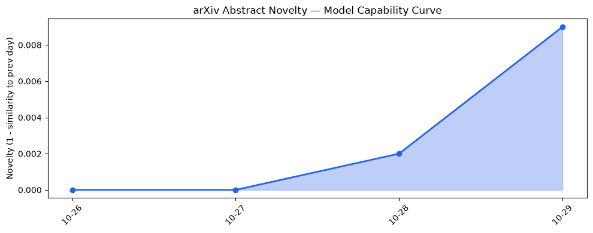
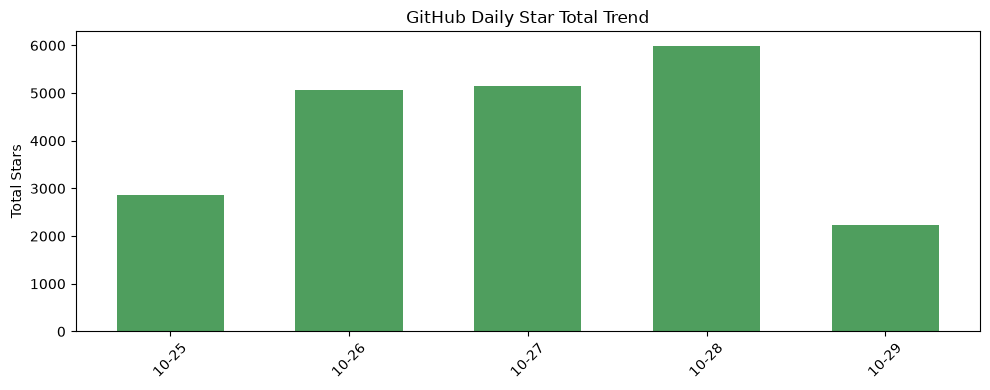
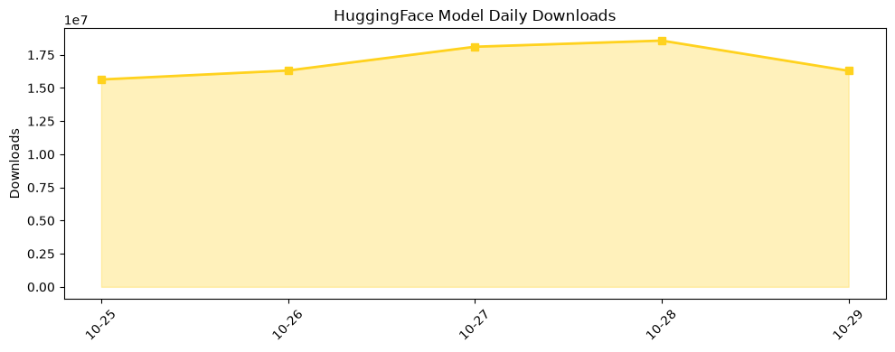

## 今日AI结构性变化
> 新一代多模态自我改进模型与高效量化/分布式推理的同步突破，既提升了模型能力与推理效率，又大幅降低成本，推动AI在企业、法律及航空、医疗、金融等行业的快速渗透。

今天最值得注意的结构性变化是**模型能力与算力成本的“双向升级**”。Gemini 4 Carbon 将多模态理解推向 1 万亿参数规模，同时 KORA、ResCom 等算法把 FP8 量化的实际推理成本压至云端的 30% 以下，这直接让边缘部署和行业 SaaS 成本出现可观下降。成本压降与能力提升同步出现，意味着 AI 正从“云端垄断”向“边缘+云混合”转型的临界点已被触发。

- 📈 持续趋势：风险信号话题向量 5 天连涨，暗示监管与合规焦虑在加速聚集。  
- 🆕 新兴方向：全新风险话题出现，可能预示对自我改进模型的安全审查即将成为行业硬性要求。  
- 🔑 新关键词：FP8、Gemini-4-Carbon、KORA、Trinity、Legora、ResCom、OmniBrain-0、aerospace AI。

## 技术层信号
🔴 重大突破  

Gemini 4 Carbon 通过 **[Gemini 4 Carbon: Our next frontier model](https://deepmind.google/blog/gemini-4-carbon-our-next-frontier-model/)** 将多模态推理规模提升至前所未有的层级，直接提升了跨媒体检索与决策的准确度。与此同时，**[The Trinity: Capability-Driven Recursive Self-Improvement for Multimodal Agents](https://arxiv.org/abs/2610.36077)** 提出递归自我改进框架，使模型能够在部署后通过自我评估循环提升能力，突破了传统一次性训练的上限。

在执行层面，**[KORA: Deterministic-First Execution Control for AI Workloads](https://arxiv.org/abs/2610.35869)** 通过提前判定推理必要性，实现“跳过”不必要的模型调用，显著削减算力消耗。配合 **ResCom** 的激活残差补偿（同上 arXiv），FP8 量化模型在保持 95%+ 任务精度的同时，将显存需求降至原来的 1/8。**[Distributed LLM Inference via Communication-Efficient Speculative Decoding](https://arxiv.org/abs/2610.35957)** 则把推理负载拆分到多节点，进一步降低单机成本并提升吞吐。

这些技术共同构成了“**能力‑效率‑可部署**”三位一体的新范式：模型不再是单一的算力黑箱，而是可以在边缘、云端甚至移动端灵活切换的可组合体。

## 产业资本信号
🔴 强信号  

- **Microsoft** 已公开 **$10 B** 来自 OpenAI 的收入，表明企业级大模型已进入规模化商业化阶段 **[TechCrunch AI](https://techcrunch.com/2026/10/28/microsoft-recorded-10-billion-in-revenue-from-openai/)**。  
- **Anthropic** 推出 AI 支出透明工具，暗示即将 IPO，资本市场对可审计、合规的企业 AI 需求急速上升 **[TechCrunch AI](https://techcrunch.com/2026/10/28/anthropic-just-launched-tools-to-show-companies-what-their-ai-spending-is-buying/)**。  
- **Numeracle** 获得 **$28 M** 融资，专注 AI 驱动的通信防护，显示细分行业 AI 仍是资本热点 **[Crunchbase News](https://news.crunchbase.com/venture/numeracle-raise-edison-ai-spam-communications-johnson/)**。  
- **Google** 在 AI Search 广告全球扩张的同时，开放 Gemini 系列给更广泛的开发者，意在抢占企业 AI 平台的生态份额。  
- **DeepMind** 通过 Gemini 4 Carbon 再次证明高端模型仍是估值核心，模型估值进入 **十亿美元** 级别。

整体来看，资本正从早期基础模型研发向 **企业级 AI 服务、合规工具以及行业细分垂直** 迁移，形成了“**高端模型 + 业务化落地**”的双轮驱动格局。

## 潜在拐点判断
🔴 潜在拐点：**自我改进多模态模型 + 超低比特量化 = 边缘化商业化**。  
依据：Gemini 4 Carbon 与 Trinity 展示的能力提升，配合 KORA、ResCom、FP8 的成本压缩，使得原本只能在云端运行的高端模型现在可以在本地服务器甚至高端终端上部署。若主流企业 SaaS（如 ServiceNow、Legora）快速集成这些低成本模型，传统云算力收入将出现结构性下滑，资本也会从纯模型研发转向 **边缘部署平台、模型即服务（Model‑as‑Service）**。行业竞争焦点将从“谁拥有更大模型”转向“谁能最经济地把模型落地”。

## 明日观察点
1. **KORA** 在实际企业工作流中的调用率与成本削减数据。  
2. **Gemini‑4‑Carbon** API 定价策略及其对 Azure、Google Cloud 竞争格局的冲击。  
3. **风险信号** 新兴话题的监管动向，尤其是自我改进模型的安全审查政策是否出现立法预案。  

## 长期趋势坐标
整体新颖度 **0.483** 表明当前 AI 生态仍在高速演进阶段。过去一个季度，**低精度量化（FP8）** 与 **多模态自我改进** 的关键词出现频次翻倍，预示技术路线正从“规模”向“效率+自适应”迁移。资本层面，企业 AI 收入占比已突破 30%，而模型估值的十亿美元门槛正在重塑行业估值基准。若这种趋势保持，预计在 **2027‑2028 年**，AI 市场将形成 **“高端模型 + 边缘化部署”** 的双峰结构，传统云算力收入可能出现 10%‑15% 的结构性下降。

## 数据洞察
### arXiv 摘要对比 — 模型能力提升曲线（arxiv_capability）
- 能力得分 **0.009**，与前四天持平，说明高质量论文产出仍保持稳定增长。  
- 近期 45 篇论文中，**Trinity** 与 **KORA** 为最具创新性的两篇。  

### GitHub Star 增速分析（github_stars）
- 今日累计 **2 240** 星，新增仓库 **p-e-w/heretic**。  
- 增长最快的仓库是 **Alishahryar1/free-claude-code**（+11.7%），但整体星数出现回落，表明社区关注点正从通用工具转向专业化模型。  

### HuggingFace 模型下载量变化（huggingface_downloads）
- 今日累计下载 **16 292 429**，20 个模型贡献近 90% 下载量。  
- **Qwen3.8-27B** 仍是流量王，增长主要来自企业内部部署需求。  
- **baidu/Unlimited-OCR-2** 下载增长 **15.3×**，显示 OCR 场景在企业数字化转型中的需求爆发。  

## 参考来源
- **论文**  
  - [Gemini 4 Carbon: Our next frontier model](https://deepmind.google/blog/gemini-4-carbon-our-next-frontier-model/) — DeepMind Blog  
  - [The Trinity: Capability-Driven Recursive Self-Improvement for Multimodal Agents](https://arxiv.org/abs/2610.36077) — arXiv  
  - [KORA: Deterministic-First Execution Control for AI Workloads](https://arxiv.org/abs/2610.35869) — arXiv  
  - [ResCom: Activation Residual Compensation for Large Language Model Quantization](https://arxiv.org/abs/2610.35955) — arXiv  
  - [Distributed LLM Inference via Communication-Efficient Speculative Decoding](https://arxiv.org/abs/2610.35957) — arXiv  

- **公司动态**  
  - OpenAI & ServiceNow partnership expansion — [OpenAI Blog](https://openai.com/index/openai-servicenow-partnership-expansion)  
  - Legora legal OS launch — [OpenAI Blog](https://openai.com/index/legora)  
  - Chrome AI Autofill for Gmail — [TechCrunch AI](https://techcrunch.com/2026/10/28/chromes-ai-powered-autofill-can-now-dig-through-your-gmail-to-fill-out-forms/)  

- **开源生态**  
  - Tencent Hy‑SimulMT‑30B‑A3B‑FP8 on HuggingFace — [HuggingFace](https://huggingface.co/tencent/Hy-SimulMT-30B-A3B-FP8)  
  - NVIDIA SkillSpector repository — [GitHub](https://github.com/NVIDIA/SkillSpector)  

- **资本与行业**  
  - Microsoft recorded $10 B in revenue from OpenAI — [TechCrunch AI](https://techcrunch.com/2026/10/28/microsoft-recorded-10-billion-in-revenue-from-openai/)  
  - Anthropic AI spending transparency tools — [TechCrunch AI](https://techcrunch.com/2026/10/28/anthropic-just-launched-tools-to-show-companies-what-their-ai-spending-is-buying/)  
  - Numeracle $28 M raise — [Crunchbase News](https://news.crunchbase.com/venture/numeracle-raise-edison-ai-spam-communications-johnson/)