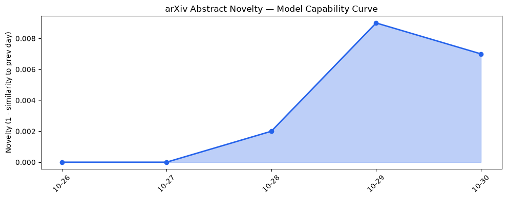
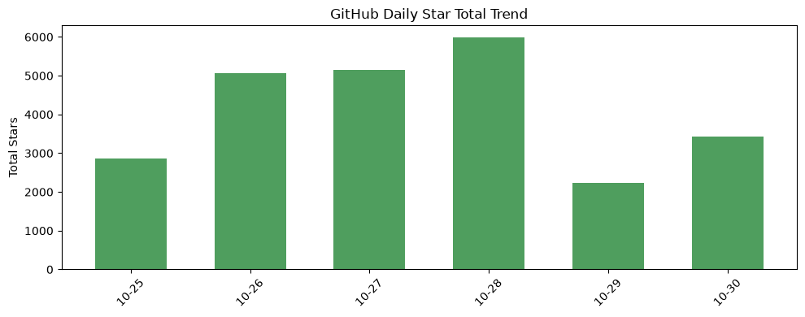
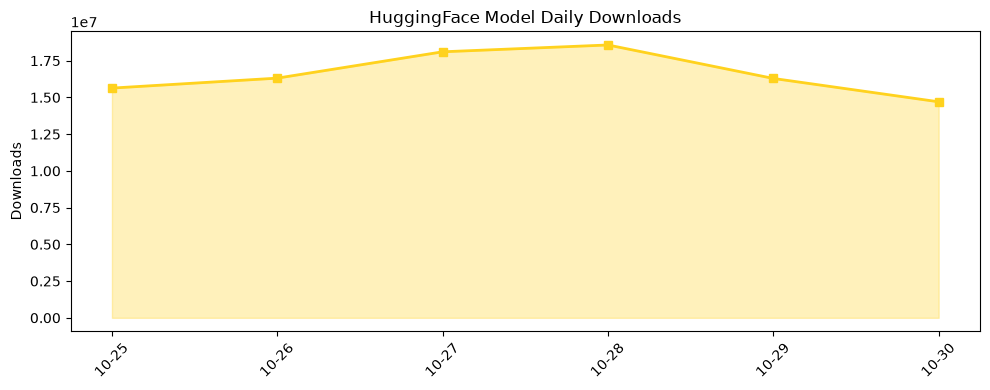

## 今日AI结构性变化
> 千参数开放模型与多行业AI落地同步出现，资本向大额并购倾斜，种子轮融资受压，监管与安全风险同步上升。

今天最值得注意的结构性变化是**超大模型从封闭走向开放**，并被快速套用到安防、法律、建筑等传统行业。与此同时，资本市场从“大量小额融资”转向“少数大额并购”，种子轮资金紧缩，表明行业进入**规模化竞争与合规成本双重叠加**的阶段。  
📈 基础设施话题向量持续增强（6 天递增）  
📈 资本信号持续增强（6 天递增）  
📈 风险信号持续增强（6 天递增）  
🆕 基础设施出现全新话题（相似度 0.11）  

## 技术层信号
🟡 渐进改善  

Mistral 公开了**万亿参数模型的权重**，并直接定位网络安全场景，说明**规模仍是性能关键**，但开放权重让企业能够自行审计、微调，开启了“大模型可定制化”新范式。与此同时，**Spiking Neural Networks** 在防模型窃取方面表现出更高的抗攻击性，暗示硬件层面的安全防护正在与模型层面同步进化。OpenAI 也发布了新版模型规范，强调对齐与监控，这在技术层面强化了**安全合规的底层标准**。  

## 产业资本信号
🔴 强信号  

资本流向出现明显分层：Series B 融资总额创历史新高，但交易数量下降，说明**资金更倾向于少数大项目**；Series A 轮规模膨胀导致种子轮融资紧缩，创业公司面临更高的门槛。OpenAI 生态合作深化（Ropes & Gray 法律 AI）以及 Meta 低调切入时尚领域，都是**大公司通过并购或生态绑定抢占新赛道**的典型。Thrive Holdings（OpenAI 背书）收购 ADT，标志着**AI 与传统安防的深度整合**已经进入并购阶段，预示后续更多行业巨头将通过并购快速获取 AI 能力。

## 潜在拐点判断
### 拐点：开放超大模型加速行业渗透
- **依据**：Mistral 公开万亿模型权重、AI 在家庭安防、法律事务、建筑施工等行业实现原生落地、资本并购频率上升。  
- **影响**：模型开放将削弱少数大模型供应商的垄断，推动行业自研与定制化；并购加速将导致 **AI 生态向少数平台集中**，中小创新企业的生存空间被压缩，竞争焦点转向**技术合规与行业深耦合**。

## 明日观察点
1. **Mistral 权重开放后的社区优化进度**：是否出现显著的推理成本下降或安全审计工具。  
2. **Thrive – ADT 并购后产品化进度**：AI 安防服务的商业化速度与用户接受度。  
3. **美国对 Nvidia 高管的间谍调查后，芯片出口政策是否收紧**：对全球算力供应链的直接冲击。

## 长期趋势坐标
从**overall_novelty = 0.528**来看，当前话题新颖度保持在中等偏上区间，说明 AI 产业仍在快速演进但已进入**结构化分化**阶段。基础设施、资本、风险三大维度的连续上升趋势表明 **算力供给、资金配置与监管压力将同步加剧**，未来 3‑6 个月内，行业格局可能从“技术驱动的扩张”转向“合规与资本驱动的整合”。  

## 数据洞察
### arXiv 摘要对比 — 模型能力提升曲线（arxiv_capability）
- 能力得分 0.013，均值相似度 0.987，趋势“延续”。过去 5 天共计 15 篇论文，表明**前沿模型能力提升仍在稳步进行**，但增长幅度有限，暗示突破更多来自**模型规模与安全机制的结合**。

### GitHub Star 增速分析（github_stars）
- 今日累计星标 3 428，涉及 8 个仓库。增长最快的仓库 `rohitg00/ai-engineering-from-scratch` +4.5%，其余两大仓库出现星标下降，说明**社区关注正向实用工具倾斜**。新仓库如 `beenuar/AiSOC`、`volcengine/OpenViking` 进入榜单，预示**安全与底层框架方向的兴趣上升**。

### HuggingFace 模型下载量变化（huggingface_downloads）
- 今日总下载量 14 702 112，20 个模型被访问。下载榜首 `Qwen/Qwen3.8-27B` 超过 7.5 百万，显示**大模型仍是主流需求**。增长最快的 `baidu/Unlimited-OCR-2` 下载量翻倍，说明**OCR 与文档智能在企业落地需求激增**。

### 趋势图
  
  
  

## 参考来源
- **技术层**  
  - [Mistral releases weights for its trillion-parameter AI model, targeting cybersecurity](https://techcrunch.com/2026/10/29/mistral-releases-weights-for-its-trillion-parameter-ai-model-targeting-cybersecurity/) — TechCrunch AI  
  - [Spiking Neural Networks Are Harder to Steal: A Benchmark Study of Model Stealing Attacks](https://arxiv.org/abs/2610.36298) — arXiv  
  - [An updated Model Spec for more capable and beneficial AI](https://openai.com/index/updated-model-spec) — OpenAI Blog  

- **基础设施**  
  - [AWS will be a $1T business, Jassy says. But first, it will spend big.](https://techcrunch.com/2026/10/29/aws-will-be-a-1t-business-jassy-says-but-first-it-will-spend-big/) — TechCrunch AI  
  - [NVIDIA-Nemotron-3.5-Transcribe-30B-A4B](https://huggingface.co/nvidia/NVIDIA-Nemotron-3.5-Transcribe-30B-A4B) — HuggingFace  

- **应用层**  
  - [OpenAI-backed Thrive Holdings acquires ADT](https://techcrunch.com/2026/10/29/openai-backed-thrive-holdings-acquires-adt/) — TechCrunch AI  
  - [Rivian expands joint venture with VW to include AI assistant](https://techcrunch.com/2026/10/29/rivian-expands-joint-venture-with-vw-to-include-ai-assistant/) — TechCrunch AI  
  - [Meta quietly launches an AI fashion app called Style Sketch](https://techcrunch.com/2026/10/29/meta-quietly-launches-an-ai-fashion-app-called-style-sketch/) — TechCrunch AI  
  - [Ex-Palantir execs launch Dream with $17M from a16z to build AI world models for construction](https://techcrunch.com/2026/10/29/ex-palantir-execs-launch-dream-with-17m-from-a16z-to-build-ai-world-models-for-construction/) — TechCrunch AI  
  - [How Ropes & Gray is developing AI for transactional diligence](https://openai.com/index/ropes-gray-ai-diligence) — OpenAI Blog  

- **资本**  
  - [Series B Funding Is Up, But Fewer Deals Are Getting Done](https://news.crunchbase.com/venture/seriesb-startup-funding-up-deals-down-ai-prometheus/) — Crunchbase News  
  - [Jumbo Series A Rounds Hiding The Real Squeeze On Seed Startups](https://news.crunchbase.com/seed/jumbo-seriesa-squeeze-seed-startup-funding-schroder-mgv/) — Crunchbase News  

- **风险**  
  - [US investigated Chinese spy plot aimed at Nvidia CEO](https://techcrunch.com/2026/10/29/u-s-investigated-chinese-spy-plot-aimed-at-nvidia-ceo/) — TechCrunch AI  
  - [How we detect frontier model misalignment](https://openai.com/index/how-we-detect-frontier-model-misalignment) — OpenAI Blog  

---