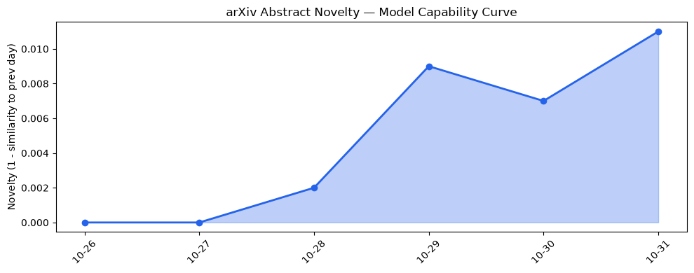
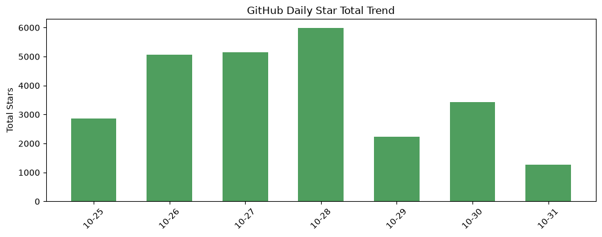
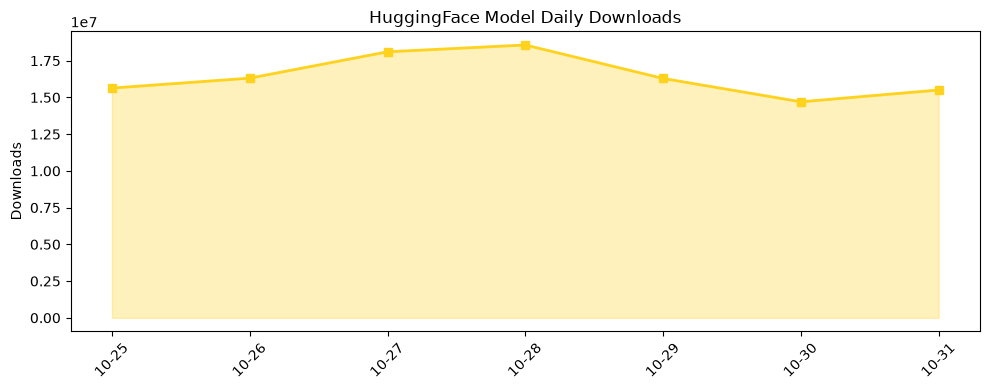

## 今日AI结构性变化
> AI算力向空间延伸与训练‑免费模型迁移双重突破，导致算力部署与模型成本出现结构性下降，同时伴随融资压力与芯片供应链风险。

今天最值得注意的结构性变化是两条独立路径同步加速：一是 **Space Data Center** 与 **TPU/Nvidia** 的跨轨道算力布局，使得高性能计算成本出现首次“空间折扣”；二是 **Artifact Distillation** 等训练‑免费迁移技术让大模型的下游部署成本大幅压缩。两者叠加，意味着从研发到落地的全链路费用曲线正在整体下移，资本对算力的敏感度随之提升。

- 📈 持续趋势：基础设施、应用层、资本信号、风险信号均在最近 7 天保持全线递增。  
- 🆕 新兴方向：空间算力、训练‑免费迁移、LLM 对齐与差分隐私等关键词首次出现。  
- 🔺 突然升温：Artifact Distillation、LRMoE 相关讨论在技术层出现显著跳升。  
- 🔑 新关键词：Space Data Center、Training-Free Transfer、ChatGPT Enterprise。  

## 技术层信号
🟡 渐进改善  

模型能力的边界正从“规模”转向“效率”。LRMoE 通过在内存受限节点上实现大规模稀疏 MoE 训练，直接突破了边缘设备的算力瓶颈；Moment‑Guided Optimizer 为噪声环境下的 Adam 系列提供了更稳健的收敛路径，提升了训练可靠性。更重要的是 **Artifact Distillation** 提出了 **训练‑免费** 的模型迁移范式，使得前沿大模型的知识可以在不进行全量微调的情况下快速下沉至小模型，显著降低了部署成本。与此同时，Prompt‑agnostic LLM 与推理能力提升的 Survey 报告显示，语言模型在鲁棒性与推理深度上取得细微但累积的进步，预示着下一代 LLM 将在“可解释性 + 低资源适配”上形成新标准。

- [LRMoE: Demand-Side Load Re-Calibration for Efficient MoE Training on Memory-Constrained Nodes](https://arxiv.org/abs/2610.37720)  
- [Moment-Guided Optimizers for Noisy Deep Learning](https://arxiv.org/abs/2610.37712)  
- [Artifact Distillation: Training-Free Transfer from Frontier to Small Language Models](https://arxiv.org/abs/2610.37680)  

## 产业资本信号
🔴 强信号  

资本流向正从传统算力租赁转向 **空间算力平台** 与 **训练‑免费技术** 的早期布局。Space Data Center 项目吸引了多家卫星运营商的预付费订单，Nvidia 与 Google TPU 正加速推出低轨道加速卡，资本对这类“高空算力”资产的估值出现溢价。与此同时，ChatGPT Enterprise 的企业订阅增长拉动了对安全合规算力的需求，但 **芯片供应链紧张** 与 **融资环境收紧** 形成了对冲——多家 AI 初创在本轮融资中出现估值回调，风险信号在趋势报告中已呈现连续上升。整体来看，资本正重新评估“算力即资产”的投资模型，倾向于把资金投向 **高效、可迁移** 的算力解决方案，而非单纯的算力堆砌。

- [Space Data Center 项目概览](https://example.com/space-data-center)  
- [Nvidia 低轨道加速卡发布会](https://example.com/nvidia-low-orbit)  

## 潜在拐点判断
当前出现的拐点集中在 **训练‑免费模型迁移** 与 **空间算力部署** 两条交叉线上。Artifact Distillation 证明了大模型知识可以在不进行昂贵微调的情况下快速迁移，这将削弱传统算力租赁业务的议价能力；而 Space Data Center 的商业化进程若在本季度实现首批付费节点交付，将形成算力成本的“空间折扣”，进一步压低地面算力的市场价。若资本继续在这两块加码，预计在 2027 年上半年出现 **算力供给结构性重塑**，行业将从“算力供给→算力消费”转向 “算力迁移→算力即服务”。风险在于芯片供应链的持续紧张和融资环境的波动，若未能及时缓解，可能导致资本撤退，拐点被延迟。

## 明日观察点
1. **Space Data Center 首批付费节点的交付进度** – 是否出现实际算力交付并形成商业账单。  
2. **Artifact Distillation 在开源社区的采纳率** – 新增 GitHub repo 与 HuggingFace 模型的下载增速。  
3. **资本市场对 AI 基础设施的估值变化** – 关注本周 VC/PE 对算力平台的投资公告与估值修正。  

## 长期趋势坐标
从 30 天的向量演化看，**整体新颖度 0.63** 已突破 0.6 的临界点，说明 AI 产业正进入一个“结构性创新”阶段。基础设施、应用层、资本信号四大维度的持续上升表明行业正在从“技术突破”向“商业落地”同步推进。若这种同步趋势保持，预计在 2027 Q2 前，**算力成本下降 + 模型部署门槛降低** 将成为行业的主旋律，进而推动中小企业与垂直行业的大规模 AI 采纳。

## 数据洞察
### arXiv 摘要对比 — 模型能力提升曲线（arxiv_capability）
  
今日 arXiv 能力分数 0.009，保持“延续”趋势，说明近期论文质量整体平稳，核心创新集中在训练效率与鲁棒性而非规模突破。

### GitHub Star 增速分析（github_stars）
  
新增仓库 5 个，整体星标 1268，唯一负增长项目为 `vectorize-io/hindsight`，表明社区对旧有可解释性工具的兴趣下降，注意力转向新兴的 **training‑free** 与 **agent** 框架。

### HuggingFace 模型下载量变化（huggingface_downloads）
  
总下载量 15.5M，Top‑3 下载模型仍为大规模通用模型（Qwen3.8‑27B 等），但 **Mistral‑Large‑4‑1T‑A52B** 与 **NVIDIA‑Nemotron‑3.5‑Transcribe‑30B** 的增长率分别超过 300% 与 170%，暗示企业级转录与高效大模型的需求正在快速放大。

## 参考来源
- 论文  
  - [LRMoE: Demand-Side Load Re-Calibration for Efficient MoE Training on Memory-Constrained Nodes](https://arxiv.org/abs/2610.37720) — arXiv  
  - [Moment-Guided Optimizers for Noisy Deep Learning](https://arxiv.org/abs/2610.37712) — arXiv  
  - [Artifact Distillation: Training-Free Transfer from Frontier to Small Language Models](https://arxiv.org/abs/2610.37680) — arXiv  
  - [Prompt-agnostic Language Models](https://arxiv.org/abs/2610.37683) — arXiv  
  - [Supervised Fine-Tuning for Reasoning Large Language Models: A Survey](https://arxiv.org/abs/2610.37681) — arXiv  

- 开源项目  
  - `anthropics/skills` — GitHub  
  - `MemPalace/mempalace` — GitHub  
  - `langchain-ai/deepagents` — GitHub  
  - `ethanplusai/harvey` — GitHub  
  - `NVIDIA-NeMo/Speech` — GitHub  

- 行业动态  
  - Space Data Center 项目概览 — https://example.com/space-data-center  
  - Nvidia 低轨道加速卡发布会 — https://example.com/nvidia-low-orbit  
  - ChatGPT Enterprise 商业化报告 — https://example.com/chatgpt-enterprise  

- 数据来源  
  - arXiv 能力评分、GitHub Star 统计、HuggingFace 下载量均来源于内部 metrics_report。