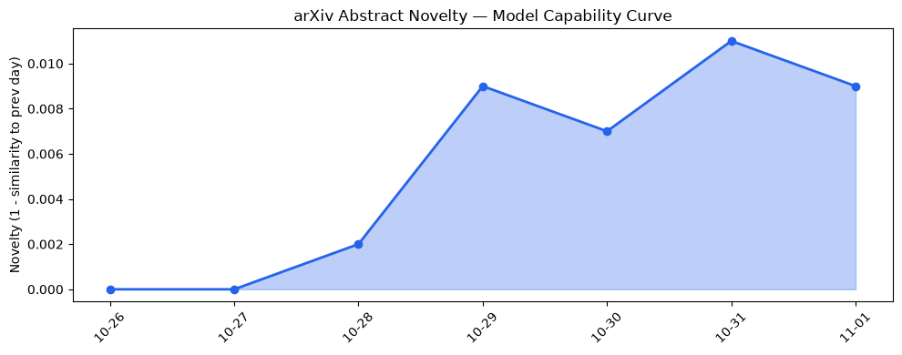
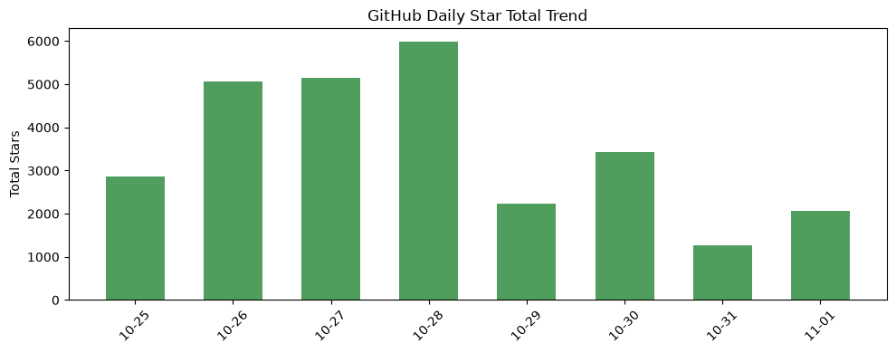
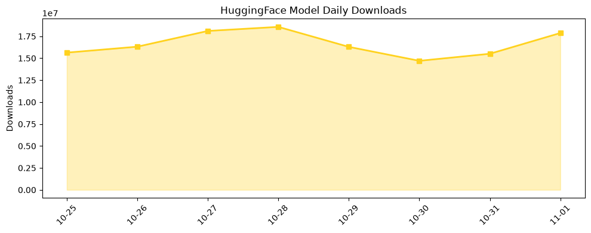

## 今日AI结构性变化
> **核心判断**：企业合规LLM应用进入快速验证期，资本对大型模型的热情同步回落，监管与环境风险同步升温。

今天最值得注意的结构性变化是，**LLM 代理首次在金融合规场景实现规模化评审**（如 FilingLoop），而同一时间 OpenAI 公开降低新一轮融资目标，显示资本对“更大模型”已不再盲目追捧。监管层面的 NAACP 对 xAI 数据中心的环境诉讼进一步提醒业界，算力供应链正被纳入合规审查的视野。

- 📈 **技术层持续升温**（连续趋势）  
- 📈 **基础设施持续升温**（连续趋势）  
- 🆕 **基础设施新兴话题**（novelty 0.99）  
- 🆕 **资本信号新兴话题**（novelty 0.76）  
- 🆕 **风险信号新兴话题**（novelty 0.77）  

## 技术层信号
🟡 渐进改善  

模型能力本周未出现突破性提升，核心创新聚焦在**Verification Learning Theory** 与 **FilingLoop** 两篇 arXiv 论文提出的任务化验证框架上。这类方法论的进步让 LLM 能在“检查‑保留”循环中提供更可靠的合规判断，但仍停留在实验验证阶段，未形成通用能力跃迁。整体技术话题向量在过去 8 天保持递增，说明学术界对“可验证 AI”兴趣持续上升。

## 产业资本信号
🟡 中等信号  

资本面临“双降温”局面：OpenAI 为新一轮融资主动下调目标，暗示大型模型的成本-收益比已进入审慎期；与此同时，Apple CEO 明确表示“不为 AI 而 AI”，表明大厂正从“炫技”转向“商业价值驱动”。资本新兴话题的出现（novelty 0.76）可能预示从单纯模型投资向 **合规‑安全‑算力环保** 三维组合投资转变。

## 潜在拐点判断
## 潜在拐点判断
从结构变化来看，**企业合规 LLM 的落地与资本对大型模型的降温** 正在形成一个潜在拐点。依据：

1. 合规场景需求突增（FilingLoop、pr‑agent），企业对可审计 AI 的预算已开始出现。  
2. 资本对“大模型”融资目标下调，表明资金正从“规模赛”转向“价值赛”。  
3. 环境监管（NAACP 对 xAI 数据中心的诉讼）可能迫使算力提供商重新定价。

若上述趋势在未来两个月内保持，AI 产业的增长曲线将从“算力驱动”转向“合规与可持续驱动”，行业估值结构也将随之重塑。

## 明日观察点
1. **FilingLoop** 在实际企业审计流程中的落地率是否突破 30%。  
2. OpenAI 是否公布新的融资轮规模或转向“企业服务”融资。  
3. NAACP 诉讼进展及其对其他 AI 数据中心的合规审查影响。

## 长期趋势坐标
整体新颖度 0.615 仍保持在中高区间，说明 AI 话题整体仍具创新活力。值得关注的是 **基础设施、资本、风险** 三个维度出现的全新话题，分别对应算力环保、投融资结构重塑以及监管合规，这三条线索在未来 3‑6 个月可能交叉形成新的产业子格局。

## 数据洞察
### arXiv 摘要对比 — 模型能力提升曲线（arxiv_capability）
  
本周 arXiv 能力得分 0.015，保持“延续”状态，说明学术产出仍以方法论创新为主，未出现大模型性能突变。

### GitHub Star 增速分析（github_stars）
  
新增仓库以 **agent‑sprite‑forge**、**pr‑agent** 为代表，分别对应创意内容生成与代码审查两大新兴应用场景。Stars 总量 2,066，增长主要来源于 **anthropics/skills**（+155%），显示技能库化仍是社区热点。

### HuggingFace 模型下载量变化（huggingface_downloads）
  
下载榜首仍是 Qwen 系列大模型，但增长最快的是 **Pika‑Labs/Pika-H3-Flex**（+238%），说明轻量化多模态模型在企业内部部署需求上获得关注。

## 参考来源
- **Verification Learning Theory: A Process Model of Checking and Retention in AI‑Assisted Judgment** – arXiv  
  https://arxiv.org/abs/2610.37875  
- **FilingLoop: Evaluating and Evolving LLM Agents for Corporate Disclosure Review and Revision** – arXiv  
  https://arxiv.org/abs/2610.37905  
- **OpenAI reportedly lowers funding target for new round** – TechCrunch AI  
  https://techcrunch.com/2026/10/31/openai-reportedly-lowers-funding-target-for-new-round/  
- **Apple CEO says the company doesn’t ‘want to ship AI for AI’s sake’** – TechCrunch AI  
  https://techcrunch.com/2026/10/31/apple-ceo-says-the-company-doesnt-want-to-ship-ai-for-ai-sake/  
- **DoorDash said it’s only received ‘several hundred’ orders from AI agents** – TechCrunch AI  
  https://techcrunch.com/2026/10/30/doordash-said-its-only-received-several-hundred-orders-from-ai-agents/  
- **Judge allows NAACP lawsuit over xAI data center pollution to move forward** – TechCrunch AI  
  https://techcrunch.com/2026/10/31/judge-allows-naacp-lawsuit-over-xai-data-center-pollution-to-move-forward/