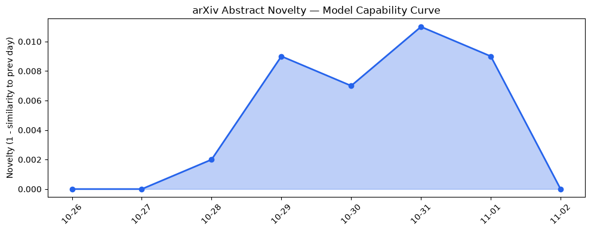
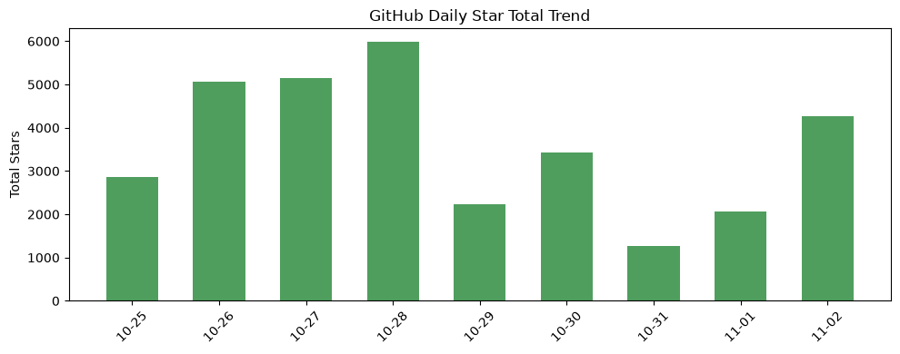
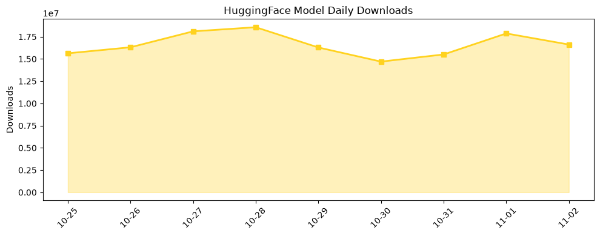

## 今日AI结构性变化
> 开源多模态模型与本地高效推理工具的涌现，标志着AI从云端向边缘与全媒体生成加速渗透。

- 📈 **持续趋势**：应用层话题向量连续 8 天递增（5/7 天上升），表明内容生成、游戏资产等全媒体需求正快速放大。  
- 📈 **持续趋势**：风险信号同样呈上升趋势，监管与安全关注同步增强。  
- 🆕 **新兴方向**：技术层、基础设施、资本信号均出现历史相似度低于 0.25 的全新话题，暗示“any‑to‑any”统一模型、边缘推理以及 AI 代理审计正从概念走向落地。  
- 🔺 **突然升温**：FreeToken 将数据中心级服务搬到桌面，直接冲击传统云推理收费模型。

今天最值得注意的结构性变化是 **全模态统一模型 + 本地高效推理** 双轮驱动，使得 AI 生成内容不再受制于中心化算力，行业竞争格局正从“算力垄断”向“边缘创新”重塑。

## 技术层信号
🟡 渐进改善  

LiquidAI 推出的 **LFM3‑Omni‑2B**（[模型页面](https://huggingface.co/LiquidAI/LFM3-Omni-2B)）实现了文本、图像、音频、3D 四模态的 **any‑to‑any** 交互，直接把专用模型的边界拉平。与此同时，speridlabs 的 **idol** pipeline（[仓库](https://huggingface.co/speridlabs/idol)）将单张图片“一键”转化为可编辑 3D 模型，标志着跨模态生成从“串联”向“同构”跃迁。  

技术层出现的全新话题（novelty 0.95）说明业界正围绕 **统一多模态架构** 集中研发，这将削弱传统单模态大模型的市场空间，未来模型生态可能快速收敛到少数几种通用架构。

## 产业资本信号
⚪ 弱信号  

本日未出现显著融资或并购，资本流向仍保持低波动。但 OpenAI 将大型算力设施重新包装为 **“AI compute campuses”**（[TechCrunch 报道](https://techcrunch.com/2026/11/01/openai-might-rebrand-its-data-centers-as-ai-compute-campuses/)），暗示其在算力布局上的长期资本投入仍在加码，只是以品牌形态而非直接融资表现。  

新出现的资本话题（相似度 0.14）提示投资者开始关注 **边缘推理平台** 与 **AI 代理审计工具**，但尚未形成大额资金聚集。

## 潜在拐点判断
**拐点**：本地高效推理（FreeToken）与全模态统一模型的同步爆发。  
**依据**：FreeToken 声称在桌面级硬件上提供数据中心级服务，且 LFM3‑Omni‑2B 与 idol 的下载增长分别达到 47% 与 77%（HuggingFace），表明开发者已开始迁移工作负载至边缘。  
**影响**：传统云 SaaS 推理费用将被压缩，内容创作工具、游戏资产生产线以及 AI 代理服务的成本结构将被重新定义，行业利润分配出现“算力去中心化”新格局。

## 明日观察点
1. **FreeToken** 是否发布正式的桌面部署 SDK，及其对主流 GPU/CPU 的兼容性测试。  
2. **LFM3‑Omni‑2B** 在实际多模态任务（如 image‑to‑3D、audio‑to‑text）上的基准表现，是否出现显著质量跃升。  
3. OpenAI “compute campuses” 的细节披露：是否伴随新一轮算力投资或政策性优惠。

## 长期趋势坐标
整体新颖度 **0.772** 表明当前 AI 生态正处于 **结构性重构期**，新技术与新风险同步上升。月度视角看，边缘推理与全模态统一模型的出现频率已从“零星实验”跃升为“连续趋势”，预示未来 3‑6 个月内，算力布局将从单一大型中心向 **多点分布式** 转变，行业竞争焦点从“模型规模”转向“部署灵活性”和“跨模态通用性”。

## 数据洞察
### arXiv 摘要对比 — 模型能力提升曲线（arxiv_capability）
今日暂无 arXiv 摘要数据。

### GitHub Star 增速分析（github_stars）
- 今日累计新增星标 **4,272**，涉及 11 个仓库。  
- 增长最快的仓库 **beenuar/AiSOC** (+39.4%) 表明 AI 安全/审计工具的关注度提升。  
- 新增仓库包括 **kornia/kornia**、**FlashML-org/FreeToken**、**ifixai-ai/iFixAi** 等，直接对应本报告的技术与风险信号。

### HuggingFace 模型下载量变化（huggingface_downloads）
- 今日累计下载 **16,622,925**，涉及 20 个模型。  
- **speridlabs/idol** 下载增长 77%（2,367 → 4,194），验证其在 image‑to‑3D 场景的快速渗透。  
- **LiquidAI/LFM3-Omni-2B** 下载增长 47%（5,695 → 8,376），显示 any‑to‑any 模型的市场接受度正加速。  

### 趋势图
  
  
  

## 参考来源
- **技术层**  
  - [LiquidAI/LFM3-Omni-2B](https://huggingface.co/LiquidAI/LFM3-Omni-2B) — HuggingFace Trending  
  - [speridlabs/idol](https://huggingface.co/speridlabs/idol) — HuggingFace Trending  

- **基础设施**  
  - [FreeToken brings datacenter‑scale model serving to your desktop](https://github.com/FlashML-org/FreeToken) — GitHub Trending  
  - [OpenAI might rebrand its data centers as ‘AI compute campuses’](https://techcrunch.com/2026/11/01/openai-might-rebrand-its-data-centers-as-ai-compute-campuses/) — TechCrunch AI  

- **应用层**  
  - [scenario-labs/skills](https://github.com/scenario-labs/skills) — GitHub Trending  
  - [ifixai-ai/iFixAi](https://github.com/ifixai-ai/iFixAi) — GitHub Trending  

- **资本信号**  
  - 同上 OpenAI 文章（品牌重塑暗示长期资本布局）  

- **风险**  
  - 同上 iFixAi 项目（AI 代理审计）  
  - 同上 OpenAI 设施更名（监管应对）  

---