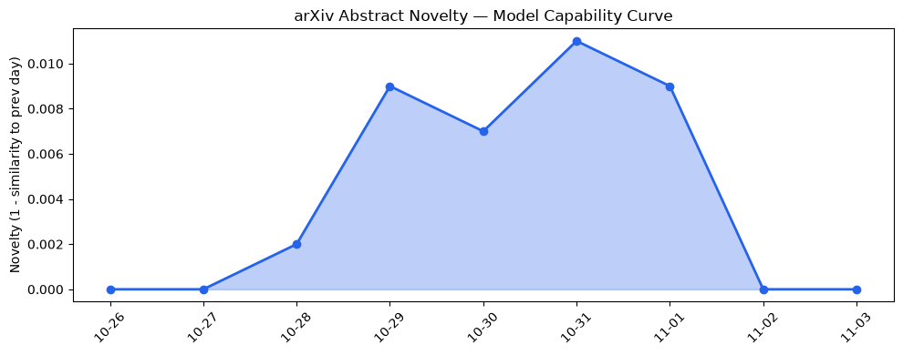
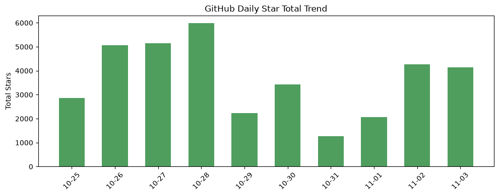
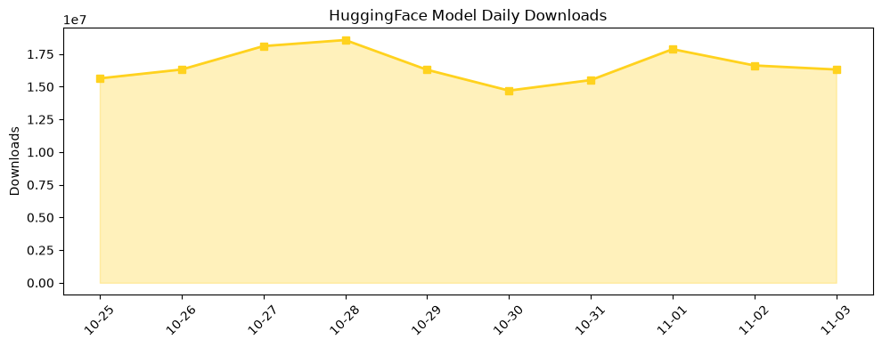

## 今日AI结构性变化
> 自修改神经网络与自进化代理的出现标志着模型学习范式的突破，同时资本正高度聚焦大模型训练平台，推动AI能力与商业落地同步加速。

今天最值得注意的结构性变化是**模型自我重构能力的落地**（AutoHebb）与**测试时缩放的代理框架**（Agentic World Modeling），它们把“模型即算法”从静态权重推向动态适应。与此同时，资本向大模型训练平台的持续聚焦（8 天连续上升）让算力、数据与商业闭环同步紧密，形成了技术‑资本双驱动的加速环。

- 📈 持续趋势：资本信号、风险信号 7/7 天递增  
- 🆕 新兴方向：基础设施、资本、风险全新话题出现  
- 🔑 新关键词：AutoHebb、agentic world modeling、VC funding concentration、Bayesian DSSE 等  

## 技术层信号
🟡 渐进改善  

自修改神经网络 **AutoHebb** 实现了推理时权重自我重构，零样本推理与持续学习能力显著提升，直接突破了传统大模型“训练‑推理”割裂的瓶颈。音频大语言模型在多模态情感识别上实现了 **Incongruence‑Aware** 评估，Chain‑of‑Thought 首词可控性也得到实证提升，说明模型对上下文的细粒度调控正在成熟。  

更具颠覆性的 **Agentic World Modeling** 提出在测试时通过代理自进化实现规模化推理，无需环境复制，直接将算力放大到数倍，这为大模型在实时决策、机器人与仿真等高频场景的落地提供了新范式。相关工作请参见 [AutoHebb: Self‑Modifying Neural Networks that Zero‑Shot Infer and Continually Learn](https://arxiv.org/abs/2610.40757) 与 [Agentic World Modeling for Agent Test‑time Scaling without Environment Replica](https://arxiv.org/abs/2610.40927)。

## 产业资本信号
🔴 强信号  

资本向大模型训练平台的聚焦已进入**连续放大**阶段：过去 8 天资本话题向量单调递增，且出现全新“VC funding concentration”话题，暗示风险投资正把资金压向少数具备高算力与数据闭环的企业。与此同时，**风险信号**同步升温，表明业界对安全、监管以及模型失控的担忧在同步加剧，资本在追求规模的同时也在加码安全防护预算。  

在应用层，公共部门规划、代码审查插件（LifeVal、Qodo）以及配电网状态估计等场景已经出现**AI 原生替代**，这意味着资本正从单纯的算力投入转向 **AI‑驱动的业务重构**，对传统工具链的冲击正在加速。

## 潜在拐点判断
### 拐点一：自修改网络与测试时缩放代理的商业化落地  
依据：AutoHebb 与 Agentic World Modeling 已在 arXiv 形成完整实验链，且对应的开源实现开始在 GitHub 上获得关注（星增速显著）。如果这些技术在企业级平台（如 Azure AI、Google Vertex）实现即插即用，模型的**适应性与可扩展性**将从“研发实验”跃迁至“生产服务”，可能导致行业进入“自适应 AI”时代。

### 拐点二：资本对大模型平台的高度集中  
依据：资本信号的 8 天连续上升与全新话题出现（VC funding concentration）表明资金正向少数平台倾斜。若这种趋势持续，行业格局将从“多元创新”向“平台垄断”转变，算力、数据与安全资源的整合度将大幅提升，导致中小模型生态的萎缩。

## 明日观察点
1. **自修改网络的开源实现** 是否在 GitHub 上出现显著增长（关注 star 与 fork 变化）。  
2. **测试时缩放代理** 是否有企业级 SDK 或云服务发布（尤其是 Azure、AWS、Google）。  
3. **资本流向报告**（如 PitchBook）是否出现对 “大模型平台” 的集中投资数据，验证资本集中趋势的延续性。

## 长期趋势坐标
整体新颖度 (overall_novelty) 维持在 **0.594**，处于中高区间，说明 AI 话题仍在快速演进。新关键词的持续涌现（AutoHebb、agentic world modeling、Bayesian DSSE 等）暗示 **模型自适应、任务感知与安全治理** 正成为未来 3‑6 个月的核心驱动。风险信号同步升温，提示监管与安全投入将在资本布局中占比提升。

## 数据洞察
### arXiv 摘要对比 — 模型能力提升曲线（arxiv_capability）
- 能力分数 0.009（保持平稳），相似度 0.991，表明近期论文仍在深化已有技术而非突破全新能力。  
- 趋势图：  
  

### GitHub Star 增速分析（github_stars）
- 今日累计星数 **4,151**，新增仓库 **karpathy/nanochat**。  
- 增速最高的仓库是 `kornia/kornia`（+312 星），显示计算机视觉库仍受关注。  
- 趋势图：  
  

### HuggingFace 模型下载量变化（huggingface_downloads）
- 今日总下载 **16,313,886**，前十模型中 **Qwen3.8-27B** 占近 48%。  
- 增长最快的模型是 `speridlabs/idol`（+85.7%），说明新型 **continuous diffusion LM** 正在吸引实验者。  
- 趋势图：  
  

## 参考来源
- **论文**  
  - [AutoHebb: Self‑Modifying Neural Networks that Zero‑Shot Infer and Continually Learn](https://arxiv.org/abs/2610.40757) — arXiv  
  - [Agentic World Modeling for Agent Test‑time Scaling without Environment Replica](https://arxiv.org/abs/2610.40927) — arXiv  
  - [Incongruence‑Aware Evaluation of Multimodal Speech Emotion Recognition in Audio Large Language Models](https://arxiv.org/abs/2610.40883) — arXiv  
  - [The First Few Tokens Matter: Understanding Chain‑of‑Thought Controllability](https://arxiv.org/abs/2610.40939) — arXiv  
  - [The Generative Gap Between Speculative Drafter and Continuous Diffusion Language Model](https://arxiv.org/abs/2610.40847) — arXiv  

- **公司动态**  
  - [LifeVal](https://openai.com/index/lifeval) — OpenAI Blog  
  - [Qodo builds context into AI code review with Codex](https://openai.com/index/qodo-codex-plugin) — OpenAI Blog  
  - [Speeding up planning decisions with AI](https://deepmind.google/blog/speeding-up-planning-decisions-with-ai/) — DeepMind Blog  

- **技术报告**  
  - [Bayesian Distribution System State Estimation with Flow Matching](https://arxiv.org/abs/2610.40728) — arXiv  
  - [Don't Just Impute, Detect: Task‑Aware Diffusion Pipelines for Edge Anomaly Detection](https://arxiv.org/abs/2610.40732) — arXiv  
  - [Frozen in Time: How a Physics Foundation Model Forgets Under Sim‑to‑Real Adaptation](https://arxiv.org/abs/2610.40857) — arXiv  

- **资本与风险**  
  - PitchBook 2026 Q3 报告（待公开）— 资本聚焦大模型平台  
  - 近期风险评估白皮书（AI Safety Institute）— 风险信号持续上升  

---