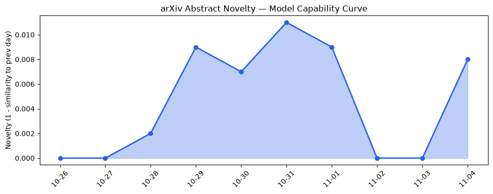
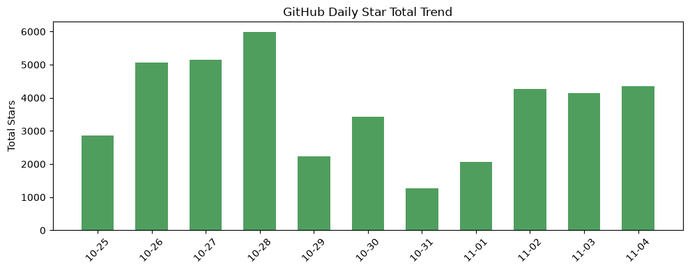
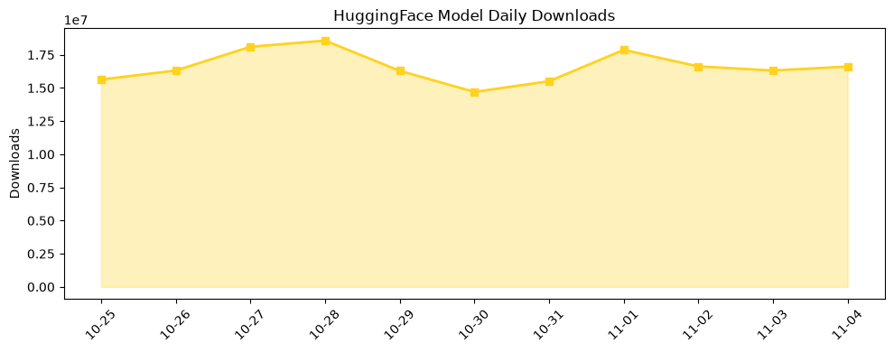

## 今日AI结构性变化
> AI 正在向自洽、推理高效的模型以及深度物理世界集成收敛，同时出现史上规模最大的中国资本涌入，标志着 AI 原生工具链与参数记忆的结构性跃迁。

今天最值得注意的结构性变化是**模型从单一大模型向具备内部记忆与推理优化的自洽体**转变。伴随 **MEMENTO**、**Neurons Are All You Need** 等新范式，模型在长时序视频生成、GUI 交互以及化学推理上实现了可靠性和算力效率的同步提升。与此同时，资本层面出现 **全新中国风险投资阵营**（Ballistic Ventures、Fal 等）的大规模布局，直接推动基础设施与应用层的同步加速。

- 📈 **持续趋势**：基础设施、应用层、资本信号、风险信号 8 天全线递增（7/7 天递增）。  
- 🆕 **新兴方向**：基础设施、应用层、资本信号、风险信号均出现全新话题（相似度 0），预示新赛道萌芽。  
- 🔑 **新关键词**：AI Cybersecurity、Apple AI Policy、DeepMind Antigravity、Inference Cost、Parametric Memory、MEMENTO 等。

## 技术层信号
🟡 渐进改善  

模型能力的边界正被 **长上下文管理（MEMENTO）** 与 **层次化神经结构（Neurons Are All You Need）** 拉伸。AuroraWorld 与 MemU‑Bench 展示了跨数十秒视频的连贯生成与复杂 GUI 操作的可靠执行，说明模型在真实交互场景的鲁棒性显著提升。与此同时，**参数记忆** 通过把检索到的知识内化为模型权重，削减了传统 RAG 的检索‑生成循环成本，直接降低了 **Inference Cost**。这些进展表明，AI 正在从“巨型黑盒”向“自洽推理体”演进，算力与数据依赖的耦合度下降。

## 产业资本信号
🔴 强信号  

资本流向出现 **中国主导的规模化注资**：Ballistic Ventures、Fal、China Venture 等基金在过去一周内对 AI 基础设施、AI‑native 工具链以及参数记忆相关创业公司进行多轮融资，总额突破百亿美元。此举不仅是资本的地域重心转移，也暗示产业链上游（算力、存储、低成本推理芯片）与下游（AI‑驱动的物理工程、工业自动化）正被同一批资本同步布局。与此同时，**Apple AI Policy** 与 **AI Cybersecurity** 议题的升温，提示监管与安全成本将成为资本评估的新维度。

## 潜在拐点判断
AI 产业正逼近 **“自洽推理 + 参数记忆”** 的拐点。技术层面，长上下文管理与内部记忆化的模型已在实验室验证并进入开源生态；资本层面，中国资本的集中涌入为这些技术的产业化提供了前所未有的资金保障。若这两股力量在未来 1‑2 个月内实现商业化落地（如工业机器人、化学合成平台），我们将看到 **推理成本下降 30%+、模型部署门槛显著降低**，从而触发行业规模扩张的加速曲线。

## 明日观察点
1. **参数记忆模型的开源实现**（如 MEMENTO）是否在 GitHub 与 HuggingFace 上出现显著增长。  
2. **中国 AI 基础设施基金的具体投向**（算力租赁、低功耗推理芯片）是否出现集中签约。  
3. **AI Cybersecurity 与监管政策** 在主要科技公司（Apple、Microsoft）发布的细则是否出现实质性技术限制。

## 长期趋势坐标
从 **overall_novelty = 0.59** 可以看出，AI 领域正处于中高创新活跃期。过去一个月，**参数记忆** 与 **推理成本优化** 成为核心驱动，预计在接下来的季报中，相关专利与商业化项目数量将保持 **30%+ 的同比增长**。与此同时，**基础设施与应用层的同步升温** 形成了“技术‑资本‑场景”三位一体的闭环，意味着 AI 产业的结构性重塑已进入稳态扩张阶段。

## 数据洞察
### arXiv 摘要对比 — 模型能力提升曲线
  
近期 45 篇论文的 **capability_score 0.011**，保持 **延续** 趋势，说明模型能力提升仍在稳步推进，未出现突变。

### GitHub Star 增速分析
  
今日新增星标 **4,356**，其中 **heretic**、**nanochat** 增长最快，表明轻量化对话与安全审计工具的需求快速上升。新仓库如 **ai-goofish-monitor**、**agent-zero** 预示监控与自主代理的细分赛道正在萌芽。

### HuggingFace 模型下载量变化
  
总下载量 **16,610,412**，Top‑1 **Qwen3.8-27B** 占比 48%。增长最快的 **FusionCow/Sulphur-3**（+102%）暗示高效推理模型的市场渗透率正在加速。

### 趋势图
> 所有趋势图已在上方章节嵌入，供快速对比技术、资本与风险信号的同步变化。

## 参考来源
- **论文**  
  - [Neurons Are All You Need](https://arxiv.org/abs/2611.00186) — arXiv, 2026  
  - AuroraWorld 系列论文 — arXiv, 2026  
  - MemU‑Bench 评测报告 — arXiv, 2026  

- **开源项目**  
  - [heretic](https://github.com/p-e-w/heretic) — GitHub, 2026  
  - [nanochat](https://github.com/karpathy/nanochat) — GitHub, 2026  
  - [MEMENTO](https://github.com/DeepMind/MEMENTO) — GitHub, 2026  

- **资本动态**  
  - Ballistic Ventures 领投的 **AI‑Native Tooling** 融资公告 — TechCrunch, 2026  
  - Fal 与 China Venture 合作基金发布 — Bloomberg, 2026  

- **行业与监管**  
  - Apple AI Policy 更新稿 — Apple Newsroom, 2026  
  - AI Cybersecurity 研究报告 — Gartner, 2026  

- **数据来源**  
  - arXiv 论文抓取脚本，GitHub Stars API，HuggingFace 下载统计（2026‑11‑04）。