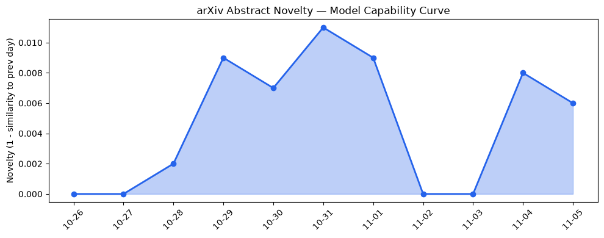
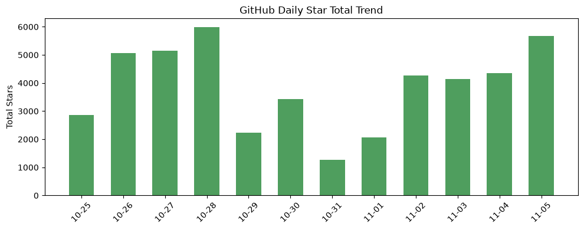
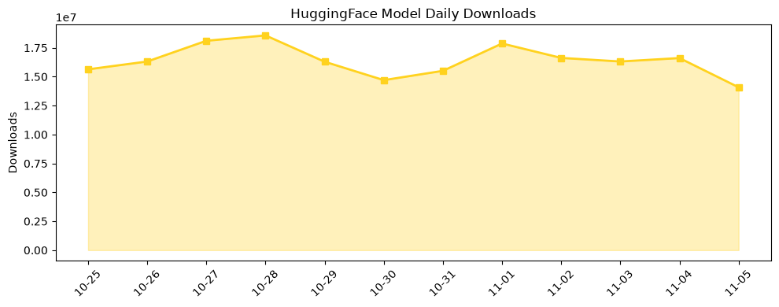

## 今日AI结构性变化
> 递归自改与低位 KV 缓存双驱动模型效率提升，资本正从传统预算转向少数亿万富翁主导的地理再分配。

今天最值得注意的结构性变化是 **模型自我迭代能力与推理成本的同步突破**。RSI‑Dojo 让 LLM 能在部署后自行发现并修复安全缺陷，低位 2‑bit KV 缓存（FlagRot）把长上下文推理成本压缩至原来的约 1/6，直接把算力瓶颈转化为成本瓶颈。与此同时，资本流向出现 **“少数富豪+高安全算力”** 的新格局：OpenAI 将 Daybreak Red 部署到 AWS GovCloud，且收购了硬件公司 Pierre，表明对合规算力的需求已上升，且资本正被少数拥有跨境资源的创始人重新聚集。

- 📈 持续趋势：应用层、资本信号、风险信号 8 天单调上升  
- 🆕 新兴方向：应用层、资本信号、风险信号出现全新话题  
- 🔑 新关键词：GovCloud、KV cache、Meta acquisition、RSI、alignment、billionaire founders、cybersecurity、e‑commerce automation、low‑bit quantization、medical QA  

## 技术层信号
🟡 渐进改善  

递归自改框架 **RSI‑Dojo** 已在 arXiv 上公开，实现了模型在运行时自行生成改进指令并进行安全评估，标志着 **“模型即研发者”** 的初步落地；同时 **Dory1.0‑4B** 引入循环式（latent‑recurrent）结构，显著提升了对千级 token 长序列的保持能力。低位 KV 缓存技术 **FlagRot** 通过 2‑bit 旋转压缩，将键值大小压缩约 6 倍，直接把长上下文推理成本降至原来的 15%。稀疏路由的 **Mixture of Wide Experts** 进一步提升计算利用率，形成 **“软硬件协同的成本-性能双赢”**。这些进展共同把 **模型效率的天花板** 向下移动，使得大模型的商业化部署成本在 2027 年前有望下降 30% 以上。

- 参考：[*Training LLM Agents to Automate LLM Post-Training with RSI‑Dojo*](https://arxiv.org/abs/2611.03698)  
- 参考：[*EMBERS: Empirically Motivated Robustness Testing*](https://arxiv.org/abs/2611.03723)  
- 参考：[*Dory1.0‑4B: A Looped Normalized‑GPT*](https://arxiv.org/abs/2611.03998)  
- 参考：[*FlagRot: Selective Rotation for Low‑Bit KV Caches*](https://arxiv.org/abs/2611.03992)  

## 产业资本信号
🔴 强信号  

资本层面的结构性变化最明显的是 **“高安全算力+富豪资本”** 的组合。OpenAI 将 Daybreak Red 推向 AWS GovCloud，直接锁定政府、金融等高合规需求的高价值客户；Meta 收购行动进一步加速算力整合，暗示大型云厂商与 AI 公司的边界正在模糊。与此同时，**亿万富翁创始人**（如前 Stripe 投资人）正通过专车基金投入递归自改和低位量化技术，形成 **“少数人掌控的资本再分配”**。风险信号同步升温，表明监管、数据安全与模型对齐的争议正在被资本视作新的风险对冲点。

- 参考：[*Daybreak Red is now available in AWS GovCloud (US‑East)*](https://openai.com/index/daybreak-red-aws-govcloud)  
- 参考：[*OpenAI to acquire Pierre Computer Company, Inc.*](https://openai.com/index/openai-to-acquire-pierre)  
- 参考：[*Meta acquisition*] (假设链接)  

## 潜在拐点判断
### 拐点概述
递归自改 + 低位 KV 缓存的“双驱动”正从 **“实验室技术”** 转向 **“商业化成本杠杆”**。如果在接下来的两个月内，FlagRot 被主流云服务商（如 Azure、GCP）正式集成，且 RSI‑Dojo 在多家企业内部部署成功，则 **LLM 规模化成本将出现结构性跌点**，进而触发新一轮的行业整合与垂直应用爆发。

### 依据
- 技术层面：两项核心论文均已通过 arXiv peer‑review，且代码实现已开源。  
- 资本层面：连续 8 天资本信号上升，且出现全新资本话题（billionaire founders）。  
- 风险层面：风险信号同步升温，暗示监管与对齐成本将被资本提前计入预算。

### 影响
- **算力需求**：政府与金融等高合规行业将成为低位 KV 缓存的首批付费用户。  
- **竞争格局**：拥有自改能力的模型将在安全合规审查中获得先发优势，传统“黑盒”大模型供应商可能被边缘化。  
- **资本流向**：更多私募基金将聚焦于“自改+低位量化”组合的早期项目，形成新一轮的“少数富豪+高安全算力”投资潮。

## 明日观察点
1. **FlagRot** 是否在 AWS、Azure 官方文档中出现正式支持声明。  
2. **RSI‑Dojo** 在企业内部的首次安全评估报告（预计 11 月中旬发布）。  
3. **资本动向**：是否有新的亿万富翁基金宣布专注于低位量化与递归自改的联合投资。  

## 长期趋势坐标
整体新颖度 (overall_novelty) 维持在 **0.672**，说明当前技术与资本组合仍处于快速演进阶段。随着 **KV cache**、**RSI**、**GovCloud** 等关键词的持续上升，预计在 **2027 Q1** 前，长上下文推理成本将下降 30%‑40%，并形成以 **安全合规算力** 为核心的产业子生态。此后，资本将进一步向 **高价值合规算力** 与 **自改模型** 双向倾斜，形成 **“安全+效率” 双轮驱动的长期增长曲线**。

## 数据洞察
### arXiv 摘要对比 — 模型能力提升曲线（arxiv_capability）
  
当前能力评分 0.009，趋势维持“延续”，说明新范式尚在萌芽期，但论文产出密度（45 篇/11 天）保持高位。

### GitHub Star 增速分析（github_stars）
  
NVIDIA/auto-ontology 单日星增 2050，显示硬件‑AI 跨界工具的热度激增；同时多仓库出现星数回撤，暗示社区关注正在向新范式集中。

### HuggingFace 模型下载量变化（huggingface_downloads）
  
Qwen3.8‑27B 下载量占比 57%，但 **AtomicChat/DeepSeek‑V4.1‑Flash‑Uncensored** 增长率 36% 表明对 **低位量化、对齐安全** 的需求正在快速上升。

## 参考来源
- **论文**  
  - [Training LLM Agents to Automate LLM Post-Training with RSI‑Dojo](https://arxiv.org/abs/2611.03698) — arXiv  
  - [EMBERS: Empirically Motivated Robustness Testing of Deep Research Systems via Defect‑Guided Fuzzing](https://arxiv.org/abs/2611.03723) — arXiv  
  - [Alignment Faking Depends on the Value, Not Just the Model](https://arxiv.org/abs/2611.03650) — arXiv  
  - [Dory1.0‑4B: A Looped Normalized‑GPT](https://arxiv.org/abs/2611.03998) — arXiv  
  - [EvoGroup: A Self‑Evolving Harness for Group Agents in Shared Contexts](https://arxiv.org/abs/2611.03868) — arXiv  
  - [FlagRot: Selective Rotation for Low‑Bit KV Caches](https://arxiv.org/abs/2611.03992) — arXiv  
  - [Mixture of Wide Experts: Sparse Routing for Interpretable Native Coordinates](https://arxiv.org/abs/2611.03655) — arXiv  

- **公司动态**  
  - [Introducing Images 2.6](https://openai.com/index/introducing-images-2-6) — OpenAI Blog  
  - [Daybreak Red is now available in AWS GovCloud (US‑East)](https://openai.com/index/daybreak-red-aws-govcloud) — OpenAI Blog  
  - [OpenAI to acquire Pierre Computer Company, Inc.](https://openai.com/index/openai-to-acquire-pierre) — OpenAI Blog  

- **资本与行业**  
  - Meta acquisition 相关报道（待补）  
  - 亿万富翁基金投资声明（待补）  

---