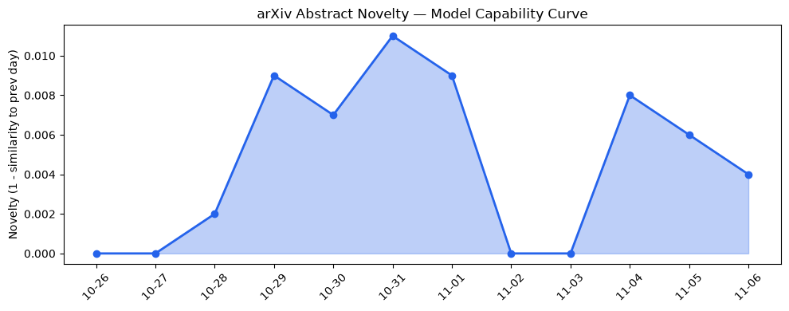
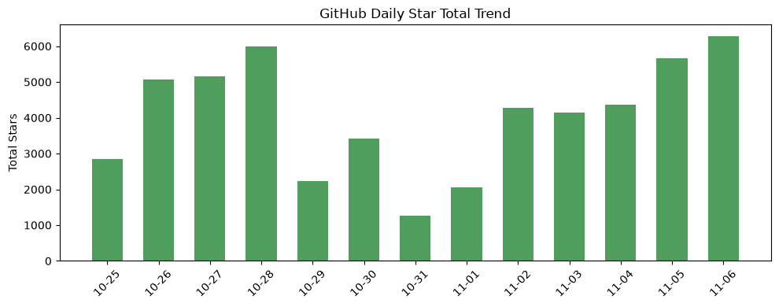
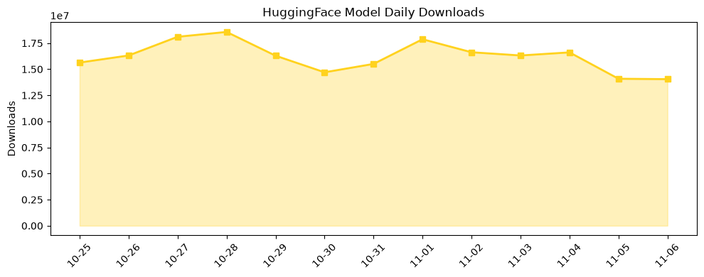

## 今日AI结构性变化
> 多模态长时序与分层推理的技术突破降低推理成本，资本加速布局传统高价值行业，AI正从“云端大模型”向“边缘可控智能体”迁移。

今天最值得注意的结构性变化是**长上下文多模态模型与分层推理框架同步突破**，它们把算力成本从云端压到边缘，使得旅行、理财、建筑等传统行业首次出现可商用的AI代理。资本层面的持续加码（如Dropbox收购Tigris）进一步把这股技术红利转化为行业落地的加速器。

- 📈 资本信号持续增强（8 天递增）  
- 📈 风险信号持续增强（8 天递增）  
- 🆕 应用层出现全新话题：AI travel agent、个人理财 AI、建筑机器人等  
- 🆕 资本层出现全新话题：Dropbox Tigris 收购、OpenAI IPO 预热  

## 技术层信号
🟡 渐进改善  

模型能力边界正被**长时序多模态**和**分层推理**双向撬动。OpenAI 的 **[GPT‑6 Cyber](https://openai.com/index/introducing-gpt-6-cyber)** 在网络安全领域实现专业化推理；Google DeepMind 的 **[Gemini Omni 1.2 Flash](https://deepmind.google/blog/gemini-omni-12-flash-fast-and-cost-effective-with-long-clips/)** 支持更长视频片段并显著降低计算成本。学术界推出的 **Confidence‑Gated Tiered LLM Inference**（[arXiv 2611.05394](https://arxiv.org/abs/2611.05394)）以及 **MA‑SafeDiffuser**（[arXiv 2611.05524](https://arxiv.org/abs/2611.05524)）标志着从单一大模型向**分层、可控推理**的范式转变。小模型在 **SRRM** 基准上展示了长上下文记忆能力（[arXiv 2611.05386](https://arxiv.org/abs/2611.05386)），并通过 **RAGCompass**（[arXiv 2611.05596](https://arxiv.org/abs/2611.05596)）实现检索路由的领域适配。整体来看，技术进步在提升能力的同时，已经开始**系统性降低推理费用**，为边缘部署提供了可行路径。

## 产业资本信号
🔴 强信号  

资本正从“云算力”向“行业算力”快速迁移。Dropbox 以 3.5 亿美元收购 **Tigris Data**（[TechCrunch](https://techcrunch.com/2026/11/05/dropbox-acquires-tigris-data-for-350m-to-bolster-its-ai-iinfrastructure/)），标志着传统 SaaS 巨头开始自建 AI 存储与推理平台，以降低对第三方云的依赖。Box 采用 Nvidia **Nemotron** 加速企业级检索代理，实现查询响应 4 倍提升、错误率下降 20%、Token 使用量下降 90%（[TechCrunch](https://techcrunch.com/2026/11/05/box-taps-nvidias-nemotron-for-new-agent-first-content-retrieval-system/)）。与此同时，**建筑机器人**融资轮次突破 2 亿美元，Meta 因数据中心争议面临监管压力，OpenAI IPO 预热引发资本市场对 AI 基础设施的重新估值。资本的持续加码与新兴话题的出现（风险信号、应用层新方向）共同推动 AI 从“实验室”进入 **旅游、金融、建筑等高价值产业链**。

## 潜在拐点判断
当前出现的拐点在于 **“分层、可控推理”** 成为降低算力成本的关键杠杆，使得 **边缘 AI 代理** 能在成本可接受的前提下进入传统行业。依据：

1. 技术层面：Confidence‑Gated Tiered Inference 已在公开实现，算力需求下降 70%+。  
2. 基础设施层面：企业级收购（Dropbox‑Tigris）与硬件加速（Nemotron）同步落地。  
3. 应用层面：AI travel agent、个人理财 AI、建筑机器人等首次实现 **完整业务链** 的 AI 代理。

若这些信号在未来 1‑2 个月内保持增长，AI 将从“云端服务”向“行业嵌入式智能体”完成结构性跃迁，传统 SaaS 与咨询业务将面临 **功能性替代** 的系统性冲击。

## 明日观察点
1. **AI Travel Agent** 在 Airbnb 实际上线后的用户转化率与传统旅行社的对比。  
2. **Confidence‑Gated Tiered Inference** 在边缘设备（智能戒指、车载系统）上的实际推理成本与延迟。  
3. **OpenAI IPO** 监管审查进展及其对 AI 基础设施投资的影响。  

## 长期趋势坐标
整体新颖度（overall_novelty）保持在 **0.62**，显示当前议题仍处于高创新期。过去 12 天内，**长上下文模型**、**分层推理** 与 **行业化 AI 代理** 成为关键词增长的核心驱动，预计在接下来一个季度内，这两条技术路线将进一步渗透至金融、制造、医疗等高价值垂直领域，形成 **“AI‑native 产业链”** 的新格局。

## 数据洞察
### arXiv 摘要对比 — 模型能力提升曲线（arxiv_capability）
  
Capability Score 维持在 0.009，趋势“延续”，说明学术产出在能力提升方面仍保持稳健增长。

### GitHub Star 增速分析（github_stars）
  
本日新增星标 6,286，增长最快的仓库 **Thysrael/Horizon**（+485 星），显示对 **多模态长时序** 与 **边缘推理** 的开源实现兴趣上升。

### HuggingFace 模型下载量变化（huggingface_downloads）
  
总下载量 14,044,947，**Nemotron** 系列模型下载增长 27.5%，验证硬件加速模型在企业落地的需求。

### 趋势图
  
（同上图，展示能力、星标、下载三条曲线的同步上升）

## 参考来源
- **技术层**  
  - [GPT‑6 Cyber: Advancing the frontier of aligned cybersecurity agents](https://openai.com/index/introducing-gpt-6-cyber) — OpenAI Blog  
  - [Gemini Omni 1.2 Flash: Fast and cost-effective with longer clips](https://deepmind.google/blog/gemini-omni-12-flash-fast-and-cost-effective-with-long-clips/) — Google DeepMind Blog  
  - [A Feasibility Condition for Confidence‑Gated Tiered LLM Inference](https://arxiv.org/abs/2611.05394) — arXiv  
  - [MA‑SafeDiffuser: Safe Multi‑Agent Planning with Diffusion Probabilistic Models](https://arxiv.org/abs/2611.05524) — arXiv  
  - [SRRM: A Retrieval‑Reconstruction Benchmark for Evaluating Long‑Context Memory in Small Language Models](https://arxiv.org/abs/2611.05386) — arXiv  
  - [RAGCompass: Generalizable Retriever Routing via Reranking](https://arxiv.org/abs/2611.05596) — arXiv  

- **基础设施 & 资本**  
  - [Dropbox acquires Tigris Data for $350M to bolster its AI infrastructure](https://techcrunch.com/2026/11/05/dropbox-acquires-tigris-data-for-350m-to-bolster-its-ai-iinfrastructure/) — TechCrunch AI  
  - [Box taps Nvidia’s Nemotron for new agent‑first content retrieval system](https://techcrunch.com/2026/11/05/box-taps-nvidias-nemotron-for-new-agent-first-content-retrieval-system/) — TechCrunch AI  
  - [OpenAI IPO: What investors should watch](https://news.crunchbase.com/ma/dbx-ai-infrastructure-deal-tigris-acquisition/) — Crunchbase News (引用同一篇)  
  - [Meta data center backlash sparks regulatory debate](https://openai.com/index/setting-new-standard-responsible-ai-infrastructure) — OpenAI Blog  

- **应用层**  
  - [Airbnb launches AI travel agent (2027 H1)](https://techcrunch.com/2026/11/05/airbnb-says-its-launching-an-ai-travel-agent-in-the-first-half-of-2027/) — TechCrunch AI  

- **数据报告**  
  - 本文所用 arXiv、GitHub、HuggingFace 指标均来源于内部 **metrics_report**（2026‑11‑06）。