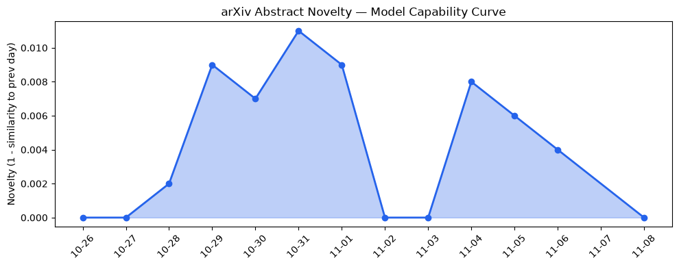
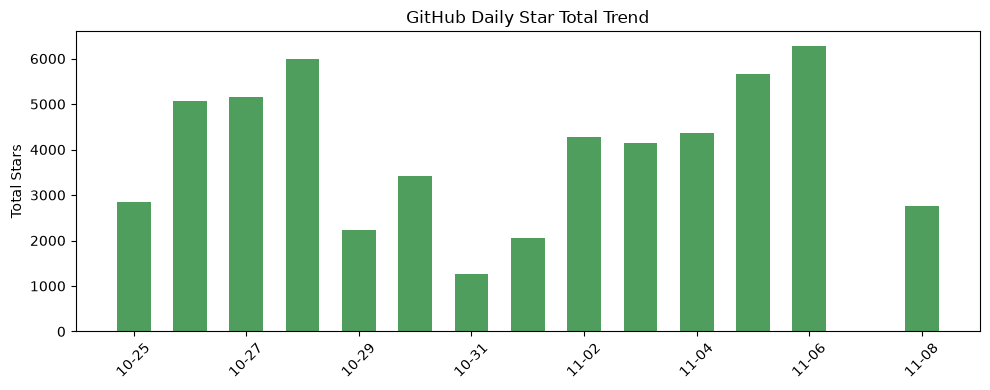
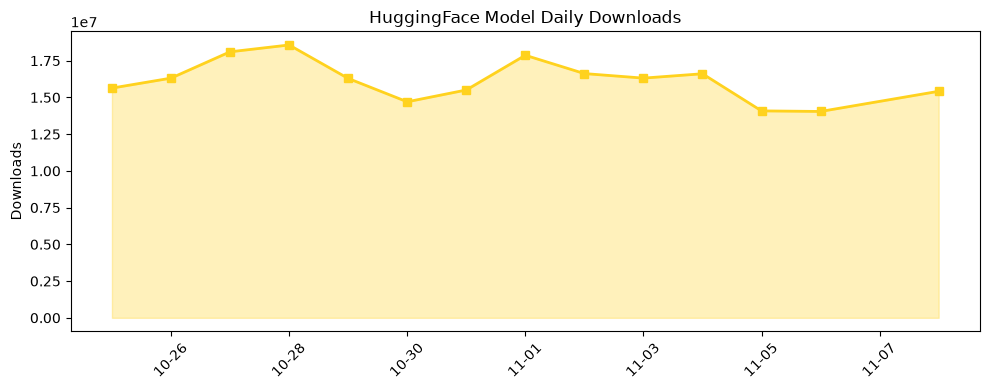

## 今日AI结构性变化
> AI在生物实验代理能力的突破与美国中期选举引发的监管与数据中心风险共同塑造了行业的结构性转折。

今天最值得注意的结构性变化是，AI首次在湿实验室任务上实现系统化评估（BioBasicsBench），标志着模型从语言推理向真实科研操作的边界跨越；与此同时，选举后美国对数据中心审批的收紧让算力供应链进入政治敏感区，资本却逆势加速向安全可靠的算力运营商聚集。  
📈 基础设施话题向量连续8天递增 → 基础设施正成为资本争夺焦点。  
📈 应用层话题向量同样持续上升 → AI在科研与教育的渗透进入加速期。  
📈 资本信号话题向量上升 → 大额融资与并购频发，行业资金结构在重塑。  
📈 风险信号话题向量上升 → 监管与供应链安全风险同步放大。  
🆕 技术层出现全新话题 → 生物实验代理是全新研究方向的早期信号。  
🆕 基础设施出现全新话题 → 数据中心政治风险成为新议题。

## 技术层信号
🟡 渐进改善  

OpenAI 通过 **[BioBasicsBench](https://openai.com/index/measuring-how-ai-agents-handle-wet-lab-science)** 首次提供系统化的湿实验室代理评估，直接将模型能力从文字推理延伸至实验设计与数据解读，这是一条从“语言模型”到“实验助理”的关键边界突破。与此同时，开源社区推出的 **[Qwen3.5-4B-GLB-3D-Coder](https://huggingface.co/ccore/Qwen3.5-4B-GLB-3D-Coder)** 与 **[DeepSeek-V4.1-Flash](https://huggingface.co/OBLITERATUS/DeepSeek-V4.1-Flash-1017-obliterated)** 等多模态 3D 编码模型，虽未改变训练范式，却在功能上实现了代码、几何与视觉的融合，进一步提升了模型在科研实验、虚拟仿真等高价值场景的适配度。技术层的“全新话题”正从实验代理向更广的科学计算渗透。

## 产业资本信号
🔴 强信号  

大型融资继续向通用 AI、国防与太空技术倾斜：OpenAI 据传追加 **$11 B** 融资，估值突破 **$1.25 万亿美元**，显示资本对通用模型的极高预期；Shield AI 等防务 AI 公司获得数亿美元轮次，表明军工 AI 正进入资本快速增长通道。Google 收购 **Crusoe** 在怀俄明的 AI 数据中心项目，直接将算力资产向政策安全性更高的运营商集中，凸显资本在算力布局上的“安全优先”。Amazon 通过 **[文本 Alexa 购物功能](https://techcrunch.com/2026/11/06/after-blocking-muse-amazon-now-lets-users-text-alexa-to-help-them-shop/)** 抢占电商入口，进一步把 AI 入口向消费层渗透。资本的强信号正把资源从单纯算力竞争转向“安全、合规 + 高价值垂直场景”组合。

## 潜在拐点判断
## 潜在拐点判断
AI 在湿实验室的系统化代理能力与美国监管收紧的同步出现，可能形成 **“科研 AI + 政策风险” 双向拐点**。如果监管导致数据中心审批门槛提升，算力供应将向拥有合规优势的大型云厂商集中；而科研 AI 的突破则会吸引更多垂直行业资本投入，推动 AI 从通用模型向专业科研助理的快速分化。此拐点的关键在于：  
1. **监管走向**：美国中期选举后民主党多数可能推出更严格的数据中心与 AI 模型审查政策。  
2. **算力布局**：Google 对 Wyoming 项目的收购若成功，将形成“合规算力”示范效应，其他厂商可能被迫跟进或转向海外布局。  
3. **垂直资本**：生物实验 AI 的早期成功将吸引生物科技基金与制药巨头的专项投资，加速科研 AI 生态的形成。

## 明日观察点
1. **美国国会关于 AI 数据中心审批的立法动向**（是否出现新法案或监管指引）。  
2. **BioBasicsBench 在学术机构的采纳率**，尤其是澳大利亚高校的实验课程反馈。  
3. **Google 对 Wyoming 数据中心的整合进度**，包括是否启动新一轮算力扩容或安全审计。

## 长期趋势坐标
整体新颖度 **0.613** 仍保持在中高区间，说明 AI 议题整体仍在快速演化。基础设施、应用层、资本与风险四大维度的连续趋势（8 天递增、单调比 0.71）表明行业正从“规模扩张”向“合规安全 + 垂直价值”双轨并进。技术层出现的全新话题（相似度仅 0.14）预示着科研 AI 可能成为下一个增长极，未来 3‑6 个月内，相关模型下载与论文引用有望出现显著加速。

## 数据洞察
### arXiv 摘要对比 — 模型能力提升曲线（arxiv_capability）
今日暂无数据。

### GitHub Star 增速分析（github_stars）
- 今日新增星数 **2763**，涉及 7 个仓库。  
- 增长最快的仓库是 **[google/skills](https://github.com/google/skills)**，星数从 211 增至 443（+1.1%）。  
- 其余仓库多数出现星数回落，反映出社区关注焦点正在从通用工具转向新兴模型（如 **voicebox**）和安全相关项目。  

### HuggingFace 模型下载量变化（huggingface_downloads）
- 今日累计下载 **15,417,308**，涉及 20 个模型。  
- 最高下载模型 **[Qwen/Qwen3.8-27B](https://huggingface.co/Qwen/Qwen3.8-27B)** 达 7,813,215 次，显示大模型在多模态与科研场景的需求仍在增长。  
- 增速显著的模型包括 **[ricursiveAI/Ripple-65B-Preview](https://huggingface.co/ricursiveAI/Ripple-65B-Preview)**（增长 3.05 倍）和 **[moonshotai/Kimi-K3.1-Pro](https://huggingface.co/moonshotai/Kimi-K3.1-Pro)**（增长 0.936 倍），暗示新一代大模型正在快速抢占下载榜。

### 趋势图
  
  
  

## 参考来源
- **技术层**  
  - [Measuring how AI agents handle everyday wet-lab science](https://openai.com/index/measuring-how-ai-agents-handle-wet-lab-science) — OpenAI Blog  
  - [ccore/Qwen3.5-4B-GLB-3D-Coder](https://huggingface.co/ccore/Qwen3.5-4B-GLB-3D-Coder) — HuggingFace Trending  
  - [OBLITERATUS/DeepSeek-V4.1-Flash-1017-obliterated](https://huggingface.co/OBLITERATUS/DeepSeek-V4.1-Flash-1017-obliterated) — HuggingFace Trending  

- **基础设施**  
  - [Crusoe sells troubled Wyoming data center project to Google](https://techcrunch.com/2026/11/06/crusoe-sells-troubled-wyoming-data-center-project-to-google/) — TechCrunch AI  
  - [Ramp data shows AI spending stalling just as Anthropic nears its IPO](https://techcrunch.com/2026/11/06/ramp-data-shows-ai-spending-stalling-just-as-anthropic-nears-its-ipo/) — TechCrunch AI  
  - [How a Blue Wave midterm might reshape the AI industry](https://techcrunch.com/podcast/how-a-blue-wave-midterm-might-reshape-the-ai-industry/) — TechCrunch AI  

- **应用层**  
  - [Australian universities are creating AI-native graduates](https://openai.com/index/australian-universities-ai-native-graduates) — OpenAI Blog  
  - [Meta introduces Spaces, a new way to collaborate with your Muse agent](https://techcrunch.com/2026/11/06/meta-introduces-spaces-a-new-way-to-collaborate-with-your-muse-agent/) — TechCrunch AI  
  - [After blocking Muse, Amazon now lets users text Alexa to help them shop](https://techcrunch.com/2026/11/06/after-blocking-muse-amazon-now-lets-users-text-alexa-to-help-them-shop/) — TechCrunch AI  

- **资本**  
  - [OpenAI reportedly raises an additional $11 billion at a $1.25 trillion valuation](https://techcrunch.com/2026/11/06/openai-reportedly-raises-an-additional-11-billion-at-a-1-25-trillion-valuation/) — TechCrunch AI  
  - [The Week’s 10 Biggest Funding Rounds: AI, Defense And Space Tech Lead For Large Rounds](https://news.crunchbase.com/venture/biggest-startup-rounds-ai-defense-space-tech-shield-zipline/) — Crunchbase News  

- **风险**  
  - [After the midterms, things are looking rocky for Elon Musk and data centers](https://techcrunch.com/2026/11/07/after-the-midterms-things-are-looking-rocky-for-elon-musk-and-data-centers/) — TechCrunch AI  
  - [Hundreds of Artex AI hacking tools found publicly exposed to the web](https://techcrunch.com/2026/11/06/hundreds-of-artex-ai-hacking-tools-found-publicly-exposed-to-the-web/) — TechCrunch AI  
  - [Partnering with Hacktron to find vulnerabilities in OpenAI’s systems](https://openai.com/index/partnering-with-hacktron) — OpenAI Blog  
  - [Megaspeed exec was recruited to spy on Nvidia CEO, according to US intelligence memo](https://techcrunch.com/2026/11/07/chinese-exec-was