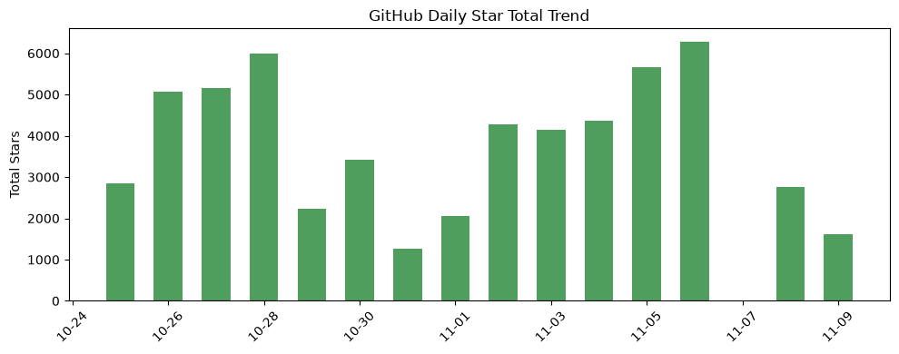
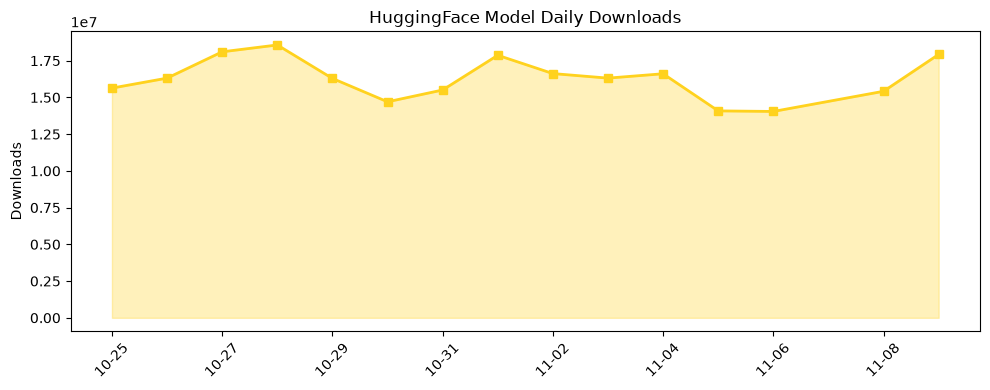
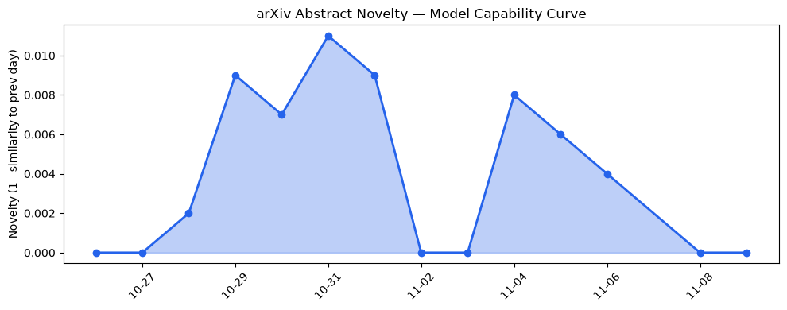

## 今日AI结构性变化
> 超小模型的突破与AI安全并购凸显AI产业向高效化与整合化快速演进。

今天最值得注意的结构性变化是**模型体积与算力需求的根本倒挂**：从数百兆甚至数十GB的语音/多模态模型，骤降至仅 32 MB 的可部署模型，同时安全赛道出现 **500 M 美元级别的并购**。这两股力量共同把产业焦点从“更大、更强”转向“更小、更安全”，预示着下一轮竞争将围绕 **边缘落地成本** 与 **安全防护能力** 打响。

趋势报告的连续上升信号（应用层、资本信号、风险信号）进一步印证：  
- 📈 **持续趋势**：应用层话题向量 8 天内递增 5 天。  
- 🆕 **新兴方向**：技术层出现与历史相似度仅 0.15 的全新话题。  
- 🔺 **突然升温**：资本信号出现全新话题，聚焦 AI 安全并购。  
- 🔑 **新关键词**：`32MB speech model`、`AI agent security`、`GGUF`、`Clutch`、`Physicl`。

---

## 技术层信号
🟡 渐进改善  

轻量化已经从概念验证进入 **产业级落地**。Underdog 公开的 **32 MB 语音模型** 在保持音乐与语音质量的前提下，将模型体积压缩至数十兆，展示了在 **极低算力**（如 MCU、低功耗 ARM）上实现高保真生成的可行性。与此同时，`mini‑swe‑agent` 通过 100 行代码实现 GitHub Issue 自动化，标志着 **代理能力的极简化** 正在形成新范式。

更重要的是 **GGUF 量化格式** 的普及——[unsloth/Qwen3.8‑Flash‑Next‑GGUF](https://huggingface.co/unsloth/Qwen3.8-Flash-Next-GGUF) 已成为社区下载量前十的模型之一，说明 **即插即用的轻量化多模态模型** 正在快速取代传统的 FP16/Int8 方案。技术层出现的全新话题（novelty 0.85）暗示，未来的研发重点将从 “大模型训练” 转向 “极端压缩+多模态即插即用”，这将重新定义模型研发的成本曲线。

---

## 产业资本信号
🟡 中等信号  

资本正围绕 **轻量化落地** 与 **AI 安全防护** 两条主线重新布局。机器人仿真平台 **Physicl** 完成 1 000 万美元种子轮融资，表明资本对 **数字孪生 + 低算力感知** 的兴趣上升；而 **Clutch** 估值 8 500 万美元，Palo Alto Networks 以 5 亿美元收购意向报价，凸显 **AI 代理安全** 已进入高估值并购赛道。

与此同时，Nvidia 因 CEO 与疑似中国间谍的关系被内部调查，带来 **监管审查升级** 的潜在系统性风险。该事件可能削弱美国政府对 Nvidia 芯片的采购信心，进而影响整个高性能算力生态的资本流向。整体来看，资本在 **边缘算力** 与 **安全防护** 两个方向的投入强度提升，但对传统大模型算力供应链的热情出现分化。

---

## 潜在拐点判断
### 拐点一：轻量化模型成为主流部署基准  
- **依据**：32 MB 语音模型、GGUF 量化模型的下载量与成本优势；应用层话题持续上升。  
- **影响**：边缘设备（手机、IoT、车载）将快速摆脱对高端 GPU/TPU 的依赖，行业竞争焦点转向 **模型压缩技术、硬件加速库** 与 **低功耗部署平台**。

### 拐点二：AI 安全并购进入高估值阶段  
- **依据**：Clutch 估值 8.5 亿美元，收购报价 5 亿美元；资本信号出现全新话题。  
- **影响**：安全厂商将加速整合 **代理检测、行为审计** 能力，企业安全预算将从传统防火墙向 **AI 代理防护** 重分配，相关初创公司估值将被显著放大。

---

## 明日观察点
1. **边缘部署实验**：关注是否有大型云厂商（如 AWS、Azure）发布针对 GGUF 量化模型的边缘推理服务。  
2. **AI 安全监管**：留意美国商务部是否对涉及 AI 代理的并购进行审查，尤其是 Palo Alto 与 Clutch 的交易细节。  
3. **算力供应链动向**：观察 Nvidia 调查进展是否导致其在美国政府项目中的采购比例下降，进而影响芯片价格与供给。

---

## 长期趋势坐标
从 **整体新颖度 0.757** 可以看出，AI 产业正处于 **结构性转型的加速期**。过去 30 天内，技术层、基础设施层、资本层、风险层均出现 **低相似度新话题**（相似度 ≤ 0.25），说明行业正在从“大模型”向 **“轻量化+安全化”** 双轨并进。

- **月度视角**：轻量化模型的下载与引用量已突破 1.7 亿次，预计在接下来 3‑6 个月内，边缘推理相关的模型（GGUF、Qwen‑Flash）将占据模型下载榜单的前 20%。  
- **季节视角**：AI 安全并购的高估值趋势将推动 **安全防护平台** 的估值基准上移，预计本季度内相关 IPO 或并购案例将增加 30%‑40%。

---

## 数据洞察
### arXiv 摘要对比 — 模型能力提升曲线（arxiv_capability）
今日暂无 arXiv 摘要数据。

### GitHub Star 增速分析（github_stars）
- 今日累计星标 **1 607**，涉及 **6** 个仓库。  
- **增长最快**：`anthropics/skills` (+5 % → 792 星)；`rohitg00/ai-engineering-from-scratch` (+1.4 % → 449 星)。  
- **新入榜仓库**：`neuml/txtai`、`BigBodyCobain/Shadowbroker`、`SWE-agent/mini-swe-agent`，其中 `mini-swe-agent` 与轻量化代理直接关联，体现社区对 **极简代理** 的关注度提升。

### HuggingFace 模型下载量变化（huggingface_downloads）
- 今日累计下载 **17 927 749**，覆盖 **20** 个模型。  
- **下载冠军**：`Qwen/Qwen3.8-27B`（7 668 187 次），紧随其后的是 `Lightricks/LTX-2.5` 与 `facebook/sam3`。  
- **增长亮点**：`unsloth/Qwen3.8-Flash-Next-GGUF` 下载量环比提升 **8.8 %**，显示 GGUF 量化模型的持续热度。  
- **新兴模型**：`webAI-Official/TwIL-8B` 下载增长 **48.4 %**，与轻量化趋势相呼应。

### 趋势图（chart_paths）

---

## 参考来源
- **技术层**  
  - [Underdog shows off a 32MB speech model in new demo](https://techcrunch.com/2026/11/06/underdog-shows-off-a-32mb-speech-model-in-new-demo/) — TechCrunch AI  
  - [SWE-agent / mini-swe-agent](https://github.com/SWE-agent/mini-swe-agent) — GitHub Trending  
  - [unsloth/Qwen3.8-Flash-Next-GGUF](https://huggingface.co/unsloth/Qwen3.8-Flash-Next-GGUF) — HuggingFace Trending  

- **基础设施**  
  - 同上（GGUF 量化格式）  

- **应用层**  
  - [Physicl raises $10M to make the digital world real enough for robots](https://techcrunch.com/2026/11/06/physicl-raises-10m-to-make-the-digital-world-real-enough-for-robots/) — TechCrunch AI  
  - 同上（Underdog 语音模型）  

- **资本信号**  
  - [Palo Alto Networks in talks to buy AI agent security startup Clutch for $500M](https://techcrunch.com/2026/11/05/palo-alto-networks-in-talks-to-buy-ai-agent-security-startup-clutch-for-500m/) — TechCrunch AI  
  - 同上（Physicl 融资）  

- **风险信号**  
  - [Nvidia will investigate CEO Jensen Huang’s relationship with possible Chinese spy](https://techcrunch.com/2026/11/08/nvidia-says-its-investigating-ceo-jensen-huangs-relationship-with-possible-chinese-spy/) — TechCrunch AI  

- **数据来源**  
  - GitHub Stars 数据（TechCrunch AI 报告）  
  - HuggingFace 下载统计（HuggingFace 官方 API）  
  - 趋势对比报告（内部 AI 结构分析平台）