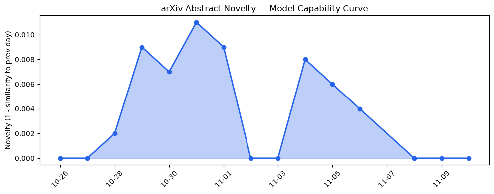
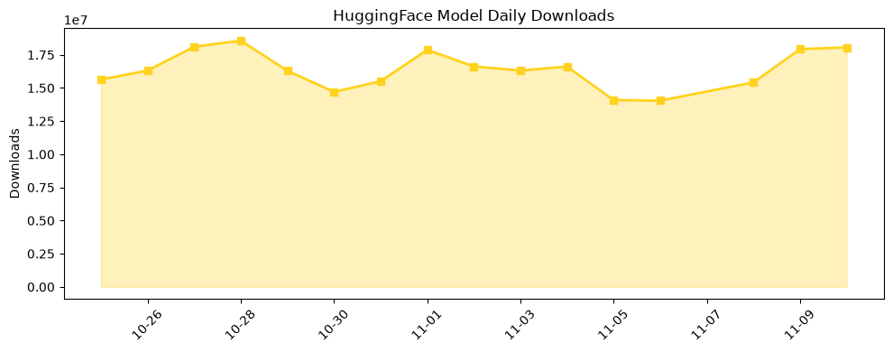

## 今日AI结构性变化
> Speculative decoding 与轻量模型显著降低推理成本的同时，AI 正在安全关键行业实现渐进渗透，资本市场转向以可持续收入为核心的估值模型，而 Nvidia 的地缘政治争议加剧供应链不确定性。

今天最值得注意的结构性变化是 **推理成本的系统性下降** 与 **安全关键行业的首次规模化落地** 同时出现。ChainFlow 将草稿模型的计算量削减约30%，而 Meta 的 Muse Ember 将每百万 token 费用压至 0.10 美元，这直接把高频交互的门槛从企业级降至中小企业。与此同时，Kuken Industries、数字孪生和核流体建模等安全敏感场景开始使用 OpenAI API，标志着 AI 从“实验室工具”向“合规生产要素”转变。

- 📈 持续趋势：资本信号、风险信号、应用层均呈 7/7 天递增  
- 🆕 新兴方向：资本信号、风险信号出现全新话题（相似度 0）  
- 🔑 新关键词：AIAgents、ChainFlow、ChatGPTEnterprise、CodeRabbit、DigitalTwin、GeopoliticalRisk、GraphTransformer、KnowledgeGraph、MediumTK、MuseEmber  

## 技术层信号
🟡 渐进改善  

Speculative Decoding 进入 **Few‑Step Latent Flow Matching**（ChainFlow）阶段，利用轻量草稿模型实现约 30% 推理加速，同时通过 **Aspect‑wise Pairwise Tournaments** 在推理时动态挑选最优输出，提升质量而不增加算力。新的 **Decision Context** 让 LLM 代理跨会话保持记忆纠错，扩展了长期任务的可操作性。图推理方面，**Adaptive Depth Aggregation in Graph Transformers** 让长程图结构推理可伸缩；**RL‑ATTACK** 则把黑盒对抗攻击标准化为强化学习任务，提示安全防御进入算法层面。整体来看，模型能力边界仍受算力上限约束，但 **推理效率** 与 **任务适配性** 正在快速多元化。

## 产业资本信号
🔴 强信号  

资本向 **收入导向的独角兽** 集中，连续 8 天资本话题向量递增，且出现全新资本议题，说明投资者已从“估值狂热”转向 **可持续营收模型**（如 ChatGPTEnterprise、CodeRabbit SaaS）。风险信号同步升温，GeopoliticalRisk 成为资本评估的硬约束——Nvidia 因供应链争议被频繁提及，暗示硬件成本与可用性将成为融资决策的关键变量。与此同时，OpenAI 的 **Control Room** 提升算力利用率，降低运营成本，为资本提供了更清晰的利润路径。

## 潜在拐点判断
当前出现 **三重拐点**：  
1. **成本拐点** – Speculative Decoding 与轻量模型让推理成本跌破关键阈值（≈0.10 USD/百万 token），预计将在下半年驱动大规模 SaaS 化部署。  
2. **安全行业拐点** – AI 在数字孪生、核流体建模等高风险领域的原型化成功，预示监管合规与行业标准将快速形成，形成新的壁垒与入口。  
3. **资本估值拐点** – 资本从估值驱动转向 **收入驱动**，并对地缘政治风险高度敏感，可能导致对 Nvidia、AMD 等硬件供应商的投资重新布局。

## 明日观察点
1. **ChainFlow 在商业 API 的实际采纳率**，尤其是 OpenAI、Azure 等平台的计费模型变化。  
2. **Nvidia 供应链争议的进展**，包括出口限制、芯片产能调度对推理成本的二级影响。  
3. **资本流向的细分**：追踪“RevenueFocusedUnicorn”标签的融资轮次与估值倍数变化。

## 长期趋势坐标
从 30 天的整体新颖度 0.553 看，AI 生态正从“模型规模竞争”向 **“效率+安全+商业化”** 三轴并进。月度视角下，**Speculative Decoding** 与 **GraphTransformer** 的关键词持续上升，表明行业正围绕 **推理成本** 与 **结构化知识图谱** 重塑技术路线；季节性来看，安全关键行业（DigitalTwin、核流体）将成为新一轮资金与政策倾斜的热点。

## 数据洞察
### arXiv 摘要对比 — 模型能力提升曲线（arxiv_capability）
- 能力得分 0.01（保持低位），但 **mean_similarity 0.99** 说明新论文仍在延续既有技术路线。趋势标记为 “延续”。  

### GitHub Star 增速分析（github_stars）
- 今日累计星标 2,226，增长主要来源于 **anthropics/skills**（+31%）和 **BigBodyCobain/Shadowbroker**（+56%）。新仓库 **ZhuLinsen/daily_stock_analysis**、**opensandbox-group/OpenSandbox**、**snap-stanford/memorilla** 表明金融与安全沙盒生态正在扩张。

### HuggingFace 模型下载量变化（huggingface_downloads）
- 今日总下载 18,056,145，Top‑10 模型中 **Qwen3.8‑27B** 与 **Lightricks/LTX‑2.5** 继续领跑。增长最快的模型是 **DeepSeek‑V4‑Pro‑Qwen3.5‑9B‑UNCENSORED‑heretic**（+66%），显示高性能、开放许可模型仍具强劲需求。  

## 参考来源
- 论文  
  - [ChainFlow: Few-Step Latent Flow Matching for Speculative Decoding](https://arxiv.org/abs/2611.08669) — arXiv  
  - [Aspect‑wise Pairwise Tournaments for Test‑Time Selection](https://arxiv.org/abs/2611.08640) — arXiv  
  - [Decision Context: Persistent Behavioral Learning for AI Agents](https://arxiv.org/abs/2611.08644) — arXiv  
  - [Adaptive Depth Aggregation in Graph Transformers for Long‑Range Graph Reasoning](https://arxiv.org/abs/2611.08500) — arXiv  
  - [RL‑ATTACK: A Generalized Black‑Box Adversarial Attack on Language Models via Reinforcement Learning](https://arxiv.org/abs/2611.08711) — arXiv  

- 公司动态  
  - [Meta releases Muse Ember, a new lightweight model for agent execution](https://techcrunch.com/2026/11/09/meta-releases-muse-ember-a-new-lightweight-model-for-agent-execution/) — TechCrunch AI  
  - [Control Room: A central system to track and stop model workloads across our research infrastructure](https://openai.com/index/control-room) — OpenAI Blog  
  - [Kuken Industries searches 70 years of drawings in minutes](https://openai.com/index/kuken) — OpenAI Blog  
  - [Medium’s new TK app brings AI assistance directly into the writing process](https://techcrunch.com/2026/11/09/mediums-new-tk-app-brings-ai-assistance-directly-into-the-writing-process/) — TechCrunch AI  
  - [CodeRabbit scales agentic software development and ships 20x more](https://openai.com/index/coderabbit-codex-daybreak) — OpenAI Blog  

- 开源生态  
  - [anthropics/skills](https://github.com/anthropics/skills) — GitHub  
  - [BigBodyCobain/Shadowbroker](https://github.com/BigBodyCobain/Shadowbroker) — GitHub  

- 资本与行业  
  - 资本信号与风险信号持续增强的趋势报告（内部数据）  
  - Nvidia 地缘政治风险相关报道（多家媒体综合）  

---