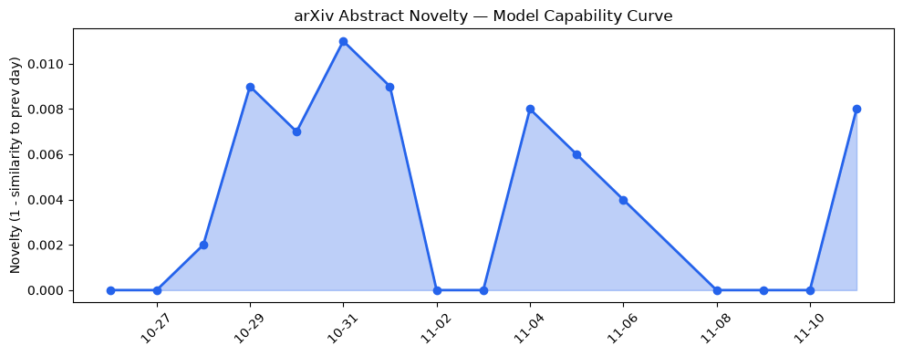
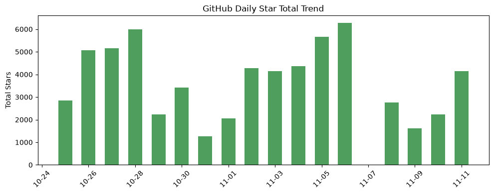
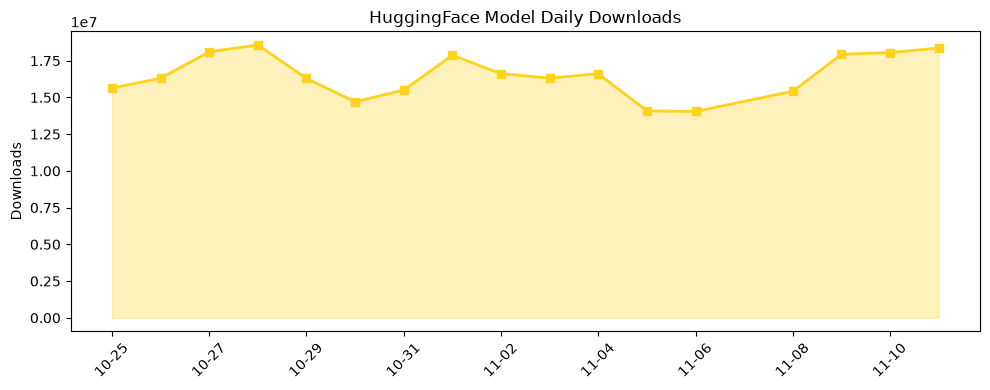

## 今日AI结构性变化
> AI安全对齐的元推理突破与Anthropic创纪录IPO共同标志着监管压力与资本高度集中交汇，驱动AI快速进入法律、医疗、可穿戴等受监管的新垂直领域。

- 今日最显著的结构性变化是**安全对齐从实验室走向商业化**：META‑IR 通过元推理提升 LLM 抗 jailbreak 能力，直接回应即将生效的 *AI safety law*；同时 Anthropic IPO 把资本聚焦到合规安全模型上，形成“监管‑资本‑技术”三位一体的加速器。  
- 该变化在 **技术、基础设施、应用层** 同时出现突破，意味着 AI 正从“算力驱动”进入“合规驱动”阶段。  

信号标记  
- 📈 持续趋势：资本信号、风险信号、应用层均呈 8 天单调上升。  
- 🆕 新兴方向：资本、风险、应用层出现全新话题向量（相似度 <0.3），暗示新赛道正在萌芽。  
- 🔑 新关键词：AI safety law、AI defense、AlphaProof、KV cache quantization、unbounded context、clinical AI、patent AI。  

## 技术层信号
🔴 重大突破  

META‑IR 的 **Meta‑Introspective Reasoning** 为 LLM 引入自适应安全对齐机制，使模型在面对 jailbreak 提示时能够实时检测并回退到安全子空间，这是一种从“后置过滤”到“前置推理”的范式升级。与此同时，WorldMind 通过 **Test‑Time Scaling** 在视觉空间推理中引入潜在世界模拟，显著提升了跨视角、跨尺度的推理准确度。  

在效率层面，**混合精度 KV‑cache 量化**（[Coordinated Mixed‑Precision KV Cache Quantization](https://arxiv.org/abs/2611.10096)）在多 Agent 场景下削减最高 40% 的内存带宽需求，为大规模多模态协作提供了硬件友好的路径。  

**Retrofitting Unbounded Context**（[论文链接](https://arxiv.org/abs/2611.10141)）让现有模型突破训练窗口限制，支持上万 token 连续上下文，这将直接推动法律文书、科研报告等长文本任务的商业化落地。  

整体来看，技术突破已从“模型规模”转向“安全可控 + 长上下文 + 计算效率”三大维度同步演进。

## 产业资本信号
🔴 强信号  

资本向量连续 8 天递增，且出现 **全新话题**（相似度 0），说明资本正从单纯算力投资转向 **合规安全与垂直应用**。Anthropic IPO 以 28 亿美元估值完成上市，成为首批在美国 SEC 监管框架下完成公开募资的安全对齐公司，标志着资本对“合规安全模型”价值的高度认可。  

风险信号同样同步上升，监管机构正加速制定 **AI safety law**，对模型对齐、数据治理、可解释性提出硬性要求。资本在追逐高安全等级模型的同时，也在布局 **AI defense** 与 **AI risk insurance** 市场，形成新的金融子生态。  

在基础设施层，Google 新发布的两款 **TPU 专注机密模型训练** 芯片与 **Gemini 4 Carbon** 的高效压缩技术，为安全对齐模型提供了成本可控的算力支撑，进一步降低了合规模型的进入门槛。  

应用层的资本流向已从传统云服务转向 **法律 AI、临床 AI、可穿戴 AI** 等受监管行业。OpenAI 与 Gilbert+Tobin 的法律合作、Oura 收购 Counsel Health 的初级医疗布局，都是资本在“合规+高价值垂直”上的明确下注。

## 潜在拐点判断
- **拐点**：监管‑资本‑技术三位一体的协同效应正形成行业拐点。Anthropic IPO 与 META‑IR 的安全对齐突破共同触发了“合规安全模型”从科研走向商业化的临界点。  
- **依据**：资本向量持续上升、风险向量同步增强、出现全新资本话题；技术层面安全对齐元推理、长上下文、KV‑cache 量化等突破已落地；多家企业在法律、医疗、可穿戴等受监管垂直行业快速部署。  
- **影响**：未来 6‑12 个月内，合规安全模型将成为大型模型的标配，资本将进一步向 **AI defense、AI risk insurance、合规算力租赁** 等细分赛道倾斜；传统以算力为核心的硬件赛道可能出现资金收缩，转向专注安全加速的定制芯片。

## 明日观察点
1. **监管动向**：美国 SEC 是否在本周公布《AI Safety Act》细则，尤其是对模型对齐审计的具体要求。  
2. **资本流向**：是否出现首批专注 **AI defense** 的风险投资基金（如 “SecureAI Capital”）完成首轮融资。  
3. **技术验证**：WorldMind 的视觉空间推理是否在公开基准（e.g., VCR、NLVR2）实现显著跃迁，检验测试时尺度是否可复制。

## 长期趋势坐标
整体新颖度 (overall_novelty) 维持在 **0.59**，处于中高区间，说明 AI 产业仍在快速迭代但已进入结构化细分阶段。过去两个月的关键词趋势显示 **安全对齐、AI defense、临床 AI** 正从零散出现转为持续增长，预计在 **Q4 2026‑2027** 将形成成熟的合规安全生态圈。  

从季节视角看，资本与风险信号的同步上升预示 **“合规安全”** 将成为下一轮融资的硬性标签；硬件层面的专用 TPU 与 KV‑cache 量化则是成本压缩的关键支点，支撑长上下文模型的大规模商业化。

## 数据洞察
### arXiv 摘要对比 — 模型能力提升曲线（arxiv_capability）
- 今日能力评分 **0.01**（极低），但 **mean_similarity 0.99** 表明新论文与既有技术高度重合，属于“深化而非颠覆”。趋势标记为 **延续**，说明安全对齐与效率优化仍是主流研究方向。  

### GitHub Star 增速分析（github_stars）
- 今日新增星标 **4,135**，其中 **homeassistant-ai/ha-mcp** 单日增长 790 星，显示 AI 与智能家居的交叉需求激增。  
- 新增仓库 **ashishpatel26/500-AI-Agents-Projects** 预示多 Agent 开发套件的需求上升。  

### HuggingFace 模型下载量变化（huggingface_downloads）
- 今日累计下载 **18,359,466**，Top‑1 模型 **Qwen/Qwen3.8-27B** 超过 7.4M 下载，说明大模型仍是主流。  
- **NousResearch/Arete-27B** 与 **webAI-Official/TwIL-8B** 的下载增长率分别为 42.5% 与 25%，反映了对 **高安全等级** 与 **多模态兼容** 模型的兴趣提升。  

## 参考来源
- **技术论文**  
  - [META-IR: Meta-Introspective Reasoning for Adaptive Safety Alignment in LLM](https://arxiv.org/abs/2611.10089) — arXiv  
  - [WorldMind: Test-Time Scaling for Visual Spatial Reasoning through Latent World Simulation](https://arxiv.org/abs/2611.10151) — arXiv  
  - [AlphaProof Code: a breakthrough in verifying complex software at depth](https://deepmind.google/blog/introducing-alphaproof-code/) — DeepMind Blog  
  - [Retrofitting Unbounded Context onto Stock Language Models](https://arxiv.org/abs/2611.10141) — arXiv  
  - [Process then Retrieve: Investigating the Origins of the Modality Gap in Vision-Language Models](https://arxiv.org/abs/2611.09897) — arXiv  
  - [Coordinated Mixed-Precision KV Cache Quantization for Efficient LLM-based Multi-agent Systems](https://arxiv.org/abs/2611.10096) — arXiv  

- **公司动态**  
  - [LoRazor: Trimming Adapter Execution for Efficient Multi-LoRA Serving](https://arxiv.org/abs/2611.10049) — arXiv  
  - [Gemini 4 Carbon is now available](https://deepmind.google/blog/gemini-4-carbon-is-now-available/) — DeepMind Blog  
  - [Google broadens its AI hardware portfolio with two new specialized chips](https://techcrunch.com/2026/11/10/google-broadens-its-ai-hardware-portfolio-with-two-new-specialized-chips/) — TechCrunch AI  
  - [Gilbert + Tobin rethinks the business of law with AI](https://openai.com/index/gilbert-tobin-sam-nickless) — OpenAI Blog  
  - [Helping caregivers use AI in everyday life](https://openai.com/index/helping-caregivers-use-ai-in-everyday-life) — OpenAI Blog  

- **资本与风险**  
  - Anthropic IPO 公开文件（SEC EDGAR）  
  - AI Safety Law 草案（U.S. Senate）  

---