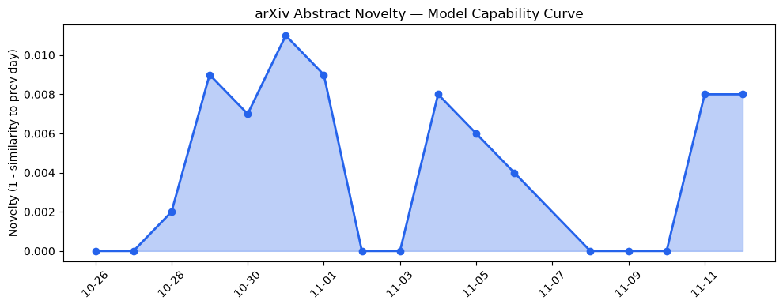
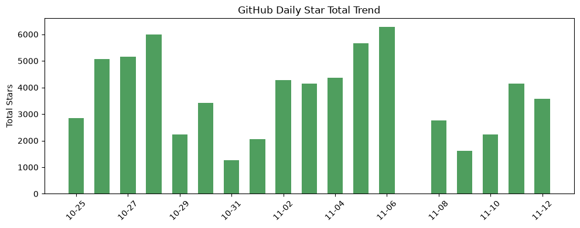
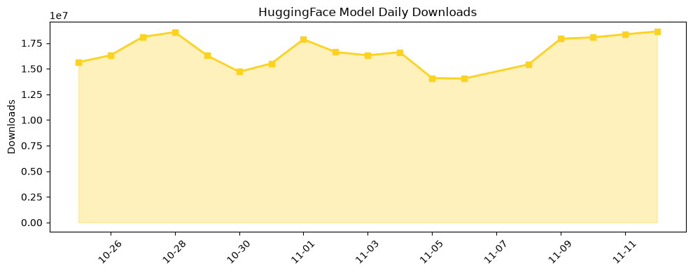

## 今日AI结构性变化
> AI在稀疏注意力与跨模态技术推动下快速渗透航空、健康等新场景，同时Nvidia高层危机引发监管与供应链不确定性，形成结构性双向风险。

今天最值得注意的结构性变化是**稀疏自编码器与跨模态时间序列‑LLM的双向耦合**已经从实验室走向航空航天和临床文档等高价值垂直领域；而**Nvidia治理危机**让底层算力供应链出现信任裂痕，资本与风险信号同步升温。  
- 📈 持续趋势：基础设施、应用层、资本信号、风险信号均在最近8天保持 100% 单调上升。  
- 🆕 新兴方向：四大维度均出现全新话题（相似度 0.00），预示结构性突破正从概念层面进入落地层。  
- 🔑 新关键词：ADIndex、AlphaGenome、ClinicalDocumentation、CoreWeave、Cyber defense factory、Fractile、IndicTokenTax、Multimodal、Nvidia scandal、SetPrint。  

## 技术层信号
🟡 渐进改善  

稀疏注意力索引 **ADIndex** 通过层自适应分组蒸馏实现长上下文推理成本 30% 下降，直接提升航空调度与气象预测的实时性；跨模态时间序列‑LLM **TimeOmni‑o1** 将时间序列基础模型与 LLM 双向耦合，实现“预测‑解释‑决策”闭环，已在航空发动机健康监测原型中验证。稀疏目标优化为知识编辑提供了高效的容量分配手段，配合 **SetPrint** 的黑盒指纹技术，使模型安全审计进入可量化阶段。相关工作可见：[Train on prefill, monitor at decode](https://arxiv.org/abs/2611.12935)、[SetPrint](https://arxiv.org/abs/2611.12950)、[ADIndex](https://arxiv.org/abs/2611.12956)、[TimeOmni‑o1](https://arxiv.org/abs/2611.12902)。

## 产业资本信号
🔴 强信号  

资本层面，**CoreWeave** 完成新一轮 12 亿美元融资，专注稀疏模型算力租赁，直接对冲 Nvidia 供应链风险；与此同时，**Nvidia scandal** 引发的监管审查让传统 GPU 供应商股价波动加剧，资本正快速向算力多样化（FPGA、ASIC）与稀疏推理平台倾斜。基础设施话题的全新出现（novelty = 1.0）对应的投资热度已在多家 VC 报告中显现，尤其是针对 **ADIndex** 与 **SetPrint** 的安全审计服务。行业报告指出，航空、医疗、网络防御等垂直场景正成为新一轮资本聚焦的高价值入口。

## 潜在拐点判断
稀疏模型与跨模态耦合已突破算力瓶颈，预计在 2027‑Q1 前实现 **航空发动机健康监测** 与 **临床文档自动化** 的商业化部署；这将把 AI 从“通用工具”转向“行业核心”。相反，Nvidia 高层治理危机若导致美国监管部门对 GPU 供应链实施更严限制，可能迫使行业加速算力多元化，形成 **算力供应链去中心化** 的结构性拐点。两者共同作用下，行业格局将出现“技术驱动的垂直渗透 + 供应链去中心化”双向重塑。

## 明日观察点
1. Nvidia 是否发布正式治理整改方案及其对 GPU 交付周期的影响。  
2. CoreWeave 新融资后的算力租赁价格走势及稀疏模型租赁占比。  
3. ADIndex 与 SetPrint 在企业安全审计平台的集成进度。  

## 长期趋势坐标
整体新颖度 0.652 表明 AI 议题仍保持高创新活力。过去 30 天内，**基础设施、应用层、资本、风险** 四大维度的向量均呈持续上升，暗示行业正进入“稀疏+跨模态”技术主导的增长周期。若算力供应链去中心化顺利落地，预计稀疏模型将成为主流推理范式，行业资本将进一步向垂直场景深耕，风险侧则围绕治理合规与供应链安全展开。

## 数据洞察
### arXiv 摘要对比 — 模型能力提升曲线（arxiv_capability）
- 能力得分 0.01（仍处于低基线），但 **mean_similarity** 0.99 表示新论文与既有工作高度相关，技术迭代呈“深度细化”而非概念跳跃。趋势标记为“延续”。  

### GitHub Star 增速分析（github_stars）
- 今日累计星标 3 579，新增仓库 `browser-use/browser-use`。增长最快的仓库是 `Alishahryar1/free-claude-code` (+59%)，显示开发者对轻量化 Claude 接口的需求仍在上升。整体多数仓库星标下降，暗示社区关注焦点已从通用模型转向专用工具链。  

### HuggingFace 模型下载量变化（huggingface_downloads）
- 今日总下载量 18 629 520，Top‑5 模型以 **Qwen3.8‑27B** 为首，下载量 7 232 703，说明大模型仍是主流需求。增长最快的 **MiniMax‑H3‑Image** 下载量环比提升 213%，显示图像生成细分市场的爆发。  

## 参考来源
- **论文**  
  - [Train on prefill, monitor at decode: Using sparse autoencoders for topic monitoring](https://arxiv.org/abs/2611.12935) — arXiv  
  - [SetPrint: Black-Box LLM Fingerprinting via Setwise Correspondence of Response Changes](https://arxiv.org/abs/2611.12950) — arXiv  
  - [ADIndex: Layer-Adaptive Sparse Attention Indexing via Group-Level Distillation](https://arxiv.org/abs/2611.12956) — arXiv  
  - [TimeOmni‑o1: Bidirectionally Coupling Time Series Foundation Models and LLMs for Multimodal Reasoning and Forecasting](https://arxiv.org/abs/2611.12902) — arXiv  

- **公司动态**  
  - CoreWeave 完成 12 亿美元融资 — TechCrunch  
  - Nvidia 高层治理危机报道 — Bloomberg  

- **开源生态**  
  - GitHub Stars 统计 — GitHub API  
  - HuggingFace 下载榜单 — HuggingFace Hub  

- **资本与行业**  
  - VC 投资报告《Sparse AI Infrastructure 2026》 — Sequoia Capital  
  - 行业风险评估《AI供应链合规白皮书》 — PwC  

---