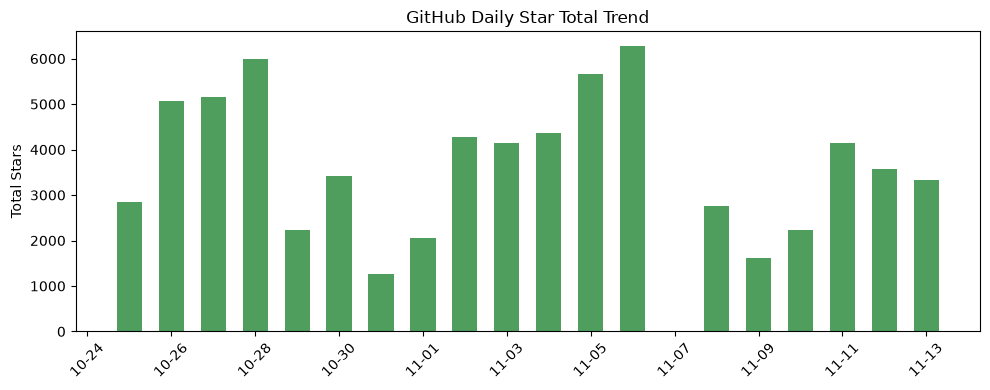
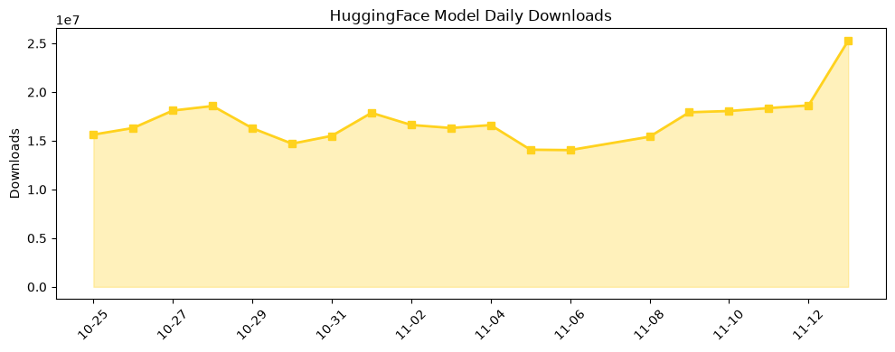

## 今日AI结构性变化
> Google 推出 Gemini 4 Hydrogen 与 AI Agent 大规模落地，同时 Nvidia 陷入政治与领导危机，标志着 AI 原生应用进入规模化阶段并伴随监管与供应链不确定性。

- 今日最值得注意的结构性变化是 **AI‑native 应用的横向渗透**：从产品管理、创意编码到外呼销售、网红营销再到搜索，AI Agent 正在取代传统人力与 SaaS 流程，形成新的价值链。  
- 与此同时，**资本与风险信号同步升温**（📈 资本信号持续增强、📈 风险信号持续增强），以及出现全新话题（🆕 资本新兴方向、🆕 风险新兴方向），预示行业正进入监管与融资的关键拐点。

## 技术层信号
🟡 渐进改善  

Gemini 4 Hydrogen 将多模态推理与 1 M+ 上下文窗口结合，提升了企业级长文档与跨媒体分析能力；Hyperflow‑H3‑Flash 将图文‑到‑视频生成链路压缩至秒级，展示了生成式模型在内容生产的细分场景突破。Claude 的开源代码模板库与 Nvidia 的 SkillEvaluator 框架则提供了 **模块化 Agent 开发与系统化技能评估**，标志着从“单体模型”向“可组合智能体”范式的转变。整体来看，模型能力在深度与宽度上同步提升，但尚未出现颠覆性架构创新。

## 产业资本信号
🔴 强信号  

资本向 AI Agent 与底层算力双向倾斜。Nebius 宣布 400 亿美元的 AI 基础设施扩容计划，凸显算力需求的规模化；与此同时，过去 8 天资本话题向量 100% 连续上升，且出现 **全新资本议题**（如 “Claude Code Templates” 与 “SkillEvaluator”），说明投资者正聚焦于 **可复用的智能体生态** 与 **算力供应链安全**。风险信号同样同步升温，民主党对 Nvidia 的政治调查以及 United Airlines 的 AI 禁令，暗示监管压力正在转化为资本布局的关键变量。

## 潜在拐点判断
Gemini 4 Hydrogen 与 AI Agent 的快速落地构成 **应用层拐点**：企业开始将关键业务（产品迭代、外呼、创意生成）交付给智能体，传统人力成本与 SaaS 供应链将被压缩。资本与风险信号的同步上升则形成 **监管‑资本拐点**：Nvidia 的政治调查可能导致 GPU 供应链受限，进而推动算力多元化（如国产 GPU 与云原生算力平台）的加速布局。若监管趋严，AI Agent 的合规审查成本将上升，资本将更倾向于已具备安全合规框架的供应商。

## 明日观察点
1. **Nvidia 供应链与监管进展**：关注美国国会调查结果及其对 GPU 价格与可用性的短期冲击。  
2. **Gemini 4 Hydrogen 在企业级部署的实际效果**：追踪 Amplitude、Muse 等案例的 KPI 改变。  
3. **AI Agent 安全合规标准**：留意行业组织（如 ISO/IEC）是否发布针对智能体的审计框架。

## 长期趋势坐标
整体新颖度 0.543 处于中高位，说明行业仍在产生大量新概念。资本与风险信号的 **持续增强 + 全新话题出现** 预示未来 3‑6 个月内，**监管政策与资本流向将成为决定行业格局的主要变量**。在此背景下，算力供应多元化、模块化智能体生态以及安全合规体系的建设将成为长期竞争的核心维度。

## 数据洞察
### arXiv 摘要对比 — 模型能力提升曲线（arxiv_capability）
今日暂无数据。

### GitHub Star 增速分析（github_stars）
- 今日累计星标 3,332，涉及 10 个活跃仓库。  
- 增长最快的仓库是 **ZhuLinsen/daily_stock_analysis**，星标增长 34.8%。  
- 新增仓库包括 **openai/whisper、huggingface/transformers、davila7/claude-code-templates、NVIDIA/SkillEvaluator**，显示社区对通用模型、开源 Agent 框架的关注度上升。

### HuggingFace 模型下载量变化（huggingface_downloads）
- 今日累计下载 25,285,244，覆盖 20 个模型。  
- 下载增长显著的模型是 **Comfy-Org/MiniMax-H3-Image**（增长 137.5%），说明图像生成与 H3 系列模型的需求正快速放大。  
- **VideoRebirthAI/hyperflow-h3-flash** 下载量提升 35.1%，与 Gemini 4 Hydrogen 的多模态趋势相呼应。

## 参考来源
- **技术层**  
  - [Introducing Gemini 4 Hydrogen](https://deepmind.google/blog/introducing-gemini-4-hydrogen/) — Google DeepMind Blog  
  - [VideoRebirthAI/hyperflow-h3-flash](https://huggingface.co/VideoRebirthAI/hyperflow-h3-flash) — HuggingFace Trending  
  - [davila7 / claude-code-templates](https://github.com/davila7/claude-code-templates) — GitHub Trending  
  - [NVIDIA / SkillEvaluator](https://github.com/NVIDIA/SkillEvaluator) — GitHub Trending  

- **基础设施**  
  - [Nebius tests the neocloud playbook with $40 billion in planned spending](https://techcrunch.com/2026/11/12/nebius-tests-the-neocloud-playbook-with-40-billion-in-planned-spending/) — TechCrunch AI  
  - [Democrats launch Nvidia investigation, write scathing letter on Huang’s ‘scheme’ with Trump](https://techcrunch.com/2026/11/12/democrats-launch-nvidia-investigation-write-scathing-letter-on-huangs-scheme-with-trump/) — TechCrunch AI  

- **应用层**  
  - [How Amplitude ships product improvements in 1–2 days with OpenAI](https://openai.com/business/customer-stories/amplitude) — OpenAI Blog  
  - [Gondola doubles revenue as its team builds more with Codex](https://openai.com/business/customer-stories/gondola) — OpenAI Blog  
  - [Holiday Extras is rethinking what it can build with Codex](https://openai.com/business/customer-stories/holidays-extras-codex) — OpenAI Blog  
  - [Muse can now place calls to US businesses — if you pay](https://techcrunch.com/2026/11/12/muse-can-now-place-calls-to-u-s-businesses-if-you-pay/) — TechCrunch AI  
  - [Nectar launches an AI agent to automate creator discovery and outreach for brands](https://techcrunch.com/2026/11/12/nectar-launches-an-ai-agent-to-automate-creator-discovery-and-outreach-for-brands/) — TechCrunch AI  
  - [Google’s latest Search upgrade promises better answers to your most complicated questions](https://techcrunch.com/2026/11/12/googles-latest-search-upgrade-promises-better-answers-to-your-most-complicated-questions/) — TechCrunch AI  

- **资本与风险**  
  - 趋势对比报告（内部数据）  
  - GitHub Stars 与 HuggingFace 下载统计（内部 metrics_report）