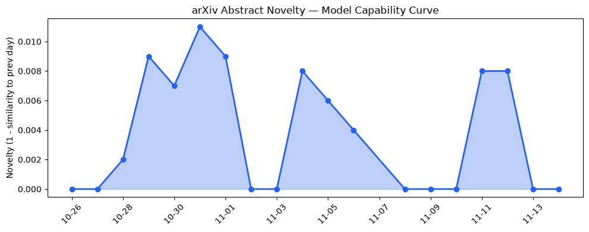
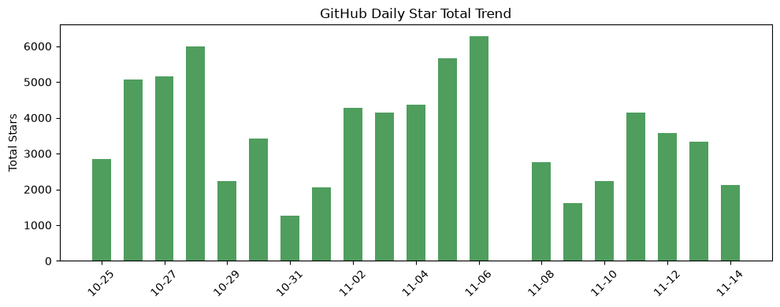
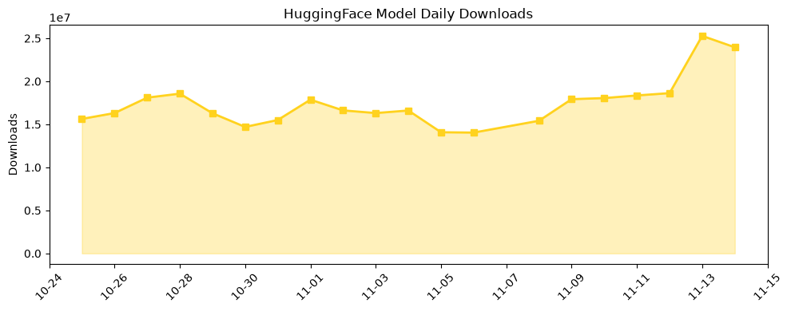

## 今日AI结构性变化
> Nvidia高层动荡触发资本热潮，推动AI基础设施与Agentic AI创新，同时加速AI应用落地并暴露供应链地缘政治风险。

今天最值得注意的结构性变化是：在Nvidia创始人离任的冲击下，资本迅速聚焦于“去中心化算力”和“Agentic AI”两条赛道，导致基础设施层面的持续编译、GPU‑Native 内核融合等技术加速落地；与此同时，AI在电商、运维、会议记录等新场景的渗透速度明显提升。  
这意味着产业链上游的算力供给与下游的业务落地正被同一波资本驱动的结构性力量同步拉动。

- 📈 **资本信号**：最近8天资本话题向量持续递增（7/7 天递增），呈现强劲上行。  
- 📈 **风险信号**：同周期风险话题向量亦同步上升，暗示供应链与地缘政治风险正在被放大。  
- 🆕 **应用层新兴方向**：ChatGPT Wallet、Shield、ElevenLabs 等全新业务模型首次出现，历史相似度仅 0.25。  
- 🆕 **资本新兴话题**：资本向量出现全新话题（相似度 0），表明资金正向未被充分定义的细分赛道倾斜。  
- 🆕 **风险新兴话题**：风险向量同样出现全新话题，提示供应链、合规等潜在冲击点正在形成。

## 技术层信号
🟡 渐进改善  

模型能力边界正通过“持续编译”与“图化经验回放”两条技术路线被重新定义。Together Compiler 提出的 **Continual Compilation for AI Inference**（[arXiv](https://arxiv.org/abs/2611.14681)）让推理部署在同一硬件上实现自适应优化，降低了版本迭代成本。GenPFN（[arXiv](https://arxiv.org/abs/2611.14804)）展示了在表格数据上进行 in‑context 学习的潜力，为工业小样本场景打开了新入口。StructRL（[arXiv](https://arxiv.org/abs/2611.14599)）通过显式 Replay Graph 将强化学习从模型‑Free 向可解释图结构迁移，预示着 RL 训练效率将迎来质的飞跃。与此同时，KernelMosaic（[arXiv](https://arxiv.org/abs/2611.14604)）和 CAFIN（[arXiv](https://arxiv.org/abs/2611.14589)）提供的大规模 CUDA kernel 数据集与 GPU‑Native 内核融合技术，使得大模型在算力密集型任务上的成本下降成为可能。整体来看，技术创新仍属渐进式，但围绕 **Agentic AI** 与 **inference compilation** 的新范式已经形成可观的叠加效应。

## 产业资本信号
🔴 强信号  

Nvidia 创始人 Jensen Huang 的离任在业界引发“资本真空”，但随即出现了创纪录的 AI 初创投资热潮。Crunchbase 报道显示，2026 年上半年 Nvidia 关联的创业融资额创历史新高（[Crunchbase News](https://news.crunchbase.com/venture/huang-nvda-ai-startup-funding-record-2026/)），资本正快速向算力供应链、Agentic AI 平台以及垂直行业落地项目倾斜。与此同时，TechCrunch 揭露的 **出口禁运的 Nvidia 芯片** 已被用于中国最强模型（[TechCrunch AI](https://techcrunch.com/2026/11/13/export-banned-nvidia-chips-are-behind-chinas-most-powerful-ai-models-uh-oh-jensen/)），凸显供应链地缘政治风险正转化为资本布局的决策变量。风险信号的同步上升说明，VC 在追逐高回报的同时，也在加紧对合规、供应链安全的审查力度。

## 潜在拐点判断
**拐点**：Nvidia 高层动荡触发的资本重构。  
**依据**：资本与风险向量在过去 8 天内均出现全新话题且持续递增；同时，算力出口禁运导致的供应链风险被显性化，资本开始向“去中心化算力平台”（如自研编译器、GPU‑Native 内核）和 “Agentic AI” 场景倾斜。  
**影响**：1）算力供给将从单一 GPU 供应商向多元化编译/调度层面分散；2）Agentic AI 可能在 R&D SaaS、金融决策等高价值垂直领域形成先发优势；3）地缘政治风险将成为资本评估的硬约束，促使更多企业布局本土化算力与数据治理。

## 明日观察点
1. **算力供应链监管**：美国对 Nvidia 芯片的进一步出口限制是否会导致国内替代方案加速落地。  
2. **Agentic AI 投融资动向**：是否出现专注于 “Trait Hitchhiking” 与 “Replay Graph” 的新一轮种子轮融资。  
3. **应用层新场景验证**：ChatGPT Wallet 与 Shield 在真实商业环境中的转化率是否突破 30% 关键阈值。

## 长期趋势坐标
整体新颖度（overall_novelty）维持在 **0.617**，说明 AI 产业仍处于高速演进期。新关键词如 **Agentic AI、CUDA、ChatGPT Wallet、Federated Learning** 正在从零点起步，短期内将形成技术与商业双向驱动的叠加效应。中期（3‑6 个月）预计会出现两条主线：一是算力层面的 “持续编译 + GPU‑Native 融合” 成为成本竞争的核心杠杆；二是 Agentic AI 通过 **LangChain** 与 **StructRL** 等框架渗透到研发自动化、金融决策等高价值垂直领域，形成新的增长极。

## 数据洞察
### arXiv 摘要对比 — 模型能力提升曲线（arxiv_capability）
  
今日 arXiv 能力分数 0.009，保持“延续”趋势，说明近期论文在模型能力上仍以细分优化为主，未出现大模型尺度突破。

### GitHub Star 增速分析（github_stars）
  
今日新增星标 2,116，增长主要来自 **volcengine/OpenViking**（+28%）与 **Alishahryar1/free-claude-code**（+24%），显示开源社区对高效推理与代码生成工具的需求持续上升。

### HuggingFace 模型下载量变化（huggingface_downloads）
  
总下载量 23,956,661，Top‑3 模型均为 Qwen 系列大模型，说明国产大模型在全球算力竞争中已占据显著市场份额。增长最快的 **Comfy-Org/MiniMax-H3-Image**（+50%）表明多模态生成仍是热点。

### 趋势图
- arXiv 能力曲线  
- GitHub Stars 趋势  
- HuggingFace 下载趋势  

（图表已嵌入上述章节）

## 参考来源
- **Together Compiler: Continual Compilation for AI Inference** – arXiv, 2026‑11‑14 – [https://arxiv.org/abs/2611.14681](https://arxiv.org/abs/2611.14681)  
- **GenPFN: An In-Context Tabular Foundation Model Approach** – arXiv, 2026‑11‑14 – [https://arxiv.org/abs/2611.14804](https://arxiv.org/abs/2611.14804)  
- **KernelMosaic: An Open Dataset and Agentic Framework for CUDA Kernel Generation** – arXiv, 2026‑11‑14 – [https://arxiv.org/abs/2611.14604](https://arxiv.org/abs/2611.14604)  
- **StructRL: Model-Free Reinforcement Learning with Replay Graphs** – arXiv, 2026‑11‑14 – [https://arxiv.org/abs/2611.14599](https://arxiv.org/abs/2611.14599)  
- **CAFIN: CUDA‑accelerated Adaptive Fisher Information Matrix Network Optimization** – arXiv, 2026‑11‑14 – [https://arxiv.org/abs/2611.14589](https://arxiv.org/abs/2611.14589)  
- **Export‑banned Nvidia chips are behind China’s most powerful AI models** – TechCrunch AI, 2026‑11‑13 – [https://techcrunch.com/2026/11/13/export-banned-nvidia-chips-are-behind-chinas-most-powerful-ai-models-uh-oh-jensen/](https://techcrunch.com/2026/11/13/export-banned-nvidia-chips-are-behind-chinas-most-powerful-ai-models-uh-oh-jensen/)  
- **Jensen Huang’s departure blasts big hole in AI startup funding** – TechCrunch AI, 2026‑11‑13 – [https://techcrunch.com/2026/11/13/jensen-huangs-departure-blasts-big-hole-in-ai-startup-funding-vcs-and-founders-say/](https://techcrunch.com/2026/11/13/jensen-huangs-departure-blasts-big-hole-in-ai-startup-funding-vcs-and-founders-say/)  
- **Crunchbase Data: Nvidia’s Startup Funding Deals Hit A Record** – Crunchbase News, 2026‑11‑13 – [https://news.crunchbase.com/venture/huang-nvda-ai-startup-funding-record-2026/](https://news.crunchbase.com/venture/huang-nvda-ai-startup-funding-record-2026/)  
- **Introducing ChatGPT Wallet** – OpenAI Blog, 2026‑11‑10 – [https://openai.com/index/introducing-chatgpt-wallet](https://openai.com/index/introducing-chatgpt-wallet)  
- **Shield helps technicians hand off legacy portal work with OpenAI** – OpenAI Blog, 2026‑11‑09 – [https://openai.com/business/customer-stories/shield](https://openai.com/business/customer-stories/shield)