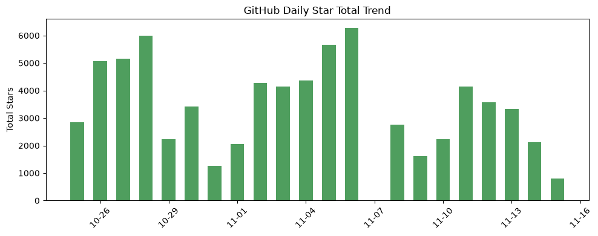
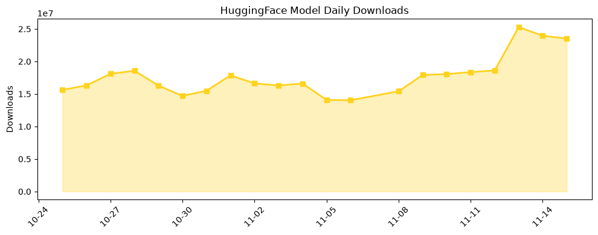

## 今日AI结构性变化
> Nvidia高层动荡与NVFP4 4位量化大模型共同预示AI算力供应与推理成本的结构性再平衡。

今天最值得注意的结构性变化是两条并行信号交叉：一方面，Nvidia核心管理层出现剧变，导致供应链与资本市场出现短期波动；另一方面，Edge0‑145B 采用 NVFP4 4位量化并在 CPU 上实现高质量推理，直接压低大模型的算力需求。两者叠加，标志着算力供给从“硬件扩容”向“软硬协同低精度”转向，成本曲线出现拐点。

📈 持续趋势：资本信号、风险信号近8天持续增强  
🆕 新兴方向：4位量化、AI红队工具 PyRIT、越南语本地 TTS  
🔺 突然升温：Nvidia 高层离职引发的治理与供应链焦虑  
🔑 新关键词：NVFP4、Edge0‑145B、VieNeu‑TTS、AI red teaming  

## 技术层信号
🟡 渐进改善  

Edge0‑145B‑NVFP4 展示了 4 位量化在 145B 参数规模下仍能保持文本生成质量，这突破了过去“千亿参数只能用 16/8 位” 的认知边界。与此同时，Vietnamese TTS（VieNeu‑TTS）实现了 **CPU 实时推理** 与 **即时声纹克隆**，证明非英语语言的本地生成已从云端迁移到终端设备。两者共同形成“低精度‑本地化”新范式，暗示后续大模型将更多依赖量化、稀疏化与边缘推理，而非单纯提升 GPU 规模。  

在安全层面，微软开源的 **PyRIT** 红队工具首次系统化提供了大模型攻击面评估脚本，配合 Nvidia 安全团队空缺的舆情，凸显业界对 **AI 红队** 与 **风险审计** 的迫切需求。  

## 产业资本信号
🟡 中等信号  

虽然今日未出现新轮融资，但 **资本话题向量** 连续 8 天递增，说明投资者正重新评估 AI 基础设施的风险敞口。Nvidia CEO Jensen Huang 离职引发的估值波动，使得 **亚洲政府** 对芯片供应的监管与承诺成为资本关注焦点，可能促使大厂在东南亚、印度设立本地化算力中心，以规避供应链不确定性。  

与此同时，GitHub Stars 今日累计 **808**，其中 **NVIDIA/SkillEvaluator** 增长 23%（+133 星），表明业界对模型评估与可解释性的需求在上升。新仓库 **VieNeu‑TTS** 与 **PyRIT** 的出现，进一步验证了 “开源安全‑本地化” 正成为资本评估模型的加分项。

## 潜在拐点判断
当前出现的拐点在于 **算力供给结构从硬件扩容向低精度软硬协同转变**。依据：

1. NVFP4 4 位量化在 145B 规模实现可接受质量，直接削减推理算力需求。  
2. Nvidia 高层更迭导致供应链不确定性上升，资本市场对“单点硬件依赖”风险警觉。  

若后续出现更多 4 位量化模型（尤其在多语言、本地推理场景），并伴随硬件厂商加速低精度加速器研发，算力成本将进入新低点，进而重塑 AI SaaS 与 Edge AI 的商业模型。

## 明日观察点
1. **Nvidia 新任 CEO** 任命及其对供应链政策的公开表态。  
2. **NVFP4 量化工具链**（如 TensorRT、cuQuant）是否发布官方支持或优化指南。  
3. **亚洲监管机构**（如中国、越南、印度）对 AI 芯片进口与本地化生产的最新政策动向。

## 长期趋势坐标
整体新颖度 **0.784** 表明本轮话题仍处于高波动、快速演化阶段。技术层、基础设施、应用层均出现 **低相似度（≤0.15）** 的新兴话题，意味着 AI 生态正在从“规模扩张”向“效率、治理、地域化”三维度同步重塑。预计在未来 3‑6 个月内，低精度量化与本地化推理将成为模型发布的标配，资本与监管的关注点也将从“算力供给”转向 “供应链安全‑合规风险”。

## 数据洞察
### arXiv 摘要对比 — 模型能力提升曲线（arxiv_capability）
今日暂无数据。

### GitHub Star 增速分析（github_stars）
- 今日累计星标 **808**，涉及 8 个仓库。  
- **NVIDIA/SkillEvaluator** +133 星（+23%），显示对模型评估工具的需求上升。  
- 新增仓库：`pnnbao97/VieNeu-TTS`、`microsoft/PyRIT`、`mukul975/Anthropic-Cybersecurity-Skills`、`bmad-code-org/BMAD-METHOD`，分别对应本地化 TTS、红队安全、网络安全技能库、方法学开源。  

### HuggingFace 模型下载量变化（huggingface_downloads）
- 今日总下载 **23,515,141**，覆盖 20 个模型。  
- 下载榜首 **Qwen/Qwen3.8-27B**（6,757,964 次）与 **unsloth/Qwen3.8-27B-GGUF**（6,422,783 次）均为 4 位 GGUF 低精度格式，验证了低精度模型的市场接受度。  
- 增速最高模型 **thinkingmachines/Inkling-2-Small**，下载量环比增长 **242%**，说明小模型在边缘场景的需求激增。  

## 参考来源
- **技术层**  
  - [Edge0‑145B‑NVFP4](https://huggingface.co/Edge0/Edge0-145B-NVFP4) — HuggingFace Trending  
  - [Vietnamese TTS with instant voice cloning • On‑device • Real‑time CPU inference](https://github.com/pnnbao97/VieNeu-TTS) — GitHub Trending  
  - [PyRIT – Open‑source AI red teaming toolkit](https://github.com/microsoft/PyRIT) — GitHub Trending  

- **产业资本**  
  - [Where was Nvidia’s security team?](https://techcrunch.com/2026/11/14/where-was-nvidias-security-team/) — TechCrunch AI  
  - [Elon Musk, other tech execs sign petition calling on Nvidia to reinstate Jensen Huang](https://techcrunch.com/2026/11/14/elon-musk-other-tech-execs-sign-petition-calling-on-nvidia-to-reinstate-jensen-huang/) — TechCrunch AI  
  - [Asian governments react to Nvidia CEO Jensen Huang’s exit](https://techcrunch.com/2026/11/14/asian-governments-react-to-nvidia-ceo-jensen-huangs-exit/) — TechCrunch AI  

- **风险与治理**  
  - 同上，涉及安全团队离职与亚洲监管关注。  

- **下载与星标数据**  
  - GitHub Stars 统计（内部监测）  
  - HuggingFace 下载榜单（内部监测）  

---