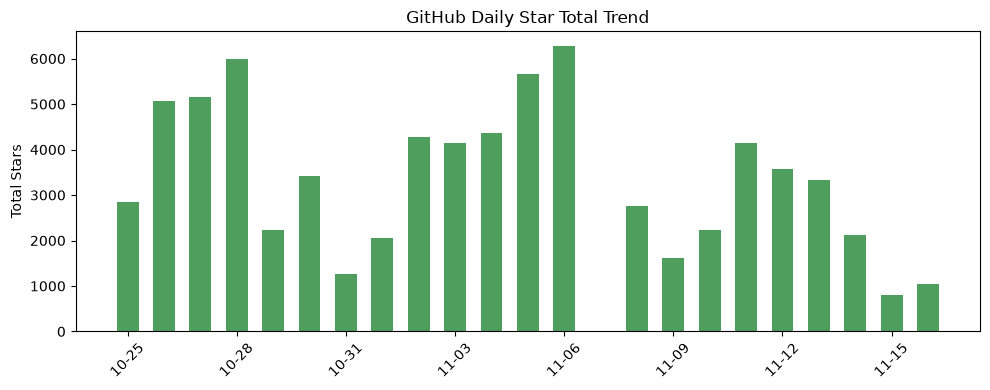
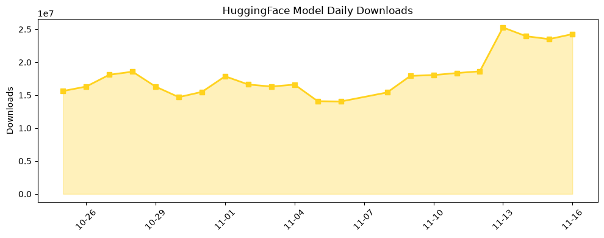
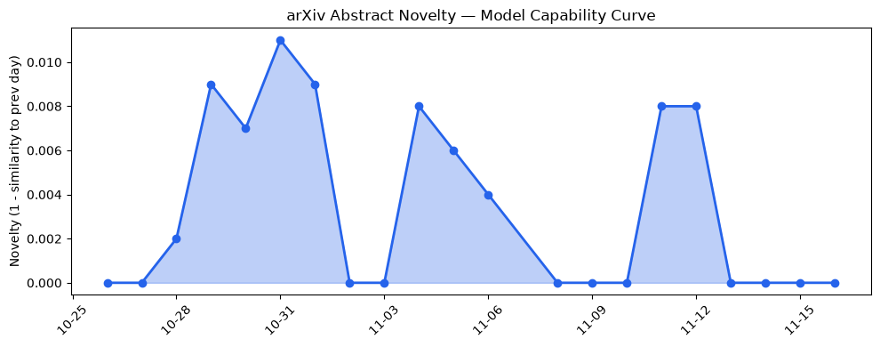

## 今日AI结构性变化
> GPT-6在非扰动格点标准模型证明中的成功应用，标志着大模型从“文本生成工具”向“科学发现伙伴”跃迁，同时AI传感器芯片融资与消费级健康AI的加速布局，预示产业链多元化进入加速期。  

- 📈 资本信号持续增强（近8天递增）  
- 📈 风险信号持续增强（近8天递增）  
- 🆕 技术层出现全新话题（相似度0.23）  
- 🆕 基础设施出现全新话题（相似度0.17）  
- 🆕 应用层出现全新话题（相似度0.17）  
- 🆕 资本信号出现全新话题（相似度0.24）  
- 🆕 风险信号出现全新话题（相似度0.17）  

## 技术层信号
🔴 重大突破

GPT-6 Astra在《A step toward defining the Standard Model on a lattice》博客中协助完成了标准模型的格点非扰动证明，首次展示大模型在高能物理与严谨数学推导中的可操作性。这一突破把大模型从“被动文本工具”升级为“主动科研合作者”，预示AI‑augmented科学研究将成为新范式。与此同时，Haru-4B（[Haru-4B on HuggingFace](https://huggingface.co/higurashi-ai/Haru-4B)）的发布体现了模型规模与多模态能力的快速迭代，进一步印证技术层出现全新话题的信号。

## 产业资本信号
🟡 中等信号

Bharat Semi 获得 2400 万美元种子轮融资（[TechCrunch 报道](https://techcrunch.com/2026/11/15/indian-chip-startup-bharat-semi-lands-24m-seed-round-as-it-eyes-global-ai-sensor-market/)），标志资本正从传统 GPU 生态向专用 AI 传感器、边缘算力布局倾斜。Apple 通过发布 AI 健康研究 App（[TechCrunch 报道](https://techcrunch.com/2026/11/15/apple-launches-new-app-to-study-how-people-use-ai-for-health/)）展示了消费级健康 AI 的商业化意图。风险维度的持续上升与 Nvidia 创始人 Jensen Huang 的负面新闻（[TechCrunch 分析](https://techcrunch.com/2026/11/15/is-bad-news-for-jensen-huang-also-bad-news-for-the-ai-industry/)）可能对 GPU 主导的算力生态形成冲击，资本在此背景下更倾向于分散风险、布局多元算力。

## 潜在拐点判断
GPT-6 在高能物理证明中的成功使用构成**科研 AI 的拐点**：模型不再是后置分析工具，而是参与理论构建、实验设计的前置力量，未来学术期刊、科研基金的评审标准可能将“AI 协同”列入考量。与此同时，Bharat Semi 的融资表明**边缘 AI 硬件进入规模化商业化**，若后续进入量产，GPU 主导的算力格局将被分层化取代，产业链上下游的资本与技术布局将重新洗牌。

## 明日观察点
1. 监测 GPT-6 在其他基础科学领域（量子化学、材料模拟）的后续实验报告。  
2. 跟踪 Bharat Semi 是否在 3 个月内完成系列 A 融资及首批量产芯片交付。  
3. 关注 Apple Health AI App 的用户增长、数据隐私合规进展以及竞争者（如 Google Health）的响应。  

## 长期趋势坐标
整体新颖度 0.731 处于高位，说明 AI 生态正进入 **多维度创新叠加期**。技术层、基础设施、应用层、资本与风险均出现全新话题，意味着行业正从单一算力驱动向 **边缘感知、健康嵌入、科学协同** 三大方向同步演进。资本持续升温与风险同步上升的并行趋势，暗示投资者在追逐新机会的同时，也在为供应链与监管不确定性做风险对冲。

## 数据洞察
### arXiv 摘要对比 — 模型能力提升曲线（arxiv_capability）
今日暂无 arXiv 摘要数据。

### GitHub Star 增速分析（github_stars）
- 今日累计新增星标 1,048，涉及 9 个仓库。  
- 增长最快的仓库是 `kajisho5/ffmpeg-skill`，星标从 168 增至 331，增长率 97%。  
- 其他显著增长包括 `HKUDS/AutoSwarm`（+93%）和 `davila7/claude-code-templates`（+71%）。  
- 新增仓库 `bojieli/ai-infra-book`、`huytieu/COG-second-brain`、`HKUDS/Vibe-Trading`、`Canner/WrenAI` 与本日结构性变化中的技术与应用新议题高度吻合。  

### HuggingFace 模型下载量变化（huggingface_downloads）
- 今日累计下载 24,279,806，覆盖 20 个模型。  
- 下载量最高的模型是 `unsloth/Qwen3.8-27B-GGUF`（6,566,295 次），紧随其后的是 `Qwen/Qwen3.8-27B`（6,547,772 次），显示大模型在多模态与推理效率上的竞争仍然激烈。  
- 增长最快的模型为 `Zyphra/ZONOS3-Mini`，下载量环比提升 101.9%。  
- `higurashi-ai/Haru-4B` 的下载增长率 66% 与技术层新兴话题相呼应，表明社区对新模型的快速采纳。  

### 趋势图（chart_paths）

## 参考来源
- **技术层**  
  - [A step toward defining the Standard Model on a lattice](https://openai.com/index/step-toward-defining-the-standard-model) — OpenAI Blog  
  - [Haru-4B](https://huggingface.co/higurashi-ai/Haru-4B) — HuggingFace  

- **基础设施**  
  - [ai-infra-book](https://github.com/bojieli/ai-infra-book) — GitHub Trending  

- **应用层**  
  - [Apple launches new app to study how people use AI for health](https://techcrunch.com/2026/11/15/apple-launches-new-app-to-study-how-people-use-ai-for-health/) — TechCrunch AI  
  - [COG-second-brain](https://github.com/huytieu/COG-second-brain) — GitHub Trending  

- **资本**  
  - [Indian chip startup Bharat Semi lands $24M seed round as it eyes global AI sensor market](https://techcrunch.com/2026/11/15/indian-chip-startup-bharat-semi-lands-24m-seed-round-as-it-eyes-global-ai-sensor-market/) — TechCrunch AI  

- **风险**  
  - [Is bad news for Jensen Huang also bad news for the AI industry?](https://techcrunch.com/2026/11/15/is-bad-news-for-jensen-huang-also-bad-news-for-the-ai-industry/) — TechCrunch AI  

- **数据**  
  - GitHub Stars 数据（本日统计）  
  - HuggingFace 下载数据（本日统计）  
  - 趋势图文件（charts 目录）