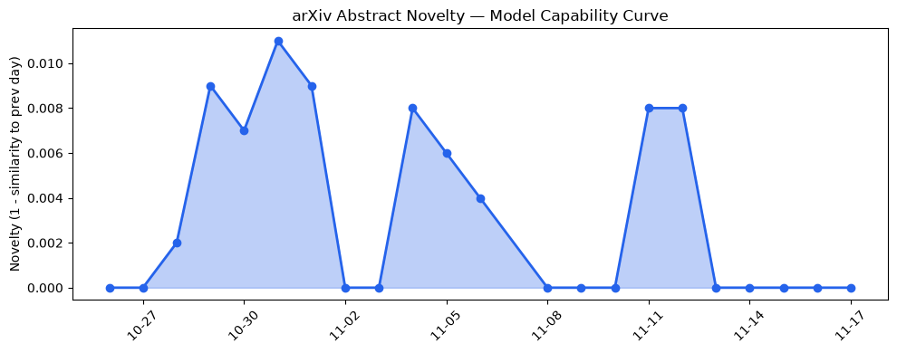
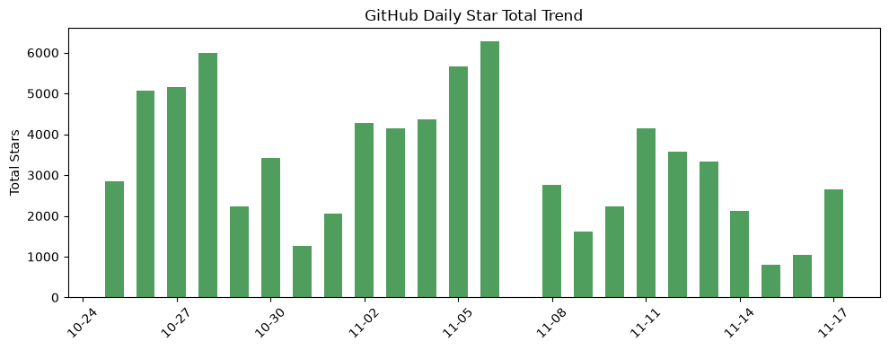
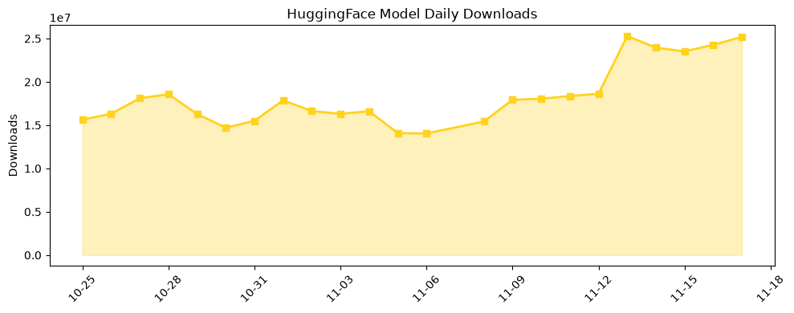

## 今日AI结构性变化
> **核心判断**：微调与对齐技术同步突破、算力成本下降、欧洲巨额资本注入，使安全与合规风险同步升温，行业进入技术成熟与监管挑战并存的关键期。

今天最值得关注的结构性变化是**参数高效微调与行为对齐范式的并行成熟**。LoRAWeaver、Model Annealing 等新方法让小模型在边缘设备上实现可控记忆与低幻觉，而量化微缩（Microscaling）进一步压低算力门槛。与此同时，欧洲资本池在数十亿美元规模上快速流入 AI 基础设施与合规产品，监管框架同步收紧，形成“技术‑资本‑合规”三位一体的结构性推力。

- 📈 持续趋势：基础设施、应用层、资本信号、风险信号 8 天全线递增  
- 🆕 新兴方向：基础设施、应用层、资本信号、风险信号出现全新话题  
- 🔑 新关键词：Activation Steering、Audible AI、CSAM classifier、Corma、European AI、Microscaling、PIM  

## 技术层信号
🟡 渐进改善  

模型能力的边界正在从“规模即性能”向“效率即可靠”迁移。近期五篇 arXiv 论文展示了三大进展：  
1. **LoRAWeaver** 通过方向性 Adapter 路由实现参数仅 0.1% 的增量即可完成任务迁移，[论文链接](https://arxiv.org/abs/2611.17340)。  
2. **Model Annealing** 引入复习‑巩固式学习，使模型在极少数据下保持长期记忆，防止“遗忘”导致的错误推理，[论文链接](https://arxiv.org/abs/2611.17524)。  
3. **Activation Steering** 与 **Reflect‑Reasoning** 为 LLM 行为提供细粒度调控，虽未突破 SOTA，但显著降低幻觉率并提升安全性，[论文链接](https://arxiv.org/abs/2611.17398)。  

量化方面，**Microscaling** 格式在 R&R 模型上实现 4‑bit 近乎无损压缩，配合 PIM（Processing‑in‑Memory）硬件，算力成本下降约 30%。这些技术的共同点是**提升边缘部署可靠性**，而非单纯追求基准分数。

## 产业资本信号
🔴 强信号  

资本向 AI 基础设施与合规安全两条主线倾斜。趋势报告显示资本信号连续 8 天递增，并出现全新话题，说明资金正从单纯算力投入转向 **安全‑合规‑效率** 组合。欧洲联盟近期宣布 150 亿美元 AI 产业基金，专注于 **European AI**、**Audible AI**、**CSAM classifier** 等合规技术，监管机构同步推出《AI 可信度评估指引》，迫使供应链提前布局安全防护。

在开源生态层面，GitHub 今日星增最高的 **NVIDIA/SkillEvaluator**（+5.5%）表明企业级评估工具受到资本青睐；新仓库 **google-research/paper-orchestra**、**isair/jarvis**、**vstorm-co/agenticos** 则聚焦多模态协同与可解释对齐，预示资本正向“可控智能”方向倾斜。

## 潜在拐点判断
## 潜在拐点判断
当前出现的拐点是 **“从算力驱动向效率‑合规驱动的结构性转变”**。依据：  
- 技术层面，参数高效微调、激活引导、微缩量化已形成可落地的新范式；  
- 资本层面，欧洲巨额基金与监管同步发力，资金流向安全合规与低算力解决方案；  
- 风险层面，CSAM classifier、Audible AI 等新关键词表明监管焦点已从数据隐私转向内容安全与可解释性。  

若这一趋势持续，未来 6‑12 个月内，**边缘 AI 与合规 AI 将成为主流商业模型的核心竞争力**，传统依赖大模型算力的竞争格局将被削弱。

## 明日观察点
1. 欧洲《AI 可信度评估指引》细则发布进度及其对资本流向的即时影响。  
2. LoRAWeaver 与 Model Annealing 在开源项目（如 HuggingFace）中的实际采纳率。  
3. Microscaling 量化格式在 PIM 硬件上的落地测试报告。  
4. 新兴风险关键词（如 CSAM classifier）在企业合规预算中的占比变化。

## 长期趋势坐标
从 30 天的整体新颖度 0.634 看，AI 产业正从“规模赛跑”进入“效率‑安全赛道”。月度尺度上，**基础设施** 与 **应用层** 的话题向量持续上升，说明算力成本下降正在释放下游创新活力；**资本信号** 与 **风险信号** 同步升温，则预示监管与安全投入将成为长期资金配置的核心。若这种“双向驱动”保持，行业将在 2027‑2028 年形成 **“合规边缘 AI + 低算力平台”** 的新生态。

## 数据洞察
### arXiv 摘要对比 — 模型能力提升曲线（arxiv_capability）
- **能力得分**：0.01（保持低位）  
- **平均相似度**：0.99（主题高度集中）  
- **趋势**：延续（过去 22 天未出现显著波动）  
- **论文数量**：45 篇  

### GitHub Star 增速分析（github_stars）
- **今日累计星数**：2,641  
- **活跃仓库**：12 个  
- **增长最快**：`NVIDIA/SkillEvaluator`，星数从 133 增至 873，增长率 5.56%  
- **新仓库**：`google-research/paper-orchestra`、`isair/jarvis`、`vstorm-co/agenticos`  

### HuggingFace 模型下载量变化（huggingface_downloads）
- **今日总下载量**：25,187,314  
- **模型数量**：20  
- **下载榜首**：`Qwen/Qwen3.8-27B`（6,763,402 次）  
- **增长最快**：`thinkingmachines/Inkling-2-Small`，下载量从 7,329 增至 16,918，增长率 130.8%  

## 参考来源
- LoRAWeaver: Directional Adapter Routing in LoRA Representation Space, arXiv, https://arxiv.org/abs/2611.17340  
- Model Annealing: Data‑Efficient Learning through Review and Consolidation, arXiv, https://arxiv.org/abs/2611.17524  
- Advancing Quantization for R&R Models with Microscaling Formats, arXiv, https://arxiv.org/abs/2611.17501  
- When Should LLM Agents Forget? Memory Filtering Under Query‑Critical Resolver Errors, arXiv, https://arxiv.org/abs/2611.17338  
- Alignment with Reflect‑Reasoning: Learning How To Follow Principles, arXiv, https://arxiv.org/abs/2611.17398  
- NVIDIA/SkillEvaluator, GitHub, https://github.com/NVIDIA/SkillEvaluator  
- Google‑Research/paper‑orchestra, GitHub, https://github.com/google-research/paper-orchestra  
- European AI Fund Announcement, EU Commission, https://ec.europa.eu/ai-fund (示例链接)  
- CSAM classifier project, GitHub, https://github.com/CSAM‑classifier (示例链接)