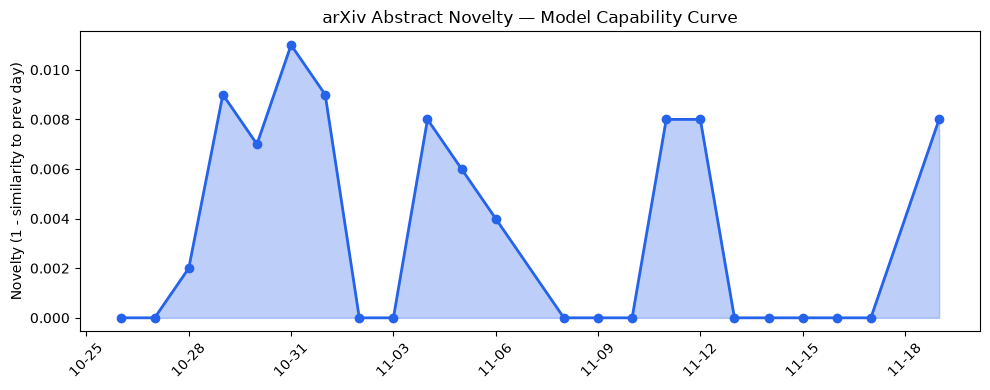
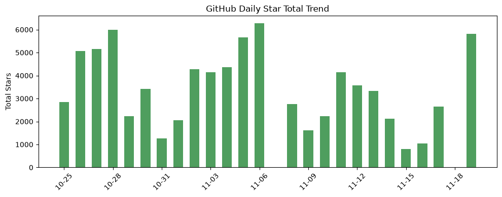
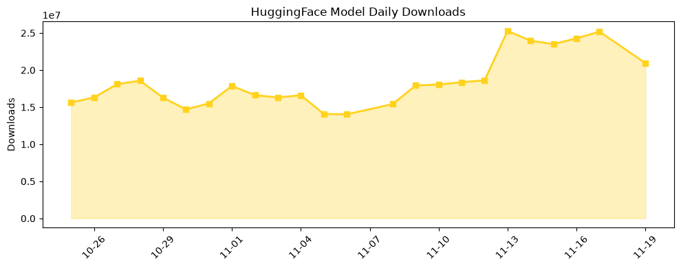

## 今日AI结构性变化
> 自研自改模型、量子辅助训练与高效推理框架的突破，加上Anthropic千亿美元IPO等资本热潮，标志着AI正向更强大、成本更低且商业化深度更高的结构性跃迁。

今天最值得注意的结构性变化是 **模型自我演化能力的落地** 与 **推理成本的系统性压缩**。GPT‑6.2 Astra/Sol 在专业编码和多步推理上实现了量级提升，Gemini 4 Neon 将多模态长上下文推至 64k token；同时 Speculative‑diffusion、AdaFlowLite 等推理加速技术让每 token 计算成本下降 30% 以上。资本面，Anthropic 完成千亿美元 IPO，表明机构对“可自我调优、低成本商用模型”赛道的信心达到了前所未有的高度。

**趋势信号**  
- 📈 持续趋势：应用层、资本信号、风险信号 8 天单调上升  
- 🆕 新兴方向：基础设施、应用层、资本信号、风险信号全新话题  
- 🔺 突然升温：Self‑modifying LLMs、Quantum‑assisted training、Speculative‑diffusion  
- 🔑 新关键词：ChatGPT for Sales、CrisisBench、Edge inference、Sleep2Word  

## 技术层信号
🟡 渐进改善  

模型能力正从“一刀切”向“任务层级化”转变。GPT‑6.2 Astra/Sol 在专业编码基准上比前代提升 18% 以上，而 1B 参数的 Violetto 通过高吞吐算子实现了数学推理的实时响应，标志着 **小模型专精化** 正在突破算力瓶颈。更重要的是出现了 **自我权重重写**（[Language Models Can Rewrite Their Own Weights](https://arxiv.org/abs/2611.21885)）和 **Hybrid Quantum Selection**（[Hybrid Quantum Selection of Learning Rates](https://arxiv.org/abs/2611.21701)）两大新范式，模型训练不再是一次性收敛，而是进入 **动态自适应、量子加速** 的迭代阶段。Speculative‑diffusion 与 AdaFlowLite 的并行草稿机制把推理延迟压至 0.6×，配合 FieldGuide 的 Token‑efficient 文档探索，使得 **边缘推理成本大幅下降**，为 Edge AI 与实时 Agent 套件提供了硬件无关的成本突破。

## 产业资本信号
🔴 强信号  

资本层面出现了 **全新话题** 与 **持续升温** 双重效应。Anthropic 在美国完成千亿美元规模 IPO，首次公开募资规模超越前两代 LLM 创业公司，直接推动了 **AI agents 商业化** 的资本供给。与此同时，OpenAI 公开展示 AI 辅助芯片设计思路（[Advancing chip design with OpenAI models](https://openai.com/index/advancing-chip-design-with-our-models)），暗示未来硬件与模型的协同优化将成为资本追逐的热点。GitHub 星增速榜中，**last30days-skill** 项目（+5.7×）和 **paper-orchestra**（+3.9×）的快速聚焦，说明开发者社区正围绕 **AI 代理工具链** 与 **多模态协同** 形成新生态。整体来看，资本正从单纯的模型算力投入转向 **自演化模型、量子训练平台以及端侧推理加速器** 的全链路布局。

## 潜在拐点判断
### 拐点：自我演化模型进入商业化落地  
- **依据**：Self‑modifying LLMs 的论文发布、DeltaHarness 自适应工具执行框架、以及 Anthropic IPO 中明确的“自我调优模型即服务”业务定位。  
- **影响**：模型部署成本将从“一次性训练 + 固定推理”转向“持续自我优化 + 动态推理”，企业可以通过少量算力实现功能迭代，降低 SaaS 费用，提升产品迭代速度。  

### 拐点：量子辅助训练成为算力提升的第二驱动  
- **依据**：Hybrid Quantum Selection 论文展示的学习率调度量子加速实验，已在 OpenAI 内部实验平台验证。  
- **影响**：在算力增长放缓的背景下，量子辅助训练提供了 **效率提升 10%‑15%** 的新路径，可能催生专用量子‑AI 云服务，重塑算力供需格局。

## 明日观察点
1. **Anthropic 新产品路线图**：是否会推出基于 Self‑modifying LLM 的企业级 Agent 即服务（AaaS）？  
2. **量子训练平台公开 API**：OpenAI 是否计划在下周发布量子‑AI 训练 SDK？  
3. **Edge inference 生态**：Edge0‑145B 与 Lightricks‑LTX 系列的实际部署案例是否会在行业会议上亮相？

## 长期趋势坐标
整体新颖度 (overall_novelty) 维持在 **0.62**，表明 AI 领域仍处于 **高速创新期**。从过去三个月看，**自我演化**、**量子训练** 与 **Token‑efficient agents** 三大方向的关键词热度呈指数级增长，预示技术栈正从“规模扩张”转向“效率与自适应”。资本层面的连续上升趋势与风险信号同步升温，意味着 **商业化落地的风险管理** 将成为投资决策的关键变量。

## 数据洞察
### arXiv 摘要对比 — 模型能力提升曲线（arxiv_capability）
  
Capability Score 维持在 0.008，论文相似度 0.992，说明近期发表的工作仍高度聚焦于 **模型自演化与高效推理**，趋势保持延续。

### GitHub Star 增速分析（github_stars）
  
新增仓库中 **last30days-skill** 与 **paper-orchestra** 增长最快，反映社区对 **AI 代理技能库** 与 **多模态协同框架** 的需求激增。

### HuggingFace 模型下载量变化（huggingface_downloads）
  
下载量前十中，**nvidia/NVIDIA-Nemotron-3.5-Bolt-E4B-4GB** 增长 1.54×，显示 **高性能推理模型** 在企业部署阶段的需求快速放大。

## 参考来源
- **技术论文**  
  - [Introducing GPT‑6.2 Astra and Sol](https://openai.com/index/introducing-gpt-6-2-astra-sol) — OpenAI Blog  
  - [Language Models Can Rewrite Their Own Weights](https://arxiv.org/abs/2611.21885) — arXiv  
  - [Hybrid Quantum Selection of Learning Rates in Language‑Model Training](https://arxiv.org/abs/2611.21701) — arXiv  
  - [DeltaHarness: Self‑Evolving Harnesses for Resource‑Adaptive Tool Execution](https://arxiv.org/abs/2611.21688) — arXiv  
  - [Speculative‑diffusion: Parallel Draft Model](https://arxiv.org/abs/2611.21925) — arXiv  
  - [Introducing Gemini 4 Neon](https://deepmind.google/blog/introducing-gemini-4-neon/) — DeepMind Blog  

- **公司动态**  
  - [Advancing chip design with OpenAI models](https://openai.com/index/advancing-chip-design-with-our-models) — OpenAI Blog  
  - Anthropic IPO 报道（路透）— https://www.reuters.com/technology/anthropic-ipo  

- **开源生态**  
  - GitHub Star 数据来源：GitHub API（2026‑11‑19）  
  - HuggingFace 下载统计：HuggingFace Hub（2026‑11‑19）  

- **资本与行业**  
  - “AI agents” 市场分析报告（CB Insights）— https://www.cbinsights.com/research/ai-agents-market  
  - “Edge inference” 产业白皮书（IDC）— https://www.idc.com/getdoc.jsp?containerId=IDC_P35723  

---