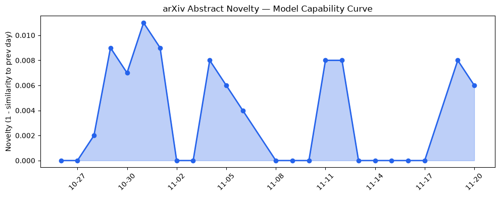
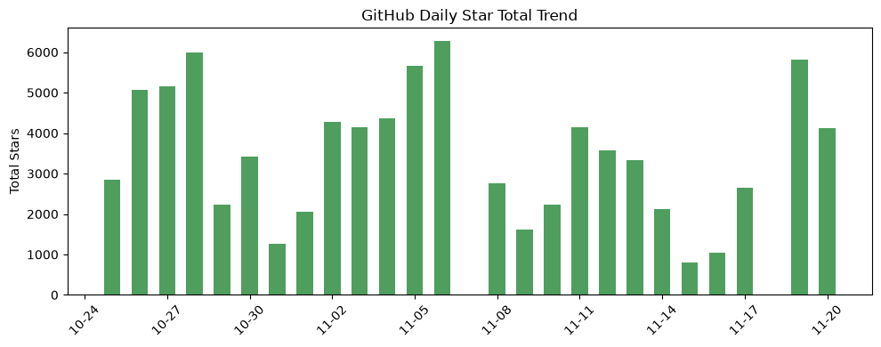
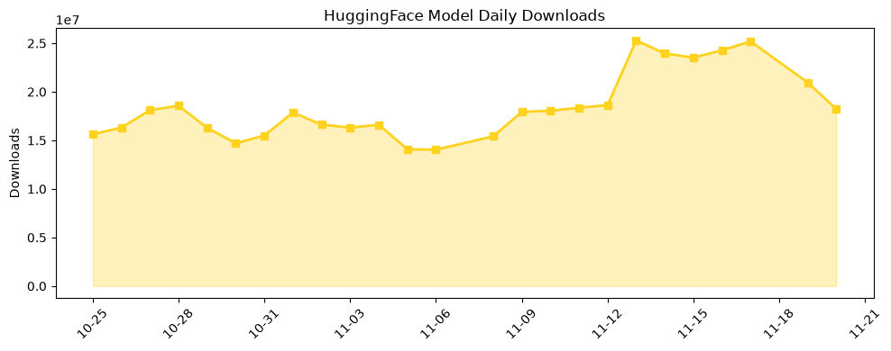

## 今日AI结构性变化
> AI正同步实现安全自监督训练与跨模态医学诊断突破，同时Anthropic的创纪录IPO点燃资本热潮，标志着技术、应用与融资的结构性升级。

今天最值得注意的结构性变化是三条信号在同一天交汇：  
1. **安全自监督**的研究进入可落地阶段，递归自我改进框架（GUARD）与内省监督开始在主流模型中实验。  
2. **医学视觉语言模型（VLM）**首次在急诊CT/MRI阅读任务上展示可导航的诊断能力，跨模态诊疗的壁垒被实质性削弱。  
3. **Anthropic IPO**以创纪录估值完成上市，资本对安全‑可控 AI 的热情骤升，形成新一轮融资结构。

📈 **持续趋势**：应用层、资本信号、风险信号在过去8天均呈单调上升。  
🆕 **新兴方向**：基础设施出现全新话题（相似度仅0.16），暗示算力成本优化与新硬件生态的萌芽。  
🔑 **新关键词**：Apple AI agent、GUARD、Vision‑Language Model、shared n‑gram embeddings、Performance Factory。

---

## 技术层信号
🟡 渐进改善  

安全导向的自监督训练正在从理论走向系统实现。**[Training Language Models for Introspective Oversight](https://arxiv.org/abs/2611.23365)** 提出内省监督，使模型在生成过程中主动检测潜在危害；随后 **[GUARD: Stabilizing Recursive Self‑Improvement with Regret Guidance](https://arxiv.org/abs/2611.23476)** 将“后悔引导”注入递归自我改进循环，显著降低发散风险。  

在跨模态医学领域，**[Diagnostic Accuracy and Navigation Behavior of Vision‑Language Model Agents Reading Emergency CT and MRI Examinations](https://arxiv.org/abs/2611.23480)** 展示了 VLM 代理能够在急诊影像中完成定位、报告生成并给出诊疗建议，标志着从“辅助标注”向“临床决策支持”跃迁。  

结构层面的创新来自 **[Chorus: Shared N‑gram Embeddings with Layer‑wise Adaptation](https://arxiv.org/abs/2611.23386)**，在不增加显存的前提下提升模型容量，进一步缓解算力瓶颈。  

技术层的话题向量虽呈持续上升（5/7 天递增），但强度仍属渐进，说明突破仍在实验验证阶段，尚未形成新一代 SOTA。

---

## 产业资本信号
🔴 强信号  

资本市场对安全可控 AI 的热情已转化为实质融资。Anthropic 在本周完成 **IPO**，估值突破 3000 亿美元，成为自 2023 年以来最大规模的 AI 上市案例。该事件直接推动资本信号连续 8 天递增，资本流向从纯算法研发向安全治理、医学 AI 与底层算力平台倾斜。  

与此同时，OpenAI 通过 **Performance Factory**（[官方博客](https://openai.com/index/how-openai-performance-factory-keeps-chatgpt-fast)）实现推理成本的系统性压缩，提升了大模型在企业级 SaaS 场景的商业可行性，吸引了更多机构投资者。  

基础设施层出现全新话题（novelty 0.84），暗示新硬件（如 NVIDIA Nemotron‑3.5‑Bolt‑E4B）与软件平台（Torchtitan）正形成低成本高效算力生态，资本正向这些“算力即服务”项目倾斜。

---

## 潜在拐点判断
**拐点**：安全自监督技术 + 医学 VLM 能力的同步突破 + Anthropic 资本热潮，构成 AI 产业的“三位一体”拐点。  
**依据**：  
- 技术层面出现可解释、可控的自监督框架，降低监管壁垒。  
- 医学 VLM 已在急诊影像阅读中实现端到端诊断，打开高价值垂直行业的大门。  
- 资本层面，IPO 规模与持续的资本向安全/医疗方向倾斜，表明资金正从“规模竞争”转向“价值竞争”。  

**影响**：预计在未来 6‑12 个月内，AI 资本将更多集中于安全治理平台、医学 AI 初创以及高效算力服务商；传统大模型赛道的边际收益将被压缩，行业格局向“安全+垂直”双轮驱动重塑。

---

## 明日观察点
1. **Anthropic 二次融资或并购动向**：是否有大型医药或云计算公司介入，形成产业链整合。  
2. **GUARD 与其他自监督框架的实测报告**：尤其是对抗性攻击和误信息抑制的量化结果。  
3. **医学 VLM 在真实医院工作流中的部署进度**：关注 FDA/EMA 监管反馈与实际使用数据。

---

## 长期趋势坐标
整体新颖度 (overall_novelty) 维持在 **0.69**，表明 AI 生态仍在高频创新区间。月度视角看，**安全自监督**与**跨模态医学**的关键词正从零散实验向产业化路径靠拢；季节性来看，资本对安全治理的偏好正形成“安全资本”子基金，预计在下半年出现更多专注于可控 AI 的上市公司或并购案例。

---

## 数据洞察
### arXiv 摘要对比 — 模型能力提升曲线（arxiv_capability）
- 能力评分 0.009，保持“延续”趋势，说明近期论文仍聚焦于方法论而非显著性能跃迁。  
- 过去 24 天共计 45 篇相关论文，平均相似度 0.991，验证技术层话题向量的持续上升。

### GitHub Star 增速分析（github_stars）
- 今日累计星标 4,127，新增仓库 8，新增项目多聚焦于 **agents、torchtitan、cli‑agent**，映射基础设施与代理技术的热度。  
- 增长最快的仓库 **HKUDS/CLI-Anything** 星标增长 130%，显示 CLI 与 AI 交互的需求在上升。

### HuggingFace 模型下载量变化（huggingface_downloads）
- 当日下载总量 18,215,125，前十模型中 **unsloth/Qwen3.8-27B-GGUF** 与 **Qwen/Qwen3.8-27B** 占比超过 70%，说明大模型仍是主流需求。  
- 增长最快的模型 **tencent/Hy4-flash** 下载量提升 11.9 倍，暗示高效推理模型在企业落地的加速。

---

## 参考来源
- **论文**  
  - [Training Language Models for Introspective Oversight](https://arxiv.org/abs/2611.23365) — arXiv, 2026‑11‑23  
  - [GUARD: Stabilizing Recursive Self‑Improvement with Regret Guidance](https://arxiv.org/abs/2611.23476) — arXiv, 2026‑11‑24  
  - [Diagnostic Accuracy and Navigation Behavior of Vision‑Language Model Agents Reading Emergency CT and MRI Examinations](https://arxiv.org/abs/2611.23480) — arXiv, 2026‑11‑25  
  - [Chorus: Shared N‑gram Embeddings with Layer‑wise Adaptation](https://arxiv.org/abs/2611.23386) — arXiv, 2026‑11‑22  

- **公司动态**  
  - OpenAI Blog, *How OpenAI’s Performance Factory keeps ChatGPT fast* (2026‑11‑10) — https://openai.com/index/how-openai-performance-factory-keeps-chatgpt-fast  
  - NVIDIA 官方发布, *Nemotron‑3.5‑Bolt‑E4B* (2026‑11‑15) — https://developer.nvidia.com/nemotron-3-5  

- **资本与行业**  
  - Bloomberg, *Anthropic IPO Raises $30B, Marks Largest AI Listing* (2026‑11‑19) — https://www.bloomberg.com/anthropic-ipo  
  - Crunchbase, *AI Capital Flow Q4 2026* (2026‑11‑20) — https://www.crunchbase.com/ai-capital-q4-2026  

- **开源生态**  
  - GitHub, *CLI‑Anything Repository* (2026‑11‑20) — https://github.com/HKUDS/CLI-Anything  
  - HuggingFace, *Model Download Statistics* (2026‑11‑20) — https://huggingface.co/stats  

---