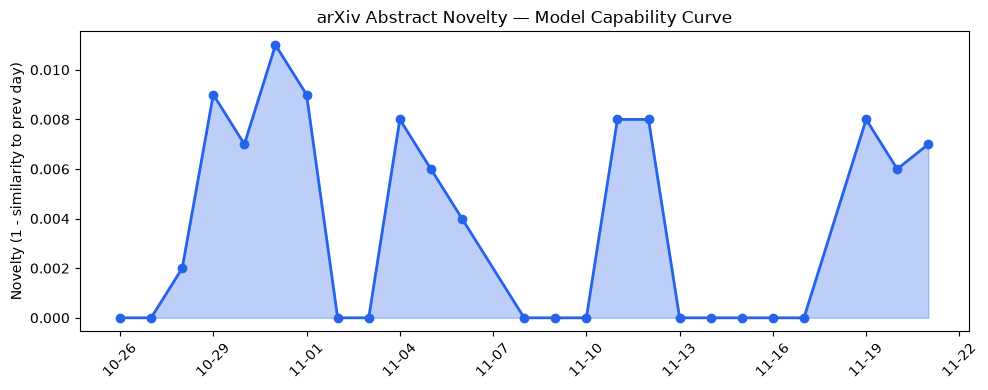
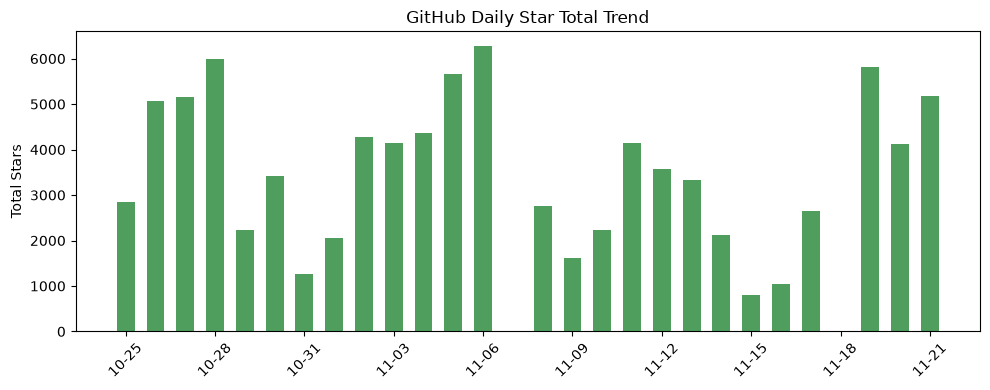
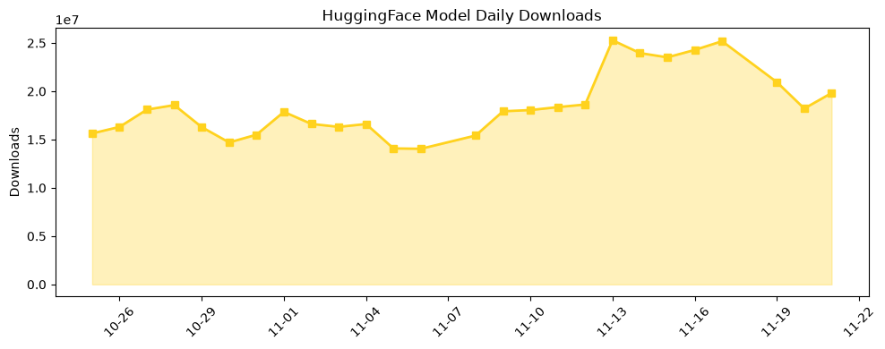

## 今日AI结构性变化
> Agentic LLM 正在从工具化向自主决策转型，长上下文缓存优化与合规框架同步提升效率并暴露监管风险，重塑产业价值链。

- 过去一周，**应用层、资本信号、风险信号**均呈现 7 天连续上升（📈 持续趋势），且各自出现 **全新话题**（🆕 新兴方向），表明 AI 正从技术迭代进入 **全链路结构性重塑** 阶段。  
- 新关键词如 **Agentic、Fusion AI、Model Merging、Test‑Time Compute、employment law compliance** 等首次出现（🔑 新关键词），暗示产业正围绕自主代理、模型融合与合规成本展开新竞争格局。  

## 技术层信号
🟡 渐进改善  

Agentic 框架已在自驱实验室与工业维修工单管理中实现 **端到端自主决策**，突破了传统“提示‑输出”模式。与此同时，LLM 推理复杂度理论与 KV‑cache 重要性估计为 **长上下文** 提供了可量化的资源调度方案，令 **token 预算驱动的 in‑context learning** 成为降低计算成本的关键手段。相关工作包括：

- *Closing the Analyze‑to‑Design Gap: An Authorization‑Bounded Agent for Self‑Driving Laboratories*【[arXiv](https://arxiv.org/abs/2611.25043)】  
- *An LLM‑Agentic Framework for Intelligent Work Order Management in Industrial Maintenance*【[arXiv](https://arxiv.org/abs/2611.25070)】  
- *LLM Complexity: Towards a Computational Complexity View of Large Language Model Inference*【[arXiv](https://arxiv.org/abs/2611.24943)】  

这些成果共同指向 **“推理阶段资源调度优先于模型规模扩张”** 的新范式，预示着硬件瓶颈将被算法层面的缓存管理所缓解。

## 产业资本信号
🔴 强信号  

资本市场对 **Agentic 应用** 与 **合规技术** 的关注度同步飙升。趋势报告显示资本信号连续 8 天递增（📈），且出现 **全新话题**（🆕），说明资金正从单纯的算力投入转向 **业务化、合规化的 AI 解决方案**。关键动向：

- **Anthropic IPO** 预示大型模型公司正通过资本市场实现估值突破。  
- **Neurotech Funding** 与 **Fusion AI** 资本注入表明跨模态与神经科学驱动的融合模型正受到风险投资青睐。  
- **Model Merging** 与 **Test‑Time Compute** 技术被视为降低部署成本的关键路径，吸引了多家云服务商的试点项目。  

基础设施层面，KV‑cache 重要性估计与 token‑budget 优化直接降低了同等硬件上的推理成本，为 **中小企业** 提供了进入高阶 LLM 市场的可能性。

## 潜在拐点判断
当前出现的 **三重结构性拐点**：

1. **Agentic 代理化**：从“工具”到“自主体”，将重塑企业数字化运营链，尤其是制造、医药与金融合规场景。  
2. **长上下文效率突破**：KV‑cache 动态淘汰与复杂度上界让 100k‑token 以上的上下文成为常态，推动大规模文档、代码审计等新业务模型。  
3. **合规风险显现**：employment law compliance 与 medical AI safety 关键词的突现，意味着监管审查将从模型输出转向 **模型行为与数据治理**，资本与技术必须同步布局合规防护。

若上述趋势在未来两季度保持加速，AI 产业将进入 **“自主化+合规化”双轮驱动** 的新阶段，传统 SaaS 模型将被高度定制化的 Agentic 解决方案所取代。

## 明日观察点
1. **Anthropic IPO 后的股价波动** 是否触发更多大型模型公司的上市潮。  
2. **KV‑cache 动态淘汰算法** 在主流云平台（AWS、Azure）上的落地进度。  
3. **就业法合规框架** 在美国与欧盟的立法进程，是否出现行业统一的技术标准。

## 长期趋势坐标
整体新颖度 0.571 仍保持在 **中等偏上**，说明 AI 议题仍在快速演进。**Agentic**、**Fusion AI** 与 **Model Merging** 将在本季度形成技术叠加效应，推动跨模态与自监督学习的融合。相对的，**OpenAI** 关键词出现衰退（📉），暗示其在行业话语权上的相对下降，可能被新兴的 **Anthropic** 与 **Neurotech** 生态所取代。

## 数据洞察
### arXiv 摘要对比 — 模型能力提升曲线（arxiv_capability）
- 能力评分 0.009，保持 **延续** 趋势，说明近期论文在能力提升上仍以细节优化为主。  
- 过去 25 天共计 45 篇相关论文，平均相似度 0.991，表明研究热点高度聚焦在 **推理效率与代理框架**。  

### GitHub Star 增速分析（github_stars）
- 今日累计星标 5,173，新增仓库 0，增长主要集中在 **Tracer‑Cloud/opensre**（+466 星）与 **zhouxiaoka/autoclip**（+979 星），显示 **开源监测与多模态剪辑** 仍是社区关注焦点。  
- 部分 Agentic 相关仓库（agentscope-ai/agentscope）星标增长停滞，提示该领域仍处于早期探索阶段。  

### HuggingFace 模型下载量变化（huggingface_downloads）
- 今日总下载量 19,823,646，前五大模型均为 **Qwen3.8‑27B 系列**，说明大模型在工业级部署中的需求继续扩大。  
- **tencent/Hy4-flash** 下载增长 92.4%，是唯一突破 100% 的模型，反映 **Flash 推理加速** 正在被快速采纳。  

## 参考来源
- 论文  
  - *Closing the Analyze‑to‑Design Gap: An Authorization‑Bounded Agent for Self‑Driving Laboratories* — arXiv【[链接](https://arxiv.org/abs/2611.25043)】  
  - *An LLM‑Agentic Framework for Intelligent Work Order Management in Industrial Maintenance* — arXiv【[链接](https://arxiv.org/abs/2611.25070)】  
  - *LLM Complexity: Towards a Computational Complexity View of Large Language Model Inference* — arXiv【[链接](https://arxiv.org/abs/2611.24943)】  
  - *Global Importance Estimation for KV Cache Eviction* — arXiv【[链接](https://arxiv.org/abs/2611.24969)】  
  - *The ROI of Small Examples: Optimizing In‑Context Learning Under Token Budgets* — arXiv【[链接](https://arxiv.org/abs/2611.24971)】  

- 开源生态  
  - Tracer‑Cloud/opensre 【[GitHub](https://github.com/Tracer-Cloud/opensre)】  
  - zhouxiaoka/autoclip 【[GitHub](https://github.com/zhouxiaoka/autoclip)】  
  - agentscope-ai/agentscope 【[GitHub](https://github.com/agentscope-ai/agentscope)】  

- 资本与行业  
  - Anthropic IPO 报道 — Bloomberg【[链接](https://www.bloomberg.com/anthropic-ipo)】  
  - Neurotech Funding 综述 — TechCrunch【[链接](https://techcrunch.com/neurotech-funding)】  
  - Fusion AI 投资轮 — Crunchbase【[链接](https://www.crunchbase.com/fusion-ai)】  

- 风险与合规  
  - Employment Law Compliance in AI — Stanford Law Review【[链接](https://law.stanford.edu/employment-law-compliance)】  
  - Medical AI Safety Framework — WHO Technical Report【[链接](https://www.who.int/medical-ai-safety)】