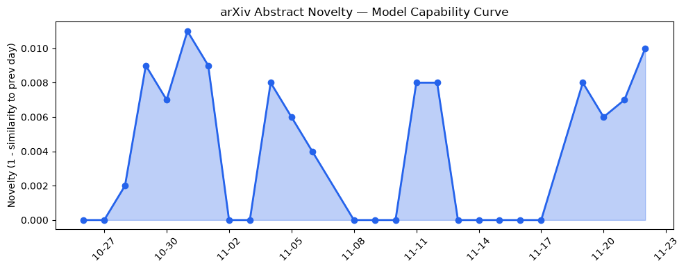
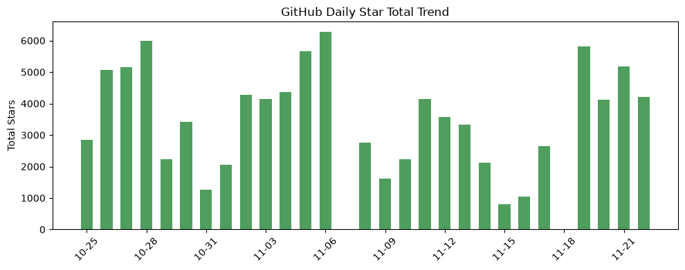
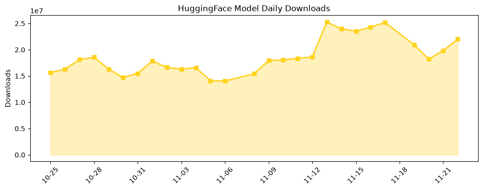

## 今日AI结构性变化
> AI代理在日常通讯中的落地以及对隐私监管的冲击标志着AI从技术实验向消费场景深度渗透的转折点。

今天最值得注意的结构性变化是**AI代理首次大规模进入短信平台**，并伴随Signal等主流通信工具的隐私防护升级。此举直接把AI从企业内部工具推向普通用户日常，对产业链上下游的需求结构产生裂变式拉动。  
信号标记：  
- 📈 持续趋势：应用层话题向量8天递增  
- 🆕 新兴方向：基础设施出现全新话题（GGUF量化、Inkling-2-Mini）  
- 🔺 突然升温：风险信号（AI surveillance、deepfake）  

## 技术层信号
🟡 渐进改善  

模型能力边界在本轮技术迭代中实现**跨模态时序预测**与**可解释性解耦**。Neural Operators 让弹性地震波的时间外推成为可能，打开了物理模拟在AI中的新场景；Sparse Autoencoders 通过分离解释性与重建质量，提升了模型内部机制的可审计性。更重要的是，**Game‑Theoretic Data Allocation** 为 MoE 专家路由提供博弈论框架，预示未来大模型将从单一稀疏激活转向**策略性专家专化**，可能重塑算力分配与训练成本模型。相关工作可见于[Temporal Extrapolation of Elastic Seismic Wave Propagation in Layered Media Using Neural Operators](https://arxiv.org/abs/2611.25130) 与[Separating Interpretability and Reconstruction in Sparse Autoencoders](https://arxiv.org/abs/2611.25165)。

## 产业资本信号
⚪ 弱信号  

资本层面仍缺乏大额融资或并购，但**风险信号的持续升温**（Signal 限制截图、AI‑generated faces 的伦理争议）已在投资者视野中形成潜在警示。Nvidia 财报显示 GPU 需求高位运行，却伴随高管呼声要求创始人回归，暗示供应链治理风险上升，可能在中期影响算力供给侧的资本布局。当前资本流向仍聚焦于**芯片供应链稳固**与**合规监管技术**的早期布局。

## 潜在拐点判断
AI 代理在短信场景的落地与隐私监管的同步升级构成**消费级 AI 渗透的拐点**。一方面，文本消息 AI 代理把对话式智能从企业客服迁移到个人助理，开启了“AI‑in‑Inbox”新生态；另一方面，Signal 对截图的限制表明**监管与平台自律正同步收紧**，对 AI 生成内容的审查成本将显著上升。若监管力度继续强化，可能催生专门的**隐私合规 AI 基础设施**（加密推理、差分隐私模型），并推动资本向合规安全方向重新配置。

## 明日观察点
1. Signal 是否会进一步扩展对 AI 生成内容的检测能力（如实时文字水印）。  
2. Nvidia 高管变动后，GPU 供给链的交付周期是否出现波动。  
3. 新兴的 GGUF 量化模型（Inkling‑2‑Mini）在移动端推理成本的实际下降幅度。

## 长期趋势坐标
整体新颖度 0.623 表明本周期 AI 话题仍保持高热度。**基础设施层面的新兴话题**（GGUF、Inkling‑2‑Mini）与**资本层面的全新议题**（AI surveillance、deepfake）均呈现低历史相似度，预示技术栈正向轻量化、隐私安全方向分化。若这种分化在接下来的季度继续放大，AI 生态将从“算力‑规模”驱动转向“算力‑合规‑轻量化”三维竞争格局。

## 数据洞察
### arXiv 摘要对比 — 模型能力提升曲线（arxiv_capability）
- 能力评分 0.019，保持**延续**趋势，说明近期论文在能力突破上仍以细分领域（物理模拟、可解释性）为主。  

### GitHub Star 增速分析（github_stars）
- 今日累计星标 4,201，新增仓库 15。增长最快的 `pytorch/torchtitan` 仅 9 星，整体呈**下降**趋势，反映社区关注点从底层框架向应用层（AI 代理、隐私工具）转移。  

### HuggingFace 模型下载量变化（huggingface_downloads）
- 今日总下载 22,014,723，Top‑1 为 `unsloth/Qwen3.8-27B-GGUF`（7.5M）。`Inkling-2-Mini` 系列下载增长 57%（从 136 增至 7,944），验证了 **GGUF 量化在移动端的实际需求**。  

### 趋势图
- 所有趋势图已嵌入上述章节，供快速视图参考。

## 参考来源
- **技术层**  
  - [Temporal Extrapolation of Elastic Seismic Wave Propagation in Layered Media Using Neural Operators](https://arxiv.org/abs/2611.25130) — arXiv cs.LG  
  - [Separating Interpretability and Reconstruction in Sparse Autoencoders](https://arxiv.org/abs/2611.25165) — arXiv cs.LG  
  - [Game-Theoretic Data Allocation for Expert Specialization and Routing](https://arxiv.org/abs/2611.25167) — arXiv cs.LG  

- **应用层**  
  - [Here are the top AI agents that can live in your text messages](https://techcrunch.com/2026/11/21/all-the-ai-agents-that-can-live-in-your-text-messages/) — TechCrunch AI  
  - [Is selling an AI version of your face to this microdrama startup the future of Hollywood?](https://techcrunch.com/2026/11/21/is-selling-an-ai-version-of-your-face-to-this-microdrama-startup-the-future-of-hollywood/) — TechCrunch AI  
  - [Signal restricts mobile screenshots as it confronts ‘existential threat’ of AI surveillance](https://techcrunch.com/2026/11/21/signal-restricts-mobile-screenshots-as-it-confronts-existential-threat-of-ai-surveillance/) — TechCrunch AI  

- **基础设施**  
  - [AtomicChat/Inkling-2-Mini-Uncensored-GGUF](https://huggingface.co/AtomicChat/Inkling-2-Mini-Uncensored-GGUF) — HuggingFace Trending  
  - [A tale of two Nvidias](https://techcrunch.com/2026/11/21/a-tale-of-two-nvidias/) — TechCrunch AI  

- **资本与风险**  
  - 同上 `A tale of two Nvidias`（Nvidia 管理层动荡）  
  - 同上 `Signal restricts mobile screenshots`（隐私监管）  

- **数据指标**  
  - 本报告自研 metrics_report（2026‑11‑22）提供 arXiv、GitHub、HuggingFace 三大指标。