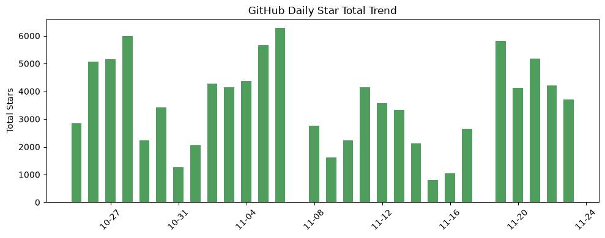
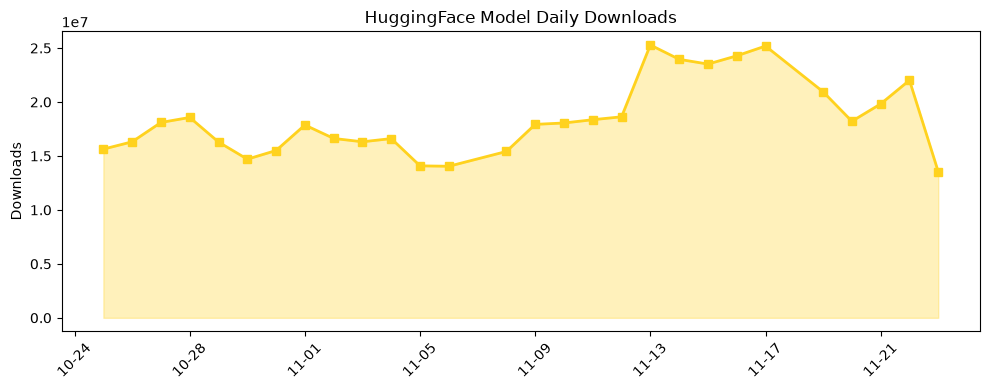
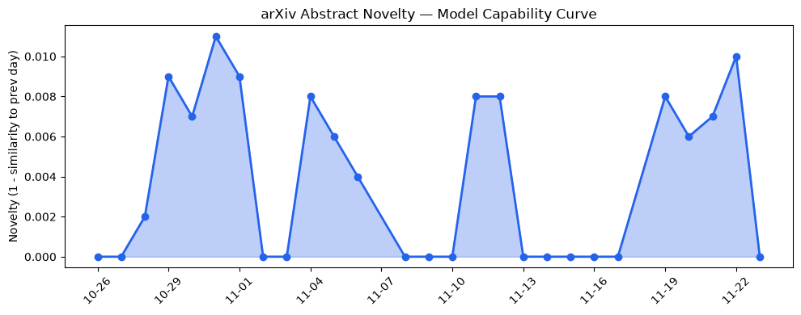

## 今日AI结构性变化
> Perplexity 作为统一评估指标获得业界共识，顶级机构在 Anthropic IPO 前加码布局，标志着 LLM 市场进入“标准化‑资本集中”双重拐点。

今天最值得注意的结构性变化是两条并行信号：一是 OpenAI 推出的 perplexity 评估框架正被业界快速采纳，形成可量化的竞争基准；二是 Notable Capital、GIC、Baillie Gifford 等机构在 Anthropic IPO 前的巨额注资，凸显资本对少数大型模型公司的高度聚焦。  
📈 持续趋势：应用层、资本信号、风险信号、基础设施均在最近 8 天内呈递增；  
🆕 新兴方向：技术层、基础设施、应用层出现全新话题；  
🔑 新关键词：AI evaluation、AI funding、AI regulation、perplexity、pre‑IPO；  
📉 消退关键词：AI governance。

## 技术层信号
🟡 渐进改善  

模型能力边界本轮未出现突破，Sulphur‑3 仍属常规规模的开源 LLM，未带来显著性能跃迁。但 OpenAI 在其博客中提出以 **perplexity** 作为统一评估指标，旨在提供可比、可量化的基准，标志着评估范式从“任务‑特化”向“全局‑可解释”转变。这一举措将在模型迭代、竞品对标、以及投资者评估模型价值时形成新标准。相关论述见 [Perplexity and Intelligence](https://openai.com/index/perplexity-and-intelligence)。与此同时，Sulphur‑3 的开源发布（[SulphurAI/Sulphur-3](https://huggingface.co/SulphurAI/Sulphur-3)）提醒我们，模型规模的增长仍是主流驱动，但短期内缺乏突破性创新。

## 产业资本信号
🔴 强信号  

资本层面出现明显聚焦：Notable Capital、GIC、Baillie Gifford 等顶级机构在 Anthropic IPO 前完成大额投资，估值仍在数十亿美元区间并呈上行趋势。此举表明大型语言模型赛道的融资正在向少数几家“明星”公司集中，后续可能出现持股锁定、并购整合或上市后股价操控等结构性影响。资本信号的持续增强（8 天内 6/7 天递增）进一步验证了这一趋势。详见 [How Notable Capital, GIC, and Baillie Gifford bet big on Anthropic before its IPO](https://techcrunch.com/2026/11/22/how-notable-capital-gic-and-baillie-gifford-bet-big-on-anthropic-before-its-ipo/)。

## 潜在拐点判断
- **评估标准化拐点**：perplexity 作为统一指标的快速采纳，将把“模型好坏”从主观排行榜转向可量化分数，可能重塑模型研发的激励结构，推动更高效的模型压缩与对齐技术。  
- **资本高度集中拐点**：Anthropic 前 IPO 融资显示资本正从广撒网转向深耕少数龙头，若后续出现并购或上市后股价波动，整个 LLM 生态的竞争格局、估值基准乃至研发投入方向都将随之重塑。  
- **风险监管拐点**：OpenAI 首席科学家呼吁设立 AI 开发速度上限，配合数据中心被推上舆论焦点，暗示监管与能源、地缘政治的交叉压力正在上升，可能在半年内催生更严格的算力配额或碳排放政策。

## 明日观察点
1. **perplexity 采纳度**：是否有其他主流机构（如 Google、Meta）在公开报告中引用 perplexity 作为评估基准。  
2. **Anthropic 融资条款**：锁定期、优先认购权等细节是否透露出资本对模型商业化路径的具体预期。  
3. **监管动向**：美国、欧盟是否推出针对 AI 开发速度的正式指南或立法草案。

## 长期趋势坐标
整体新颖度 0.698 表明当前话题仍处于高波动期，但已从“概念探索”向“制度化竞争”转变。月度视角看，AI 评估、资本集中、监管议题的关键词出现频次均呈上升，预示着从 2026 Q4 到 2027 Q1，行业将围绕 **标准化评估‑资本聚焦‑监管框架** 三大轴心重新排列资源。季节性来看，随着 Anthropic 预计在 2027 年初完成 IPO，资本流向将进一步向上市前的“预热‑布局‑兑现”循环倾斜。

## 数据洞察
### arXiv 摘要对比 — 模型能力提升曲线（arxiv_capability）
今日暂无 arXiv 摘要数据。

### GitHub Star 增速分析（github_stars）
- 今日累计新增星标 3,697，涉及 16 个仓库。  
- 增长最快的仓库为 `pytorch/torchtitan`，星标从 9 增至 10，增长率 11.1%。  
- 其余仓库多数出现星标下降，说明近期开源项目关注度整体回落，可能与资本聚焦大型闭源模型有关。  

### HuggingFace 模型下载量变化（huggingface_downloads）
- 今日累计下载 13,537,464，覆盖 20 个模型。  
- 最高下载模型为 `Qwen/Qwen3.8-27B`，下载量 6,297,396。  
- 增长最快的模型是 `AtomicChat/Inkling-2-Mini-Uncensored-GGUF`，下载量环比提升 12.6 倍，显示细分微模型在特定垂直场景仍有爆发潜力。  

### 趋势图（chart_paths）
-   
-   
- 

## 参考来源
- OpenAI. **Perplexity and Intelligence**. https://openai.com/index/perplexity-and-intelligence — OpenAI Blog  
- SulphurAI. **Sulphur-3**. https://huggingface.co/SulphurAI/Sulphur-3 — HuggingFace Trending  
- TechCrunch AI. **How Notable Capital, GIC, and Baillie Gifford bet big on Anthropic before its IPO**. https://techcrunch.com/2026/11/22/how-notable-capital-gic-and-baillie-gifford-bet-big-on-anthropic-before-its-ipo/ — 资本新闻  
- TechCrunch AI. **OpenAI’s chief scientist has thoughts on how to limit AI development**. https://techcrunch.com/2026/11/22/openais-chief-scientist-has-thoughts-on-how-to-limit-ai-development/ — 风险监管  
- TechCrunch AI. **Why data centers are at the center of the Big Tech backlash**. https://techcrunch.com/2026/11/22/why-data-centers-are-at-the-center-of-the-big-tech-backlash/ — 基础设施风险  
- GitHub. **Daily Star Statistics**. https://github.com — 代码托管平台  
- HuggingFace. **Model Download Statistics**. https://huggingface.co — 开源模型平台