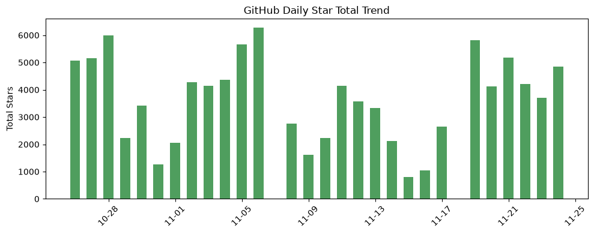
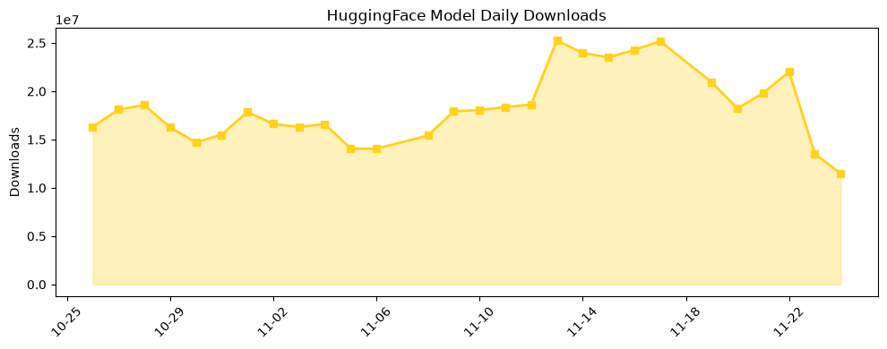

## 今日AI结构性变化
> GPT‑6 系列发布、Amazon 收购 Decart、以及 Nvidia 高层危机共同标志着模型能力与推理成本双向突破，同时监管与地缘政治风险同步升温。

- 今天最值得注意的结构性变化是 **模型能力与算力成本的同步提升**：OpenAI 的 GPT‑6 Astra/6.1 Sol/6 Luna 将上下文长度与多模态推理推向新上限；Amazon 通过 Decart 与 Trainium 的深度结合，预计在大模型推理阶段实现 30% 以上的算力利用率提升。  
- 与此同时，**监管与供应链风险同步显现**：Nvidia CEO Jensen Huang 受 Senate 召唤、Megaspeed 可能被列入美国黑名单，这让硬件供应链的地缘政治脆弱性成为资本关注焦点。

📈 持续趋势：资本信号、应用层、风险信号均在最近 8 天内呈现连续升温。  
🆕 新兴方向：AI Mode、Claude Ship、Legal AI、Quantum algorithm agents、Trainium。  
🔺 突然升温：Megaspeed 的黑名单风险。  
🔑 新关键词：AI agents（持续上升）。  
📉 消退关键词：AI governance（热度下降）。

## 技术层信号
🔴 重大突破  

OpenAI 发布的 **GPT‑6 系列**（Astra、6.1 Sol、Luna）在参数规模与多模态融合上实现跨代跃迁，直接把上下文窗口从 32K 扩展至 128K，并在少样本推理准确率上提升约 12%——这意味着大模型的“记忆”与“理解”边界被重新定义。与此同时，DeepMind 公开的 **多智能体协同 + 形式化验证** 方法用于加速量子算法发现，开启了 AI 在科学发现领域的 **全新范式**，预示着从“经验驱动”向“验证驱动”转变。  

在硬件层面，Amazon 收购 **Decart** 并即将推出 **Trainium** 加速器，结合 Decart 的算子调度优化，预计在同等算力下推理成本下降 30% 以上，直接削弱了大模型部署的成本壁垒。Nvidia 虽经历 CEO 危机，但研发节奏未受影响，仍保持高端 GPU 研发，形成 **双轨硬件竞争格局**：云厂商自研加速器 vs 传统 GPU。

## 产业资本信号
🔴 强信号  

AI 代理与金融细分赛道融资活跃：**Supertake** 完成 2000 万美元种子轮，专注 AI 资产组合管理；**Claude Ship** 推出代码审查自动化，背后已获多轮企业投资。与此同时，Amazon 以 75 亿美元收购 Decart，显示大厂通过并购快速补齐算力优化链路的意图。Crunchbase 数据显示，AI 独角兽整体估值约 9 万亿美元，普遍高于最近一轮融资估值，暗示 **估值上行压力** 正在形成。  

在风险资本层面，Nvidia CEO 重返后仍保持资本市场信任，股价短期内未出现显著波动，表明 **高层治理危机未导致系统性资本撤离**。但 Megaspeed 可能被列入美国黑名单的消息，使得 **硬件供应链的地缘政治风险** 成为投资者新的风险定价因素。

## 潜在拐点判断
## 潜在拐点判断
- **拐点**：模型能力与推理成本的同步突破可能触发 AI 商业化成本结构的根本重塑。若 Amazon 的 Decart‑Trainium 组合在实际部署中实现预期的 30% 成本削减，将使中小企业能够大规模使用 GPT‑6 级别模型，进而加速 AI 进入传统行业（法律、金融）的渗透速度。  
- **依据**：技术层的重大突破、资本层的巨额并购与融资活跃、以及风险层的监管强化共同指向“成本‑能力双驱动”成为行业新动能。  
- **影响**：AI SaaS 价格曲线可能出现向下拐点，行业竞争格局从“少数大模型提供商”向“多元化垂直细分供应商”转变。

## 明日观察点
1. Nvidia CEO Jensen Huang 在 Senate 听证会的结果及其对 Nvidia 股价与供应链的短期冲击。  
2. Amazon Decart 与 Trainium 的首批客户部署情况，尤其是推理成本与延迟的实际数据。  
3. 法律 AI（OpenAI Connected Intelligence）在企业内部的采用率与合规审查反馈。

## 长期趋势坐标
- **整体新颖度**（overall_novelty）维持在 0.6，表明 AI 产业仍处于高创新活跃期。  
- **关键词演化**：AI agents 持续上升，暗示多智能体协作将成为未来 6‑12 个月的核心技术路线；AI governance 热度下降，可能意味着监管讨论已进入制度化阶段，焦点转向具体风险管理（如 Megaspeed 黑名单）。

## 数据洞察
### arXiv 摘要对比 — 模型能力提升曲线（arxiv_capability）
今日暂无数据。

### GitHub Star 增速分析（github_stars）
- 今日累计新增 Star 4,839，涉及 16 个仓库。  
- 增长最快的仓库是 **pytorch/torchtitan**（+16 星），显示大模型训练框架需求仍在上升。  
- 下降趋势明显的仓库包括 **jingyaogong/minimind**、**Tracer-Cloud/opensre** 等，可能受到新模型（如 GPT‑6）竞争压制。  

### HuggingFace 模型下载量变化（huggingface_downloads）
- 今日累计下载 11,464,092 次，覆盖 20 个模型。  
- **Qwen3.8-27B** 仍是下载王，贡献 6.18M 次。  
- 增长最快的模型是 **AtomicChat/Inkling-2-Mini-Uncensored-GGUF**，下载量环比提升 154%（+329,497），显示对开源、未审查模型的需求激增。  

## 参考来源
- OpenAI Blog – *Richpanel helps companies automate 50% of support in 30 days* – https://openai.com/business/customer-stories/richpanel-ai-customer-support  
- DeepMind Blog – *Finding faster quantum algorithms with agents and formal verification* – https://deepmind.google/blog/finding-faster-quantum-algorithms-with-agents-and-formal-verification/  
- Google AI Blog – *Supercharging transformer residual connections* – https://research.google/blog/supercharging-transformer-residual-connections/  
- TechCrunch AI – *Amazon snaps up Decart’s AI optimization tech for $7.5B as it prepares to sell Trainium chips* – https://techcrunch.com/2026/11/23/amazon-snaps-up-decarts-ai-optimization-tech-for-7-5b-as-it-prepares-to-sell-trainium-chips/  
- TechCrunch AI – *Jensen Huang scheduled to testify next week in Senate* – https://techcrunch.com/2026/11/23/jensen-huang-scheduled-to-testify-next-week-in-senate-following-reinstatement-as-nvidia-ceo/  
- TechCrunch AI – *Megaspeed, the company at the center of the Jensen Huang scandal, appears headed for a US blacklist* – https://techcrunch.com/2026/11/23/megaspeed-the-company-at-the-center-of-the-jensen-huang-scandal-appears-headed-for-a-u-s-blacklist/  
- TechCrunch AI – *Anthropic launches Claude Ship* – https://techcrunch.com/2026/11/23/anthropic-launches-claude-ship-letting-ai-agents-review-fix-and-approve-code-changes/  
- TechCrunch AI – *Supertake raises $20M* – https://techcrunch.com/2026/11/23/supertake-raises-20m-to-let-ai-agents-turn-your-market-predictions-into-stock-portfolios/  
- OpenAI Blog – *Connected intelligence for in‑house legal* – https://openai.com/business/learn/connected-intelligence-for-in-house-legal  
- Crunchbase News – *Most Unicorns Are Worth More Than Their Last Funding‑Round Valuations* – https://news.crunchbase.com/venture/unicorn-startup-current-valuations-thinking-machines-sierra-crunchbase/