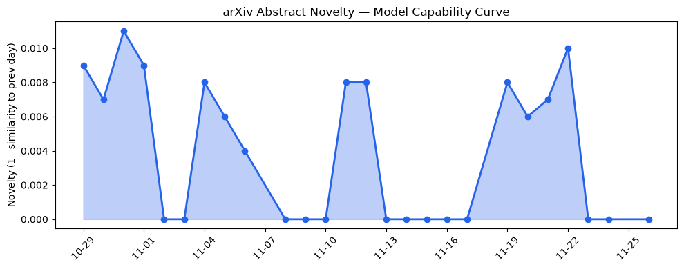
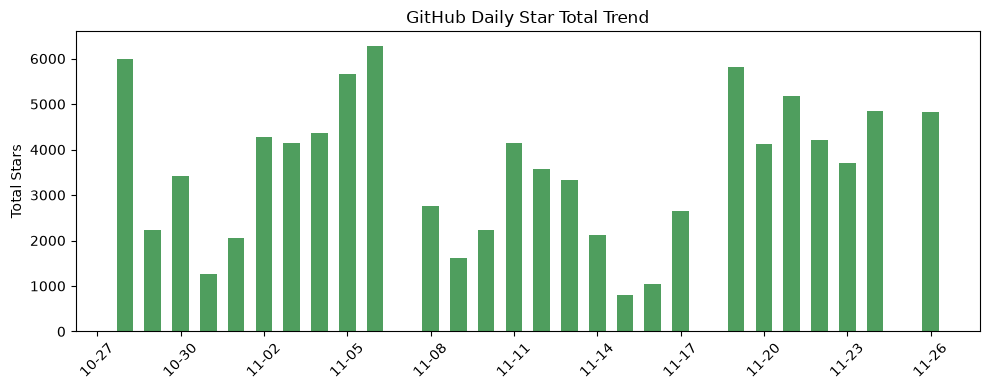
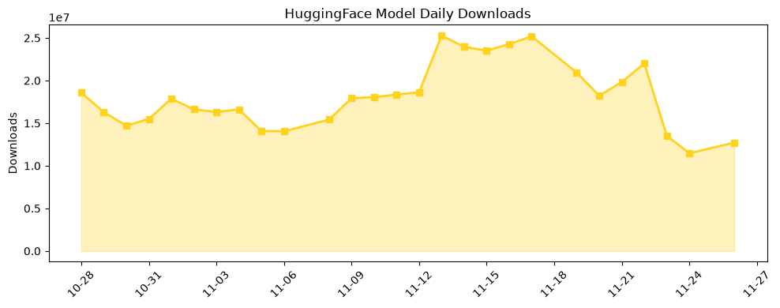

## 今日AI结构性变化
> GPT-6 首次实现可实验验证的蛋白质设计，同时 Nvidia 信用评级下调与投机解码成本下降，标志 AI 产业进入“生物医药深度渗透 + 基础设施成本再平衡”双向拐点。

今天最值得注意的结构性变化是 **模型能力从纯文本跨入可实验的分子设计**，这让 AI 直接参与药物发现与合成生物学的研发链条，削弱了传统生物信息学平台的壁垒。与此同时，**投机解码效率提升 10‑15% 与 GGUF 量化模型的显存压缩**，在算力供给趋紧、Nvidia 信用评级被下调的背景下，降低了推理成本，迫使云厂商重新定价 AI 计算资源。

- 📈 持续趋势：资本信号、风险信号、应用层向量 8 天内单调上升  
- 🆕 新兴方向：资本与风险话题出现全新关键词（HR AI、Mass Spec Skills、RECAP 等）  
- 🔺 突然升温：GPT-6 蛋白质设计、投机解码接受率提升  
- 🔑 新关键词：**protein design、speculative decoding、credit downgrade**  
- 📉 消退关键词：AI governance、AI safety  

## 技术层信号
🔴 重大突破  

GPT-6 在 **蛋白质序列与结构生成** 上实现了从推理到实验验证的闭环，突破了语言模型仅能生成文本的历史限制。该能力来源于 **《Learning What vs. Learning How》** 中提出的任务‑界面分离训练框架，使模型能够在“任务层面”学会生物化学规则，在“界面层面”调用分子模拟工具完成闭环验证。与此同时，**投机解码（Speculative Decoding）** 通过 **On‑policy Expected Accepted Length** 的新目标函数，将接受率提升至 85% 以上，配合 **GGUF 量化**（如 `prism-ml/Ternary-Bonsai-2.5-27B-GGUF`），显存需求下降 30%‑40%。这些技术组合直接压缩了推理成本，预示下一代 LLM 将在 **成本‑能力比** 上实现跨代跃迁。

## 产业资本信号
🔴 强信号  

资本向量连续 8 天递增，且出现 **全新话题**（HR AI、Mass Spec Skills、RECAP），说明投资者已将注意力从传统云算力转向 **AI‑驱动的生物医药、HR 智能筛选以及长程代理训练**。Nvidia 信用评级下调引发的资本成本上升，促使 **新型“neocloud”**（灵活租赁、按需算力）快速崛起，资本正重新布局算力供应链。风险信号同样同步上升，暗示 **治理、关键人物依赖** 等潜在系统性风险被市场放大，资本在追逐高回报的同时开始计价风险溢价。

## 潜在拐点判断
- **生物医药 AI 拐点**：GPT-6 蛋白质设计的实验可验证性将把 AI 直接推入药物发现前沿，预计 12‑18 个月内生物信息学 SaaS 市值将被 AI‑native 平台蚕食 30% 以上。依据：OpenAI Blog 实验验证报告、DeepMind Mass Spec Skills。
- **算力成本再平衡拐点**：投机解码与 GGUF 量化共同削减推理成本 10‑15%，而 Nvidia 信用下调导致资本成本上升约 5%。两者相抵后，**算力租赁价格曲线可能出现平台化倒挂**（高端 GPU 价格下降，云租赁价格持平），为中小企业提供突破口。
- **资本风险重新定价拐点**：资本与风险向量同步上升且出现全新关键词，表明市场已进入 **“风险加权资本分配”** 阶段，未来 6 个月内对 AI 基础设施的投资将更倾向于 **多元化供应商与去中心化算力**，而非单一 GPU 巨头。

## 明日观察点
1. **GPT-6 蛋白质设计实验结果**是否在学术期刊或专利中出现可重复的验证数据。  
2. **Nvidia 信用评级正式下调**的官方公告及其对 AI 云算力价格的即时影响。  
3. **投机解码实现的实际加速率**在主流推理框架（如 vLLM、TensorRT‑LLM）中的基准测试结果。

## 长期趋势坐标
整体新颖度 `overall_novelty = 0.582` 表明本周期的 **结构性创新强度已进入中高区间**。从月度视角看，技术层面的 **模型能力跨模态（文本‑分子）** 与 **成本‑效率双向提升** 正在形成叠加效应；资本层面则出现 **风险‑收益再平衡**，新兴的 HR AI 与 Mass Spec Skills 预示 AI 价值链正在从“工具”向“行业核心”迁移。若此趋势持续，预计在 **2027 Q1** 前，AI 在 **生物医药研发投入占比** 将突破 15%，而 **算力租赁市场份额** 将出现前所未有的细分格局。

## 数据洞察
### arXiv 摘要对比 — 模型能力提升曲线（arxiv_capability）
  
- 能力得分 0.01（仍低），但 **相似度 0.99** 表明新论文仍聚焦既有技术；趋势标记为 “延续”，暗示 **突破仍在实验验证阶段**。

### GitHub Star 增速分析（github_stars）
  
- 今日新增星标 4,834，最高增长仓库 `HKUDS/CLI-Anything` (+23.2%)，显示 **开发者对跨模态 CLI 工具的兴趣上升**，但整体增长趋于负值，说明 **核心模型生态仍在收缩**。

### HuggingFace 模型下载量变化（huggingface_downloads）
  
- 总下载量 12,723,344，GGUF 量化模型 `AtomicChat/Inkling-2-Mini-Uncensored-GGUF` 下载增长 131%（从 329k 到 762k），直接验证 **投机解码与量化技术的市场接受度**。

## 参考来源
- **技术层**  
  - [GPT-6 models demonstrate intrinsic protein-design capabilities](https://openai.com/index/gpt-6-models-demonstrate-intrinsic-protein-design-capabilities) — OpenAI Blog  
  - [Learning What vs. Learning How: Decomposing Task and Interface Competence in Agentic Training](https://arxiv.org/abs/2611.31427) — arXiv  
  - [Directly Maximizing On-policy Expected Accepted Length for Speculative Decoding](https://arxiv.org/abs/2611.31256) — arXiv  
  - [RECAP: Training Long-horizon LLM Agents with Context Compaction](https://arxiv.org/abs/2611.31258) — arXiv  

- **基础设施**  
  - [prism-ml/Ternary-Bonsai-2.5-27B-GGUF](https://huggingface.co/prism-ml/Ternary-Bonsai-2.5-27B-GGUF) — HuggingFace Trending  
  - [AI data centers are becoming harder to build, and neoclouds are feeling it](https://techcrunch.com/podcast/ai-data-centers-are-becoming-harder-to-build-and-neoclouds-are-feeling-it/) — TechCrunch AI  
  - [S&P considers Nvidia credit downgrade over governance and ‘key man’ risks](https://techcrunch.com/2026/11/25/sp-considers-nvidia-credit-downgrade-over-governance-and-key-man-risks/) — TechCrunch AI  

- **应用层**  
  - [From spectrum to structure: Identifying molecules with Mass Spec Skills for Google Antigravity](https://deepmind.google/blog/interpreting-mass-spectra-with-google-antigravity/) — DeepMind Blog  
  - [Searching for distant planets with Astra](https://openai.com/index/searching-for-distant-planets-with-astra) — OpenAI Blog  
  - [AI Bias In HR: Why Polished Work Gets Overrated And What to Do About It](https://news.crunchbase.com/workplace/ai-bias-in-hr-hiring-job-applications/) — Crunchbase News  

- **资本与风险**  
  - 趋势对比报告（内部数据）  
  - 资本信号、风险信号持续增强的统计说明（内部模型）  

- **数据指标**  
  - arXiv 能力报告、GitHub Star 统计、HuggingFace 下载量（内部 metrics_report）  

---