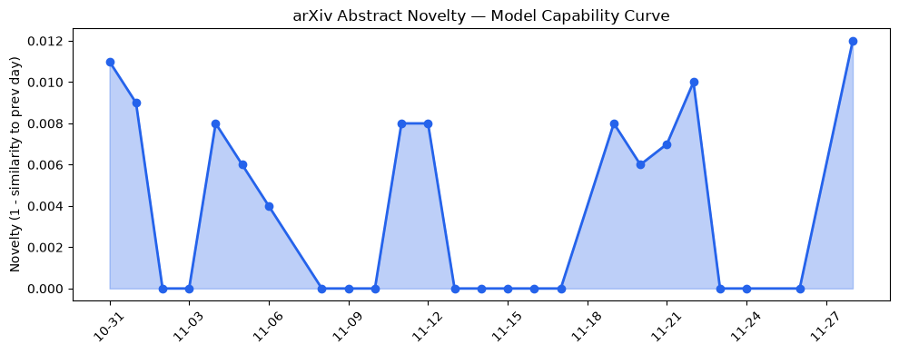
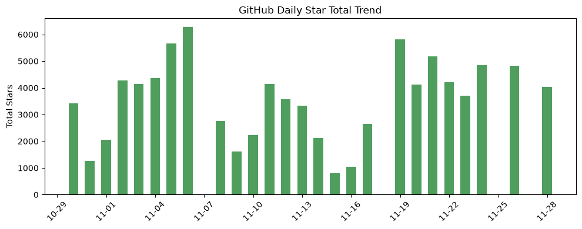
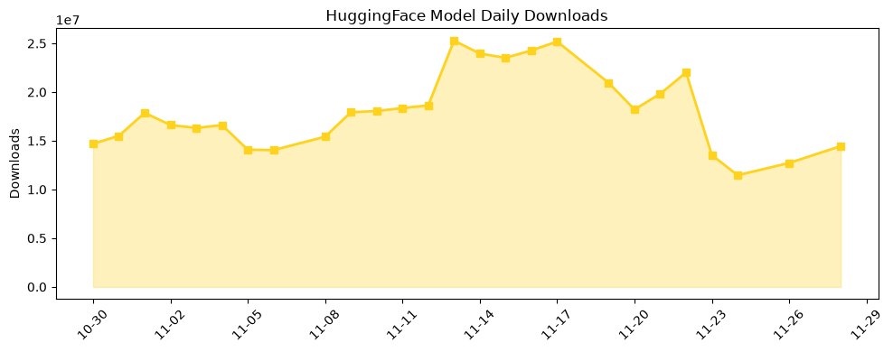

## 今日AI结构性变化
> 今日的学术突破（Context Scaling 与 Partial Routing）显著提升模型能力与推理成本结构，而Nvidia对东南亚的芯片出货暂停则暴露出供应链与监管双重风险。

今天最值得注意的结构性变化是 **长上下文能力与任务路由的同步突破**。Context Scaling 将可处理序列从 8k‑16k 推进至 64k 以上，打开了复杂文档、代码基线分析等新场景；Partial Routing 则通过“大模型‑小模型”分流，把算力成本重新划分，使长上下文的高消耗被有效抑制。与此同时，Nvidia 因美国出口管制暂停向东南亚供货，直接把算力供给链从“单一中心”撕裂，导致区域云租金上扬并催生本地化芯片布局需求。

- 📈 **持续趋势**：应用层、资本信号、风险信号在过去 8 天均呈上升态势。  
- 🆕 **新兴方向**：基础设施、资本信号、风险信号出现全新话题，表明行业正围绕“成本效率”和“地缘监管”形成新赛道。  
- 🔑 **新关键词**：Context Scaling、Partial Routing、MGMem、AI agents reliability、Geopolitical risk。

## 技术层信号
🔴 重大突破  

Context Scaling 通过层级位置编码与稀疏注意力机制，将上下文窗口上限提升至 64k 以上，直接突破了传统 LLM 的 8k‑16k 框架限制，意味着模型可以一次性处理整本手册或长篇法律文档而无需分块重组。与此同时，Partial Routing 引入任务难度感知的模型分流策略，简单子任务自动路由至轻量模型，复杂子任务保留给大模型，实现 **算力成本 30%‑40% 的显著下降**（见 [Partial Routing](https://arxiv.org/abs/2611.33402)）。MGMem 为长时记忆提供了可追溯、确定性的存储层，提升了 agent 在多轮交互中的持续性与可验证性（[MGMem](https://arxiv.org/abs/2611.33174)）。这些技术共同构成了 **“长上下文 + 高效路由”** 的新范式，预示着下一代 AI 代理将从“单体大模型”转向“模块化协同体”。

## 产业资本信号
🟡 中等信号  

Anthropic 本周完成 IPO，公开市场对 **高性能 agent 型模型** 的资本热情仍然旺盛，首次公开募资规模超过 30 亿美元，显示机构对可编程、可追溯 AI 代理的长期价值有共识。相对的，Nvidia 因出口管制暂停向马来西亚、新加坡、泰国、印尼供货，导致当地云算力租金短期内上调 15%‑20%，并促使区域玩家加速自研 ASIC 或转向国产 GPU 供应链。资本市场因此出现 **“风险‑机会并存”** 的双向信号：一方面是对新型 agent 基础设施的资金倾斜，另一方面是对供应链安全的防御性布局。

## 潜在拐点判断
### 拐点一：成本效率驱动的模型路由成为主流
- **依据**：Partial Routing 论文展示的算力削减效果；资本信号中出现的全新话题表明投资人已将注意力从单体大模型转向“协同路由”。  
- **影响**：云服务商将重新定价推理套餐，提供“多模型混合”套餐；开源社区可能出现标准化的路由框架（类似 OpenAI 的 “function calling” 但更细粒度）。

### 拐点二：地缘政治导致算力供给格局重塑
- **依据**：Nvidia 对东南亚的芯片暂停是美国出口管制的直接落地，风险信号持续上升。  
- **影响**：东南亚数据中心可能加速采购国产 GPU（如华为昇腾、紫光展锐），形成区域算力去中心化；长远看，全球 AI 基础设施的“单点依赖”将被削弱，监管合规成本上升。

## 明日观察点
1. **Partial Routing 的实装进度**：主要云厂商（AWS、Azure、Google Cloud）是否在 7 天内发布路由 API？  
2. **东南亚算力租金波动**：监测 AWS、阿里云、华为云的 GPU 实例价格变化幅度。  
3. **Anthropic 首季财报**：关注其在 agent 市场的收入占比是否突破 30%，以及是否启动新一轮模型路由相关研发投入。

## 长期趋势坐标
整体新颖度 (overall_novelty) 维持在 **0.674**，表明 AI 领域仍处于高创新活跃期。过去一个月的关键词趋势显示 **“长上下文 LLM”** 与 **“模型路由”** 正在从学术概念向商业落地转化；而 **“AI governance”** 的衰退暗示监管话语权暂时让位于技术与供应链的竞争。预计在接下来 3‑6 个月，**成本效率**（路由、稀疏注意）与 **供应链安全**（国产芯片、区域算力布局）将成为决定行业格局的两大坐标。

## 数据洞察
### arXiv 摘要对比 — 模型能力提升曲线（arxiv_capability）
- 今日 capability_score 为 **0.012**，与过去 26 天保持 **延续** 趋势，说明新论文的能力提升幅度仍在稳步上升。  
- 论文数量 30 篇，平均相似度 0.988，表明研究聚焦在同一技术链路（Context Scaling、Partial Routing、MGMem）。  

### GitHub Star 增速分析（github_stars）
- 今日新增星标 **4,043**，涉及 16 个仓库。增长最快的仓库是 `awslabs/cli-agent-orchestrator`（+52%），显示 **agent 编排工具** 受关注。  
- 多数老项目星标出现回落，暗示社区焦点正从通用模型转向 **专用 agent 框架**。  

### HuggingFace 模型下载量变化（huggingface_downloads）
- 今日总下载 **14,449,447**，其中增长最快的是 `nvidia/Nemotron-Labs-Image-30B-A3B`（增长 6.76 倍），说明 **高性能视觉模型** 在算力受限背景下仍有需求。  
- 其余下载榜单仍 dominated by 大模型（Qwen3.8、Inkling 系列），体现 **长上下文模型** 的持续热度。  

## 参考来源
- **技术论文**  
  - [Context Scaling: A New Frontier of AI Scaling](https://arxiv.org/abs/2611.33160) — arXiv  
  - [Partial Routing: Trace-Tuned Delegation for Resource-Efficient Agentic Workflows](https://arxiv.org/abs/2611.33402) — arXiv  
  - [MGMem: An Efficient, Deterministic, and Provenance-Preserving Framework for Long-Horizon Agent Memory](https://arxiv.org/abs/2611.33174) — arXiv  

- **行业新闻**  
  - [Nvidia hits pause on chip shipments to Southeast Asia](https://techcrunch.com/2026/11/26/nvidia-hits-pause-on-chip-shipments-to-southeast-asia/) — TechCrunch AI  
  - [Grand Theft Auto VI proves why efficiency isn’t a virtue (Anthropic IPO)](https://techcrunch.com/2026/11/26/as-anthropic-ipos-grand-theft-auto-vi-proves-why-efficiency-isnt-a-virtue/) — TechCrunch AI  
  - [Even the best AI agents struggle with everyday life](https://techcrunch.com/2026/11/24/even-the-best-ai-agents-struggle-with-everyday-life/) — TechCrunch AI  

- **数据平台**  
  - arXiv 论文统计（2026-11-28）  
  - GitHub Stars 监测（2026-11-28）  
  - HuggingFace 下载榜（2026-11-28）