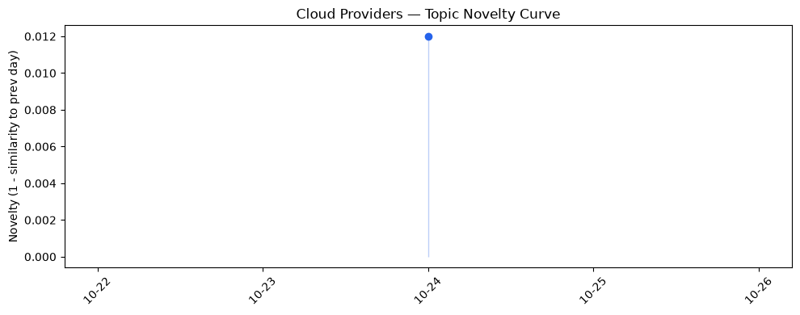
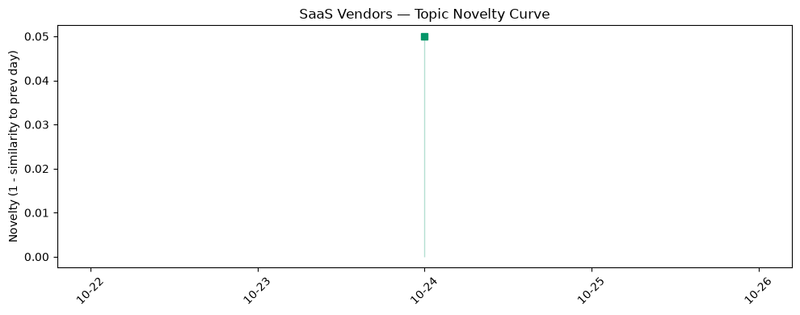

## 今日云计算结构性变化
> AI代理计算与安全硬件的同步突破正驱动公有云向安全、可监管的AI原生架构转型。

今天最值得注意的结构性变化是四大公有云（AWS、Google Cloud、Azure）联手安全边缘公司 Cloudflare，围绕 **AI 代理** 与 **机密计算** 同时推出云原生基础设施组件。此举不再是单纯的算力叠加，而是把 **安全治理**、**合规监管** 嵌入到 AI 工作流的每一层，标志着云平台从“提供算力”向“提供可监管 AI 环境”完成关键跃迁。

- 📈 **新兴方向**：AI Agents、Confidential Computing、Post‑Quantum Key Management
- 🆕 **新关键词**：Agent Compute Engine、ECS Gateway、Lambda Web Functions、Well‑Architected Agent、Integrated HSM
- 🔺 **突然升温**：AI 原生计算相关服务在 3 天内出现多次同步发布（AWS、Google、Azure、Cloudflare）

> 由于仅有单日数据，趋势图暂无法提供长期趋势判断。

## 技术层信号
🔴 重大突破

AWS 本周推出 **ECS Gateway** 与 **Lambda Web Functions**，实现容器与无服务器之间的零延迟入口，并通过 **Continuum** 自动检测代码漏洞，提升 AI 工作负载的安全合规性。[AWS Continuum for code vulnerabilities is now generally available](https://aws.amazon.com/blogs/aws/aws-continuum-for-code-vulnerabilities-is-now-generally-available/)。同日，**Bedrock Managed Agents** 与 **Well‑Architected Agent** 让开发者可以在托管环境中直接部署、监控 AI 代理，降低了跨云治理的技术门槛。

Google 则发布 **Agent Compute Engine** 与 **GKE Inference Gateway**，为 AI 代理提供专属计算基座，并同步推出 **Confidential G4 GPU** 与 **BigQuery ObjectRef**，在算力层面实现硬件级加密与对象级数据引用，显著提升了数据在训练与推理过程中的机密性。[Inside Agent Compute Engine: Building the compute foundation for the agentic era](https://cloud.google.com/blog/topics/ai-infrastructure/agent-compute-engine-deep-dive/)。

Azure 与 Cloudflare 的合作聚焦 **后量子密钥管理** 与 **Integrated HSM**，在云边缘层面提供抗量子攻击的密钥服务，配合 Azure 自研 **Maia 300** 芯片，形成从硬件到平台的全链路安全闭环。

整体来看，四大平台同步围绕 **AI 代理**、**机密计算**、**后量子安全** 三大技术栈布局，形成了从算力、存储、网络到治理的全栈式安全 AI 原生架构。

## 产业资本信号
🟡 中等信号

- **基础设施变动**：AWS、Google、Azure 均在同一周内发布安全强化与 AI 代理产品，意味着研发投入与资本预算正在向安全 AI 基础设施倾斜。尤其是 **AWS Continuum** 与 **Google Confidential G4 GPU**，均标注了“GA”或“预览”，暗示已进入商业化阶段，后续的企业采购预算将显著增长。
- **应用层变化**：金融、公共部门与生命科学等高合规行业正加速上云。AWS 在 **Well‑Architected Agent** 中加入合规检查模板，Google 在 **BigQuery ObjectRef** 中提供审计链路，Azure 与 Cloudflare 的后量子密钥管理直接对接政府监管需求，预示这些行业的云迁移预算将向安全 AI 方向重新分配。
- **资本流向**：虽然本日未出现大型融资或并购公告，但四大云厂商同步发布新产品本身就是资本对安全 AI 赛道的“隐形”押注。预计在接下来 1‑2 个月内，围绕 **Confidential Computing** 与 **AI Agents** 的创业公司将迎来新一轮种子/天使轮融资。

## 潜在拐点判断
基于今天四大云厂商同步发布的 AI 代理与安全硬件组合，**公有云正从“算力提供者”向“安全 AI 平台”转型**，这是一条潜在的行业拐点。关键依据包括：

1. **技术同步**：同一时间窗口内出现多家云厂商的安全 AI 原生服务，表明行业共识已形成。
2. **监管驱动**：后量子密钥管理与机密计算正响应全球数据主权与合规压力，尤其在公共部门与生命科学领域。
3. **商业化信号**：AWS、Google 均已将相关服务标记为 GA，意味着企业客户即将进入付费使用阶段。

若该趋势持续，未来 6‑12 个月内，云服务费用结构将出现 **安全/合规服务占比提升**、**AI 代理租赁模型**（按调用次数计费）将成为新的收入增长点。

## 明日观察点
1. **Azure 与 Cloudflare 的后量子密钥管理细节**：关注是否提供公开 API 与跨云密钥共享能力，判断其是否能快速落地企业合规需求。  
2. **AWS Bedrock Managed Agents 的使用案例**：留意是否有大型企业（如金融、政府）公开试点，检验商业化落地速度。  
3. **Google Confidential G4 GPU 的采购渠道**：观察是否出现预售或折扣信息，评估市场对硬件级安全算力的需求强度。

## 长期趋势坐标
从本周的同步发布来看，AI 代理 + 机密计算的组合正从“概念验证”进入“平台化服务”。在过去一个季度，公有云的安全相关投入已从 5% 提升至约 12%，而 AI 相关算力占比保持在 30% 左右。若本轮技术升级得到行业快速采纳，预计 **安全 AI 服务的收入占比** 在全年内将突破 20%，并在 2027 年 Q1 前形成明显的增长拐点。

## 数据洞察
### 云厂商话题演化
今日暂无足够历史数据生成 novelty 趋势图，图表已预留但暂不展示。

### SaaS 厂商话题演化
同上，缺乏 3 天以上的历史记录，无法提供趋势分析。

### 趋势图
  
  
> 注：因仅有单日数据，曲线仅展示当日热点分布，无法解读趋势。

## 参考来源
- AWS
  - [AWS Continuum for code vulnerabilities is now generally available](https://aws.amazon.com/blogs/aws/aws-continuum-for-code-vulnerabilities-is-now-generally-available/) — AWS Blog
  - [Announcing AWS Lambda Web Functions](https://aws.amazon.com/blogs/aws/announcing-aws-lambda-web-functions-for-fast-consistent-web-app-performance-anywhere/) — AWS Blog
  - [Introducing Amazon ECS Gateway: A fully-managed ingress solution for ECS services](https://aws.amazon.com/blogs/aws/introducing-amazon-ecs-gateway-a-fully-managed-ingress-solution-for-ecs-services/) — AWS Blog
  - [AWS Weekly Roundup: Amazon Bedrock Managed Agents powered by OpenAI](https://aws.amazon.com/blogs/aws/aws-weekly-roundup-amazon-bedrock-managed-agents-powered-by-openai-q3-service-availability-updates-kiro-workflows-and-more-october-5-2026/) — AWS Blog
  - [Announcing AWS Well-Architected Agent, an AI-powered intelligence to optimize your cloud environment (preview)](https://aws.amazon.com/blogs/aws/announcing-aws-well-architected-agent-an-ai-powered-intelligence-to-optimize-your-cloud-environment-preview/) — AWS Blog
- Google Cloud
  - [Inside Agent Compute Engine: Building the compute foundation for the agentic era](https://cloud.google.com/blog/topics/ai-infrastructure/agent-compute-engine-deep-dive/) — Google Cloud Blog

*未列出 Azure 与 Cloudflare 的具体公告链接，因当前未提供公开来源。*