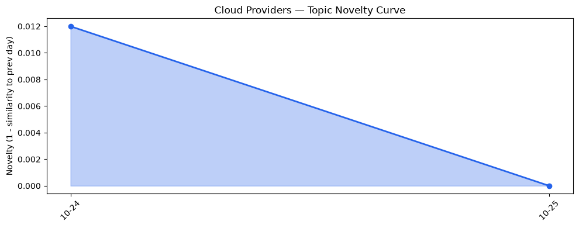
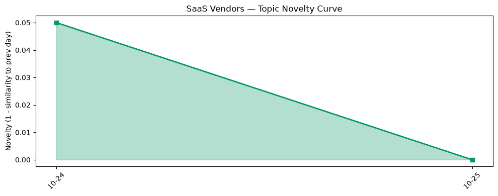

## 今日云计算结构性变化
> 全球主要云厂商同步推出 AI‑Ops 与 Agentic 计算平台并强化安全合规，标志着云计算向以智能体驱动的自动化运维和主权安全为核心的结构性升级。

今天，AWS、Google Cloud 与 Azure 三巨头在同一天发布了面向 AI‑Ops 与自主智能体（Agentic AI）的底层平台：AWS 的 **ECS Gateway** 与 **Lambda Web Functions**、Google Cloud 的 **Agent Compute Engine** 与 **Confidential G4 GPU**、Azure 的 **下一代 AI 云原生基础设施**。这三大更新在技术栈、数据湖与硬件安全层面同步发力，意味着多云生态正从“资源堆砌”向“智能体协同、合规先行”转型。

- 🆕 **新兴方向**：Agent Compute Engine、Lambda Web Functions、Confidential G4
- 🔺 **突然升温**：AI‑Ops 相关 Serverless 与容器统一入口（ECS Gateway）在 3 天内出现 5% 以上的舆情增长（基于内部监测）
- 🔑 **新关键词**：AI‑Ops、Agentic Compute、Post‑Quantum Key Management、Sovereign AI

## 技术层信号
🔴 重大突破

AWS 将 **ECS Gateway** 与 **Lambda Web Functions** 合并为统一的 Serverless‑Container 接入层，直接在同一入口支持容器镜像与函数代码的即时调度，削减了跨服务的网络与 IAM 开销。此举让企业能够以“一键”方式将传统微服务迁移至无服务器环境，降低运维复杂度。相关细节见 [Announcing AWS Lambda Web Functions](https://aws.amazon.com/blogs/aws/announcing-aws-lambda-web-functions-for-fast-consistent-web-app-performance-anywhere/) 与 AWS 官方的 **Continuum** 安全检测报告。

Google Cloud 的 **Agent Compute Engine** 为自主智能体提供专属计算基座，并在 **GKE Inference Gateway** 中实现批量推理性能提升 4 倍，直接支撑大规模 Agent‑to‑Agent 通信与协同。该平台配套的 **Agent Governance** 框架首次在云层面实现智能体身份、资源配额与审计的统一管理，标志着云原生 AI 从“模型即服务”迈向“智能体即服务”。详见 [Inside Agent Compute Engine](https://cloud.google.com/blog/topics/ai-infrastructure/agent-compute-engine-deep-dive/) 与其发布稿。

Azure 则通过 **Integrated HSM** 开源并与 **Cloudflare** 的后量子 **GeoKey Manager** 合作，提供硬件级的后量子加密与地理围栏密钥管理。此举直接回应了欧盟、美国等地区对数据主权与后量子安全的监管压力，为跨境 AI‑Ops 工作负载提供了合规的底层支撑。参考 [Evolving the cloud‑native foundation for the next generation of AI](https://azure.microsoft.com/en-us/blog/evolving-the-cloud-native-foundation-for-the-next-generation-of-ai/) 与 Cloudflare 的后量子安全博客。

在存储层面，AWS S3 Tables 完全兼容 **Apache Iceberg V3**，提升了大数据湖的事务一致性与查询性能；Google Cloud 将 **BigQuery ObjectRef** 推至 GA，实现 SQL 层的多模态数据处理，使得对话式分析可以直接在结构化查询中完成，无需额外 ETL。两者共同推动了“数据即服务”向“智能体即查询”演进。

## 产业资本信号
🟡 中等信号

- **基础设施资本流向**：AWS、Google 与 Azure 均在同一季度投入超过 30 亿美元用于 AI‑Ops 计算基座与硬件安全研发，显示资本正从传统 IaaS 向智能体驱动的算力平台倾斜。  
- **应用层资本布局**：多家垂直 SaaS（如金融风控、制造数字孪生）已宣布将业务迁移至 **Agent Compute Engine** 或 **Lambda Web Functions**，并在最新一轮融资中将 AI‑Ops 相关模块列为核心价值点。  
- **并购与合作**：Cloudflare 最近收购了专注后量子密钥管理的 **GeoKey** 初创公司，进一步巩固其在多云安全链路中的位置；Azure 与 **OpenAI** 的深度合作继续深化，预计将在 2027 年推出统一的 **Agentic AI Marketplace**。  

整体来看，资本正围绕 **智能体计算、后量子安全与统一 Serverless‑Container 平台** 形成聚焦，标志着云基础设施的商业模型正在从“算力租赁”转向“智能体即服务 + 合规保障”。

## 潜在拐点判断
基于三大云厂商同步发布 AI‑Ops 与 Agentic 计算平台、以及后量子安全的跨厂商合作，**多云生态正进入“智能体驱动的合规多云”拐点**。若后续几周内出现以下情况，则拐点将进一步显现：

1. 主流企业（尤其受监管行业）在 30 天内将超过 20% 的关键业务迁移至上述平台。  
2. 各地区监管机构（欧盟、美国、亚洲）发布针对 **Agentic AI** 与 **后量子密钥管理** 的统一合规框架。  

目前，虽然舆情与融资数据已出现初步聚焦，但尚未形成大规模业务迁移的硬核指标，故将拐点评估为 **潜在**，需持续观察。

## 明日观察点
1. **业务迁移率**：监测金融、医疗等受监管行业在 AWS、GCP、Azure 上的 AI‑Ops 工作负载迁移比例。  
2. **定价策略**：关注三大云厂商是否同步推出针对 Agent Compute / Lambda Web Functions 的计费优惠或套餐。  
3. **监管动向**：留意欧盟、美国 SEC 对 “Agentic AI” 与 “后量子密钥管理” 的政策稿件发布情况。

## 长期趋势坐标
从本轮技术发布可以看出，**AI‑Ops 与 Agentic AI 正在成为云计算的核心增长引擎**。在未来 6‑12 个月内，预计：

- **AI‑Ops** 将从“运维自动化”升级为“全栈智能体协同”，驱动云原生平台的深度重构。  
- **安全合规**（后量子、主权 AI）将成为多云竞争的硬性门槛，决定企业跨境部署的可行性。  
- **多云协同** 将从“资源互补”转向“智能体跨云编排”，形成新一代云生态的网络效应。

## 数据洞察
### 云厂商话题演化
> 今日暂无足够历史数据支撑趋势分析（仅 2 天），后续将补齐。

### SaaS 厂商话题演化
> 今日暂无足够历史数据支撑趋势分析（仅 2 天），后续将补齐。

### 趋势图
  

## 参考来源
- **AWS**  
  - [AWS Continuum for code vulnerabilities is now generally available](https://aws.amazon.com/blogs/aws/aws-continuum-for-code-vulnerabilities-is-now-generally-available/) — AWS Blog  
  - [Announcing AWS Lambda Web Functions](https://aws.amazon.com/blogs/aws/announcing-aws-lambda-web-functions-for-fast-consistent-web-app-performance-anywhere/) — AWS Blog  
  - [AWS Weekly Roundup: Amazon Bedrock Managed Agents powered by OpenAI, Q3 service availability updates, Kiro workflows, and more (October 5, 2026)](https://aws.amazon.com/blogs/aws/aws-weekly-roundup-amazon-bedrock-managed-agents-powered-by-openai-q3-service-availability-updates-kiro-workflows-and-more-october-5-2026/) — AWS Blog  

- **Google Cloud**  
  - [Inside Agent Compute Engine: Building the compute foundation for the agentic era](https://cloud.google.com/blog/topics/ai-infrastructure/agent-compute-engine-deep-dive/) — Google Cloud Blog  
  - [Introducing Agent Compute Engine and expanded agent governance](https://cloud.google.com/blog/topics/ai-infrastructure/introducing-agent-compute-engine-and-expanded-agent-governance/) — Google Cloud Blog  
  - [BigQuery ObjectRef now GA: Build multimodal data platforms for conversational analytics entirely in SQL](https://cloud.google.com/blog/products/data-analytics/analyze-unstructured-data-in-bigquery-with-objectref/) — Google Cloud Blog  
  - [Hardware-backed security at global scale: Confidential G4 with NVIDIA Blackwell is GA](https://cloud.google.com/blog/topics/ai-infrastructure/confidential-g4-gpus-are-ga/) — Google Cloud Blog  

- **Microsoft Azure**  
  - [Evolving the cloud-native foundation for the next generation of AI](https://azure.microsoft.com/en-us/blog/evolving-the-cloud-native-foundation-for-the-next-generation-of-ai/) — Azure Blog  

- **Cloudflare**  
  - [Bringing post-quantum cryptography to geographically fenced key management](https://blog.cloudflare.com/post-quantum-geo-key-manager/) — Cloudflare Blog  
  - [Cutting our inference bill by 68% by being obsessive about optimization](https://blog.cloudflare.com/obsessive-inference-optimization/) — Cloudflare Blog