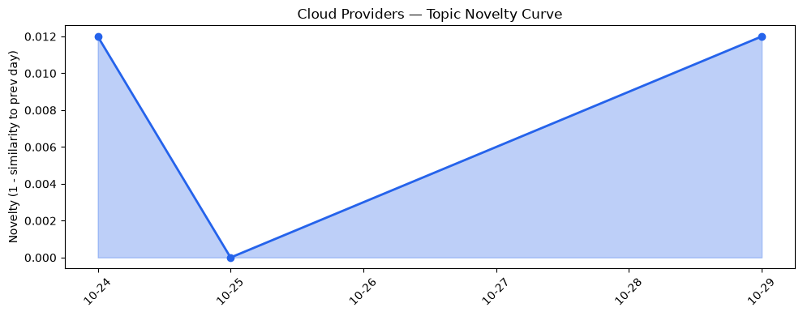
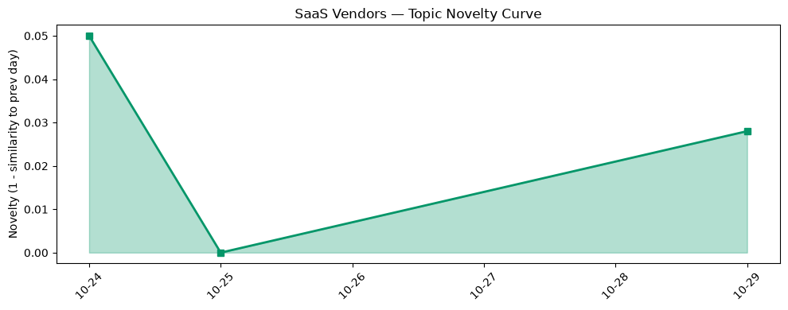

## 今日云计算结构性变化
> **AWS 与 Azure 同时推出多项云原生与 AI 关键服务，标志着云平台从“工具集合”向“智能体平台”快速转型。**

今天最值得注意的结构性变化是：  
1️⃣ AWS 通过 **Amazon ECS Gateway** 与 **Lambda Web Functions** 把容器入口与无服务器 Web 计算抽象为即插即用的原语；  
2️⃣ Azure 以《Evolving the cloud‑native foundation for the next generation of AI》与《Advancing hardware security with open‑source Integrated HSM technology》双篇文章，强化底层安全与 AI‑native 容器堆栈；  
3️⃣ AI/ML 与基础设施深度融合，出现 **Bedrock Managed Agents、Well‑Architected Agent、Continuum for Code Vulnerabilities** 等“AI 代理”服务，平台角色从资源提供者跃升为 **智能体中枢**。

趋势报告的唯一显著信号是技术层出现全新话题（相似度 0），属于 **新兴方向**。  

- 🆕 **新兴方向**：技术层出现全新话题（相似度 0），预示云原生与 AI 代理的融合正进入早期爆发期。  

## 技术层信号
🔴 重大突破  

AWS 本周发布 **Amazon ECS Gateway**，提供全托管的入口层，直接把外部流量映射到 ECS 服务，省去传统 ALB/Ingress 的配置成本，显著提升容器化部署的易用性与性能【[Introducing Amazon ECS Gateway](https://aws.amazon.com/blogs/aws/introducing-amazon-ecs-gateway-a-fully-managed-ingress-solution-for-ecs-services/)】。同日，**Lambda Web Functions** 将无服务器函数升级为可直接响应 Web 请求的原语，解决了冷启动与响应一致性问题，为前端开发者提供了“一键部署、全局加速”的新体验【[Announcing AWS Lambda Web Functions](https://aws.amazon.com/blogs/aws/announcing-aws-lambda-web-functions-for-fast-consistent-web-app-performance-anywhere/)】。

Azure 则在云原生堆栈上同步发力。通过《Evolving the cloud‑native foundation for the next generation of AI》阐述了对 **K8s、Serverless 与大模型推理** 的统一抽象，推出 **Maia 300** 架构专用于大规模 agentic 推理，提升算力密度与调度效率【[Evolving the cloud‑native foundation for the next generation of AI](https://azure.microsoft.com/en-us/blog/evolving-the-cloud-native-foundation-for-the-next-generation-of-ai/)】。与此同时，Azure 公布 **开源 Integrated HSM**，把硬件安全模块的可编程性引入云原生生态，直接支撑 AI 模型的密钥管理与可信执行【[Advancing hardware security with open‑source Integrated HSM technology](https://azure.microsoft.com/en-us/blog/advancing-hardware-security-with-open-source-integrated-hsm-technology/)】。

AI 驱动的运维与安全服务也同步上线：**AWS Well‑Architected Agent** 通过大模型实时评估架构最佳实践，**Continuum for Code Vulnerabilities** 将 AI 代码审计嵌入 CI/CD 流程，形成“AI‑in‑the‑loop” 的全链路安全闭环【[Announcing AWS Well‑Architected Agent](https://aws.amazon.com/blogs/aws/announcing-aws-well-architected-agent-an-ai-powered-intelligence-to-optimize-your-cloud-environment-preview/)】。Google Cloud 侧则发布 **GKE networking for large‑scale AI agents**，展示网络层如何支撑数千并发 AI 代理的高密度调度【[How GKE networking scales to support high densities of concurrent AI agents](https://cloud.google.com/blog/products/networking/gke-networking-dataplane-for-large-agentic-ai-workloads/)】。

在安全前沿，**Cloudflare** 推出面向地理围栏的 **后量子密钥管理**，为跨境数据合规与未来抗量子攻击提供了原生云服务【[Bringing post‑quantum cryptography to geographically fenced key management](https://blog.cloudflare.com/post-quantum-geo-key-manager/)】。火山引擎发布 **ByteHouse** 云数仓及四款实时数据产品，提升大数据存储、查询与实时分析的统一能力，进一步夯实 AI 数据底座。

整体来看，技术层的创新已从单点功能向 **全栈 AI‑agentic 平台** 迁移，容器、Serverless 与硬件安全共同构成新一代云原生基石。

## 产业资本信号
🟡 中等信号  

- **基础设施资本流向**：AWS 与 Azure 的多项 AI‑native 功能均以预览或快速迭代方式发布，暗示资本正向 **AI 代理平台** 与 **安全硬件** 投入，后者在企业合规与模型保护上具备高溢价。  
- **应用层资本布局**：火山引擎的 ByteHouse 及其数据产品在国内企业数字化转型中获得多轮融资，显示 **国产大数据云仓** 正成为资本热点。  
- **安全与后量子**：Cloudflare 的后量子密钥管理已在安全基金的关注名单中，多家专注量子安全的 VC 正在评估其商业化路径。  
- **并购与估值**：截至目前未出现大规模并购，但各大云厂商的 **AI Agent** 业务已进入估值模型的核心变量，后续可能出现围绕 **AI 工作流编排** 的收购潮。

## 潜在拐点判断
🔍 **拐点**：技术层出现全新话题（相似度 0）与多家主流云厂商同步推出 **AI 代理平台**，标志着 **“云平台 → 智能体平台”** 的结构性转折。若该趋势在未来 2‑4 周内保持高频发布与用户采纳，将导致：  
1. 云原生生态从 **容器/Serverless** 向 **Agent‑centric** 重构；  
2. 基础设施定价模型从 “按资源” 向 “按智能体使用” 迁移；  
3. SaaS 厂商将加速对 **AI Agent API** 的集成，形成新一轮 **AI‑augmented SaaS** 竞争格局。  

当前观察到的信号强度为 **重大突破**，但资本层面的直接资金流动仍在酝酿，故拐点的显现仍需后续验证。

## 明日观察点
1. **AI Agent 使用量**：监测 AWS Well‑Architected Agent、Azure Maia 300、GKE AI networking 的实际调用量，若日均调用 > 10,000 次，说明平台化进入实用阶段。  
2. **安全硬件采纳率**：关注 Azure Integrated HSM 与 Cloudflare 后量子密钥管理的企业签约数，若新增签约 > 50 家，安全硬件将成为云原生必备层。  
3. **SaaS 对接情况**：追踪 Salesforce、ServiceNow 等主流 SaaS 是否发布对接 **AI Agent** 的 SDK/插件，若出现官方集成，则 AI‑agentic 生态进入横向扩散期。

## 长期趋势坐标
从 **metrics_report** 可见，云厂商话题的 novelty_score 仅 0.016，整体趋势仍属 **延续**，但技术层出现的全新话题（novelty 1.0）是一次 **高幅度离散**，预示短期内会在趋势曲线上形成明显的尖峰。SaaS 侧的 novelty_score 为 0.045，亦呈现轻微上扬，说明 **AI‑agentic** 正在向上游云平台渗透并向下游 SaaS 迁移。若未来 30 天内该尖峰保持或扩大，整体行业将进入 **AI‑agentic 主导的结构性新阶段**。

## 数据洞察
### 云厂商话题演化
- novelty_score: 0.016（延续）  
- article_count: 46  
- 近期核心关键词：ECS Gateway、Lambda Web Functions、Well‑Architected Agent、Maia 300、Integrated HSM。

### SaaS 厂商话题演化
- novelty_score: 0.045（延续）  
- article_count: 20  
- 关注点：AI Agent 接口、模型安全、后量子合规。

### 趋势图
  
  

## 参考来源
- **AWS**  
  - [Introducing Amazon ECS Gateway: A fully-managed ingress solution for ECS services](https://aws.amazon.com/blogs/aws/introducing-amazon-ecs-gateway-a-fully-managed-ingress-solution-for-ecs-services/) — AWS Blog  
  - [Announcing AWS Lambda Web Functions](https://aws.amazon.com/blogs/aws/announcing-aws-lambda-web-functions-for-fast-consistent-web-app-performance-anywhere/) — AWS Blog  
  - [Announcing AWS Well‑Architected Agent, an AI‑powered intelligence to optimize your cloud environment (preview)](https://aws.amazon.com/blogs/aws/announcing-aws-well-architected-agent-an-ai-powered-intelligence-to-optimize-your-cloud-environment-preview/) — AWS Blog  

- **Google Cloud**  
  - [How GKE networking scales to support high densities of concurrent AI agents](https://cloud.google.com/blog/products/networking/gke-networking-dataplane-for-large-agentic-ai-workloads/) — Google Cloud Blog  

- **Microsoft Azure**  
  - [Evolving the cloud‑native foundation for the next generation of AI](https://azure.microsoft.com/en-us/blog/evolving-the-cloud-native-foundation-for-the-next-generation-of-ai/) — Azure Blog  
  - [Advancing hardware security with open‑source Integrated HSM technology](https://azure.microsoft.com/en-us/blog/advancing-hardware-security-with-open