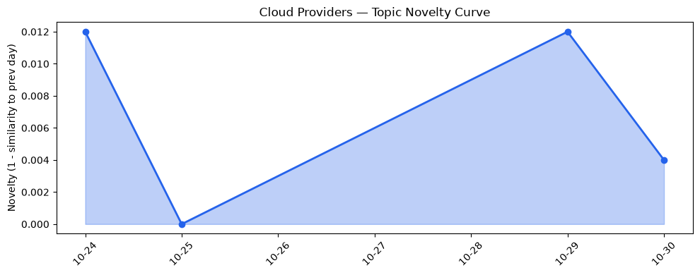
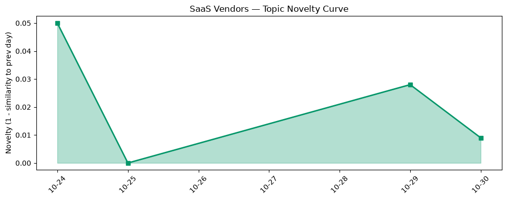

## 今日云计算结构性变化
> AI深度嵌入云原生堆栈，AWS、Google Cloud 与 Azure 同步推出生成式AI、跨云安全与主权计算服务，标志云计算进入智能化、跨行业规模化商用新阶段。

今天的核心结构性变化在于 **AI 代理从实验室走向云原生平台的底层服务**，三大公有云同步发布的生成式 AI、容器/Serverless 组合以及主权 AI 方案，使得 AI 工作负载不再是“点装”，而是成为云基础设施的第一类资源。  
这意味着云计算的竞争焦点从算力与存储转向 **AI 可编排性、跨云合规与安全治理**，企业将直接在云平台上采购“AI 即服务”，而不是自行搭建模型推理层。

- 📈 **持续趋势**：技术层话题向量最近 5 天内 3/4 天递增，表明 AI‑native 正在持续升温。  
- 🆕 **新兴方向**：container、data compliance、edge computing、post‑quantum、risk 等关键词首次出现。  
- 🔑 **新关键词**：generative AI、multi‑cloud、sovereign AI、AI agents。  

## 技术层信号
🔴 重大突破

AWS 本轮聚焦 **计算与安全智能化**：推出 Lambda Web Functions 与 Amazon ECS Gateway，实现无服务器函数直接暴露为 HTTP 接口，同时提供全托管的容器入口层，降低 AI 微服务的部署门槛【[AWS Weekly Roundup](https://aws.amazon.com/blogs/aws/aws-weekly-roundup-aws-lambda-web-functions-amazon-s3-on-the-vercel-marketplace-and-more-october-19-2026/)】。  

Google Cloud 则把 **AI 深度嵌入容器网络**：GKE 数据平面支持大规模并发 AI 代理，能够在同一集群内高效调度数千个 Agent，实现“AI‑first” 的网络调度模型【[How GKE networking scales…](https://cloud.google.com/blog/products/networking/gke-networking-dataplane-for-large-agentic-ai-workloads/)】；同时推出 AlloyDB Omni UI 与 Cloud SQL 蓝绿部署，提升数据库观测与零停机升级能力【[AlloyDB UI](https://cloud.google.com/blog/products/databases/cloud-sql-blue-green-deployments/)】。  

Azure 的 **全栈 AI‑native 基础设施** 进展最为系统：Copilot 在 Foundry Agent Service 的公开预览让企业可以通过低代码把 AI 助手嵌入业务流程【[Microsoft Copilot harness](https://devblogs.microsoft.com/foundry/microsoft-copilot-harness-in-foundry/)】；Maia 300 推理平台专为大模型提供高吞吐、低延迟算力；同时发布 Integrated HSM 与 Cloudflare 合作的后量子 GeoKey Manager，构建从边缘到云的 **主权 AI 与后量子安全** 链路【[Post‑quantum GeoKey Manager](https://blog.cloudflare.com/post-quantum-geo-key-manager/)】。  

趋势报告显示，技术层话题向量已连续 5 天递增（单调比 0.75，置信度 0.75），与上述三家同步发布的 AI‑native 功能形成呼应，表明行业正进入 **AI‑native 计算的加速期**。

## 产业资本信号
⚪ 弱信号

截至今日，公开的融资、并购或估值变动尚未出现。资本层面的热度仍集中在 **前期布局**（如各大云厂商的 AI 基础设施投入），而非新一轮融资或并购。可视为 **资金在等待明确的商业化路径**，一旦 AI‑native 服务实现规模化收入，资本将快速跟进。

## 潜在拐点判断
## 潜在拐点判断
基于三大云厂商同步推出的生成式 AI、跨云安全与主权计算服务，以及技术层话题的持续增强，**AI‑native 云原生堆栈正逼近行业拐点**。  
拐点表现为：

1. **AI 代理从垂直业务转向平台级服务**：Lambda Web Functions、GKE AI‑agent 网络、Azure Copilot Agent Service 均把 AI 代理抽象为可复用的云原生资源。  
2. **合规与安全成为算力竞争的关键维度**：Azure 的主权 AI 与后量子 HSM、Cloudflare 的 KV 缓存安全补丁显示，模型合规、数据主权已上升为硬核竞争点。  
3. **跨云与多租户 AI 推理平台的雏形**：Maia 300、ECS Gateway、GKE 大规模 AI 代理网络共同构筑了跨云统一调度的技术基座。

若这些信号在未来两周内继续叠加（如更多行业案例、付费模型推出），我们可能看到 **AI‑native 计费模型（按推理 token、Agent 并发数）取代传统 CPU/GPU 按量计费**，从而重塑云计算收入结构。

## 明日观察点
1. **AI 代理计费模型落地**：关注 AWS、Azure、Google 是否公布基于 Agent 并发或 token 的计费细则。  
2. **主权 AI 合规标准**：留意欧盟、美国监管机构对“主权 AI”概念的正式定义及合规审查流程。  
3. **跨云安全产品发布**：监测是否出现统一的多云安全治理平台（如跨云 IAM、统一审计）以及其与生成式 AI 的集成情况。

## 长期趋势坐标
从 **cloud_topic_evolution** 的 novelty_score 0.016 与 **saas_topic_evolution** 的 0.039 可见，整体话题热度保持低波动、但 SaaS 侧的创新度略高，说明 **AI‑native 云服务正向上游（基础设施）渗透，同时在 SaaS 场景形成新价值链**。若未来 1‑3 个月内 novelty 持续上升，预示 AI‑native 将从技术预热转向商业化爆发。

## 数据洞察
### 云厂商话题演化
- novelty_score: 0.016，mean_similarity: 0.984，趋势：延续。  
- 关键词新增：container、data compliance、edge computing、post‑quantum、risk。  

### SaaS 厂商话题演化
- novelty_score: 0.039，mean_similarity: 0.961，趋势：延续。  
- 关键词上升：AI agents、generative AI、sovereign AI。  

### 趋势图
  
  

## 参考来源
### 云厂商
- [How GKE networking scales to support high densities of concurrent AI agents](https://cloud.google.com/blog/products/networking/gke-networking-dataplane-for-large-agentic-ai-workloads/) — Google Cloud Blog  
- [How to troubleshoot GKE workloads faster with VPC Flow Logs](https://cloud.google.com/blog/products/containers-kubernetes/using-vpc-flow-logs-to-troubleshoot-gke-workloads/) — Google Cloud Blog  
- [Near-zero downtime upgrades: Announcing Cloud SQL for MySQL blue‑green deployments](https://cloud.google.com/blog/products/databases/cloud-sql-blue-green-deployments/) — Google Cloud Blog  
- [AWS Weekly Roundup: AWS Lambda Web Functions, Amazon S3 on the Vercel Marketplace, and more](https://aws.amazon.com/blogs/aws/aws-weekly-roundup-aws-lambda-web-functions-amazon-s3-on-the-vercel-marketplace-and-more-october-19-2026/) — AWS Blog  
- [Introducing Amazon ECS Gateway: A fully-managed ingress solution for ECS services](https://aws.amazon.com/blogs/aws/introducing-amazon-ecs-gateway-a-fully-managed-ingress-solution-for-ecs-services/) — AWS Blog  
- [AWS Continuum for code vulnerabilities is now generally available](https://aws.amazon.com/blogs/aws/aws-continuum-for-code-vulnerabilities-is-now-generally-available/) — AWS Blog  
- [Introducing the Microsoft Copilot harness in Foundry Agent Service](https://devblogs.microsoft.com/foundry/microsoft-copilot-harness-in-foundry/) — Microsoft Azure Blog  
- [Deep dive into Azure Maia 300 architecture](https://azure.microsoft.com/en-us/blog/deep-dive-into-azure-maia-300-architecture/) — Microsoft Azure Blog  
- [Evolving the cloud-native foundation for the next generation of AI](https://azure.microsoft.com/en-us/blog/evolving-the-cloud-native-foundation-for-the-next-generation-of-ai/) — Microsoft Azure Blog  

### SaaS 与行业
- [How Commerce.com and Cloudflare are getting storefronts ready for AI agents](https://blog.cloudflare.com/webmcp-commerce/) — Cloudflare Blog  
- [Designing for sovereign AI: A shared foundation from edge to cloud](https://azure.microsoft.com/en-us/blog/designing-for-sovereign-ai-a-shared-foundation-from-edge-to-cloud/) — Microsoft Azure Blog  
- [Managing open-weight model risk in enterprise deployments](https://azure.microsoft.com/en-us/blog/managing-open-weight-model-risk-in-enterprise-deployments/) — Microsoft Azure Blog  
- [Cloudflare DDoS Threat Report 2026 Q3: More swarms, fewer giants](https://blog.cloudflare.com/ddos-threat-report-2026-q3/) — Cloudflare Blog  
- [Cross-request KV cache exposure in the GLM-5.3 Workers AI model, and our remediation with SGLang](https://blog.cloudflare.com/kv-cache-exposure-remediation/) — Cloudflare Blog  
- [火山引擎正式推出四款数据产品 将持续完善敏捷数智引擎矩阵](https://www.cnblogs.com/volcengine/p/15640481.html) — 火山引擎博客  

---