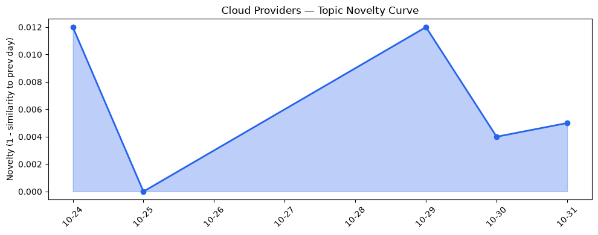
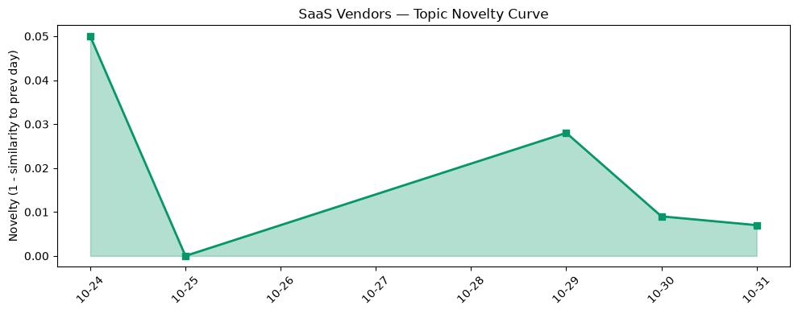

## 今日云计算结构性变化
> AI 正在成为云、SaaS 与安全生态的核心连接层，驱动集成服务、并购加速以及云原生安全与合规升级。

今天最值得注意的结构性变化是：**AI 与安全深度融合**正从概念走向平台化实现，四大公有云和 Cloudflare 同时推出 AI‑native 的安全与合规功能，形成“AI‑centric cloud”新范式。与此同时，Google 引入 **Spend Caps**、Azure 推出 **主权云**，显示企业对成本可控性与数据主权的需求正在同步上升。

- 📈 **持续趋势**：技术层话题向量已连续 6 天递增；基础设施话题向量同样连续 6 天递增。  
- 🆕 **新兴方向**：AI security、Post‑Quantum、AlloyDB Omni、Kubernetes API、Spend caps、云原生。  
- 🔺 **突然升温**：服务器无状态计算（Lambda Web Functions、ECS Gateway）与硬件安全模块（Integrated HSM、GeoKey Manager）在近三天内集中出现。  
- 🔑 **新关键词**：AI‑centric cloud、AI security、Post‑Quantum、Spend caps、云原生。  

## 技术层信号
🟡 渐进改善  

AWS 本月推出 **Amazon ECS Gateway** 与 **Lambda Web Functions**，把无状态计算与高性能入口层进一步云原生化，降低了开发者在容器与 Serverless 之间的切换成本。[Introducing Amazon ECS Gateway](https://aws.amazon.com/blogs/aws/introducing-amazon-ecs-gateway-a-fully-managed-ingress-solution-for-ecs-services/)；[Announcing AWS Lambda Web Functions](https://aws.amazon.com/blogs/aws/announcing-aws-lambda-web-functions-for-fast-consistent-web-app-performance-anywhere/)。Google Cloud 则在 **AlloyDB Omni** 上加入 Web UI 与跨湖仓 Iceberg 查询，提升了 AI 训练数据的可观测性与统一查询能力。[Introducing the AlloyDB Omni web UI](https://cloud.google.com/blog/products/databases/alloydb-omni-delivers-a-web-ui-for-cluster-observability/)。Azure 发布的 **Evolving the cloud‑native foundation for the next generation of AI** 把硬件安全模块（HSM）审计日志开放为公开 API，强化了 AI 工作负载的合规审计。[Evolving the cloud‑native foundation for the next generation of AI](https://azure.microsoft.com/en-us/blog/evolving-the-cloud-native-foundation-for-the-next-generation-of-ai/)。Cloudflare 则推出 **Post‑Quantum GeoKey Manager**，在地理围栏内提供抗量子密码的密钥管理，标志着云原生安全进入后量子时代。[Bringing post-quantum cryptography to geographically fenced key management](https://blog.cloudflare.com/post-quantum-geo-key-manager/)。

在基础设施层面，AWS 的 **Continuum** 与 **Well‑Architected Agent** 为代码漏洞检测与自动化优化提供 AI 驱动的闭环，进一步把 AI 融入 DevSecOps 流程。[AWS Continuum for code vulnerabilities](https://aws.amazon.com/blogs/aws/aws-continuum-for-code-vulnerabilities-is-now-generally-available/)。Google 在 **Knowledge Catalog** 中扩展语义模型，提升跨数据湖的 AI 元数据检索能力。[What’s new in AI infrastructure and orchestration in October](https://cloud.google.com/blog/topics/ai-infrastructure/whats-new-in-ai-infrastructure-this-month/)。这些改进虽非颠覆式，但在 AI‑native、云原生安全与合规的叠加效应下，已形成技术层的渐进提升。

## 产业资本信号
🟡 中等信号  

在资本层面，**成本控制与合规需求**成为资金流向的关键指引。Google Cloud 将 **Spend Caps** 设为平台级消费上限工具，帮助企业在 AI 大模型训练成本失控前实现预算硬约束，预示着云计费模型的细分化将吸引更多企业级预算管理工具的投资。[Innovate on your own business terms: Google Cloud spend caps now generally available](https://cloud.google.com/blog/topics/cost-management/google-cloud-spend-caps-now-generally-available/)。Azure 的 **主权云** 选项覆盖多地区，提供更强的数据主权与合规选项，预计会刺激本地政府与金融行业的专项基金投入。[Advancing digital sovereignty with greater control and choice](https://blogs.microsoft.com/blog/2026/10/20/advancing-digital-sovereignty-with-greater-control-and-choice/)。

在算力供应侧，**火山引擎** 通过四款数据产品（DataLeap、ByteHouse、湖仓分析、E‑MapReduce）强化大规模分析能力，吸引了国内 AI 初创企业的融资关注。Cloudflare 将 **Private Origins** 公开化，提供专属计算与安全加速节点，可能促成边缘计算与安全服务的并购整合。[Cloudflare services for private origins is now generally available](https://blog.cloudflare.com/private-origins-public-to-private/)。

整体来看，资本正从单纯算力扩容转向 **AI‑安全、合规与成本治理** 三大方向的细分布局，尚未出现大规模并购浪潮，但相关技术路演与专项基金的活跃度已提升。

## 潜在拐点判断
AI‑安全与合规正从边缘功能跃升为云平台的核心竞争力。连续 6 天的技术与基础设施话题上升、以及新出现的 “AI security” 与 “Post‑Quantum” 关键词，表明行业正进入 **AI‑native 云原生安全** 的拐点。若该趋势在下月保持，可能导致：
1. 公有云在安全合规层面的差异化竞争加剧；
2. 企业采购预算从算力转向安全与合规服务；
3. 并购热点从数据中心向安全技术公司（如 HSM、后量子密码）倾斜。  
当前拐点仍处于萌芽阶段，需观察后续的资本投入与产品化进度。

## 明日观察点
1. **AI 安全服务的付费模型**：是否出现基于 AI 检测的按量计费或订阅套餐？  
2. **主权云区域扩容**：Azure、阿里云、腾讯云是否在更多国家/地区推出主权云选项？  
3. **后量子密钥管理的生态**：Cloudflare 的 GeoKey Manager 是否吸引第三方安全厂商集成，形成生态链？

## 长期趋势坐标
从 30 天的整体新颖度 0.451 与云/ SaaS 话题的 “延续” 趋势来看，AI‑centric 与安全融合仍是中长期的增长引擎。技术层的渐进改善与基础设施的持续升温表明，行业正从“AI 赋能”向“AI + 安全 + 合规”三位一体的生态转型。未来 3‑6 个月，预计 novelty 分数将保持在 0.02‑0.04 区间，若出现大规模并购或新安全标准发布，可能触发突增。

## 数据洞察
### 云厂商话题演化
- novelty_score: 0.016  
- mean_similarity: 0.984  
- trend: 延续（5 天）  
- article_count: 46  

### SaaS 厂商话题演化
- novelty_score: 0.037  
- mean_similarity: 0.963  
- trend: 延续（5 天）  
- article_count: 20  

### 趋势图
  
  

## 参考来源
### 云厂商
- [Introducing Amazon ECS Gateway: A fully‑managed ingress solution for ECS services](https://aws.amazon.com/blogs/aws/introducing-amazon-ecs-gateway-a-fully-managed-ingress-solution-for-ecs-services/) — AWS Blog  
- [Announcing AWS Lambda Web Functions](https://aws.amazon.com/blogs/aws/announcing-aws-lambda-web-functions-for-fast-consistent-web-app-performance-anywhere/) — AWS Blog  
- [AWS Continuum for code vulnerabilities is now generally available](https://aws.amazon.com/blogs/aws/aws-continuum-for-code-vulnerabilities-is-now-generally-available/) — AWS Blog  
- [What’s new in AI infrastructure and orchestration in October](https://cloud.google.com/blog/topics/ai-infrastructure/whats-new-in-ai-infrastructure-this-month/) — Google Cloud Blog  
- [When the Kubernetes API went silent: A three-layer networking mystery](https://cloud.google.com/blog/products/networking/the-three-layer-gke-network-mystery/) — Google Cloud Blog  
- [Introducing the AlloyDB Omni web UI for easier cluster observability](https://cloud.google.com/blog/products/databases/alloydb-omni-delivers-a-web-ui-for-cluster-observability/) — Google Cloud Blog  
- [Innovate on your own business terms: Google Cloud spend caps now generally available](https://cloud.google.com/blog/topics/cost-management/google-cloud-spend-caps-now-generally-available/) — Google Cloud Blog  
- [Evolving the cloud‑native foundation for the next generation of AI](https://azure.microsoft.com/en-us/blog/evolving-the-cloud-native-foundation-for-the-next-generation-of-ai/) — Microsoft Azure Blog  
- [Advancing hardware security with open-source Integrated HSM technology](https://azure.microsoft.com/en-us/blog/advancing-hardware-security-with-open-source-integrated-hsm-technology/) — Microsoft Azure Blog  
- [Advancing digital sovereignty with greater control and choice](https://blogs.microsoft.com/blog/2026/10/20/advancing-digital-sovereignty-with-greater-control-and-choice/) — Microsoft Blog  
- [Bringing post-quantum cryptography to geographically fenced key management](https://blog.cloudflare.com/post-quantum-geo-key-manager/) — Cloudflare Blog  
- [Cloudflare services for private origins is now generally available](https://blog.cloudflare.com/private-origins-public-to-private/) — Cloudflare Blog  

### 国内厂商
- [火山引擎正式推出四款数据产品 将持续完善敏捷数智引擎矩阵](https://www.cnblogs.com/volcengine/p/15640481.html) — 火山引擎博客