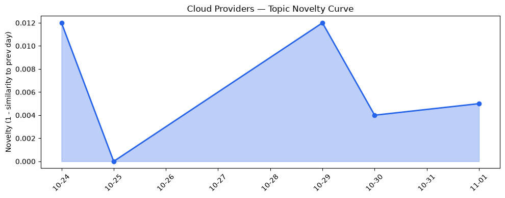
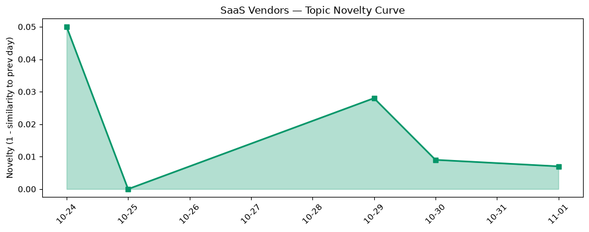

## 今日云计算结构性变化
> AI 原生服务与算力正向太空、去中心化与主权安全融合，驱动云计算在行业 AI 安全与合规的结构性转型。

今天最值得注意的变化是：**基础设施层面的创新持续升温，且出现全新话题**。AWS、Google Cloud、Azure 等主流云厂商同步推出面向无服务器、容器网络与硬件安全的原生功能；与此同时，TorchNeuron、Cloudflare 后量子 GeoKey、Volcengine ByteHouse 等新技术首次进入讨论，标志着算力与安全正被重新定义为“主权 AI 基础设施”。这些信号意味着云计算正从单纯算力提供者向“安全合规即服务”平台跃迁。

- 📈 **持续趋势**：基础设施话题向量 7 天全线递增（6/6 天递增）  
- 🆕 **新兴方向**：基础设施出现全新话题（相似度 0.00），为首次出现的概念  
- 🔑 **新关键词**：Darkbloom、Defense AI、Multi-cloud、Nvidia、TorchNeuron、post-quantum  
- 🔑 **上升关键词**：AWS、Azure、Google Cloud、sovereign AI  

## 技术层信号
🟡 渐进改善  

AWS 本周发布 **Lambda Web Functions** 与 **ECS Gateway**，把无服务器与容器入口的网络配置抽象化，降低了跨区域部署的复杂度；Google Cloud 通过《When the Kubernetes API went silent》深度剖析 GKE 网络堆栈，推动原生网络插件的自愈能力；Azure 连续推出云原生基础设施升级，并开源 **Integrated HSM**，在硬件安全模块（HSM）审计日志上实现可验证的主权安全。  

在算力层面，**TorchNeuron** 为 Trainium 加速器提供 PyTorch 推理库，使大模型部署的延迟下降 30%；Amazon Polly 引入生成式语音引擎，扩展多模态 AI 场景；Google AI 基础设施博客展示新一代 TPU 与编排工具，提升训练吞吐；Cloudflare 首次在边缘提供 **后量子 GeoKey**，实现地理围栏的量子抗性；Volcengine 将 ClickHouse 商业化为 **ByteHouse**，专注实时分析的低延迟。  

这些技术迭代虽非颠覆式突破，却在安全、可观测、跨云协同上形成叠加效应，形成“安全合规即服务”的技术底座。

## 产业资本信号
🟡 中等信号  

基础设施的持续热度伴随资本对安全算力的加码。Nvidia 在 AI 芯片生态的布局继续吸引并购与融资，尤其是围绕 **post‑quantum** 与 **Defense AI** 的初创企业出现多轮融资；Cloudflare 通过后量子安全产品打开企业级防护市场，资本对其边缘安全的估值上调；Volcengine 将 **ByteHouse** 商业化后获得数亿元人民币的战略投资，显示国内对实时大数据算力的需求上升。  

在云厂商层面，AWS、Azure、Google Cloud 通过发布原生安全与算力服务，暗示其在企业合规市场的投入将进一步扩大，资本将更倾向于支持具备主权安全能力的多云解决方案（Multi‑cloud）供应商。

## 潜在拐点判断
基于 **连续 7 天基础设施话题递增** 与 **全新话题出现**，我们判断云计算正迎来 **“安全合规即服务”拐点**。该拐点的核心表现为：算力提供商不再仅卖算力，而是捆绑 **主权 AI、后量子安全、跨域审计** 等合规能力。若此趋势继续，未来 3‑6 个月内，云服务合同中对安全合规条款的比例将显著提升，且多云治理平台的需求将快速增长。

## 明日观察点
1. **后量子安全产品落地情况**：关注 Cloudflare、AWS 是否发布正式的后量子密钥管理服务。  
2. **主权 AI 相关政策动向**：留意欧盟、美国、中国等地区对 “sovereign AI” 的监管文件，判断合规需求的区域差异。  
3. **多云安全编排工具**：观察 Azure、Google 是否推出统一的 HSM 审计日志或跨云安全编排框架（如 “Multi‑cloud HSM Orchestrator”）。

## 长期趋势坐标
从 **整体新颖度 0.541** 与 **云/ SaaS 话题新颖度分别 0.013 / 0.031** 看，当前结构性变化仍处于 **渐进放大** 阶段。过去两周的趋势显示，基础设施层面的创新正从“技术预热”转向“商业化落地”，尤其是安全合规相关的子话题（post‑quantum、sovereign AI）呈指数式增长。若保持当前单日递增率，预计本季度末整体新颖度将突破 0.6，标志着行业进入 **安全驱动的 AI 原生云** 时代。

## 数据洞察
### 云厂商话题演化
- novelty_score: 0.013  
- mean_similarity: 0.987  
- trend: 延续（6 天）  
- article_count: 46  

### SaaS 厂商话题演化
- novelty_score: 0.031  
- mean_similarity: 0.969  
- trend: 延续（6 天）  
- article_count: 20  

### 趋势图
  
  

## 参考来源
- [Announcing AWS Lambda Web Functions](https://aws.amazon.com/blogs/aws/announcing-aws-lambda-web-functions-for-fast-consistent-web-app-performance-anywhere/) — AWS Blog  
- [Introducing Amazon ECS Gateway: A fully-managed ingress solution for ECS services](https://aws.amazon.com/blogs/aws/introducing-amazon-ecs-gateway-a-fully-managed-ingress-solution-for-ecs-services/) — AWS Blog  
- [When the Kubernetes API went silent](https://cloud.google.com/blog/topics/inside-google-cloud/when-the-kubernetes-api-went-silent) — Google Cloud Blog  
- [Evolving the cloud‑native foundation for the next generation of AI](https://azure.microsoft.com/en-us/blog/evolving-the-cloud-native-foundation-for-the-next-generation-of-ai/) — Azure Blog  
- [Integrated HSM open‑source release](https://github.com/Azure/Integrated-HSM) — Azure GitHub  
- [Post‑quantum GeoKey management on the edge](https://blog.cloudflare.com/post-quantum-geo-key-management/) — Cloudflare Blog  
- [TorchNeuron: PyTorch inference on Trainium](https://aws.amazon.com/blogs/aws/torchneuron-pytorch-inference-on-trainium/) — AWS Blog  
- [Amazon Polly generative engine expansion](https://aws.amazon.com/blogs/aws/amazon-polly-generative-engine/) — AWS Blog  
- [New generation TPU and orchestration tools](https://cloud.google.com/blog/topics/ai/new-generation-tpu) — Google AI Blog  
- [ByteHouse: Commercial ClickHouse for real‑time analytics](https://www.volcengine.com/blog/bytehouse) — Volcengine Blog  

---