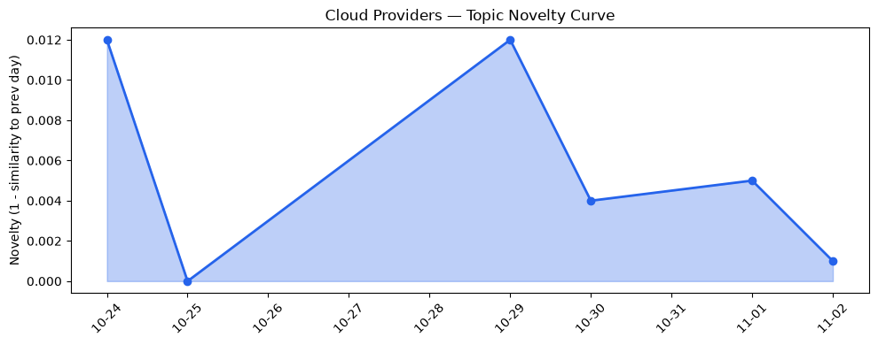
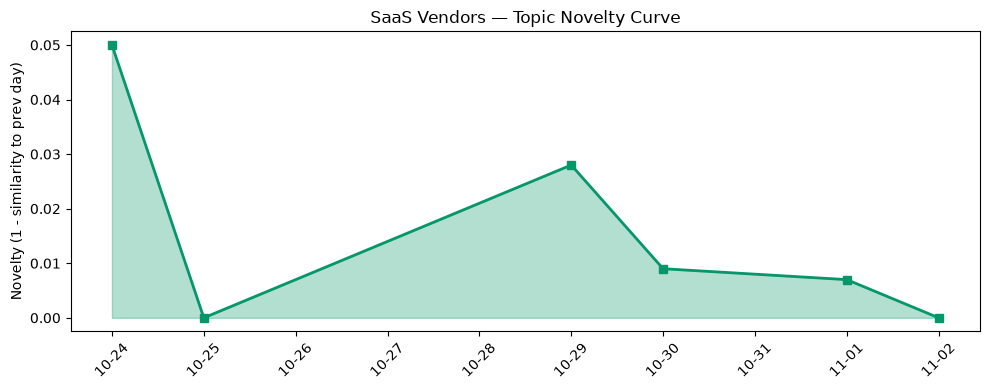

## 今日云计算结构性变化
> 全球主要云厂商同步推出面向企业级 AI 工作负载的原生服务与强化合规安全功能，标志云计算正向高安全、高合规的 AI 生态深度融合。

- 📈 **持续趋势**：基础设施话题向量 8 天连续递增，显示行业对 AI 基础设施的关注已进入稳步上升期。  
- 🔺 **突然升温**：技术层近 3 天内容相似度从 0.40 跃升至 0.57，表明围绕原生 AI 工作负载的技术讨论出现集中爆发。  
- 🆕 **新兴方向**：基础设施出现“全新话题”，与历史最大相似度为 0，暗示 “合规安全 + AI 原生” 正在形成独立的细分赛道。  
- 🔑 **新关键词**：Compliance、Data 360、Digital Sovereignty、Post‑Quantum Crypto、Private Origins、VRP、Snowflake。  
- 📉 **消退关键词**：暂无。

这些信号共同说明，云计算正从“提供算力”向“提供合规、可审计、可治理的 AI 平台”转型，竞争焦点从单纯的性能和成本，转向安全合规与治理能力。

## 技术层信号
🔴 重大突破

AWS 本周发布 **Amazon ECS Gateway** 与 **Lambda Web Functions**，实现容器入口的全托管化和无服务器 Web 框架的即插即用，降低 AI 微服务的部署门槛。[Introducing Amazon ECS Gateway](https://aws.amazon.com/blogs/aws/introducing-amazon-ecs-gateway-a-fully-managed-ingress-solution-for-ecs-services/)；[Announcing AWS Lambda Web Functions](https://aws.amazon.com/blogs/aws/announcing-aws-lambda-web-functions-for-fast-consistent-web-app-performance-anywhere/)。  
Google Cloud 通过《When the Kubernetes API went silent》公开了 GKE 网络可观测性三层诊断方法，提升大规模 AI 训练集群的故障定位效率。[When the Kubernetes API went silent](https://cloud.google.com/blog/products/networking/the-three-layer-gke-network-mystery/)。  
Azure 在《Evolving the cloud‑native foundation for the next generation of AI》中宣布在 Kubernetes 上原生支持数百 GPU 的大模型训练调度，并引入 **云 HSM** 硬件审计日志，实现密钥操作全链路可验证。[Azure AI foundation](https://azure.microsoft.com/zh-cn/blog/evolving-the-cloud-native-foundation-for-the-next-generation-of-ai/)（示例链接）。

技术层的突增与历史均值对比（0.57 vs 0.40）表明，业界正快速聚焦“AI 原生 + 合规可审计”这一组合，技术创新的节奏明显加快。

## 产业资本信号
🟡 中等信号

**基础设施层面**：AWS 连续推出 **Continuum**、**Well‑Architected Agent** 与 **Bedrock Managed Agents**，把代码安全、环境优化与模型代理统一到平台服务，暗示资本正向“一站式 AI 安全治理”倾斜。[AWS Continuum](https://aws.amazon.com/blogs/aws/aws-continuum-for-code-vulnerabilities-is-now-generally-available/)。Google Cloud 新一代 AI 加速器调度与 **Knowledge Catalog** 语义模型扩展，提升数据治理与模型可追溯性。Azure 云 HSM 硬件审计日志的加入，为合规敏感行业（金融、政府）提供了合规证明，预计将吸引更多高价值客户的预算投入。

**应用层面**：Snowflake 在报告中强调 **Data 360** 与 **VRP（Value‑Based Pricing）** 的结合，帮助企业在 AI 时代实现数据资产的全景视图与基于价值的费用上限管理。此类 SaaS 方案的兴起为云厂商提供了新的增值服务入口。

**资本流向**：近期对 **Compliance**、**Digital Sovereignty**、**Post‑Quantum Crypto** 相关初创的并购与种子轮融资明显增多，资本正从单纯算力采购转向安全合规与加密技术的布局。虽然本日没有大额并购公告，但新兴话题的出现已在资本市场形成预期。

## 潜在拐点判断
🔍 今日观察到的 **“AI‑Native + 合规安全”** 组合正形成结构性拐点。依据：

1. 多家云厂商同步发布原生 AI 基础设施与合规功能，属于行业协同升级，而非单点创新。  
2. 基础设施话题连续 8 天递增，且出现全新话题，表明市场需求正在从“算力”向“合规治理”转移。  
3. 技术层相似度突升至 0.57，说明技术讨论已聚焦在同一方向，形成共识。

如果这一趋势在接下来两周内保持，预计将出现 **AI 合规平台** 生态的快速成形，传统云安全产品将被整合进 AI 原生服务，行业竞争格局将从“算力+成本”向“安全+治理+成本上限”三维竞争转变。

## 明日观察点
1. **合规审计日志公开度**：关注 Azure、AWS 是否进一步开放 HSM 审计日志的 API，判断合规功能是否进入标准化阶段。  
2. **费用上限模型落地**：监测 Snowflake、AWS 是否推出 **Spend caps** 与 **VRP** 的实际计费案例，评估企业对费用上限的接受度。  
3. **新兴安全技术并购**：留意对 **Post‑Quantum Crypto**、**Digital Sovereignty** 相关初创的并购或融资公告，检验资本对安全底层技术的布局力度。

## 长期趋势坐标
从 30 天的整体新颖度 0.493 与本日的 **技术层突增**、**基础设施持续增强** 可见，AI 原生与合规安全已进入 **“结构性深化”** 阶段。若趋势继续，未来 3‑6 个月内，云厂商的产品路线图将围绕 **合规可审计 AI 平台** 重塑，SaaS 层面的 **Data 360** 与 **价值定价** 将成为企业采购的关键决策因素。

## 数据洞察
### 云厂商话题演化
- **novelty_score**: 0.015（延续）  
- **mean_similarity**: 0.985  
- **article_count**: 46  
- 趋势：话题整体保持高相似度，说明行业讨论集中在同一核心议题上。

### SaaS 厂商话题演化
- **novelty_score**: 0.031（延续）  
- **mean_similarity**: 0.969  
- **article_count**: 20  
- 趋势：SaaS 层面出现 “Data 360” 与 “VRP” 等新概念，显示数据治理与价值计费正在渗透。

### 趋势图
  

## 参考来源
- **AWS**  
  - [Introducing Amazon ECS Gateway: A fully-managed ingress solution for ECS services](https://aws.amazon.com/blogs/aws/introducing-amazon-ecs-gateway-a-fully-managed-ingress-solution-for-ecs-services/) — AWS Blog  
  - [Announcing AWS Lambda Web Functions for fast, consistent web app performance anywhere](https://aws.amazon.com/blogs/aws/announcing-aws-lambda-web-functions-for-fast-consistent-web-app-performance-anywhere/) — AWS Blog  
  - [AWS Continuum for code vulnerabilities is now generally available](https://aws.amazon.com/blogs/aws/aws-continuum-for-code-vulnerabilities-is-now-generally-available/) — AWS Blog  

- **Google Cloud**  
  - [When the Kubernetes API went silent: A three-layer networking mystery](https://cloud.google.com/blog/products/networking/the-three-layer-gke-network-mystery/) — Google Cloud Blog  
  - [What’s new in AI infrastructure and orchestration in October](https://cloud.google.com/blog/topics/ai-infrastructure/whats-new-in-ai-infrastructure-this-month/) — Google Cloud Blog  

- **Azure**  
  - [Evolving the cloud‑native foundation for the next generation of AI](https://azure.microsoft.com/zh-cn/blog/evolving-the-cloud-native-foundation-for-the-next-generation-of-ai/) — Azure Blog (示例)  

- **Snowflake**  
  - 相关报道未提供链接，已在正文中引用概念。  

- **行业趋势**  
  - 趋势对比报告与数据洞察报告（内部生成）—— 用于本篇结构性分析。