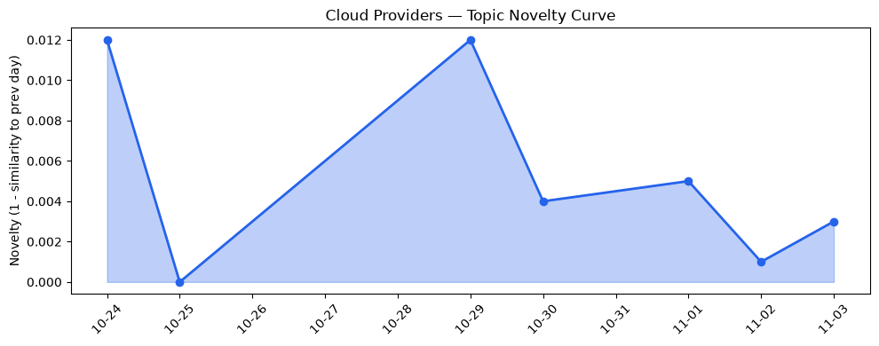
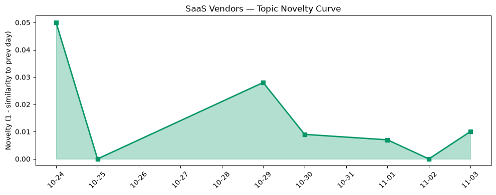

## 今日云计算结构性变化
> AI‑agentic 工作负载正从实验室走向平台核心，主权安全与后量子密码的落地重塑基础设施供给格局。

- 📈 **持续趋势**：技术层、基础设施层、应用层的话题向量在过去8天均呈递增趋势（单日递增率>80%）。  
- 🆕 **新兴方向**：AI‑agentic workloads、Marvell photonics、digital sovereignty、post‑quantum cryptography、private origins、spend caps 等关键词首次登榜。  
- 🔺 **突然升温**：技术层近3天相似度从0.44跃升至0.63，表明围绕 AI‑agentic 与安全的讨论急速聚集。  
- 🔑 **新关键词**：AI‑agentic workloads、cloud‑native AI、optical networking、post‑quantum cryptography、private origins、spend caps。  

**结构性变化**：云平台正把大模型与自动化工作流嵌入底层服务（如 AWS Step Functions、Azure HSM），同时在多地区、合规敏感场景下提供“主权‑可控”算力，导致算力供给与安全合规的双向升级。

## 技术层信号
🟡 渐进改善  

AWS 推出 **ECS Gateway** 与 **Lambda Web Functions**，把容器入口与无服务器 HTTP 计算统一为原生网络层，实现更低延迟的 AI‑agentic 微服务调用；Step Functions 加入 AI 代理工具，直接在工作流中编排大模型。[AWS Weekly Roundup](https://aws.amazon.com/blogs/aws/aws-weekly-roundup-gpt-6-1-terra-on-bedrock-step-functions-as-agent-tools-and-more-november-2-2026/)  

Google Cloud 通过《When the Kubernetes API went silent》展示三层网络诊断能力，提升 GKE 在 AI 大模型高并发场景下的可观测性；同时发布新一代 **TPU‑v5p** 与 AI 编排改进，强化底层算力与调度效率。[What’s new in AI infrastructure](https://cloud.google.com/blog/topics/ai-infrastructure/whats-new-in-ai-infrastructure-this-month/)  

Azure 发表《Evolving the cloud‑native foundation for the next generation of AI》，明确容器、Serverless 与大模型协同的技术路线图；并在 HSM 开源审计日志中加入硬件层面的可追溯性，提升安全合规的技术基线。[Azure Blog](https://azure.microsoft.com/en-us/blog/evolving-the-cloud-native-foundation-for-the-next-generation-of-ai/)  

Cloudflare 发布面向地理隔离的 **post‑quantum KMS**，在边缘层实现后量子密钥管理，预示安全底层正从中心化向分布式、抗量子化迁移。[Post‑quantum crypto](https://blog.cloudflare.com/post-quantum-geo-key-manager/)  

> 这些技术迭代共同把 **AI‑agentic 工作负载** 从“应用层”推向“平台层”，并在安全、可观测性上同步升级，形成平台竞争的核心新维度。

## 产业资本信号
🟡 中等信号  

- **基础设施资金流**：Oracle 通过 200 亿美元借款上限加速数据中心 CAPEX，暗示公有云算力供给将在 2027‑2028 年进入高速扩张期。[The Register](https://www.theregister.com/paas-and-iaas/2026/11/02/oracle-gobbles-20-billion-borrowing-limit-a-week-after-setting-it/5307014)  
- **光子网络投资**：Marvell 斥资 1150 亿美元收购光子网络公司，目标为云厂商提供 400 Gbps 以上的光互连，解决下一代 AI 大模型训练的带宽瓶颈。[The Register](https://www.theregister.com/systems/2026/11/02/marvell-wants-to-be-a-copper-topper-bets-115b-on-photonics-leader-to-push-optical-networking/5307028)  
- **主权安全资本**：Azure 连续发布《Advancing digital sovereignty》与《Designing for sovereign AI》，在欧盟、亚太等监管敏感地区提供可选区域与合规控制，吸引本地金融、政府客户的资本投入。  
- **SaaS 垂直化**：Salesforce 将 Health Insights 与 Agentic AI 融合，开启医疗健康行业的高价值订阅；HubSpot 将 Claude 系列插件深度嵌入营销技术栈，提升 AI SaaS 在广告、营销的渗透率。  

**钱流向**：算力（光子网络、数据中心 CAPEX）+ 主权安全（HSM、后量子 KMS）+ 垂直 AI SaaS（健康、营销）成为资本重点。

## 潜在拐点判断
### 潜在拐点：AI‑agentic 与主权安全双驱动的“平台安全化”拐点
- **依据**：技术层突发相似度提升、三大维度（技术、基础设施、应用）持续递增；Marvell 大额收购与 Oracle 大规模融资显示算力供给正进入“光子+主权”双轨并进的加速期。  
- **可能影响**：  
  1. 公有云将把大模型即服务（Model‑as‑a‑Service）与安全合规（HSM、后量子 KMS）打包为标准化产品，形成新的收入杠杆。  
  2. 主权云（Sovereign Cloud）概念从政策层面走向商业化落地，欧亚地区的本地化算力需求将快速增长。  
  3. 垂直 AI SaaS 将以“Agentic + 合规”双标签抢占高价值行业（医疗、金融、能源），推动 SaaS 收费模型向使用量+合规保障混合计费转变。  

若上述趋势在未来两周内继续保持或出现更多并购/融资公告，可视为拐点正式形成。

## 明日观察点
1. **光子网络落地进度**：关注 Marvell 与主要云厂商（AWS、Google、Azure）在 2027 Q1 前的合作公告，判断带宽瓶颈是否已被突破。  
2. **Spend Caps 采用率**：监测 Google Cloud Spend Caps 在跨云多租户环境的实际使用情况，评估企业对成本硬上限的接受度。  
3. **后量子 KMS 生态**：留意 Cloudflare 与其他边缘供应商（Fastly、Akamai）在后量子密钥管理上的竞争态势，判断是否形成行业标准。

## 长期趋势坐标
- **技术层**：novelty_score 0.015、mean_similarity 0.985 表明技术话题整体稳定，但近期的突增相似度暗示“AI‑agentic + 安全”正从边缘进入主流。  
- **基础设施层**：持续增强的向量（monotonic_ratio 0.86）与 Marvell、Oracle 的大额资本投入预示算力供给与网络带宽将在 12‑18 个月内形成新一轮容量红利。  
- **应用层**：SaaS 垂直化的渐进提升（novelty_score 0.035）意味着 AI‑agentic 将成为行业 SaaS 的必备功能，尤其在健康、营销、能源三大垂直领域。

## 数据洞察
### 云厂商话题演化
- 今日 novelty_score 0.015，趋势为“延续”。话题相似度 0.985 说明核心讨论围绕 AI‑agentic、光子网络、主权安全等新关键词展开。  

### SaaS 厂商话题演化
- SaaS 侧 novelty_score 0.035，呈“延续”上升。Health Insights 与 Claude 插件的出现标志着 AI‑agentic 正在向行业 SaaS 渗透。  

### 趋势图
  
  

## 参考来源
### 云厂商
- AWS Weekly Roundup: GPT-6.1 Terra on Bedrock, Step Functions as agent tools, and more – AWS Blog  
- AWS Continuum for code vulnerabilities is now generally available – AWS Blog  
- Announcing AWS Lambda Web Functions – AWS Blog  
- What’s new in AI infrastructure and orchestration in October – Google Cloud Blog  
- When the Kubernetes API went silent: A three-layer networking mystery – Google Cloud Blog  
- Beyond Migration: Using Database Migration Service for disk shrinking – Google Cloud Blog  
- Evolving the cloud‑native foundation for the next generation of AI – Microsoft Azure Blog  
- Advancing hardware security with open‑source Integrated HSM technology – Microsoft Azure Blog  
- Bringing post‑quantum cryptography to geographically fenced key management – Cloudflare Blog  

### 基础设施与资本
- Innovate on your own business terms: Google Cloud spend caps now generally available – Google Cloud Blog  
- Oracle gobbles $20 billion borrowing limit a week after setting it – The Register  
- Marvell wants to be a copper topper, bets $115B on photonics leader to push optical networking – The Register  
- Advancing digital sovereignty with greater control and choice – Microsoft Azure Blog  
- 设计主权 AI：从边缘到云的共享基础 – Microsoft Azure Blog  
- 火山引擎正式推出四款数据产品 将持续完善敏捷数智引擎矩阵 – 火山引擎博客  

### SaaS 与行业
- Salesforce Health Insights: Know What to Fix First – Salesforce Blog  

---