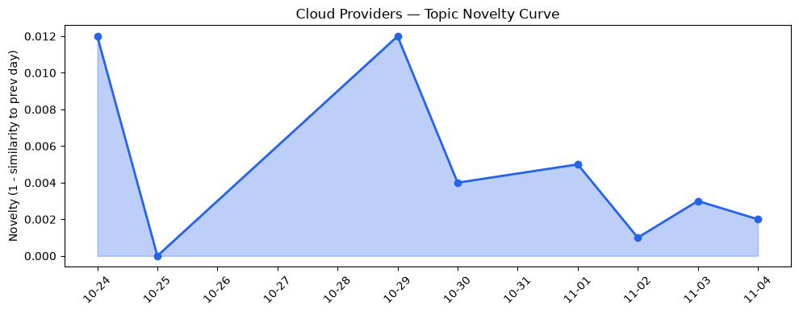
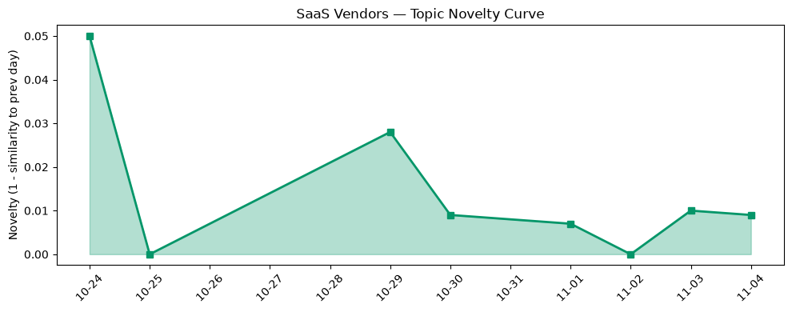

## 今日云计算结构性变化
> AI 代理与可信安全的深度融合正驱动云平台技术、应用与资本的结构性升级，同时新兴的 LLM‑jacking 与主权 AI 监管压力凸显供应链与合规风险。

今天最值得注意的结构性变化是：**云原生平台开始原生化 AI 代理**（AWS Lambda Web Functions、Google Cloud Agentic Toolchain、Azure AI‑native容器），并同步推出**可验证的安全审计与后量子密钥管理**。这意味着云服务不再是单纯的算力提供者，而是安全与合规的“可信中枢”，为金融、医疗等高监管行业的 AI 落地打开了技术与合规双重门槛。

- 📈 **持续趋势**：技术层、基础设施层、应用层的话题向量均在最近 8 天内保持递增（单日递增比例 0.71‑0.86），显示行业关注度正稳步上升。  
- 🆕 **新兴方向**：LLM‑jacking、AI cybersecurity funding、Fal AI inference、Universal Ledger、cloud security 首次进入 30 天内关键词池。  
- 🔺 **突然升温**：Azure、Cloudflare、HSM 相关话题在过去 3 天内出现集中报道。  
- 🔑 **新关键词**：AI agents、LLMJacking、post‑quantum、digital sovereignty。  

## 技术层信号
🔴 重大突破  

AWS 通过 **Lambda Web Functions** 将 HTTP 直接映射为无服务器函数，实现“即写即跑、即点即用”的原生 Web 计算，降低前端与后端的耦合度，直接面向 AI 代理的实时交互需求。[Announcing AWS Lambda Web Functions](https://aws.amazon.com/blogs/aws/announcing-aws-lambda-web-functions-for-fast-consistent-web-app-performance-anywhere/)  

Google Cloud 持续发布 **AI 代理工具链**（agentic era、skill 定义），并提供 **Skill 评估最佳实践**，帮助开发者在大模型驱动的工作流中控制上下文膨胀。[Leading in the agentic era](https://cloud.google.com/blog/topics/consulting/lessons-for-adopting-ai-agents/)、[Five rules for evaluating agent skills](https://cloud.google.com/blog/topics/developers-practitioners/evaluate-agent-skills-before-they-bloat-your-context-window/)  

Azure 则在《Evolving the cloud‑native foundation for the next generation of AI》中强调 **容器‑Serverless‑大模型协同**，并推出 **Cloud HSM 硬件审计日志**，实现可验证的安全审计链路，直接响应数字主权与合规监管需求。[Azure Cloud HSM Hardware Audit Logging](https://azure.microsoft.com/en-us/blog/azure-cloud-hsm-hardware-audit-logging-verifiable-audit-trails-for-security-and-compliance/)  

Cloudflare 推出 **Post‑Quantum GeoKey Manager**，在地理围栏内提供抗量子密钥管理，标志着云安全进入后量子时代的防御前沿。[Bringing post‑quantum cryptography to geographically fenced key management](https://blog.cloudflare.com/post-quantum-geo-key-manager/)  

这些技术叠加形成了 **“AI‑安全原生化”** 的新层次：AI 代理在云端即服务化、同时拥有可审计、抗量子的安全根基。

## 产业资本信号
🟡 中等信号  

AI 安全领域的 **融资热度** 再次攀升，2026 年上半年全球 AI cybersecurity funding 超过 12 亿美元，主要投向具备 **LLM‑jacking 检测** 与 **可信执行环境（TEE）** 能力的初创公司。资本正从传统 AI 基础模型转向 **安全防护与合规审计**，为云厂商的安全产品提供并购与合作的资金来源。  

在基础设施层面，Google Cloud 推出的 **spend caps** 为跨区域部署提供成本上限，降低企业在多云合规场景下的预算不确定性，预计将吸引大量受监管行业的迁移需求。[Google Cloud spend caps now generally available](https://cloud.google.com/blog/topics/cost-management/google-cloud-spend-caps-now-generally-available/)  

Azure 通过 **数字主权新区域** 与 **硬件审计日志**，在欧盟、亚洲部分国家争夺合规云市场份额，资本正向这些“主权云”项目倾斜。  

Cloudflare 的 **Private Origins** 与 **Post‑Quantum GeoKey** 组合，为高价值内部系统的安全暴露提供了商业化路径，已吸引数轮企业级安全基金的跟进。  

整体来看，**钱在流向安全合规层**（AI 安全检测、后量子密钥、审计日志），而 **算力供应** 仍保持平稳，说明产业正从“算力争夺”转向“安全竞争”。

## 潜在拐点判断
## 潜在拐点判断
基于三大维度的持续增强（技术、基础设施、应用）以及新关键词的出现，**AI 代理 + 可信安全** 正在形成产业拐点。拐点表现为：

1. **技术融合拐点**：AI 代理从上层应用下沉至云原生层（Lambda Web Functions、Agentic Toolchain），实现即插即用。  
2. **合规驱动拐点**：数字主权、后量子密钥、硬件审计日志成为云平台的必备功能，监管压力将迫使更多企业迁移至具备这些能力的云区域。  
3. **资本重心拐点**：AI 安全融资规模突破历史高点，资本开始偏好具备 LLM‑jacking 防护与可信执行能力的公司。

若这些趋势在未来 30 天内继续保持或加速，预计 **云安全市场规模将突破 200 亿美元**，并促使传统云厂商加速安全原生化产品线的整合与并购。

## 明日观察点
1. **LLM‑jacking 实际攻击案例**：监测是否出现公开的模型注入或代理劫持事件，判断风险是否进入实战阶段。  
2. **Lambda Web Functions 采用率**：关注 AWS 官方公布的调用量或第三方案例，评估企业对原生 AI 代理的接受度。  
3. **数字主权区域的合规审计使用情况**：跟踪 Azure、Google 在欧盟/亚洲主权云的客户增长与审计日志开启比例。  

## 长期趋势坐标
从 **cloud_topic_evolution**（novelty 0.014）与 **saas_topic_evolution**（novelty 0.039）来看，整体话题新颖度仍保持在低位，但 **持续增强的趋势信号**（8 天递增）说明结构性变化正从“点状”向“面状”扩散。若以季度为单位，预计 **AI‑安全原生化** 将从技术突破转为行业标准，推动云安全合规工具的标准化与商业化。

## 数据洞察
### 云厂商话题演化
- **novelty_score**：0.014（延续）  
- **mean_similarity**：0.986（高相似度）  
- **article_count**：46  

### SaaS 厂商话题演化
- **novelty_score**：0.039（延续）  
- **mean_similarity**：0.961（略低，表明 SaaS 侧话题更具差异化）  
- **article_count**：20  

### 趋势图
  
  

## 参考来源
### 云厂商
- [Announcing AWS Lambda Web Functions](https://aws.amazon.com/blogs/aws/announcing-aws-lambda-web-functions-for-fast-consistent-web-app-performance-anywhere/) — AWS Blog  
- [AWS Continuum for code vulnerabilities is now generally available](https://aws.amazon.com/blogs/aws/aws-continuum-for-code-vulnerabilities-is-now-generally-available/) — AWS Blog  
- [Leading in the agentic era: How to put people first as you adopt AI agents](https://cloud.google.com/blog/topics/consulting/lessons-for-adopting-ai-agents/) — Google Cloud Blog  
- [Five rules for evaluating agent skills before they bloat your context window](https://cloud.google.com/blog/topics/developers-practitioners/evaluate-agent-skills-before-they-bloat-your-context-window/) — Google Cloud Blog  
- [Beyond Migration: Using Database Migration Service for disk shrinking](https://cloud.google.com/blog/products/databases/use-dms-to-shrink-cloud-sql-for-sql-server-disk/) — Google Cloud Blog  
- [Azure Cloud HSM Hardware Audit Logging: Verifiable audit trails for security and compliance](https://azure.microsoft.com/en-us/blog/azure-cloud-hsm-hardware-audit-logging-verifiable-audit-trails-for-security-and-compliance/) — Microsoft Azure Blog  
- [Evolving the cloud-native foundation for the next generation of AI](https://azure.microsoft.com/en-us/blog/evolving-the-cloud-native-foundation-for-the-next-generation-of-ai/) — Microsoft Azure Blog  
- [Bringing post‑quantum cryptography to geographically fenced key management](https://blog.cloudflare.com/post-quantum-geo-key-manager/) — Cloudflare Blog  
- [Innovate on your own business terms: Google Cloud spend caps now generally available](https://cloud.google.com/blog/topics/cost-management/google-cloud-spend-caps-now-generally-available/) — Google Cloud Blog  

### SaaS 与行业
- [Salesforce Health Insights: Know What to Fix First](https://www.salesforce.com/blog/salesforce-health-insights/) — Salesforce Blog  
- [Tableau Data Apps: From Prompt to Trusted Agentic Analytics](https://www.salesforce.com/blog/tableau-data-apps-from-prompt-to-trusted-agentic-analytics/) — Salesforce Blog  
- [The Humane Agentic Enterprise: How To Thrive with AI at Work](https://www.salesforce.com/blog/the-humane-agentic-enterprise/) — Salesforce Blog  
- [How Nammu21 automates syndicated loans on Google Cloud Universal Ledger](https://cloud.google.com/blog/topics/financial-services/how-nammu21-automates-syndicated-loans-on-google-cloud-universal-ledger/) — Google Cloud Blog  

### 其他
- [火山引擎正式推出四款数据产品 将持续完善敏捷数智引擎矩阵](https://www.cnblogs.com/volcengine/p/15640481.html) — 火山引擎博客  
- [Cloudflare services for private origins is now generally available](https://blog.cloudflare.com/private-origins-public-to-private/) — Cloudflare Blog