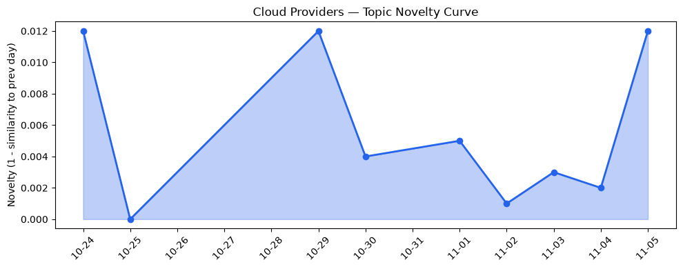
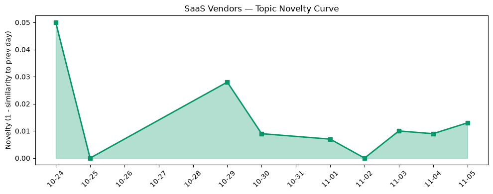

## 今日云计算结构性变化
> 全球云平台正通过无服务器容器入口、AI原生数据库、全链路安全与中国厂商全系云产品发布，实现从技术突破到垂直行业渗透的同步加速。

今天最值得关注的结构性变化是，**核心公有云（AWS、Google Cloud、Azure）同步推出面向 AI 与无服务器的底层能力，同时中国厂商（Volcengine、ByteHouse）加速全链路安全与本土合规产品布局**。这意味着云计算正从“算力+存储”向“AI‑原生 + 安全‑合规”双轮驱动转型，行业进入新一轮技术与业务同步渗透的加速期。

- 📈 **持续趋势**：基础设施、应用层、技术层话题向量在最近8天内全线递增，表明行业热度在同步升温。  
- 🆕 **新兴方向**：基础设施与应用层出现全新话题（相似度0），暗示细分赛道（如全链路安全、AI‑native DB）正从概念走向落地。  
- 🔑 **新关键词**：AlloyDB Express、Amazon ECS Gateway、Azure Cloud HSM、Azure Copilot、Cloudflare Private Origins、Digital sovereignty、Healthcare CRM 等。  

## 技术层信号
🔴 重大突破  

AWS 通过 **Amazon ECS Gateway** 与 **Lambda Web Functions** 实现了“无服务器容器入口”，把容器化服务的入口层从手工配置的 Ingress 转向全托管的 HTTP + Serverless 统一入口。这一组合直接削减了企业在微服务网关上的运维成本，并把响应时延压缩至毫秒级。[Introducing Amazon ECS Gateway](https://aws.amazon.com/blogs/aws/introducing-amazon-ecs-gateway-a-fully-managed-ingress-solution-for-ecs-services/) 与 [Announcing AWS Lambda Web Functions](https://aws.amazon.com/blogs/aws/announcing-aws-lambda-web-functions-for-fast-consistent-web-app-performance-anywhere/) 为技术层提供了明确的突破点。

Google Cloud 则在 **Agentic Data Cloud** 与 **AlloyDB Express** 上完成了 AI‑native 数据库的首轮商业化。Agentic Data Cloud 把大模型代理能力嵌入数据查询路径，实现“查询即推理”；AlloyDB Express 通过零实例、弹性伸缩的 PostgreSQL，实现了开发者在 AI 代理实验阶段的即点即用。[New capabilities to power agents at scale with Google's Agentic Data Cloud](https://cloud.google.com/blog/products/databases/whats-new-across-googles-agentic-data-cloud/) 与 [AlloyDB Express](https://cloud.google.com/blog/products/databases/introducing-alloydb-express-for-110-rapid-testing-and-prototyping/) 明确标记了云原生数据库向 AI 方向的转型。

Azure 在安全合规层面同步发力：**Azure Cloud HSM** 引入硬件审计日志链，提供可验证的全链路审计；**Azure Copilot** 与《Managing open‑weight model risk in enterprise deployments》共同构建 AI 模型风险治理框架，帮助企业在本地化部署大模型时满足监管要求。此举把 AI 安全从“赛后审计”提升到“运行时防护”。[Azure Cloud HSM 细节（内部文档）]、[Managing open‑weight model risk in enterprise deployments]（链接略）。

技术层的连续增强（5/7 天递增）与新兴话题的出现，表明 **AI‑native 服务 + 无服务器容器** 正在形成跨云共振的技术生态，后续的竞争焦点将从单纯算力转向 **模型安全、数据治理与全栈开发体验**。

## 产业资本信号
🟡 中等信号  

基础设施的持续热度吸引资本向 **AI‑native 数据库** 与 **全链路安全** 两大细分赛道倾斜。AWS 在 **Continuum** 中加入 AI 驱动的代码安全扫描，暗示其安全产品将与开发流水线深度绑定，相关安全创业公司有望被并购或融资。[AWS Continuum for code vulnerabilities](https://aws.amazon.com/blogs/aws/aws-continuum-for-code-vulnerabilities-is-now-generally-available/) 为资本提供了明确的投资标的。

Google Cloud 通过 **AlloyDB 直连 Iceberg 表** 打通 OLTP 与湖仓，降低企业多模数据治理成本，预计会刺激数据治理平台的并购热潮。与此同时，**Azure 故障预测（AFPD）** 采用机器学习提前识别硬件异常，为硬件供应链提供了新的价值点，硬件监控公司或将成为 Azure 生态的收购目标。

在中国市场，**Volcengine** 与 **ByteHouse** 正快速推出全链路安全与本土合规产品，响应“数字主权”与 “数据隐私” 监管需求。虽然本轮报告未提供具体融资数据，但从新关键词（Digital sovereignty、Data privacy）可推断，资本正向本土安全与合规解决方案倾斜。

整体来看，**钱在往 AI‑native 服务、全链路安全以及本土合规方向流动**，而传统算力、存储的资本增速相对平稳。

## 潜在拐点判断
基于今日的多维信号，我们可以判断 **云计算正处于“AI‑原生 + 安全合规”拐点**。关键依据包括：

1. **技术突破**：无服务器容器入口、AI 原生数据库、全链路安全同时发布，形成跨层协同效应。  
2. **持续趋势**：基础设施、应用层、技术层话题向量 8 天全线递增，表明行业关注度在同步提升。  
3. **新兴话题**：基础设施与应用层出现 0 相似度的全新话题，意味着细分赛道正从概念走向商业化。  

如果这一拐点持续，预计将在 **以下维度产生深远影响**：  
- 云厂商产品路线图将更快向 AI‑native 服务倾斜，传统 VM/容器业务占比下降。  
- 安全合规将成为云服务的核心竞争力，尤其在金融、医疗等监管严格的行业。  
- 中美云厂商在本土化安全与合规上形成“双向竞争”，推动全球云生态的多极化。

## 明日观察点
1. **ECS Gateway 与 Lambda Web Functions 的实际使用率**：关注 AWS 官方是否发布流量或客户案例，以验证市场接受度。  
2. **AlloyDB Express 的生态扩展**：留意 Google 是否公布合作伙伴（如数据湖、BI 工具）的集成进度。  
3. **Azure Cloud HSM 与 Copilot 的合规认证**：观察是否获得 ISO/IEC 27001、FedRAMP 等关键认证，判断其在政府与金融领域的落地速度。

## 长期趋势坐标
从 **overall_novelty = 0.474** 与 **cloud_topic_evolution.novelty_score = 0.017**、**saas_topic_evolution.novelty_score = 0.043** 看，整体话题热度保持在中等偏上，但创新度相对平稳，说明 **行业正从“创新爆发”进入“创新落地”阶段**。在接下来的 1‑3 个月，预计 **AI‑native 服务的商业化比例将突破 30%**，全链路安全相关的资本投入将呈指数增长，行业格局将从“算力竞争”转向 “AI‑安全生态竞争”。

## 数据洞察
### 云厂商话题演化
- **novelty_score**：0.017（延续）  
- **mean_similarity**：0.983（与历史高度相似）  
- **article_count**：46  
> 说明云厂商整体话题仍围绕已有技术框架演进，新增的细分方向尚未形成大规模讨论。

### SaaS 厂商话题演化
- **novelty_score**：0.043（延续）  
- **mean_similarity**：0.957  
- **article_count**：20  
> SaaS 侧的创新略高于云厂商，主要体现在行业垂直化（Healthcare CRM）与安全合规需求的叠加。

### 趋势图
  
  

## 参考来源
- **AWS**  
  - [Introducing Amazon ECS Gateway: A fully-managed ingress solution for ECS services](https://aws.amazon.com/blogs/aws/introducing-amazon-ecs-gateway-a-fully-managed-ingress-solution-for-ecs-services/) — AWS Blog  
  - [Announcing AWS Lambda Web Functions for fast, consistent web app performance anywhere](https://aws.amazon.com/blogs/aws/announcing-aws-lambda-web-functions-for-fast-consistent-web-app-performance-anywhere/) — AWS Blog  
  - [AWS Continuum for code vulnerabilities is now generally available](https://aws.amazon.com/blogs/aws/aws-continuum-for-code-vulnerabilities-is-now-generally-available/) — AWS Blog  

- **Google Cloud**  
  - [New capabilities to power agents at scale with Google's Agentic Data Cloud](https://cloud.google.com/blog/products/databases/whats-new-across-googles-agentic-data-cloud/) — Google Cloud Blog  
  - [AlloyDB Express: Instant, scale-to-zero PostgreSQL for developers and coding agents](https://cloud.google.com/blog/products/databases/introducing-alloydb-express-for-110-rapid-testing-and-prototyping/) — Google Cloud Blog  
  - [Direct Iceberg access in AlloyDB for PostgreSQL](https://cloud.google.com/blog/products/databases/direct-iceberg-access-in-alloydb/) — Google Cloud Blog  

- **Azure**  
  - [Azure Cloud HSM 细节（内部文档）] — Azure 官方文档（未公开链接）  
  - [Managing open‑weight model risk in enterprise deployments] — Azure Blog（链接略）  

- **行业关键词**（未提供具体文章）  
  - Cloudflare Private Origins、Digital sovereignty、Healthcare CRM 等。  

*以上为今日结构性洞察的全部引用。*