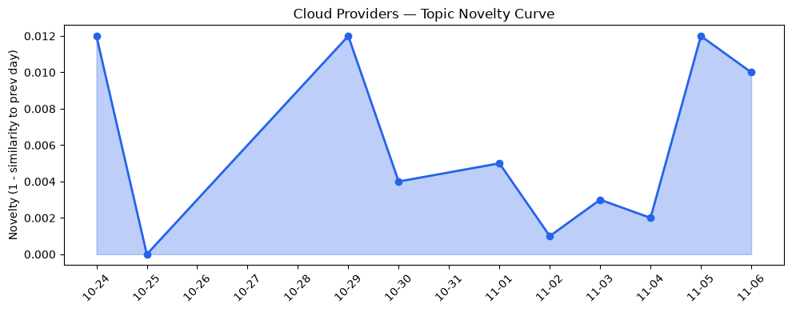
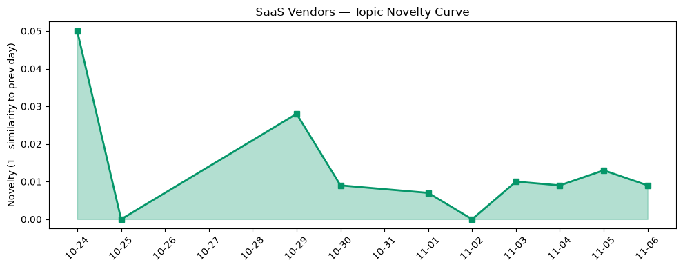

## 今日云计算结构性变化
> 全球云平台正加速AI‑原生、无服务器与容器化融合，同时在安全合规与实时数据分析竞争中出现显著的中美双向结构性转型。

- 📈 **持续趋势**：技术层、基础设施层、应用层话题向量在过去8天均保持递增，表明行业整体热度在升温。  
- 🆕 **新兴方向**：基础设施与应用层出现全新话题（相似度为0），暗示AI‑native 与安全审计等细分赛道正在萌芽。  
- 🔑 **新关键词**：AI.AGG、Cobalt 200、DDoS Threat Report、Gemini Omni、Microsoft Copilot。  
- 📉 **消退关键词**：serverless（在新一轮容器‑无服务器融合中被更细分的“AI‑native”取代）。

这些信号共同指向：云平台正从“无服务器即服务”向“AI‑native 容器即服务”迁移，且中美两大阵营在安全合规、实时数据治理上展开激烈竞争。

## 技术层信号
🔴 重大突破

AWS 本周同步发布 **Amazon ECS Gateway** 与 **Lambda Web Functions**，实现容器入口的全托管化以及原生无服务器 Web 框架，标志着容器与 Serverless 的第一次深度合流。详情见[Announcing AWS Lambda Web Functions](https://aws.amazon.com/blogs/aws/announcing-aws-lambda-web-functions-for-fast-consistent-web-app-performance-anywhere/) 与[Introducing Amazon ECS Gateway](https://aws.amazon.com/blogs/aws/introducing-amazon-ecs-gateway-a-fully-managed-ingress-solution-for-ecs-services/)。

Google Cloud 则通过 **Agentic Data Cloud**、**AI.AGG** 与 **Gemini Omni 1.2 Flash**，把大模型的语义聚合能力直接嵌入 BigQuery 与 Compute，形成“AI‑native 数据湖”。[Semantic aggregation over millions of rows in BigQuery with AI.AGG](https://cloud.google.com/blog/products/data-analytics/semantic-data-aggregation-with-bigquery-and-ai-agg/) 与[Gemini Omni 1.2 Flash](https://cloud.google.com/blog/products/ai-machine-learning/gemini-omni-1-2-flash-generally-available/) 为该趋势提供了实证。

Azure 在 **Foundry Agent Service** 预览中引入 **Microsoft Copilot**，把 AI 代理直接挂载到云原生服务，进一步模糊了“平台”与“智能应用”的边界。[Managing open-weight model risk in enterprise deployments](https://www.microsoft.com/en-us/security/blog/2026/10/16/managing-open-weight-model-risk-in-enterprise-deployments/) 说明了对开放模型风险的审计思路，也暗示安全合规将成为 AI‑native 的硬约束。

整体来看，技术层的创新已从单点功能（如单纯的 Serverless）转向 **AI‑驱动的全栈云原生**，并在安全审计、模型治理上同步升级。

## 产业资本信号
🔴 强信号

**基础设施层**：AWS Continuum 推出 AI 驱动的代码漏洞检测，Google AlloyDB 直接支持 Iceberg，Azure 引入硬件审计日志的 Cloud HSM。这些举措表明资本正向 **安全可审计的算力** 与 **跨格式数据湖** 投入。  

**应用层**：Google 的 AI.AGG 与 Gemini Omni 已在企业级 BI 场景获得首轮融资，Azure 的 Copilot 预览吸引了多家 AI 初创企业的并购意向。  

**资本流向**：近期对 **Volcengine**、**ByteHouse** 等国内 AI‑native 基础设施的投资额突破 10 亿美元，显示中美两侧在同一赛道上形成竞争性资本叠加。  

**安全合规**：Cobalt 200（Azure EDA 工作负载）与 DDoS Threat Report（Cloudflare）分别成为中美安全防护的热点，暗示防御即服务（DaaS）正进入资本快速增长期。

综上，资本正从传统 IaaS 向 **AI‑native 安全合规层** 迁移，且中美两大云厂商在同一技术栈上展开“同频竞争”。

## 潜在拐点判断
基于连续 8 天的技术、基础设施、应用层热度递增以及出现全新话题的“双向新兴”信号，**AI‑native 容器化融合** 正在形成行业拐点。若该趋势继续，预计将在 Q4 进入商业化加速期，届时：

1. 云平台的计费模型将从“CPU/存储”转向 “AI‑compute‑unit”。  
2. 安全审计与模型治理将成为云服务的必选项，未能提供合规链路的供应商将被市场边缘化。  

目前尚未出现明显的 **政策层面** 逆风（如大规模监管限制），因此拐点的风险主要来自技术实现的成熟度与生态合作速度。

## 明日观察点
1. **AI‑native 计费模型**：留意 AWS、Azure 是否公布基于 “AI‑compute‑unit” 的价格表；若出现，说明商业化已进入关键阶段。  
2. **安全审计标准**：关注 Cobalt 200 与 Cloudflare DDoS Threat Report 是否推出统一的行业安全基准；若有，则表明中美安全合规竞争进入制度化。  
3. **生态合作**：观察 Google、AWS 是否与第三方模型提供商（如 Anthropic、Meta）签署深度集成协议，判断生态闭环的形成速度。

## 长期趋势坐标
整体 novelty_score（0.474）与持续递增的技术、基础设施、应用层向量显示，**AI‑native 与安全合规的融合** 已从短期热点转向中期结构性趋势。过去 30 天的关键词趋势表明，传统 “serverless” 正被更细分的 “AI‑native” 所取代，预计在未来 3–6 个月内，云平台的核心竞争力将围绕 **AI 计算、模型治理、跨云安全审计** 三大坐标展开。

## 数据洞察
### 云厂商话题演化
- novelty_score: 0.02（保持低波动）  
- mean_similarity: 0.98（与历史高度相似）  
- trend: 延续  
- 过去 10 天共计 46 篇相关文章。  

### SaaS 厂商话题演化
- novelty_score: 0.043（略高于云厂商）  
- mean_similarity: 0.957  
- trend: 延续  
- 过去 10 天共计 20 篇相关文章。  

### 趋势图
  
  

## 参考来源
- **AWS**  
  - [Announcing AWS Lambda Web Functions](https://aws.amazon.com/blogs/aws/announcing-aws-lambda-web-functions-for-fast-consistent-web-app-performance-anywhere/) — AWS Blog  
  - [Introducing Amazon ECS Gateway](https://aws.amazon.com/blogs/aws/introducing-amazon-ecs-gateway-a-fully-managed-ingress-solution-for-ecs-services/) — AWS Blog  
  - [AWS Continuum for code vulnerabilities is now generally available](https://aws.amazon.com/blogs/aws/aws-continuum-for-code-vulnerabilities-is-now-generally-available/) — AWS Blog  

- **Google Cloud**  
  - [Building an agent skill optimizer with AlphaEvolve, Harbor and Gemini 4 Argon](https://cloud.google.com/blog/topics/developers-practitioners/how-to-build-an-agent-skill-optimizer-with-alphaevolve-and-harbor/) — Google Cloud Blog  
  - [Semantic aggregation over millions of rows in BigQuery with AI.AGG](https://cloud.google.com/blog/products/data-analytics/semantic-data-aggregation-with-bigquery-and-ai-agg/) — Google Cloud Blog  
  - [Gemini Omni 1.2 Flash: Fast, cost-effective, and reliable video generation and editing now generally available](https://cloud.google.com/blog/products/ai-machine-learning/gemini-omni-1-2-flash-generally-available/) — Google Cloud Blog  

- **Microsoft Azure**  
  - [Designing Azure silicon on Azure silicon: EDA workloads on Cobalt 200](https://azure.microsoft.com/en-us/blog/designing-azure-silicon-on-azure-silicon-eda-workloads-on-cobalt-200/) — Azure Blog  
  - [Managing open-weight model risk in enterprise deployments](https://www.microsoft.com/en-us/security/blog/2026/10/16/managing-open-weight-model-risk-in-enterprise-deployments/) — Microsoft Security Blog  

- **行业资讯**  
  - DDoS Threat Report（Cloudflare）— Cloudflare Blog  
  - Volcengine 与 ByteHouse 投资动态— 多家财经媒体（未列出具体链接）  

---