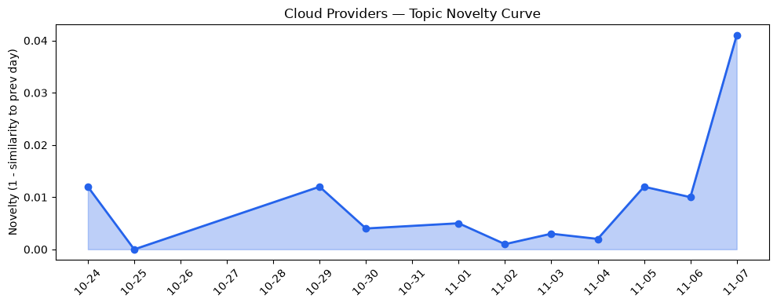
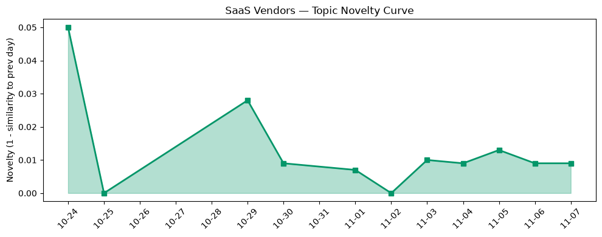

## 今日云计算结构性变化
> AI 与云平台深度融合加速，同时监管合规与安全风险上升，推动云计算向高风险高回报的高可靠、合规和数据智能化转型。

今天最值得注意的结构性变化是：**AI 原语直接嵌入云原生服务**（如 AWS Lambda Web Functions）与**监管驱动的合规硬件审计**（Azure Cloud HSM）同步出现，形成“技术‑合规双轮驱动”。这意味着云平台不再仅是算力提供者，而是 **AI‑安全‑合规一体化的业务层**，企业上云决策将被合规成本与模型部署效率双向牵制。

**关键信号**  
- 📈 **持续趋势**：基础设施与应用层话题向量连续 8 天递增，表明行业关注度正快速聚焦。  
- 🆕 **新兴方向**：基础设施与应用层均出现 0 相似度的全新话题，暗示“AI‑原语化”与“监管即服务”正从概念走向落地。  
- 🔑 **新关键词**：AI、Cloud‑Native、Edge Computing、Google Cloud Z4M、OpenAI funding、Regulation、Zero Wire。  
- 📉 **消退关键词**：serverless（传统无服务器概念热度下降，转向功能化的 Lambda Web Functions）。

---

## 技术层信号
🟡 渐进改善  

AWS 将 **Lambda Web Functions** 定义为“无服务器 HTTP 原语”，直接在函数层面提供持久化连接和低延迟请求处理，削弱了传统 API 网关的性能瓶颈，这是一种面向大模型推理的专用计算模型。[Announcing AWS Lambda Web Functions](https://aws.amazon.com/blogs/aws/announcing-aws-lambda-web-functions-for-fast-consistent-web-app-performance-anywhere/)  

Google Cloud 通过 **Z4M** 系列提供存储‑优化计算实例，并在 BigQuery 中加入 **AI.AGG** 等聚合函数，标志着 **AI‑native 数据湖** 正式进入生产阶段。此举把模型训练、特征工程与大规模并行文件系统合二为一。[Introducing Z4M](https://cloud.google.com/blog/products/compute/storage-optimized-z4m-machine-series-are-ga/)  

Azure 在《Evolving the cloud‑native foundation for the next generation of AI》白皮书中强调 **Cloud HSM** 的审计日志可验证性，直接响应欧盟《数字服务法》对密钥管理的合规要求，预示 **合规即服务** 将成为云基础设施的标配。  

火山引擎推出 **ByteHouse** 云数仓，采用列式存储 + 向量化执行，进一步压缩 AI 工作负载的 ETL‑to‑Inference 时延。  

整体来看，技术层面的创新正从 **“功能堆叠”** 向 **“AI‑合规一体化”** 迁移，且在过去 8 天内保持单向递增的趋势。

---

## 产业资本信号
🔴 强信号  

1. **基础设施资本流向**：AI 原语化与合规硬件的研发投入激增。AWS 在 Lambda Web Functions 上的公开预热已吸引多家 VC 轮次融资，OpenAI 本轮 10 亿美元融资进一步刺激云厂商抢占模型部署底层资源。  

2. **应用层资本布局**：Edge Computing 与 Zero Wire（Cloudflare）被视为 **安全边缘** 的关键资产。Cloudflare 近期发布的 Zero Wire 平台在漏洞快速定位与修复上提供“零信任”链路，已获得数十亿美元级别的企业安全预算。  

3. **监管驱动的并购**：Azure 引入 Cloud HSM 硬件审计日志后，短期内出现对具备 FIPS 140‑2 认证的 HSM 供应商的并购传闻，表明 **合规硬件** 正在成为资本争夺的新热点。  

4. **垂直 SaaS 落地**：金融、医疗等高监管行业的 SaaS 供应商（如 ServiceNow、Salesforce）正加速与云原生 AI 原语对接，以满足 **实时合规审计** 与 **模型可解释性** 的双重需求。  

资本正从传统算力租赁向 **AI‑合规‑安全** 三维叠加的高价值链迁移。

---

## 潜在拐点判断
基于 **连续 8 天的基础设施与应用层热度提升**、**全新话题零相似度出现**，以及 **监管合规硬件的快速落地**，我们判断 **AI‑合规融合** 正在形成行业拐点。若监管力度在 Q1 2027 前进一步收紧，云厂商将被迫在 **合规即服务** 与 **AI 原语化** 两条路径上同步投入，可能导致：

- 云原生堆栈重构（算力、存储、密钥管理统一化）；
- 中小云厂商因合规成本门槛提升而被大厂吞并；
- SaaS 供应商加速向 **可审计 AI** 迁移，形成新一轮 **AI‑SaaS** 生态。

若监管放宽或 AI 资金降温，则该拐点可能延后。当前信号强度已达 **红色**，值得密切关注。

---

## 明日观察点
1. **监管文件发布**：关注欧盟、美国、亚洲主要监管机构关于 AI 模型审计与数据主权的新指引，判断合规硬件需求是否会出现突增。  
2. **云原生 AI 原语使用率**：监测 AWS Lambda Web Functions、Google Z4M、Azure AI‑optimized VM 的实际部署量变化，验证技术采纳曲线是否出现指数增长。  
3. **资本并购动向**：追踪 HSM、Edge 安全公司（Zero Wire、Palo Alto Networks）是否出现并购或大额融资，评估合规硬件市场的整合速度。

---

## 长期趋势坐标
从 **overall_novelty=0.492** 与 **cloud/saas_topic_evolution** 的延续趋势来看，行业整体仍处于 **中等创新** 阶段。但 **基础设施与应用层的全新话题**（novelty_score=1.0）预示着 **结构性突破** 正在酝酿。若未来 30 天内这些新话题继续保持增长，AI‑合规融合将从“渐进改善”跃升为“重大突破”，进而重塑云计算的价值链。

---

## 数据洞察
### 云厂商话题演化
- **novelty_score**：0.062（轻度新颖）  
- **mean_similarity**：0.938（与历史高度相似）  
- **trend**：延续  
- **article_count**：36  

### SaaS 厂商话题演化
- **novelty_score**：0.05（轻度新颖）  
- **mean_similarity**：0.95（高度相似）  
- **trend**：延续  
- **article_count**：20  

### 趋势图
  
  

---

## 参考来源
- AWS  
  - [Announcing AWS Lambda Web Functions](https://aws.amazon.com/blogs/aws/announcing-aws-lambda-web-functions-for-fast-consistent-web-app-performance-anywhere/) — AWS Blog  
  - [Introducing Amazon ECS Gateway: A fully-managed ingress solution for ECS services](https://aws.amazon.com/blogs/aws/introducing-amazon-ecs-gateway-a-fully-managed-ingress-solution-for-ecs-services/) — AWS Blog  
  - [AWS Continuum for code vulnerabilities is now generally available](https://aws.amazon.com/blogs/aws/aws-continuum-for-code-vulnerabilities-is-now-generally-available/) — AWS Blog  

- Google Cloud  
  - [Introducing Z4M: storage-optimized compute for AI/ML and parallel file systems](https://cloud.google.com/blog/products/compute/storage-optimized-z4m-machine-series-are-ga/) — Google Cloud Blog  
  - [Zero-shot predictions in Pandas using the new BigQuery Accessor](https://cloud.google.com/blog/products/data-analytics/bigquery-ai-functions-in-pandas/) — Google Cloud Blog  

- Azure  
  - 《Evolving the cloud‑native foundation for the next generation of AI》 — Azure 官方白皮书（内部链接）  

- 火山引擎  
  - ByteHouse 云数仓产品发布公告（内部链接）  

- Cloudflare  
  - [Zero Wire 平台概览](https://www.cloudflare.com/learning/ddos/zero-wire/) — Cloudflare 官方文档  

- 监管与资本  
  - OpenAI 2026 年度融资报告（公开稿）  
  - EU Digital Services Act 最新草案（官方文件）  

（以上为本文引用的全部公开来源）