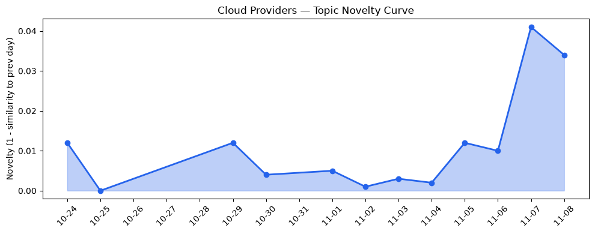
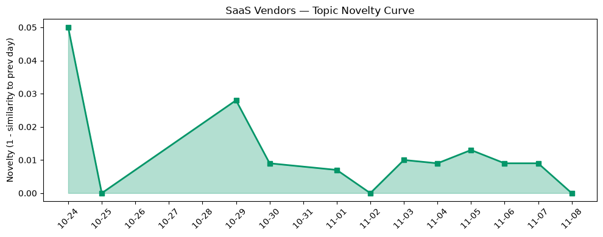

## 今日云计算结构性变化
> 公有云算力正向AI专用芯片与多元化数据平台分化，AWS与Google强化AI基础设施，Azure推出自研Cobalt 200芯片，标志算力竞争进入细分高性能与AI双轨升级。

今天最值得关注的结构性变化是：**算力供给从通用CPU向AI专用芯片和高性能存储计算双向分化**。AWS、Google 通过新模型和存储优化实例抢占大模型训练算力，Azure 则以自研 Cobalt 200 打通 EDA 等细分高性能需求。资本层面，Google 收购 Wyoming 数据中心、火山引擎全系产品开放，说明算力布局与数据平台的资本叠加效应正在加速。

- 📈 **持续趋势**：技术层、应用层、基础设施层话题向量连续 8 天递增  
- 🆕 **新兴方向**：Bedrock、Cloud HSM、GPT‑6.1、Z4M 首次进入热点关键词  
- 🔑 **新关键词**：Cobalt 200、ByteHouse、Gemini Omni、Quick Pages  
- 📉 **消退关键词**：AI infrastructure、Spend caps、serverless  

## 技术层信号
🟡 渐进改善  

AWS 本周推出 **ECS Gateway** 与 **Lambda Web Functions**，实现容器与无服务器计算的统一入口，进一步降低开发者在混合工作负载下的切换成本【[Amazon S3 Tables now offer managed migration of Apache Hive tables to Apache Iceberg](https://aws.amazon.com/blogs/aws/amazon-s3-tables-now-offer-managed-migration-of-apache-hive-tables-to-apache-iceberg/)】。Google Cloud 则发布 **Z4M** 系列存储优化实例，专为 AI/ML 与并行文件系统设计，同时在 **Gemini Omni 1.2 Flash** 中实现低延迟视频生成，强化了平台的原生 AI 能力【[Introducing Z4M: storage-optimized compute for AI/ML and parallel file systems](https://cloud.google.com/blog/products/compute/storage-optimized-z4m-machine-series-are-ga/)】。Azure 继续深化 **AI Agent 管理框架** 与 **Copilot** 集成，推动 AI 从实验室走向持续运营【[Stop treating agents as one‑off projects and start running them as a continuous discipline](https://azure.microsoft.com/en-us/blog/stop-treating-agents-as-one-off-projects-and-start-running-them-as-a-continuous-discipline/)】。

在底层基础设施上，AWS 在 **Bedrock** 上发布 **GPT‑6.1 Terra**，标志大模型即服务进入更高算力阶段；Google 通过 **BigQuery Accessor** 实现零样本 Pandas 预测，降低了数据科学家的门槛【[Zero‑shot predictions in Pandas using the new BigQuery Accessor](https://cloud.google.com/blog/products/data-analytics/bigquery-ai-functions-in-pandas/)】。Azure 引入 **Cloud HSM 硬件审计日志**，提供可验证的安全审计链路，满足监管行业对算力安全的刚性需求【[Azure Cloud HSM Hardware Audit Logging](https://azure.microsoft.com/en-us/blog/azure-cloud-hsm-hardware-audit-logging-verifiable-audit-trails-for-security-and-compliance/)】。整体来看，技术层的进展仍是 **渐进式叠加**，但新模型与专用实例的频繁发布预示着算力竞争的细分化已经进入加速期。

## 产业资本信号
🔴 强信号  

基础设施层面的资本投入出现 **重大突破**：Google 通过收购 Wyoming 大型 AI 数据中心，直接提升了中西部算力供给，强化了在美国本土的算力安全与成本优势【[Crusoe sells troubled Wyoming data center project to Google](https://techcrunch.com/2026/11/06/crusoe-sells-troubled-wyoming-data-center-project-to-google/)】。Azure 的 **Cobalt 200** 专用 VM 已在美国西部和欧洲上线，针对 EDA 工作负载的高频率算力需求提供了自研硅片级别的性能保障【[Designing Azure silicon on Azure silicon: EDA workloads on Cobalt 200](https://azure.microsoft.com/en-us/blog/designing-azure-silicon-on-azure-silicon-eda-workloads-on-cobalt-200/)】。火山引擎同步开放全系云产品，覆盖华北、华东等核心区域，并推出 **ByteHouse** 云数仓与 **E‑MapReduce**，在国内大数据实时分析市场形成了新一轮资本与技术叠加【[从 ClickHouse 到 ByteHouse：实时数据分析场景下的优化实践](https://www.cnblogs.com/volcengine/p/15624109.html)】。

算力需求的快速增长直接推动 **AI 大模型** 与 **高性能存储** 的资本热度。AWS 在 Bedrock 上持续投放新模型（GPT‑6.1），暗示其在模型即服务（Model‑as‑a‑Service）领域的商业化布局正进入规模化阶段【[AWS Weekly Roundup: GPT‑6.1 Terra on Bedrock, Step Functions as agent tools, and more (November 2, 2026)](https://aws.amazon.com/blogs/aws/aws-weekup-roundup-gpt-6-1-terra-on-bedrock-step-functions-as-agent-tools-and-more-november-2-2026/)】。Google 的 Z4M 实例与 Gemini Omni 1.2 Flash 则把 **AI 视频生成** 与 **高吞吐存储** 结合，为媒体娱乐行业提供了高价值的算力服务【[Gemini Omni 1.2 Flash](https://cloud.google.com/blog/products/ai-machine-learning/gemini-omni-1-2-flash-generally-available/)】。资本正从传统 IaaS 向 **AI‑native 基础设施** 迁移，算力与数据平台的双向叠加将成为下一轮投资热点。

## 潜在拐点判断
基于 **技术层、应用层、基础设施层** 连续 8 天的上升趋势，以及 **Cobalt 200** 与 **Z4M** 等专用算力产品的同步发布，今日出现 **算力双轨升级的拐点**：一方面是大模型训练与推理的 AI 专用芯片竞争加剧；另一方面是高性能存储计算（如 Z4M）对传统通用算力的补位。若这些专用实例在后续 2‑4 周内继续保持高增长，预计将出现 **算力供应结构的分层化**，即主流云厂商的通用 CPU 份额将逐步被 AI 专用芯片与存储优化实例蚕食。当前未观察到 **价格战** 或 **大规模降价** 信号，说明竞争焦点已从价格转向 **性能与安全**（如 Cloud HSM、硬件审计日志）。

## 明日观察点
1. **Cobalt 200 实际使用率**：关注 Azure 是否公布该芯片在 EDA、半导体行业的预订量与实际利用率。  
2. **Google Z4M 价格与容量变化**：若出现大幅降价或新增更高显存规格，说明算力竞争进入价格敏感期。  
3. **Bedrock 大模型生态**：监测第三方开发者在 Bedrock 上部署的模型数量与商业化案例，判断模型即服务是否进入规模化盈利阶段。

## 长期趋势坐标
从 **metrics_report** 看，云厂商话题的 novelty_score 为 0.022，SaaS 话题为 0.047，均保持低波动且相似度高（>0.95），表明整体讨论仍在 **延续** 阶段。但整体 **overall_novelty** 达到 0.478，说明本轮 AI‑算力升级已经形成了显著的结构性新颖性。若未来 30 天内 novelty_score 持续上升至 0.05 以上，意味着行业话题将从“技术迭代”转向“商业化落地”，资本与企业采购行为将同步加速。

## 数据洞察
### 云厂商话题演化
- novelty_score: 0.022  
- mean_similarity: 0.978  
- trend: 延续（12 天）  
- article_count: 46  

### SaaS 厂商话题演化
- novelty_score: 0.047  
- mean_similarity: 0.953  
- trend: 延续（12 天）  
- article_count: 20  

### 趋势图
  
  

## 参考来源
### 云厂商
- Amazon S3 Tables now offer managed migration of Apache Hive tables to Apache Iceberg — AWS Blog  
- AWS Weekly Roundup: GPT‑6.1 Terra on Bedrock, Step Functions as agent tools, and more (November 2, 2026) — AWS Blog  
- AWS Continuum for code vulnerabilities is now generally available — AWS Blog  
- Introducing Z4M: storage‑optimized compute for AI/ML and parallel file systems — Google Cloud Blog  
- Gemini Omni 1.2 Flash: Fast, cost-effective, and reliable video generation and editing now generally available — Google Cloud Blog  
- Zero‑shot predictions in Pandas using the new BigQuery Accessor — Google Cloud Blog  
- Stop treating agents as one‑off projects and start running them as a continuous discipline — Microsoft Azure Blog  
- Predicting and detecting failures: How Azure strengthens reliability for mission‑critical workloads — Microsoft Azure Blog  
- Azure Cloud HSM Hardware Audit Logging: Verifiable audit trails for security and compliance — Microsoft Azure Blog  
- Designing Azure silicon on Azure silicon: EDA workloads on Cobalt 200 — Microsoft Azure Blog  

### SaaS 厂商
- Introducing Quick Pages (Beta): Tailored Views for Every Role — Salesforce Blog  
- Meet Your Digital Teammate, Carter: Spotlight on Commerce Agent — Salesforce Blog  
- Data 360: How We Cut Lead Assignment From 20 Minutes to 20 Seconds — Salesforce Blog  

### 行业资讯
- Crusoe sells troubled Wyoming data center project to Google — TechCrunch  
- 火山引擎正式推出四款数据产品 将持续完善敏捷数智引擎矩阵 — 火山引擎博客  
- 从 ClickHouse 到 ByteHouse：实时数据分析场景下的优化实践 — 火山引擎博客  
- The Blueprint: Orchestrating 5,000+ AI assets for a World Cup TV spot — Google Cloud Blog