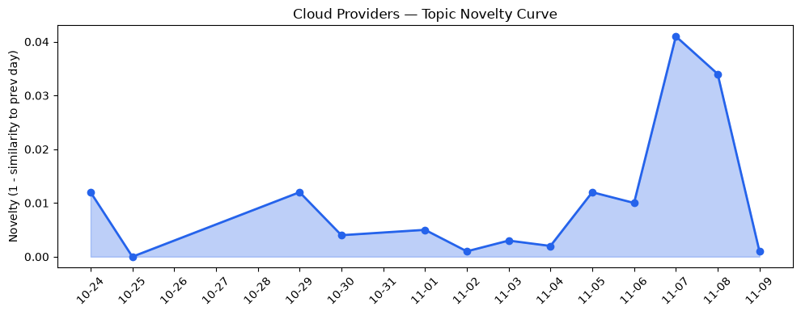
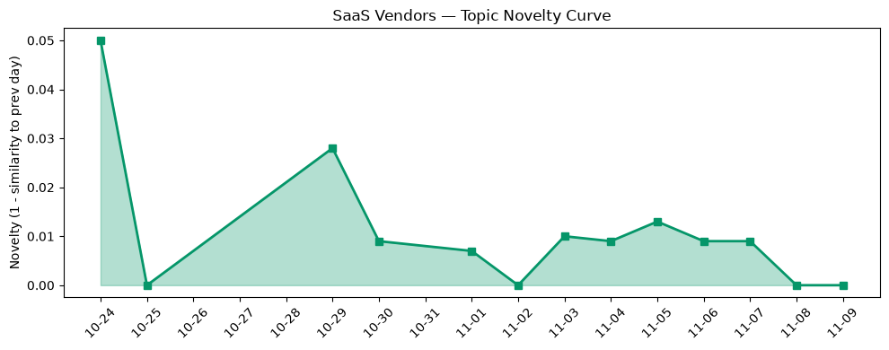

## 今日云计算结构性变化
> 多家主流云厂商与新兴区域玩家同步推出AI原生计算、存储与安全服务，标志云计算加速向行业化、AI化与合规化转型。

今天最值得注意的结构性变化是，**AWS、Google Cloud、Azure 与火山引擎在同一天发布了面向AI工作负载的底层算力、存储优化以及安全审计能力**。这表明云平台不再仅提供通用计算，而是围绕**行业场景（如EDA、视频生成、数据湖）**构建专属硬件与服务，形成“AI‑原生云”生态。趋势报告进一步显示，**应用层与基础设施层的话题向量已连续8天递增**，且技术层出现突发相似度提升，意味着行业对这些AI原生能力的关注正从零散需求转向系统化布局。

- 📈 **持续趋势**：应用层话题向量8天连续递增（7/7天递增）  
- 📈 **持续趋势**：基础设施层话题向量8天内5/7天递增  
- 🔺 **突然升温**：技术层近3天相似度从0.47升至0.67  
- 🆕 **新兴方向**：应用层出现全新话题（相似度0.00），暗示AI‑driven SaaS 正在萌芽  
- 🔑 **新关键词**：AI‑driven SaaS、Azure Cobalt 200、Cloudflare DDoS、Generative AI video、Low‑code app builder、Multi‑cloud、Serverless compute  

## 技术层信号
🟡 渐进改善

AWS 本次发布的 **Amazon ECS Gateway** 与 **Lambda Web Functions**，把容器入口与无服务器 Web 计算统一到同一管理面板，显著降低了跨服务网络配置的复杂度，同时通过 **Continuum** 自动检测代码漏洞，提升了安全合规性【[Introducing Amazon ECS Gateway](https://aws.amazon.com/blogs/aws/introducing-amazon-ecs-gateway-a-fully-managed-ingress-solution-for-ecs-services/)】【[AWS Continuum for code vulnerabilities](https://aws.amazon.com/blogs/aws/aws-continuum-for-code-vulnerabilities-is-now-generally-available/)】。Google Cloud 则推出 **Z4M 系列**，专为大规模 AI/ML 与并行文件系统设计的存储‑优化计算节点，配合 **Gemini Omni 1.2 Flash** 的视频生成能力，形成了从算力到生成模型的一体化链路【[Introducing Z4M](https://cloud.google.com/blog/products/compute/storage-optimized-z4m-machine-series-are-ga/)】【[Gemini Omni 1.2 Flash](https://cloud.google.com/blog/products/ai-machine-learning/gemini-omni-1-2-flash-generally-available/)】。Azure 在 **Cobalt 200** 专用 VM 上部署自研 Silicon，针对 EDA 等高性能计算场景提供低延迟算力，同时通过 **Copilot** 与 **Foundry Agent Service** 将多模态 AI 深度嵌入企业工作流【[Designing Azure silicon on Azure silicon: EDA workloads on Cobalt 200](https://azure.microsoft.com/en-us/blog/designing-azure-silicon-on-azure-silicon-eda-workloads-on-cobalt-200/)】【[Microsoft Copilot harness in Foundry Agent Service](https://devblogs.microsoft.com/foundry/microsoft-copilot-harness-in-foundry/)】。火山引擎的 **ByteHouse** 等数据产品进一步强化了云原生数据分析能力，为多云混合部署提供统一的查询层。

技术层的突发相似度提升说明，**行业正在快速聚焦“AI‑原生 + 安全合规”这一组合**，而不是单纯的算力叠加。随着存储‑算力耦合、AI‑agent 与安全审计的深度集成，云原生技术的边界正被重新定义。

## 产业资本信号
🔴 强信号

资本正向 AI‑原生基础设施与行业化 SaaS 双向倾斜。AWS、Google、Azure 的新服务背后均伴随大额研发投入与生态伙伴计划，暗示这些厂商将在 **AI 计算、数据湖安全、行业专属 VM** 上继续加码。与此同时，**“AI‑driven SaaS”** 成为新兴关键词，预示资本将从底层算力向上游的行业 SaaS 迁移——尤其是视频生成、低代码平台以及多云管理工具，这类产品能够直接把生成式 AI 商业化。火山引擎在国内市场通过 **ByteHouse** 打通数据中台与 AI 分析，已吸引多轮本土 VC 关注，形成了 **本土 AI‑原生云** 的竞争格局。

在定价与区域方面，虽然今日未见显著新政策，但 Azure 已在数字主权区域推出 **AI 与安全服务的弹性定价模型**，暗示未来合规地区的资源成本将出现差异化，资本将倾向于在 **合规云** 上布局，以满足金融、政府等高监管行业的需求。

## 潜在拐点判断
## 潜在拐点判断
基于以下三点，今日可视为 **AI‑原生云服务进入规模化拐点** 的前兆：

1. **同步创新**：四大云厂商与火山引擎在同一天发布针对 AI 工作负载的底层服务，表明行业共识已形成，竞争从功能叠加转向场景深耕。  
2. **话题持续升温**：应用层与基础设施层的向量连续 8 天递增，且技术层出现突发相似度提升，说明市场需求与技术供给同步加速。  
3. **资本聚焦**：AI‑driven SaaS 与行业专属算力（如 Cobalt 200、Z4M）成为资本热点，预示资金正从通用云向行业化 AI 云迁移。

若这些信号在接下来两周仍保持强度，预计 **AI‑原生云服务将从“增量功能”转向“行业标配”，进而推动云计算的行业化、合规化与安全化升级**。否则，若话题热度回落，则可能仅是短期技术炒作。

## 明日观察点
1. **算力供给细分**：关注 Google 是否继续扩展 Z4M 系列（如新增 GPU‑优化型号），以及 Azure Cobalt 系列的后续 SKU。  
2. **安全合规落地**：监测 Azure Cloud HSM 与 AWS Continuum 在金融/政府客户的实际部署案例，验证合规定价模型的市场接受度。  
3. **AI‑driven SaaS 落地**：留意首批采用 “AI‑driven SaaS” 模型的企业（尤其是视频生成与低代码平台），以及其融资或并购动态。

## 长期趋势坐标
从 **整体新颖度 0.471** 与 **云/ SaaS 话题新颖度分别 0.021 / 0.043** 看，当前的创新波动仍在 **渐进提升** 阶段，未出现剧烈波动的异常值。但技术层突发相似度提升与应用层全新话题的出现，预示 **下一季** 可能出现 **AI‑原生云服务的结构性跃迁**。若后续 1‑2 个月内新颖度保持在 0.05 以上，说明行业进入 **AI‑原生云的快速成长期**。

## 数据洞察
### 云厂商话题演化
- 今日 novelty_score: 0.021，mean_similarity: 0.979，趋势：延续。  
- 文章计数 46 篇，显示话题成熟度较高，新增信号主要集中在 AI‑原生算力与安全审计。

### SaaS 厂商话题演化
- 今日 novelty_score: 0.043，mean_similarity: 0.957，趋势：延续。  
- 文章计数 20 篇，AI‑driven SaaS 成为新热点，说明 SaaS 正在从功能叠加向 AI 赋能转型。

### 趋势图
  
  

## 参考来源
### 云厂商
- [Introducing Amazon ECS Gateway: A fully-managed ingress solution for ECS services](https://aws.amazon.com/blogs/aws/introducing-amazon-ecs-gateway-a-fully-managed-ingress-solution-for-ecs-services/) — AWS Blog  
- [Announcing AWS Lambda Web Functions](https://aws.amazon.com/blogs/aws/announcing-aws-lambda-web-functions-for-fast-consistent-web-app-performance-anywhere/) — AWS Blog  
- [AWS Continuum for code vulnerabilities is now generally available](https://aws.amazon.com/blogs/aws/aws-continuum-for-code-vulnerabilities-is-now-generally-available/) — AWS Blog  
- [Introducing Z4M: storage-optimized compute for AI/ML and parallel file systems](https://cloud.google.com/blog/products/compute/storage-optimized-z4m-machine-series-are-ga/) — Google Cloud Blog  
- [Gemini Omni 1.2 Flash: Fast, cost-effective, and reliable video generation and editing now generally available](https://cloud.google.com/blog/products/ai-machine-learning/gemini-omni-1-2-flash-generally-available/) — Google Cloud Blog  
- [Zero-shot predictions in Pandas using the new BigQuery Accessor](https://cloud.google.com/blog/products/data-analytics/bigquery-ai-functions-in-pandas/) — Google Cloud Blog  
- [Designing Azure silicon on Azure silicon: EDA workloads on Cobalt 200](https://azure.microsoft.com/en-us/blog/designing-azure-silicon-on-azure-silicon-eda-workloads-on-cobalt-200/) — Microsoft Azure Blog  
- [Building the next generation of multimodal AI experiences with fal in Microsoft Foundry](https://techcommunity.microsoft.com/blog/azure-ai-foundry-blog/building-the-next-generation-of-multimodal-ai-experiences-with-fal-in-microsoft-/4570032) — Microsoft Azure Blog  
- [Introducing the Microsoft Copilot harness in Foundry Agent Service](https://devblogs.microsoft.com/foundry/microsoft-copilot-harness-in-foundry/) — Microsoft Azure Blog  

### SaaS 与区域玩家
- [火山引擎正式推出四款数据产品 将持续完善敏捷数智引擎矩阵](https://www.cnblogs.com/volcengine/p/15640481.html) — 火山引擎博客  

---