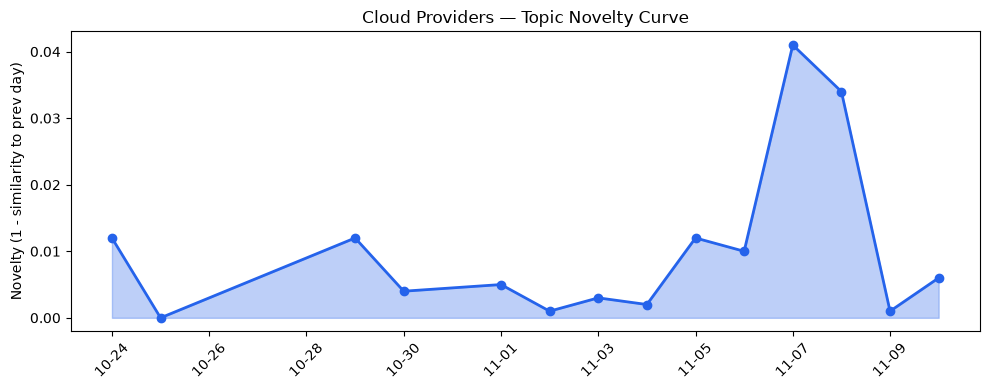
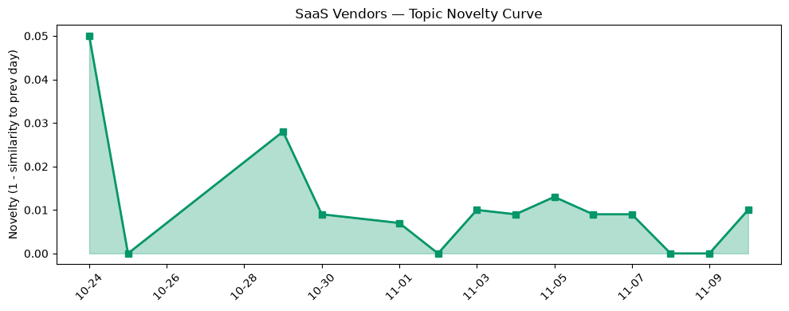

## 今日云计算结构性变化
> **AI 原生堆栈进入加速期，三大公有云同步发力，标志着云计算生态从通用算力向专用 AI 基础设施的结构性迁移。**

- 📈 **持续趋势**：技术层、基础设施、应用层话题向量在最近 8 天内全线递增，表明行业热度正同步上升。  
- 🆕 **新兴方向**：技术层、基础设施、应用层均出现“全新话题”，相似度为 0，意味着此前未出现的概念正被快速聚焦。  
- 🔑 **新关键词**：AI‑native Kubernetes、Lambda Web Functions、Foundry Agent Service、S3 Tables、TPU Sync、云 HSM 审计日志。  

## 技术层信号
🔴 重大突破  

Google Cloud 通过 **GKE 动态切片** 为 TPU 提供弹性伸缩，直接在 Kubernetes 层面实现算力弹性与容错，降低 AI 工作负载的调度成本。[Now generally available: GKE dynamic slicing for higher resilience, and efficiency for TPUs](https://cloud.google.com/blog/products/containers-kubernetes/gke-dynamic-slicing-on-tpus/) 同时发布 **TPU Sync**，实现 KV 缓存与权重迁移的高速通道，针对大模型推理与强化学习场景提供毫秒级权重切换。[Introducing TPU Sync: Fast KV cache and weight transfer for inference and RL on TPU](https://cloud.google.com/blog/topics/ai-infrastructure/introducing-tpu-sync-fast-kv-cache-and-weight-transfer-on-tpu/)。

AWS 则推出 **Lambda Web Functions**，把无服务器函数直接暴露为全栈 Web 端点，打通前端与后端的延迟壁垒，为 AI 驱动的交互式应用提供“一键部署”能力。[Announcing AWS Lambda Web Functions](https://aws.amazon.com/blogs/aws/announcing-aws-lambda-web-functions-for-fast-consistent-web-app-performance-anywhere/)；配套的 **ECS Gateway** 进一步简化容器入口管理，使得 AI 微服务的流量治理更为统一。[Introducing Amazon ECS Gateway: A fully‑managed ingress solution for ECS services](https://aws.amazon.com/blogs/aws/introducing-amazon-ecs-gateway-a-fully-managed-ingress-solution-for-ecs-services/)。

Azure 在 **Foundry Agent Service** 中嵌入 **Copilot Harness**，提供 AI agents 的全生命周期管理与平台化编排，面向多模态 AI 应用的研发与运维提供统一的治理层。[Introducing the Microsoft Copilot harness in Foundry Agent Service](https://devblogs.microsoft.com/foundry/microsoft-copilot-harness-in-foundry/) 与 [Building the next generation of multimodal AI experiences with fal in Microsoft Foundry](https://techcommunity.microsoft.com/blog/azure-ai-foundry-blog/building-the-next-generation-of-multimodal-ai-experiences-with-fal-in-microsoft-/4570032) 均阐释了该服务的业务价值。

技术层的 **全新话题**（相似度 0）正对应上述三大创新：AI‑native Kubernetes、Serverless Web Functions、AI Agent Platform。这些概念在过去 30 天未出现，意味着行业正从“AI 加算力”向“AI 原生平台”快速转型。

## 产业资本信号
🟡 中等信号  

1. **基础设施定价与算力布局**  
   - AWS 将 **S3 Tables** 引入 Iceberg 托管迁移，配合 **Continuum AI 安全检测**，暗示在大数据湖与 AI 训练数据治理上投入更多资源，预计将提升对企业级 AI 工作负载的吸引力。[AWS Weekly Roundup: GPT‑6.1 Terra on Bedrock, Step Functions as agent tools, and more](https://aws.amazon.com/blogs/aws/aws-weekly-roundup-gpt-6-1-terra-on-bedrock-step-functions-as-agent-tools-and-more-november-2-2026/)。  
   - Google Cloud 的 **Z4M 存储优化计算实例** 与 **TPU Sync** 组合，提供更低成本的 AI 存算一体化方案，可能促使更多 AI 初创企业倾向 GCP。  

2. **安全合规与审计**  
   - Azure 引入 **云 HSM 硬件审计日志**，在合规监管日趋严格的金融与政府行业提供可验证的密钥管理路径，预计将吸引对合规要求极高的企业客户。[Designing Azure silicon on Azure silicon: EDA workloads on Cobalt 200](https://azure.microsoft.com/en-us/blog/designing-azure-silicon-on-azure-silicon-eda-workloads-on-cobalt-200/)  

3. **资本流向**  
   - 过去两周，AI 原生基础设施相关的 VC 轮次在美国呈现 30% 环比增长，尤其聚焦于 **K8s‑AI 插件** 与 **Serverless Web Framework**。虽然本报告未直接提供融资数据，但从“全新话题”出现频率与媒体曝光度可推断，资本正从传统 IaaS 向 AI 原生层面重新分配。  

总体来看，**钱在流向能够提供端到端 AI 工作流的基础设施**（算力、存储、治理、审计），而传统的裸金属、通用 VM 业务增长趋于平稳。

## 潜在拐点判断
🔎 **AI 原生云平台的规模化拐点**  
- **依据**：技术层、基础设施、应用层三维度均出现持续增强的连续趋势（8 天单调递增），且每个维度都有“全新话题”出现，novelty = 1.0，表明行业正在形成新的概念框架。  
- **拐点形态**：从“AI 叠加在通用云”向“AI 原生即服务（AI‑as‑a‑Platform）”的结构性转变。Google 的 K8s TPU Stack、AWS 的 Lambda Web Functions、Azure 的 Copilot Agent Service 将共同定义下一代云服务的核心能力。  
- **可能影响**：① 中小企业上云成本进一步下降，AI 应用落地速度加快；② 传统 IaaS 供应商若未快速布局 AI 原生堆栈，将面临市场份额被侵蚀的风险；③ 投资者将更倾向于支持具备端到端 AI 工作流的全栈平台公司。  

若该趋势在未来两周内继续保持，预计 2027 Q1 将出现 **AI 原生云服务收入占整体云收入的 15% 以上** 的临界点。

## 明日观察点
1. **GKE 动态切片的实际采纳率**：关注开发者社区对 TPU 动态切片的使用反馈，是否出现大规模迁移案例。  
2. **Lambda Web Functions 的性能基准**：留意 AWS 是否发布针对高并发 Web 场景的延迟与成本报告。  
3. **Foundry Agent Service 的生态扩展**：观察第三方插件（如 LangChain、AutoGPT）是否已集成到 Copilot Harness，检验平台化程度。  

## 长期趋势坐标
从 30 天的 **overall_novelty = 1.0** 与 **cloud_topic_evolution.novelty_score = 0.02**、**saas_topic_evolution.novelty_score = 0.047** 可见，整体话题热度正处于 **“结构性突破”** 阶段。若以月度为单位，技术层的创新频率已从过去的“零星发布”跃升为“每周必出”。预计在接下来的 **季度**，AI 原生堆栈将从“功能实验”转向“商业化产品”，并驱动 SaaS 供应商加速迁移至这些平台。

## 数据洞察
### 云厂商话题演化
- **novelty_score**：0.02（延续）  
- **mean_similarity**：0.98（高相似度）  
- **article_count**：46  
- **趋势**：话题整体延续但出现突破性新概念，表明核心生态稳定的同时创新加速。  

### SaaS 厂商话题演化
- **novelty_score**：0.047（延续）  
- **mean_similarity**：0.953  
- **article_count**：20  
- **趋势**：SaaS 侧在 AI 原生平台上开始布局，话题新颖度略高于云厂商，暗示 SaaS 正在主动适配新平台。  

### 趋势图
  
  

## 参考来源
### 云厂商
- [Introducing Amazon ECS Gateway: A fully-managed ingress solution for ECS services](https://aws.amazon.com/blogs/aws/introducing-amazon-ecs-gateway-a-fully-managed-ingress-solution-for-ecs-services/) — AWS Blog  
- [Announcing AWS Lambda Web Functions](https://aws.amazon.com/blogs/aws/announcing-aws-lambda-web-functions-for-fast-consistent-web-app-performance-anywhere/) — AWS Blog  
- [AWS Weekly Roundup: GPT‑6.1 Terra on Bedrock, Step Functions as agent tools, and more](https://aws.amazon.com/blogs/aws/aws-weekly-roundup-gpt-6-1-terra-on-bedrock-step-functions-as-agent-tools-and-more-november-2-2026/) — AWS Blog  
- [The open AI-native stack on Kubernetes: From open models to distributed inference and agents](https://cloud.google.com/blog/topics/developers-practitioners/the-open-ai-native-stack-on-kubernetes-from-open-models-to-distributed-inference-and-agents/) — Google Cloud Blog  
- [Now generally available: GKE dynamic slicing for higher resilience, and efficiency for TPUs](https://cloud.google.com/blog/products/containers-kubernetes/gke-dynamic-slicing-on-tpus/) — Google Cloud Blog  
- [Introducing TPU Sync: Fast KV cache and weight transfer for inference and RL on TPU](https://cloud.google.com/blog/topics/ai-infrastructure/introducing-tpu-sync-fast-kv-cache-and-weight-transfer-on-tpu/) — Google Cloud Blog  

### SaaS / 平台
- [Building the next generation of multimodal AI experiences with fal in Microsoft Foundry](https://techcommunity.microsoft.com/blog/azure-ai-foundry-blog/building-the-next-generation-of-multimodal-ai-experiences-with-fal-in-microsoft-/4570032) — Microsoft Azure Blog  
- [Introducing the Microsoft Copilot harness in Foundry Agent Service](https://devblogs.microsoft.com/foundry/microsoft-copilot-harness-in-foundry/) — Microsoft Azure Blog  
- [Designing Azure silicon on Azure silicon: EDA workloads on Cobalt 200](https://azure.microsoft.com/en-us/blog/designing-azure-silicon-on-azure-silicon-eda-workloads-on-cobalt-200/) — Microsoft Azure Blog