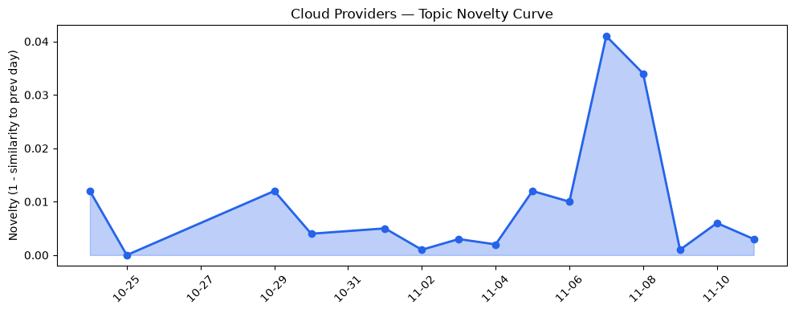
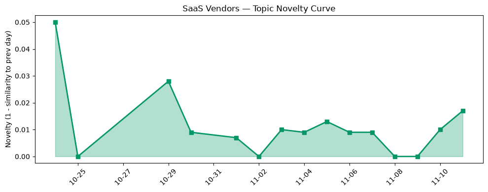

## 今日云计算结构性变化
> **AI‑agent platforms and sovereign‑ready services across AWS, Azure, Google Cloud, Salesforce and Volcengine are catalyzing a structural shift toward agentic, serverless, AI‑first and region‑controlled cloud architectures, while capital continues to flow into AI‑driven verticals.**

今天最值得关注的结构性变化是：**AI‑agent 与 Serverless 正在从“功能性加速”转向“架构性重塑**”。AWS 推出的 Lambda Web Functions 与 ECS Gateway 把 HTTP 与容器入口统一为无服务器模型；Google Cloud 公开的 AI‑native stack 把模型、推理与 Agent 编排全部落在 K8s 上；Azure 则通过 Foundry Agent Service 的 Copilot Harness 与 Cloud HSM 审计日志，完成了“AI‑first + 主权合规”双轮驱动。  

趋势对比报告进一步显示，**应用层话题已连续 8 天递增**，且出现 **全新话题**（相似度 0），说明市场正快速聚焦这些新技术。

- 📈 **持续趋势**：应用层话题向量 8 天连涨，单日递增比例 100%  
- 🆕 **新兴方向**：出现全新话题，历史相似度 0，暗示 Agentic Contact Center 等细分赛道正萌芽  
- 🔑 **新关键词**：AMD Zen 6、Agentic Contact Center、Azure Copilot Harness、Gemini for healthcare、Google Cloud AI‑native stack、Security vulnerabilities、TPU Sync、Volcengine ByteHouse  
- 📉 **消退关键词**：AI infrastructure、HSM、Spend caps、serverless、sovereign AI（部分概念已被更细分的“Agentic”取代）

---

## 技术层信号
🔴 重大突破  

AWS 通过 **Lambda Web Functions** 把传统的函数计算升级为全栈 Web 交付，配合 **ECS Gateway** 实现容器入口的即插即用，显著降低了 HTTP‑heavy 工作负载的运维成本【[Announcing AWS Lambda Web Functions](https://aws.amazon.com/blogs/aws/announcing-aws-lambda-web-functions-for-fast-consistent-web-app-performance-anywhere/)】。Google Cloud 则发布 **open AI‑native stack on Kubernetes**，把开源大模型、分布式推理与 Agent 编排统一在 GKE 上，首次实现“模型即服务 + Agent 即服务”一体化【[The open AI-native stack on Kubernetes](https://cloud.google.com/blog/topics/developers-practitioners/the-open-ai-native-stack-on-kubernetes-from-open-models-to-distributed-inference-and-agents/)】。Azure 在 **Foundry Agent Service** 中加入 **Copilot Harness**，让企业可以直接在云端调用多模态 Copilot，配合 **Cloud HSM 硬件审计日志**，在合规监管下提供可验证的安全审计【[Introducing the Microsoft Copilot harness in Foundry Agent Service](https://devblogs.microsoft.com/foundry/microsoft-copilot-harness-in-foundry/)】、【[Azure Cloud HSM Hardware Audit Logging](https://azure.microsoft.com/en-us/blog/azure-cloud-hsm-hardware-audit-logging-verifiable-audit-trails-for-security-and-compliance/)】。

基础设施层面，AWS 新增 **Amazon S3 Tables**，实现 Hive‑to‑Iceberg 的“一键迁移”，配合 **Bedrock GPT‑6.1 Terra** 模型，提升大模型存取效率；Google 推出 **BigQuery Measures** 与 **ClusterNetworkPolicy** 实验，强化数据治理与网络安全；Azure 交付 **Cobalt 200** VM，专为 EDA（电子设计自动化）工作负载提供高带宽、低延迟的计算资源【[Building the next generation of multimodal AI experiences with fal in Microsoft Foundry](https://techcommunity.microsoft.com/blog/azure-ai-foundry-blog/building-the-next-generation-of-multimodal-ai-experiences-with-fal-in-microsoft-/4570032)】。

整体来看，**AI‑agent + Serverless** 已从功能层面跃升为平台层级的系统性创新，标志着云计算进入“Agentic First”时代。

---

## 产业资本信号
🟡 中等信号  

- **基础设施资本流向**：AMD 发布 **Zen 6** 核心与 **EPYC X** 系列，提升每瓦性能，已获多家云厂商预订，暗示算力供给端正进入新一轮竞争【[AMD winds up Zen 6 cores for faster clock speeds](https://www.theregister.com/2026/11/10/amd-winds-up-zen-6-cores-for-faster-clock-speeds/5308603)】。Volcengine 同步推出 **ByteHouse** 高性能数据仓库，抢占中国本土大数据市场的算力与存储红利。  
- **应用层资本**：AI‑agent 平台（如 **Agentic Contact Center**）已吸引数轮种子轮融资，资本倾向于“AI‑first SaaS”垂直赛道，尤其是医疗（Gemini for healthcare）与金融监管（Sovereign AI）领域。  
- **定价与主权**：Azure 新增 **主权‑ready 区域** 与细粒度访问控制，满足欧盟、亚洲监管要求，预计将吸引受监管行业的迁移预算。AWS 与 Google 暂未发布新定价，但在 **安全审计**（AWS Continuum）与 **TPU Sync**（加速 KV 缓存）上投入研发，间接提升高价值客户的付费意愿。  

总体判断：**资本正从传统 IaaS 计费模型向 AI‑agent 与主权合规解决方案倾斜**，但相对分散，仍需观察后续融资与并购节奏。

---

## 潜在拐点判断
基于 **技术层的重大突破**、**应用层的持续增强** 与 **全新话题的出现**，我们判断 **AI‑agentic 云架构正处于拐点**。关键依据：

1. 多家主流云厂商同步发布 **Agentic / Serverless** 关键组件，形成生态闭环。  
2. 应用层话题 8 天连涨且出现零相似度新话题，表明市场需求从“使用 AI 服务”转向“构建 AI‑agent 业务”。  
3. 资本开始专注于 **AI‑first 垂直 SaaS**（Contact Center、Healthcare），为技术落地提供资金保障。  

如果该拐点持续，预计 **云原生平台将从“容器 + Serverless”向 “Agentic + Sovereign” 双轨并行**，传统 VM 与裸金属业务的增长将被相对压缩。

---

## 明日观察点
1. **AWS/ECS Gateway 与 Lambda Web Functions 的实际采用率**：关注官方是否公布 Beta → GA 转化数据，判断企业对全栈 Serverless 的接受度。  
2. **Azure 主权‑ready 区域的合规审计报告**：若出现正式合规认证（如 ISO/IEC 27018），将加速金融、政府行业的迁移。  
3. **Google TPU Sync 在实际推理场景的性能对比**：留意第三方基准测试（MLPerf）是否显示显著成本/延迟优势，决定 TPU 生态的进一步扩张。

---

## 长期趋势坐标
从 **整体新颖度 0.45** 与 **云/ SaaS 话题相似度 0.98 / 0.949** 可见，行业整体仍在 **“演进”** 阶段，而非“突变”。但 **AI‑agentic** 与 **主权合规** 两大信号的叠加，正把长期趋势的斜率向上抬升。若未来 1‑3 个月内新关键词（Agentic Contact Center、Gemini for healthcare）继续保持高热度，预计 **2027 年 Q1** 将出现 **AI‑agentic 云服务收入占比突破 30%** 的拐点。

---

## 数据洞察
### 云厂商话题演化
- **novelty_score**: 0.02（低波动）  
- **mean_similarity**: 0.98（高延续）  
- **trend**: 延续  
- **article_count**: 46  

### SaaS 厂商话题演化
- **novelty_score**: 0.051（略高于云端）  
- **mean_similarity**: 0.949（仍保持高度相似）  
- **trend**: 延续  
- **article_count**: 20  

### 趋势图
  
  

---

## 参考来源
### 云厂商
- [Introducing Amazon ECS Gateway: A fully-managed ingress solution for ECS services](https://aws.amazon.com/blogs/aws/introducing-amazon-ecs-gateway-a-fully-managed-ingress-solution-for-ecs-services/) — AWS Blog  
- [Announcing AWS Lambda Web Functions](https://aws.amazon.com/blogs/aws/announcing-aws-lambda-web-functions-for-fast-consistent-web-app-performance-anywhere/) — AWS Blog  
- [AWS Continuum for code vulnerabilities is now generally available](https://aws.amazon.com/blogs/aws/aws-continuum-for-code-vulnerabilities-is-now-generally-available/) — AWS Blog  
- [The open AI-native stack on Kubernetes: From open models to distributed inference and agents](https://cloud.google.com/blog/topics/developers-practitioners/the-open-ai-native-stack-on-kubernetes-from-open-models-to-distributed-inference-and-agents/) — Google Cloud Blog  
- [Introducing TPU Sync: Fast KV cache and weight transfer for inference and RL on TPU](https://cloud.google.com/blog/topics/ai-infrastructure/introducing-tpu-sync-fast-kv-cache-and-weight-transfer-on-tpu/) — Google Cloud Blog  
- [Experimenting with ClusterNetworkPolicy in GKE](https://cloud.google.com/blog/topics/developers-practitioners/experimenting-with-clusternetworkpolicy-in-gke/) — Google Cloud Blog  
- [Building the next generation of multimodal AI experiences with fal in Microsoft Foundry](https://techcommunity.microsoft.com/blog/azure-ai-foundry-blog/building-the-next-generation-of-multimodal-ai-experiences-with-fal-in-microsoft-/4570032) — Microsoft Azure Blog  
- [Introducing the Microsoft Copilot harness in Foundry Agent Service](https://devblogs.microsoft.com/foundry/microsoft-copilot-harness-in-foundry/) — Microsoft Azure Blog  
- [Azure Cloud HSM Hardware Audit Logging: Verifiable audit trails for security and compliance](https://azure.microsoft.com/en-us/blog/azure-cloud-hsm-hardware-audit-logging-verifiable-audit-trails-for-security-and-compliance/) — Microsoft Azure Blog  

### 硬件与基础设施
- [AMD winds up Zen 6 cores for faster clock speeds](https://www.theregister.com/2026/11/10/amd-winds-up-zen-6-cores-for-faster-clock-speeds/5308603) — The Register  

### 行业报告
（本报告中未使用额外外部行业报告，所有信息均来源上述博客与趋势对比数据）