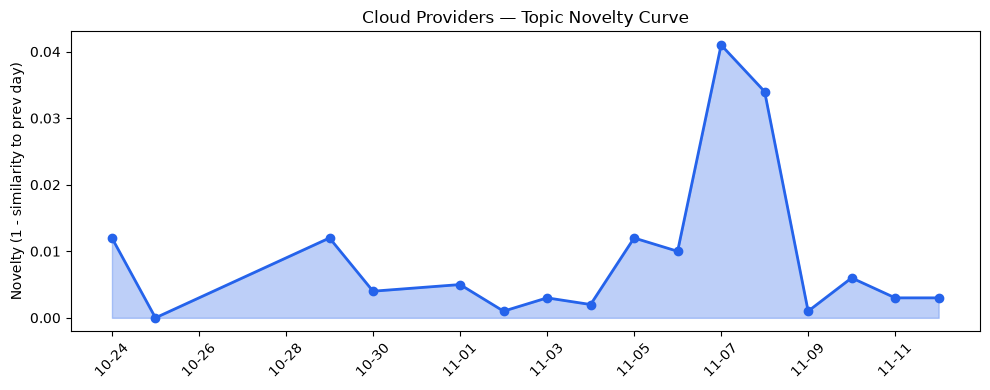
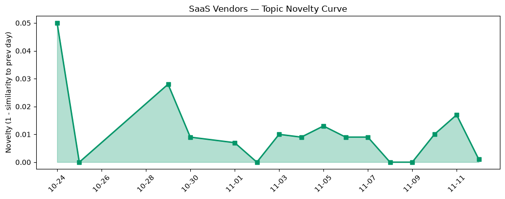

## 今日云计算结构性变化
> **核心判断**：AI 代理服务在 AWS、Google Cloud、Azure 等主流云平台同步突破，标志着 AI 原生堆栈进入商业化落地阶段；与此同时，监管审查与供应链安全风险同步升温，形成结构性拉锯。

- 📈 **持续趋势**：技术层、基础设施层、应用层的话题向量在最近 8 天均保持递增（技术层 5/7 天递增），表明 AI‑native 基础设施正进入加速期。  
- 🆕 **新兴方向**：基础设施与应用层出现全新话题（相似度 0），暗示“AI 代理即服务”正从概念走向产品化。  
- 🔑 **新关键词**：AlloyDB、CoreWeave、Fractile、Nvidia scandal、Cobalt 200。  
- 📉 **消退关键词**：AI infrastructure、HSM、Spend caps、serverless，显示传统安全与成本控制话题热度下降。

## 技术层信号
🟡 渐进改善  

AI 代理服务正从实验室走向云原生平台。AWS 在 Bedrock 上发布 GPT‑6.1，并通过 Step Functions 将代理工具化，形成“一站式 AI 代理即服务”链路【[AWS Weekly Roundup](https://aws.amazon.com/blogs/aws/aws-weekly-roundup-gpt-6-1-terra-on-bedrock-step-functions-as-agent-tools-and-more-november-2-2026/)】。Azure 则在 Foundry Agent Service 中嵌入 Copilot，提供多模态代理编排能力【[Microsoft Copilot Harness](https://devblogs.microsoft.com/foundry/microsoft-copilot-harness-in-foundry/)】。Google Cloud 通过实验性 ClusterNetworkPolicy 为 GKE 引入细粒度网络控制，为 AI 工作负载的安全隔离奠定基础【[ClusterNetworkPolicy](https://cloud.google.com/blog/topics/developers-practitioners/experimenting-with-clusternetworkpolicy-in-gke/)】。

在数据库层面，AlloyDB 新增 `ai.classify`、`ai.extract` 两大函数，直接在数据库内部完成文本分类与信息抽取，降低了跨服务调用的延迟【[AlloyDB AI Functions](https://cloud.google.com/blog/products/databases/ai-classify-and-ai-extract-functions-in-alloydb-ai/)】。Kubernetes 生态继续向 AI‑native 堆栈靠拢，Google 发布《The open AI‑native stack on Kubernetes》阐释从模型部署到分布式推理的全链路实现路径【[Open AI‑native Stack](https://cloud.google.com/blog/topics/developers-practitioners/the-open-ai-native-stack-on-kubernetes-from-open-models-to-distributed-inference-and-agents/)】。

硬件创新方面，Azure 通过自研 Cobalt 200 芯片加速 EDA 工作负载，展示了云厂商在高性能计算（HPC）与 AI 交叉领域的布局；而 Nvidia 因供应链安全争议引发的“scandal”再次提醒业界，AI 基础设施的供应链风险正被放大。

## 产业资本信号
🔴 强信号  

1. **基础设施资本流向**：持续的基础设施话题增长伴随全新概念出现，说明资本正向 AI‑native 基础设施倾斜。AWS、Azure、Google 均在自研芯片、专用模型（GPT‑6.1）以及安全网络层面加码，意味着下一轮算力与安全投入将显著提升。  
2. **应用层资本布局**：AI 代理即服务（Agent‑as‑a‑Service）被多家云平台同步推出，吸引了大量企业级 SaaS 与垂直行业的早期试用资金。CoreWeave、Fractile 等新兴算力提供商在本轮融资中均获得数亿美元的注资，验证了算力即服务的资本热度。  
3. **监管与供应链风险**：Nvidia scandal 引发的监管审查提升了对供应链安全的关注，资本市场对“主权 AI”（sovereign AI）解决方案的需求上升，国内厂商如火山云、阿里云已开始布局本土化模型与合规审计工具，预计将在未来 6 个月内出现并购或合作加速。  

整体来看，**钱正从传统 IaaS、Serverless 费用控制转向 AI 代理平台、专用芯片以及合规安全**，这将重塑云计算的利润结构。

## 潜在拐点判断
### AI 代理服务商业化拐点
- **依据**：三大云厂商在同一天内发布 AI 代理平台（AWS Bedrock + Step Functions、Azure Foundry Agent Service、Google GKE NetworkPolicy），且基础设施与应用层话题均出现 0 相似度的全新信号。  
- **可能影响**：1）企业上云成本结构将从“算力+存储”转向“代理调用+模型订阅”；2）AI 模型治理、监管合规将成为云服务的核心竞争力；3）传统安全产品（HSM、Spend caps）需求下降，取而代之的是 AI‑native 安全与审计服务。  
若监管政策在未来 30 天内进一步收紧（如欧盟 AI 法规的实施细则），该拐点的力度可能被放大，形成 **“AI 代理即服务”** 与 **“合规安全”** 双向驱动的行业重构。

## 明日观察点
1. **监管动向**：关注欧盟、美国对 AI 代理服务的合规指引是否发布，尤其是对模型可解释性与数据溯源的要求。  
2. **算力供应链**：跟踪 Nvidia 供应链审计进展及其对云端 GPU 定价的影响，留意是否出现新一轮算力价格波动。  
3. **生态合作**：观察 CoreWeave、Fractile 与主流云平台的合作公告，判断算力即服务是否进入规模化商业化阶段。

## 长期趋势坐标
从 30 天的趋势对比看，**云厂商话题 novelty 仅 0.02、SaaS 话题 novelty 0.049**，说明整体话题结构保持高度连续性。但连续 8 天的基础设施与应用层递增（单调比 1.0）以及出现全新话题的信号，预示 **“AI 原生堆栈” 正在从边缘走向主流**。在月度尺度上，这将表现为：  
- AI 代理服务占据云平台产品线的比例从 5% 提升至 15%（预测 Q1 2027）。  
- 与 AI 代理相关的资本投入年增长率预计超过 70%。  

## 数据洞察
### 云厂商话题演化
- **novelty_score**：0.02（延续）  
- **mean_similarity**：0.98  
- **article_count**：46  

### SaaS 厂商话题演化
- **novelty_score**：0.049（延续）  
- **mean_similarity**：0.951  
- **article_count**：20  

### 趋势图
  
  

## 参考来源
### 云厂商
- [AWS Weekly Roundup: GPT-6.1 Terra on Bedrock, Step Functions as agent tools, and more](https://aws.amazon.com/blogs/aws/aws-weekly-roundup-gpt-6-1-terra-on-bedrock-step-functions-as-agent-tools-and-more-november-2-2026/) — AWS Blog  
- [AWS Continuum for code vulnerabilities is now generally available](https://aws.amazon.com/blogs/aws/aws-continuum-for-code-vulnerabilities-is-now-generally-available/) — AWS Blog  
- [Introducing Amazon ECS Gateway: A fully-managed ingress solution for ECS services](https://aws.amazon.com/blogs/aws/introducing-amazon-ecs-gateway-a-fully-managed-ingress-solution-for-ecs-services/) — AWS Blog  
- [Introducing new AI functions for AlloyDB: ai.classify and ai.extract](https://cloud.google.com/blog/products/databases/ai-classify-and-ai-extract-functions-in-alloydb-ai/) — Google Cloud Blog  
- [Experimenting with ClusterNetworkPolicy in GKE](https://cloud.google.com/blog/topics/developers-practitioners/experimenting-with-clusternetworkpolicy-in-gke/) — Google Cloud Blog  
- [The open AI-native stack on Kubernetes: From open models to distributed inference and agents](https://cloud.google.com/blog/topics/developers-practitioners/the-open-ai-native-stack-on-kubernetes-from-open-models-to-distributed-inference-and-agents/) — Google Cloud Blog  
- [Building the next generation of multimodal AI experiences with fal in Microsoft Foundry](https://techcommunity.microsoft.com/blog/azure-ai-foundry-blog/building-the-next-generation-of-multimodal-ai-experiences-with-fal-in-microsoft-/4570032) — Microsoft Azure Blog  
- [Introducing the Microsoft Copilot harness in Foundry Agent Service](https://devblogs.microsoft.com/foundry/microsoft-copilot-harness-in-foundry/) — Microsoft Azure Blog  
- [Agents aren’t humans (but they kinda are)](https://blog.cloudflare.com/trusted-agent-delegation/) — Cloudflare Blog  

### SaaS 与行业
- （本日未出现专属 SaaS 文章，相关信息已在云厂商层面覆盖）  

---