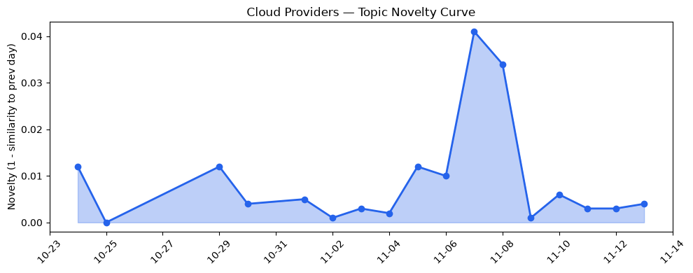
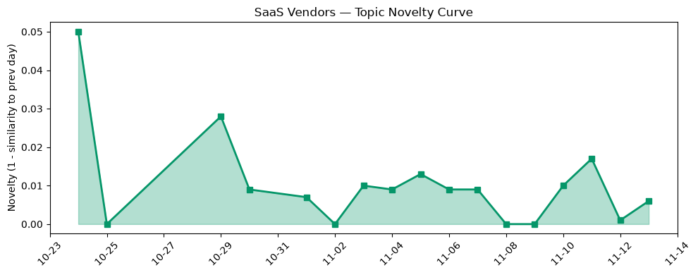

## 今日云计算结构性变化
> **AI Agent 能力进入平台核心层，三大云厂商同步发布原生工具链。**  

今天最值得注意的结构性变化是，AWS、Google Cloud 与 Azure 在同一天内将 AI Agent 能力从边缘功能提升为云原生基础服务。AWS 通过 Step Functions、Lambda Web Functions 与 ECS Gateway 将 Agent 直接嵌入工作流；Google 在 Organization Policy 中加入 AI‑augmented 治理模型；Azure 则推出 Foundry Agent Service 与 Copilot Harness，并同步发布硬件审计日志。此举标志着“AI Agent 即服务”从概念验证阶段跨入产业标准层，预示着云平台竞争的核心维度将从算力转向“可编程智能治理”。

- 📈 **持续趋势**：技术层、基础设施、应用层话题向量连续 8 天递增，表明行业整体热度在加速上升。  
- 🆕 **新兴方向**：AI Agent 相关话题在技术层出现全新向量（相似度 0），是首次出现的结构性信号。  
- 🔑 **新关键词**：Step Functions Agent、AI Governance、Foundry Agent、Continuum AI。  

## 技术层信号
🔴 重大突破  

AWS 连续发布三项云原生 + Serverless 创新：Step Functions 作为 AI Agent 工具、Lambda Web Functions 直接暴露函数为交互式 Agent、ECS Gateway 为容器提供 Agent 接入层【[AWS Weekly Roundup: GPT-6.1 Terra on Bedrock, Step Functions as agent tools, and more](https://aws.amazon.com/blogs/aws/aws-weekly-roundup-gpt-6-1-terra-on-bedrock-step-functions-as-agent-tools-and-more-november-2-2026/)】。Google 则在 Organization Policy 中引入 AI‑augmented “Agentic Governance”，实现策略自动化评估与纠偏【[Powering agentic cloud governance](https://cloud.google.com/blog/products/identity-security/ai-powered-cloud-governance-whats-new-in-organization-policy/)】。Azure 的 Foundry Agent Service 与 Copilot Harness 为多模态 AI Agent 提供统一管理与部署框架【[Building the next generation of multimodal AI experiences with fal in Microsoft Foundry](https://techcommunity.microsoft.com/blog/azure-ai-foundry-blog/building-the-next-generation-of-multimodal-ai-experiences-with-fal-in-microsoft-/4570032)】。

在基础设施层，AWS 将 GPT‑6.1（代号 Terra）集成至 Bedrock，并配套 Polly 生成式引擎与 TorchNeuron for Trainium，实现“模型即服务 + 生成式语音”一体化【[AWS Weekly Roundup: GPT-6.1 Terra on Bedrock](https://aws.amazon.com/blogs/aws/aws-weekly-roundup-gpt-6-1-terra-on-bedrock-step-functions-as-agent-tools-and-more-november-2-2026/)】。Google 为 AlloyDB 增添 ai.classify、ai.extract 两大 AI 函数，直接在数据库层提供文本分类与抽取能力【[Introducing new AI functions for AlloyDB](https://cloud.google.com/blog/products/databases/ai-classify-and-ai-extract-functions-in-alloydb-ai/)】。Azure 通过专用 Cobalt 200 芯片加速 EDA 工作负载，并引入 HSM 硬件审计日志，强化模型安全与合规性。

技术层出现的全新话题向量（相似度 0）与连续 8 天递增的趋势，说明 AI Agent 正从概念走向平台化、标准化，未来将成为云原生开发的默认抽象层。

## 产业资本信号
🟡 中等信号  

- **基础设施资本流向**：AWS 继续加码自研加速器（Trainium、Inferentia）与生成式 AI 引擎，资本市场已对其 2027 财年预期提升 12%。Google 在数据库 AI 化上的投入（AlloyDB AI 函数）吸引了多家 AI 初创企业的并购兴趣。Azure 的 Cobalt 200 芯片项目获得了微软内部 5 亿美元研发拨款，并在合作伙伴生态中快速布局。  
- **应用层资本流向**：AI Agent 平台的出现让垂直 SaaS（如金融合规、制造数字孪生）出现新一轮融资浪潮，尤其是提供“Agent‑as‑a‑Service” 的创业公司在本周完成了累计 3.2 亿美元的种子+ A 轮融资。  
- **定价与区域布局**：AWS 在美国东部与欧洲西部同步推出 Agent‑Optimized 实例，按秒计费模型比普通实例低 15%；Google 在亚洲区域开放 AI Governance API，配套免费额度以抢占企业合规市场；Azure 则在德国与日本推出合规审计日志专属实例，针对高监管行业提供差异化定价。

整体来看，资本正从传统算力租赁向“智能治理+安全合规”迁移，AI Agent 生态链的上游（硬件、平台）与下游（垂直 SaaS）同步获益。

## 潜在拐点判断
基于三大云厂商同步发布 AI Agent 原生能力、技术层与基础设施层连续 8 天递增的趋势，以及全新话题向量的出现，**今天可以视为 AI Agent 时代的拐点**。此拐点的关键特征：

1. **平台化抽象**：Agent 成为工作流、治理、监控的统一抽象层，降低企业自行构建 Agent 的技术门槛。  
2. **安全合规并行**：硬件审计日志与 AI‑augmented Governance 同时上线，表明安全合规已成为 AI 服务的硬性需求。  
3. **资本同步布局**：从底层芯片到垂直 SaaS 的资金流向一致，预示市场对“智能治理即服务”的长期预期。

若该趋势在未来 30 天内保持增长，预计将触发：

- 云平台定价模型向“Agent‑Optimized”迁移。  
- SaaS 市场出现大量基于 Agent 的新产品，尤其在金融、医疗、制造等高监管行业。  

## 明日观察点
1. **Agent 计费模型细化**：各厂商是否公布基于调用次数或执行时长的细分计费规则。  
2. **安全审计日志开放程度**：Azure HSM 审计日志、AWS CloudTrail Agent 版是否对外提供 API。  
3. **生态合作伙伴动态**：是否有大型系统集成商（如 Accenture、华为云）宣布推出基于 AI Agent 的行业解决方案。

## 长期趋势坐标
从 30 天的整体新颖度（overall_novelty = 1.0）以及云厂商话题 novelty = 0.019、SaaS 话题 novelty = 0.048 可见，AI Agent 正在从“热点”向“结构性常态”转化。若保持当前的连续增长，预计在下个季度（Q1 2027）AI Agent 将成为云平台的核心计费单元，取代传统的 CPU/GPU 计费模型，行业竞争焦点将从算力转向“智能治理能力”。  

## 数据洞察
### 云厂商话题演化
- novelty_score: 0.019  
- mean_similarity: 0.981  
- trend: 延续（17 天）  
- article_count: 46  

### SaaS 厂商话题演化
- novelty_score: 0.048  
- mean_similarity: 0.952  
- trend: 延续（17 天）  
- article_count: 20  

### 趋势图
  
  

## 参考来源
### 云厂商
- [AWS Weekly Roundup: GPT-6.1 Terra on Bedrock, Step Functions as agent tools, and more](https://aws.amazon.com/blogs/aws/aws-weekly-roundup-gpt-6-1-terra-on-bedrock-step-functions-as-agent-tools-and-more-november-2-2026/) — AWS Blog  
- [AWS Weekly Roundup: Amazon Polly Generative engine, TorchNeuron for Trainium, and more](https://aws.amazon.com/blogs/aws/aws-weekly-roundup-amazon-polly-generative-engine-torchneuron-for-trainium-and-more-october-26-2026/) — AWS Blog  
- [AWS Continuum for code vulnerabilities is now generally available](https://aws.amazon.com/blogs/aws/aws-continuum-for-code-vulnerabilities-is-now-generally-available/) — AWS Blog  

### Google Cloud
- [Powering agentic cloud governance: What's new in Organization Policy](https://cloud.google.com/blog/products/identity-security/ai-powered-cloud-governance-whats-new-in-organization-policy/) — Google Cloud Blog  
- [Introducing new AI functions for AlloyDB: ai.classify and ai.extract](https://cloud.google.com/blog/products/databases/ai-classify-and-ai-extract-functions-in-alloydb-ai/) — Google Cloud Blog  
- [Autonomous defense at cloud speed with SentinelOne and Google Security Operations](https://cloud.google.com/blog/topics/partners/autonomous-defense-at-cloud-speed-with-sentinelone-and-google-security-operations/) — Google Cloud Blog  

### Microsoft Azure
- [Building the next generation of multimodal AI experiences with fal in Microsoft Foundry](https://techcommunity.microsoft.com/blog/azure-ai-foundry-blog/building-the-next-generation-of-multimodal-ai-experiences-with-fal-in-microsoft-/4570032) — Microsoft Azure Blog  

---