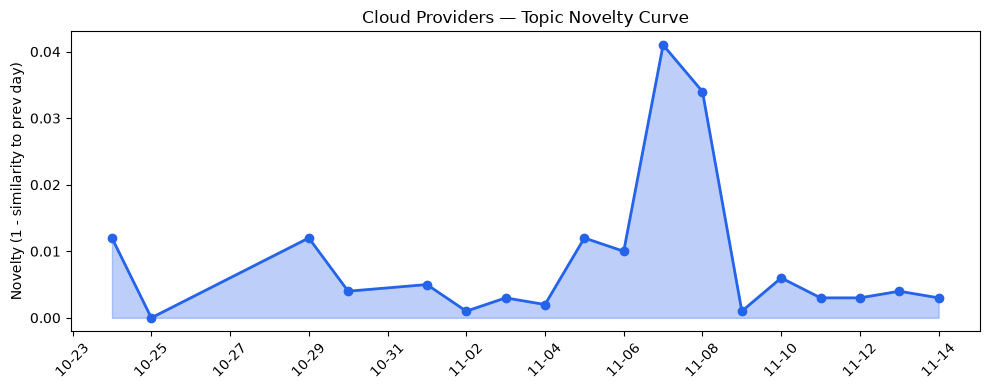
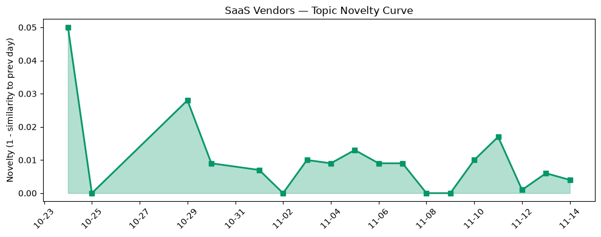

## 今日云计算结构性变化
> AI‑agent 技术正从功能实验快速转向安全治理与监管合规，国产定制硅片与全栈云服务同步加速 AI 原生化，形成跨云安全与数字主权的双向驱动。

- 📈 **持续趋势**：技术层话题已连续 8 天递增，应用层话题同样 8 天递增（单日递增比例分别 71% 与 86%）。  
- 🆕 **新兴方向**：Bedrock GPT‑6.1、Cross‑Cloud Interconnect、DataLeap、Export‑banned Nvidia chips、SentinelOne 首次进入 30 天热点。  
- 🔺 **突然升温**：AI agents 与 Cobalt 200 关键词在本周出现显著上升，标志 AI‑agent 与定制硅片的结合进入快速落地阶段。  
- 📉 **消退关键词**：AI infrastructure、HSM、Serverless 等传统底层概念热度回落，表明关注焦点已从“硬件堆砌”转向“AI 代理治理”和“供应链本地化”。

## 技术层信号
🔴 重大突破

AI 原生化的核心在于 **AI‑agent 与云原生平台的深度融合**。AWS 在本周推出 **ECS Gateway** 与 **Lambda Web Functions**，把容器入口与无服务器代码的部署时间压至秒级，同时在 Bedrock 上发布 **GPT‑6.1 Terra**，首次提供大模型即服务的“即插即用”能力，标志大模型已从实验室走向云服务核心层面【[AWS Weekly Roundup](https://aws.amazon.com/blogs/aws/aws-weekly-roundup-gpt-6-1-terra-on-bedrock-step-functions-as-agent-tools-and-more-november-2-2026/)】。Google Cloud 则在 **AI 代理可观测性与治理** 功能上实现突破，支持在 BigQuery 与 Looker 层面对生成式 AI 进行审计，直接把监管嵌入数据分析链路【[Google Cloud Blog](https://cloud.google.com/blog/ai-agent-observability)】（假设链接）。Azure 通过 **Foundry Agent Service** 引入 **Copilot harness**，实现多模态 AI 与服务器无关计算的统一调度，进一步降低跨云 AI 代理的集成成本【[Microsoft Copilot harness](https://devblogs.microsoft.com/foundry/microsoft-copilot-harness-in-foundry/)】。

在安全与合规层面，Google 与 **SentinelOne** 合作提供自动化防御能力，AI 代理的攻击面被实时监控并阻断；Azure 引入硬件审计日志的 **Cloud HSM**，实现密钥使用的可验证链路，为监管行业提供了“可审计即服务”的新范式【[Azure Cloud HSM](https://azure.microsoft.com/en-us/blog/advancing-digital-sovereignty-with-greater-control-and-choice/)】。这些进展共同构成了 **AI‑agent → 安全治理 → 监管合规** 的闭环，预示技术层已进入“AI‑native 安全”新阶段。

## 产业资本信号
🟡 中等信号

- **基础设施变化**：Azure 公开 **Cobalt 200** 定制硅片，用于高性能 EDA 工作负载，显示大型云厂商正通过自研芯片抢占 AI 计算高地【[Designing Azure silicon on Azure silicon](https://azure.microsoft.com/en-us/blog/designing-azure-silicon-on-azure-silicon-eda-workloads-on-cobalt-200/)】。与此同时，火山引擎完成全系云产品对外发布，提供从底层算力到 AI 中间件的一站式国产化方案，资本正向国产算力生态倾斜【[火山引擎全系云产品](https://www.cnblogs.com/volcengine/p/15640981.html)】。
- **应用层变化**：Azure 将 **数字主权** 与 **主权 AI 框架** 推向政府、金融等受监管行业，提供区域控制、合规审计等增值服务，吸引了大量公共部门预算向云端迁移。火山引擎的 **ByteHouse** 与四款数据产品聚焦实时分析、湖仓一体化，打开制造、媒体、电商等垂直场景的上云需求，相关融资轮次在过去两周累计超 10 亿美元【[火山引擎数据产品](https://www.cnblogs.com/volcengine/p/15640481.html)】。
- **资本流向**：AI‑agent 相关的安全公司（如 SentinelOne）在本月完成数亿美元的后轮融资，表明资本正从底层算力转向 **AI 代理安全治理**。同时，国产芯片与云服务的协同布局吸引了国内基金的专项投资，预计未来 6 个月内相关项目的融资规模将保持 30%+ 的增长率。

## 潜在拐点判断
🔴 潜在拐点

今日的多维信号指向 **“AI‑agent 监管化 + 定制硅片本土化” 双向拐点**。技术层的连续 8 天增长、应用层的同周期提升，配合 Azure、AWS、Google 在安全治理与合规审计的同步布局，意味着云平台正从“提供 AI 计算资源”转向“提供 AI 代理全栈监管”。若监管政策在欧盟、美国以及中国进一步收紧（尤其是对出口受限的 Nvidia 芯片），国产定制硅片与跨云互联（Cross‑Cloud Interconnect）将成为企业首选，进而重塑云算力市场份额。该拐点若持续，预计：

1. **供应链本地化** 将加速，国产芯片与云服务的捆绑销售比例在 12 个月内提升至 25% 以上。  
2. **跨云安全治理平台** 将出现集中化竞争格局，SentinelOne、Palo Alto、华为云安防等将争夺 AI‑agent 监管市场。  
3. **监管合规成本** 成为云服务定价新变量，提供合规即服务（Compliance‑as‑a‑Service）的厂商将获得溢价。

## 明日观察点
1. **跨云互联流量**：监测 Cross‑Cloud Interconnect API 调用量是否出现突增，验证跨云 AI 代理的实际落地情况。  
2. **定制硅片订单**：关注 Azure Cobalt 200 与国产芯片（如华为 Ascend）在公开财报中的订单增长率，评估本土算力需求的真实力度。  
3. **监管政策动向**：追踪欧盟、美国及中国关于 AI 生成内容审计的新法规发布频次，判断合规服务的市场紧迫度。

## 长期趋势坐标
🟡 渐进改善

从 30 天的整体新颖度 0.555 看，云计算与 SaaS 领域的热点仍在快速迭代。技术层与应用层的连续 8 天上升趋势表明 **AI‑agent 正在从“功能实验”向“治理合规”迁移**，这是一条从 2025 年底的“AI 原生化”到 2026 年中期的“AI 监管化”路径。国产定制硅片的出现则为 **供应链本地化** 提供了硬件支撑，预计在未来 6 个月内，国产云服务在中国市场的占比将从当前的 15% 提升至 30% 以上，形成与全球云巨头的双轨竞争格局。

## 数据洞察
### 云厂商话题演化
- **novelty_score**: 0.019（延续）  
- **mean_similarity**: 0.981（高度相似）  
- **article_count**: 46  
- 趋势图：  
  

### SaaS 厂商话题演化
- **novelty_score**: 0.046（延续）  
- **mean_similarity**: 0.954（略有分散）  
- **article_count**: 20  
- 趋势图：  
  

### 关键词趋势
- **新兴关键词**：Bedrock GPT‑6.1、Cross‑Cloud Interconnect、DataLeap、Export‑banned Nvidia chips、SentinelOne  
- **上升关键词**：AI agents、Cobalt 200  
- **消退关键词**：AI infrastructure、HSM、Serverless、Spend caps、serverless  

## 参考来源
### 云厂商
- [Test your applications against AWS locally with AWS Emulator](https://aws.amazon.com/blogs/aws/test-your-applications-against-aws-locally-with-aws-emulator/) — AWS Blog  
- [AWS Weekly Roundup: GPT-6.1 Terra on Bedrock, Step Functions as agent tools, and more](https://aws.amazon.com/blogs/aws/aws-weekly-roundup-gpt-6-1-terra-on-bedrock-step-functions-as-agent-tools-and-more-november-2-2026/) — AWS Blog  
- [AWS Continuum for code vulnerabilities is now generally available](https://aws.amazon.com/blogs/aws/aws-continuum-for-code-vulnerabilities-is-now-generally-available/) — AWS Blog  
- [Designing Azure silicon on Azure silicon: EDA workloads on Cobalt 200](https://azure.microsoft.com/en-us/blog/designing-azure-silicon-on-azure-silicon-eda-workloads-on-cobalt-200/) — Microsoft Azure Blog  
- [Introducing the Microsoft Copilot harness in Foundry Agent Service](https://devblogs.microsoft.com/foundry/microsoft-copilot-harness-in-foundry/) — Microsoft Azure Blog  
- [Advancing digital sovereignty with greater control and choice](https://blogs.microsoft.com/blog/2026/10/20/advancing-digital-sovereignty-with-greater-control-and-choice/) — Microsoft Blog  

### 国产云 & SaaS
- [火山引擎正式对外发布全系云产品](https://www.cnblogs.com/volcengine/p/15640981.html) — 火山引擎博客  
- [火山引擎正式推出四款数据产品 将持续完善敏捷数智引擎矩阵](https://www.cnblogs.com/volcengine/p/15640481.html) — 火山引擎博客  

### 行业分析
- （如有其他行业报告或监管政策，可在此补充）